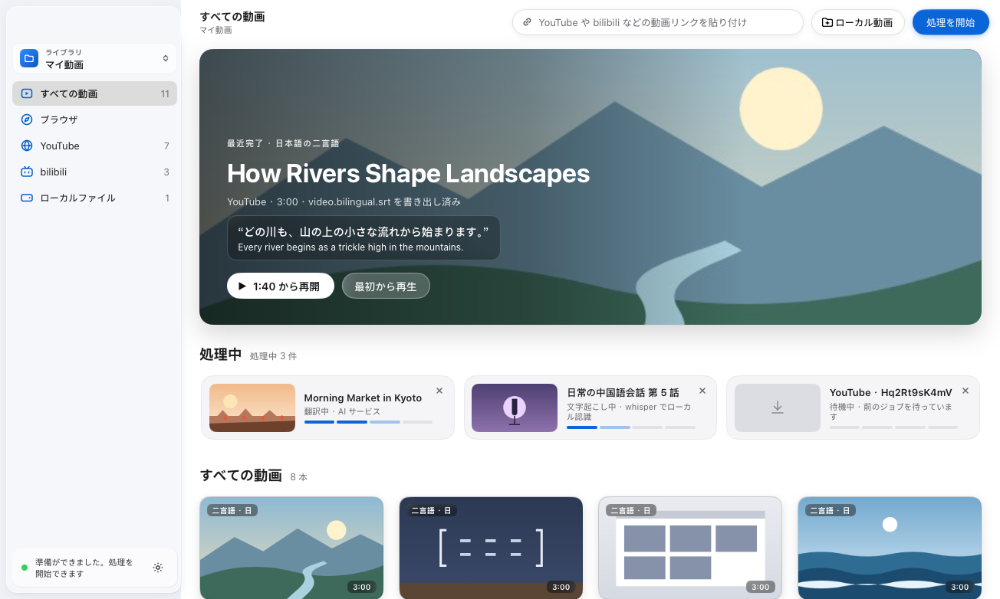
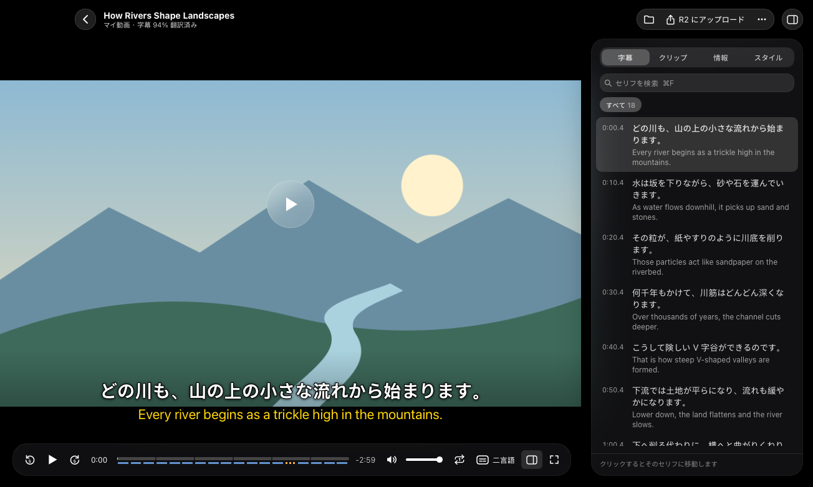
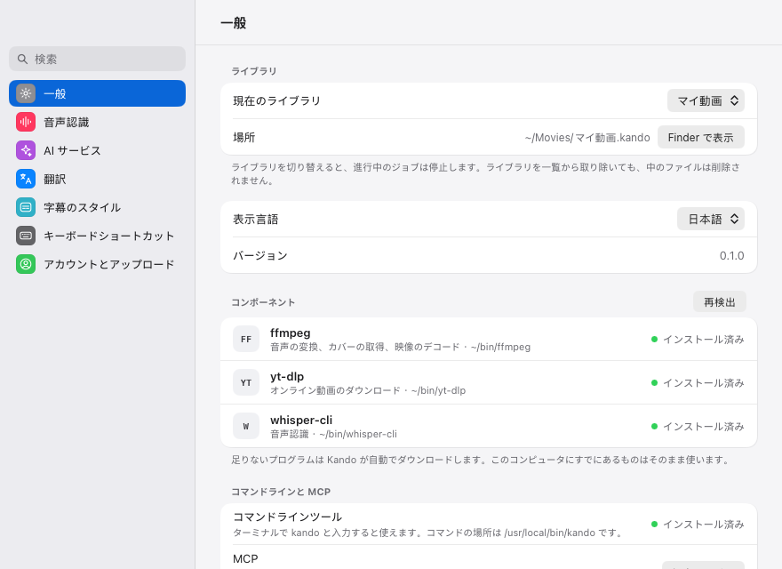
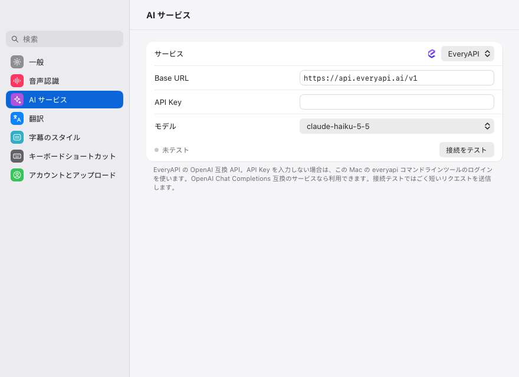

# Kando

[](https://github.com/yldm-tech/Kando/actions/workflows/ci.yml)
[](https://github.com/yldm-tech/Kando/actions/workflows/release.yml)
[](https://github.com/yldm-tech/Kando/releases)
[](LICENSE)
[](go.work)
[](#install)
[](https://github.com/yldm-tech/Kando/stargazers)
[](https://x.com/suzukaze_haduki)
[](https://github.com/sponsors/houko)

[English](README.md) · [简体中文](README.zh-CN.md) · 日本語 · [繁體中文](README.zh-TW.md) · [한국어](README.ko.md)

Kando は、ある言語で話されている動画からその言語を学ぶためのデスクトップアプリです。中国語名は「看懂」（「見て分かる」の意）です。YouTube や Bilibili のリンクを貼り付けるか、動画ファイルや動画の入ったフォルダをウィンドウにドロップすると、Kando は yt-dlp で動画をダウンロードし、whisper.cpp でお使いのコンピューター上で音声を文字起こしし、OpenAI 互換のモデルでセリフを 1 つずつ翻訳し、原文と訳文を同時に画面に表示しながら元の動画を再生します。Go で書かれており、ネイティブのインターフェースは [NSGo](https://github.com/nsgo-dev/nsgo) で描画しています。Web ビューは使っていません。



インターフェースは日本語、英語、簡体字中国語、繁体字中国語、韓国語に対応しています。最初は簡体字中国語で表示されるので、「設定」›「一般」›「表示言語」で切り替えてください。ウインドウはすぐに選んだ言語に変わります。以下で引用しているラベルは日本語のインターフェースの表示そのままです。

## 機能

- YouTube、Bilibili、そのほか yt-dlp が対応するサイトのリンクを貼り付けて動画を追加できます（対応サイトはロゴ付きで「ヘルプ」›「対応サイト…」に一覧があります）。ローカルファイル（mp4、mov、mkv、webm などの動画ファイル）を選ぶか、ウィンドウにドラッグすることもできます。ローカルファイルはコピーせず、その場所のまま文字起こしします。ウィンドウにドロップしたフォルダからは、その中の動画と、そのすぐ下の各フォルダにある動画を、名前の順（数字は数値の順で、Episode 2 は Episode 10 より前）に追加します。動画でないファイルは除かれ、その数はメッセージバーに表示されます。
- 再生リストやチャンネルのリンクを貼り付けると、Kando はその動画を一覧にし、全部で何本あり、そのうち何本がすでにライブラリにあるかを示して、確認後に 1 本ずつ別のジョブとして追加します。チャンネルからは最新の 50 本を取ります。YouTube の再生リスト内の動画のリンクはその動画だけを追加し、メッセージバーに「プレイリスト全体を追加」が表示されます。スペースや改行で区切った複数のリンクを一度に貼り付けると、まとめて追加されます。
- サイドバーの「ブラウザ」は内蔵ブラウザです。サイトを開き、必要ならログインして「動画をダウンロード」をクリックすると、表示中のページをライブラリに追加できます。再生リストやチャンネルのページでは「動画をまとめてダウンロード」になります。YouTube、Bilibili、Vimeo、TED、ニコニコ動画、Dailymotion、TikTok では、ページ内にも Kando のボタンが表示されます。動画の下の「動画をダウンロード」と、ページに並ぶ動画のサムネイルごとの「+」です。「+」は、動画が待機中や処理中のあいだは時計に、ライブラリに入るとチェックマークに変わり、ライブラリにある動画をクリックするとライブラリで表示します。リンク入力欄の横と、空のライブラリのページにある「サイトを閲覧」で、このブラウザが開きます。[ブラウザ拡張機能](#browser-extension)を使うと、同じボタンがふだん使っているブラウザにも表示されます。「設定 › 一般 › ブラウザのログイン」で Chrome、Edge、Firefox、Safari などのブラウザを選ぶと、「ブラウザ」とダウンロードがそのブラウザのログインを使います。YouTube、Bilibili、TED、NHK、ニコニコ動画、BBC、Vimeo、Dailymotion、TikTok、X のページはそのブラウザでのログインのまま開き、メンバー限定や年齢確認が必要な動画も最初からダウンロードできます。Kando がコピーするのはそれらのサイトの Cookie と、YouTube のログインに使う Google の Cookie だけで、ほかのサイトの Cookie はコピーしません。どの Cookie をブラウザがページのスクリプトから隠しているか（HttpOnly）を yt-dlp は伝えないため、Kando はサイトがそう設定しているのを確認できたものだけに印を付け、残りはスクリプトから読める状態にします。サイト自身のスクリプトがその一部を読むためです。コピーするのはブラウザを選んだとき、起動後に初めて「ブラウザ」を開いたとき、「ブラウザ」の最初のページで「ログインを更新」をクリックしたときだけです。そのため Mac でキーチェーンが Chrome、Edge、Brave の鍵について尋ねるのはこのときだけで、Kando の起動時には尋ねません。設定をオフにしても、「ブラウザ」のページが受け取ったログインは消えません（[nsgo-dev/nsgo#112](https://github.com/nsgo-dev/nsgo/issues/112)）。Safari のログインには Kando へのフルディスクアクセスが必要で、Windows の Chrome のログインはまだ読み取れません。また Google は、ふだんのブラウザより早く再ログインを求めることがあります。「ブラウザ」の中でログインした状態は、今のところダウンロードには使われません（[nsgo-dev/nsgo#112](https://github.com/nsgo-dev/nsgo/issues/112)）。設定がオフのときにログインが必要な動画はダウンロードに失敗し、代わりにブラウザでログインしているアカウントを使うよう Kando が提案します。
- ジョブはダウンロード、文字起こし、翻訳、書き出しの順に 1 件ずつ実行されます。失敗したジョブには理由と、それを解決する設定へのリンクが表示され、再試行や削除ができます。動画はダウンロードが済めば、ジョブが続いているあいだもカードから視聴でき、文字起こしが済むと原文の字幕が表示されます。
- 音声認識は whisper.cpp でお使いのコンピューター上で行い、話されている言語は whisper.cpp が判別します。「設定」›「音声認識」には Tiny（77.7 MB）から Large v3（3.1 GB）まで 7 種類の whisper モデルが並び、選んだものを Hugging Face からダウンロードします。ダウンロード元を hf-mirror.com にすると、そのミラーからダウンロードします（中国本土など Hugging Face につながりにくい場所で便利です）。Hugging Face からのダウンロードに失敗したときは、エラーの横の「hf-mirror.com からダウンロード」で、ダウンロード元を切り替えてモデルをダウンロードし直せます。どちらから取得しても、Kando に固定されたモデルの SHA-256 とサイズで検証します。
- 翻訳はデフォルトで EveryAPI を使いますが、OpenAI 互換のチャット API ならどれでも使えます。「設定」›「AI サービス」には OpenAI、OpenRouter、Groq、DeepSeek、xAI、Mistral、Qwen（DashScope）、Kimi、Zhipu GLM、SiliconFlow、Ollama、LM Studio のプリセットと、カスタムエンドポイントがあります。翻訳先の言語、モデルに直前のセリフも読ませる文脈考慮モード、プロンプトは「設定」›「翻訳」で変更できます。翻訳のない完了済みの動画（AI サービスを設定していなかった場合など）には「翻訳」があります。AI サービスを設定してあれば、動画のグリッドの上にある「N 本を翻訳」で、グリッドに表示中のそうした動画をまとめて翻訳でき、AI サービスを設定したときにはメッセージバーにも同じ操作が表示されます。動画のメニューとプレーヤーの「⋯」メニューにある「再翻訳先」は、ダウンロードや文字起こしをやり直さずに別の言語へ翻訳し直し、「未翻訳の行を翻訳」は翻訳に失敗した行だけを翻訳します。
- 処理が完了した動画ごとに、動画と同じ場所に SubRip ファイルが 2 つ作られます。原文のセリフを収めた `<video>.srt` と、各セリフの訳を原文の上に置いた `<video>.bilingual.srt` です（ダウンロードした動画では `video.srt` と `video.bilingual.srt`）。ローカルの動画の横に、Kando が書いたものではない `<video>.srt` がすでにある場合は、それには手を付けず、Kando の文字起こしを `<video>.kando.srt` に保存します。
- プレーヤーでは字幕を二言語、原文のみ、訳文のみ、オフから選べます。字幕の遅延は 0.1 秒刻みで調整でき、スタイルはサイドパネルか「設定」›「字幕のスタイル」で変更できます。前後のセリフへの移動（A、D）、今のセリフの聞き直し（R）、聞き取れるまでの 1 セリフのリピート（L）ができ、「リピートを次のセリフまで広げる」（Shift+L）で次のセリフもリピートに含めて、文や会話のひとまとまりを繰り返せます。「セリフごとに一時停止」（P）では、シャドーイングや書き取りのために各セリフの終わりで一時停止し、スペースで続きを再生します。「このセリフを二言語で表示」（T）は、字幕の表示方法にかかわらず再生中のセリフを二言語で表示します。サイドパネルでは、すべてのセリフを一覧・検索でき（セリフをクリックするとその位置へジャンプします）、動画をセリフの頭で区切った最大 12 個のクリップに分けて表示し、その動画のファイルと入手元も確認できます。どの動画も、前回視聴を止めた位置から再開されます。
- 学習ツールは、再生中のセリフ、または直前に聞いたセリフに対して働きます。「このセリフを保存」（B、またはサイドパネルのセリフの右クリックメニュー）でライブラリの保存したセリフに加わり、「学習」›「保存したセリフ…」に一覧が表示されます。クリックすると、その動画をそのセリフから再生します。「復習」（N）では、復習の時期が来たセリフを 1 つずつたどります。セリフの音声が流れて原文が表示され、「訳を表示」（スペース）で訳文が表示されます。覚えていたかどうかを「もう一度」（1）か「覚えた」（2）で答えます。覚えていたセリフは 1 日後、続いて 3、7、14、30、60 日の間隔で、その後は 60 日ごとにまた出てきます。覚えていなかったセリフは、その復習が終わるまでにもう一度出てきます。一覧の下と「ファイル」メニューにある「Anki に書き出す…」は、Anki の Basic ノートタイプ用にセリフごとに 1 ノートを収めた `Kando Saved Lines.txt`（表面が原文、裏面が訳文、セリフの音声、動画内の位置）と、ffmpeg で切り出した各セリフの音声を収めた `Kando Saved Lines audio` フォルダを書き出します。フォルダ内のファイルを Anki の `collection.media` フォルダにコピーしてから、Anki で `Kando Saved Lines.txt` を読み込みます。「このセリフを解説」（E、またはセリフの右クリックメニュー）では、AI サービスがセリフの意味、キーワード、文法をコマンドパレットで解説します。
- コマンドパレット（⌘K、Windows と Linux では Ctrl+K）では、あらゆるコマンドの実行、タイトルでの動画や設定の各セクションの表示、ライブラリ全体のセリフの検索ができます。プレーヤーでは、その動画のセリフを検索し、「この動画に質問」で動画についての質問に答えます。表示するセリフも AI サービスに送るセリフも、見たところまでのものだけなので、先の展開は明かしません。Kando にメニューバーのない Windows と Linux では、サイドバー下部の「コマンド」ボタンでパレットが開き、メニューバーのコマンドはすべてそこにあります。
- ライブラリは通常のファイルが入った `.kando` フォルダで、Finder やファイルマネージャーで管理できます。複数のライブラリを持ってサイドバーから切り替えられ、サイドバーではライブラリを入手元（YouTube、Bilibili、その他のサイト、ローカルファイル）で絞り込むこともでき、動画の言語が複数あるライブラリでは「言語」で、動画で話されている言語でも絞り込めます。動画のグリッドは「追加日が新しい順」「最近見た順」「タイトル」「ソース」「音声の言語」で並べ替えられます。音声認識が動画の言語を聞き違えたときは、プレーヤーの「情報」タブの「認識する言語」で正しい言語を選び、「<言語>で認識し直す」をクリックします。
- 任意で、プレーヤーから動画とその二言語字幕を自分のオブジェクトストレージ（Cloudflare R2、Amazon S3、Alibaba Cloud OSS、Tencent Cloud COS、または任意の S3 互換ストレージ）にアップロードできます。[設定項目](#configuration) を参照してください。
- 再生、字幕、学習、ウィンドウ操作のキーボードショートカットがあり、チートシート（⌘/、Windows と Linux では Ctrl+/）と「設定」›「キーボードショートカット」に一覧があります。
- ウィンドウはシステムのライトまたはダークの外観に合わせて表示されます。プレーヤー、コマンドパレット、チートシートは常にダークです。
- 不具合の報告に添えられるログファイルがあります。「ヘルプ」›「ログファイルを表示」（またはコマンドパレット）で表示できます。macOS では `~/Library/Logs/Kando/kando.log`、ほかの OS ではユーザー設定フォルダ内の `Kando/logs` フォルダにある `kando.log` です。失敗した各ジョブの理由（Kando が保存しているキーと AI サービスのアドレスは除く）と、失敗したツールの出力の最後の 64 KB を記録します。キーのように見える文字列はすべて `***` と書かれます。5 MB を超えると新しいファイルになり、その前の 2 つが残ります。



<a id="install"></a>

## インストール

<a id="download"></a>

### ダウンロード

macOS（Apple シリコンと Intel）、Windows（x86-64 と ARM64）、Linux（x86-64 と ARM64）向けのビルドは [GitHub Releases](https://github.com/yldm-tech/Kando/releases) にあります。お使いのシステムに合わせてファイルを選びます。`<version>` はリリースのバージョン（`0.5.0` など）です。

- macOS: Apple シリコンの Mac では `kando-<version>-macos-arm64.dmg`、Intel の Mac では `kando-<version>-macos-x64.dmg`。ディスクイメージを開き、Kando を「アプリケーション」フォルダにドラッグします。
- Windows: ほとんどの PC では `kando-<version>-windows-x64-setup.exe`、Arm 版 Windows の PC では `kando-<version>-windows-arm64-setup.exe`。インストーラーを実行します。まだ署名していないため、実行前に SmartScreen の警告が出ることがあります。「詳細情報」から「実行」を選んでください。
- Debian、Ubuntu とその派生ディストリビューション: x86-64 では `kando-<version>-linux-x64.deb`、ARM64 では `kando-<version>-linux-arm64.deb`。ダウンロードしたフォルダで `sudo apt install ./kando-<version>-linux-<arch>.deb` を実行してインストールします。
- Arch Linux とその派生ディストリビューション: `kando-<version>-linux-<arch>.pkg.tar.gz` を `sudo pacman -U ./kando-<version>-linux-<arch>.pkg.tar.gz` でインストールします。
- その他の Linux ディストリビューション: `kando-<version>-linux-<arch>.AppImage` はインストール不要です。`chmod +x` で実行可能にしてから開きます。GTK 4 はシステムのものを使います。

Linux では、プレーヤーは GTK 4 の GStreamer メディアバックエンドで動画を再生しますが、パッケージはまだこれを一緒にインストールしません（[nsgo-dev/nsgo#139](https://github.com/nsgo-dev/nsgo/issues/139)）。Debian と Ubuntu では `sudo apt install libgtk-4-media-gstreamer gstreamer1.0-plugins-good gstreamer1.0-plugins-bad gstreamer1.0-libav` でインストールしてください。その他のディストリビューションでは、GTK 4 の GStreamer バックエンドと、GStreamer の good、bad、libav プラグインをインストールしてください。

リリースのインストールスクリプトを実行することもできます。お使いのマシン向けのパッケージをダウンロードし、`.sha256` で検証してからインストールします。macOS ではディスクイメージのアプリを `/Applications`（書き込めない場合は `~/Applications`）に、Linux では `pacman` があれば Arch のパッケージを、なければ `apt` で Debian のパッケージを、いずれも `sudo` でインストールします。

```sh
curl -fsSL https://github.com/yldm-tech/Kando/releases/latest/download/install.sh | sh
```

Windows では PowerShell で `irm https://github.com/yldm-tech/Kando/releases/latest/download/install.ps1 | iex` を実行すると、インストーラーをサイレントで実行します。スクリプトをもう一度実行すると、インストール済みのバージョンに最新版を上書きインストールします。

リリースにあるその他のファイルはインストール用ではありません。`checksums.txt` は各ファイルの SHA-256 の一覧、各ファイルの横の `.sha256` はインストールスクリプトがそのファイルの検証に使うもの、`appcast-*.xml` はインストール済みの Kando がアップデートの確認で読むフィードです（[アップデート](#updates)を参照）。

0.5.1 より後のリリースの macOS 用ディスクイメージは YLDM の Developer ID で署名され、Apple の公証を受けているため、macOS は警告なしで Kando を開きます。

<a id="updates"></a>

### アップデート

Kando は GitHub にある署名済みのリリースから自分自身をアップデートします。macOS と Windows では、Kando に同梱されたアップデーター（macOS は Sparkle、Windows は WinSparkle）がバックグラウンドでおよそ 1 日に 1 回確認します。新しいバージョンがあると、そのウィンドウで「アップデートをインストール」「後で通知」「このバージョンをスキップ」を選べます。「アップデートをインストール」は新しいバージョンをダウンロードして署名を検証し、インストールして Kando を再起動します。このウィンドウにはまだリリースノートが表示されません（[nsgo-dev/nsgo#32](https://github.com/nsgo-dev/nsgo/issues/32)）。リリースノートはそのリリースのページにあります。

すぐに確認するには、macOS ではメニューバーの「Kando」›「アップデートを確認…」を選びます。メニューバーのない Linux と Windows では、コマンドパレット（Ctrl+K）で「アップデートを確認…」を選びます。「設定」›「一般」の「バージョン」の横にも「アップデートを確認…」ボタンがあります。

Linux では、Kando は起動したときと Kando に戻ってきたときに、同じフィードを 1 日に 1 回まで確認します。新しいバージョンがあると確認のダイアログを出します。`.deb` でインストールした場合は、「アップデート」で新しいパッケージをダウンロードして署名を検証し、パスワードを入力すると `dpkg` でインストールします。Arch のパッケージと AppImage はその場でアップデートできません。「アップデート」はそのリリースのページを開くので、最初と同じ方法で新しいバージョンをインストールするか、インストールスクリプトをもう一度実行してください。

### ソースからビルド

Go 1.27.4 以降を用意して、次を実行します。

```sh
git clone https://github.com/yldm-tech/Kando.git
cd Kando
make build
```

`make build` は現在のプラットフォーム向けに `go tool nsgo build` を実行し（`make build TARGET=windows_x64` のように `TARGET=` で他のプラットフォームもビルドできます）、アプリを `apps/kando/build/` に、配布するファイルを `apps/kando/build/releases/` に書き出します。macOS ではアドホック署名された `Kando.app` と `.dmg`、Windows ではプログラム本体と、`makensis` がインストールされていれば NSIS のインストーラー（なければどのシステムでもコンパイルできる `.nsi` スクリプト）、Linux ではプログラム本体、`.deb`、Arch の `.pkg.tar.gz`、`.AppImage` が作られます。リリースと同じく `GOFLAGS=-tags=nodra_nomygo` を設定し、アプリが使わないコードを含めません。標準の Windows のように `make` がない環境では、リポジトリのルートで `go tool nsgo build -target windows_x64 apps/kando` を直接実行してください。

## 動作要件

Kando は `yt-dlp`、`ffmpeg`、`whisper-cli`（whisper.cpp）を実行します。macOS と Linux では自分でインストールする必要はありません。Kando を開いたときに足りないものがあれば自動でダウンロードし、はじめにガイドに進み具合が表示されます。すでにインストールされているもの（Homebrew で入れたものなど）はそのまま使います。

| プログラム | 用途 | Kando がダウンロードするもの |
| --- | --- | --- |
| `yt-dlp` | オンライン動画のダウンロード。ローカルファイルを含め、すべてのジョブで Kando はこれを必要とします。 | [yt-dlp の公式リリース](https://github.com/yt-dlp/yt-dlp/releases)の単体ファイル版。 |
| `ffmpeg` | 音声の抽出、カバー画像の取得、復習と Anki への書き出しのための保存したセリフの音声の切り出し。システムのプレーヤーがそのままでは開けない動画には、プレーヤー用の MP4 のコピーを作り、Kando のキャッシュフォルダに置きます。 | FFmpeg 9.0.2（macOS 版は `ffplay` 付き）。このリポジトリの [tools リリース](https://github.com/yldm-tech/Kando/releases/tag/tools-1)から。 |
| `whisper-cli`（whisper.cpp） | 音声認識。 | whisper.cpp 1.9.5（macOS 版は Metal 対応）。同じリリースから。 |
| whisper.cpp の ggml モデル | はじめにガイドか「設定」›「音声認識」でダウンロードするか、`KANDO_WHISPER_MODEL` でモデルファイルを指定します。 | |

tools リリースは Tools ワークフロー（`.github/workflows/tools.yml`）が `.github/tools.env` で固定したソースからビルドし、Kando はダウンロードしたものをアプリに組み込んだ SHA-256 で検証してから使います。ダウンロードしたプログラムは `settings.json` の隣の `tools` フォルダ（macOS では `~/Library/Application Support/Kando/tools`、Linux では `~/.config/Kando/tools`）に置かれます。Kando はまずここを探し、次に `PATH` と `/opt/homebrew/bin`、`/usr/local/bin`、`/home/linuxbrew/.linuxbrew/bin` を探します。Finder やデスクトップのランチャーから開いたアプリには最小限の `PATH` しか渡されないためです。「設定」›「一般」には使っているプログラムが表示され、足りないものは「ダウンロード」か「再試行」で取得でき、「再検出」で探し直します。`yt-dlp` が古いためにダウンロードに失敗した場合は「アップデートして再試行」が表示され、インストールしたときと同じ方法で更新して再試行します。

Windows ではまだ自動でダウンロードしません。[Scoop](https://scoop.sh) なら `scoop install yt-dlp ffmpeg whisper-cpp` でインストールできます。または各プログラムのビルド（[yt-dlp.exe](https://github.com/yt-dlp/yt-dlp/releases/latest)、[gyan.dev の FFmpeg](https://www.gyan.dev/ffmpeg/builds/)、[whisper.cpp のリリース](https://github.com/ggml-org/whisper.cpp/releases)の `whisper-bin-x64.zip`）を入手し、そのフォルダを `PATH` に追加してください。「設定」›「一般」とはじめにガイドは、足りないプログラムごとにそのページへのリンクを表示します。Kando は `PATH` のほか、winget（`%LocalAppData%\Microsoft\WinGet\Links`）、Scoop（`~\scoop\shims`）、Chocolatey（`%ProgramData%\chocolatey\bin`）がプログラムを置くフォルダも探すので、Kando の起動後にインストールしたものも「再検出」で見つかります。

## 使い方

1. Kando を開きます。ライブラリがまだない場合は、「新規ライブラリ…」と「既存のライブラリを開く…」が表示されます。新しいライブラリは、変更しなければ macOS では `~/Movies`、それ以外では `~/Videos` に「動画ライブラリ」という名前で作られます。
2. 足りない `ffmpeg`、`yt-dlp`、`whisper-cli` ははじめにガイドが自動でダウンロードします。「設定」（⌘,）の「一般」に、それぞれのバージョンとともに表示されます。
3. 「音声認識」で、whisper モデルの横にある「ダウンロード」をクリックします。ダウンロードが終わると Kando がそのモデルを選択します。「おすすめ」の印が付いているのは「Large v3 Turbo（圧縮版）」で、574 MB です。Vimpo や hyperframes がすでにダウンロードしたモデルは、コピーせずに選択できます。
4. 「AI サービス」で翻訳を設定します。
   - EveryAPI（デフォルト）: [EveryAPI](https://everyapi.ai) の CLI で一度 `everyapi auth login` を実行してサインインします。Kando は CLI にキーを問い合わせる（`everyapi auth credential`）ため、CLI と同じログイン、ゲートウェイのリージョン、キーの更新をそのまま使い、トークンを貼り付ける必要はありません。デフォルトのモデルは `claude-haiku-5-5` で、ほかのモデルは `everyapi models list` で確認できます。代わりに EveryAPI のキーを「API Key」欄に貼り付けることもできます。
   - ほかのプロバイダー: 「サービス」で選ぶか、「OpenAI 互換」を選んで Base URL を入力し、「モデル」と「API Key」を設定します（Ollama や LM Studio などのローカルサーバーにはキーは不要です）。「接続をテスト」を押すと、短いリクエストを送って設定を確認します。欄の横の「API Key を取得」を押すと、そのサービスでキーを作成するページが開きます。Kando は使ったサービスごとにモデルとキーを覚えているので、そのサービスを選び直すと元に戻ります。キーは、それを入力したときのホストにしか送りません。はじめにガイドの 2 番目のステップでも、サービスの選択、API Key の入力、接続テストができます。
5. 「翻訳」で、デフォルトの翻訳先言語を選びます: 簡体字中国語（デフォルト）、繁体字中国語、英語、日本語、韓国語、スペイン語、フランス語、ドイツ語。
6. ウィンドウに戻り、上部のバーにリンクを貼り付けて「処理を開始」をクリックするか、「ローカル動画」をクリックするか、動画をウィンドウにドラッグします。サイドバー下部のステータス行は、ジョブに必要なものがすべてそろうと「準備ができました。処理を開始できます」と表示し、そうでない場合は足りないものを示します。

翻訳プロバイダーがレート制限やサーバーエラーを返した場合は、リクエストを送り直します（最初の送信を含めて最大 3 回）。





<a id="command-line-and-mcp"></a>

## コマンドラインと MCP

Kando のプログラムは、コマンドライン `kando` と、AI エージェント向けの MCP サーバーも兼ねています。下の表のコマンドを付けて実行すると Kando アプリを操作し、コマンドなしで実行するといつもどおりウィンドウを開きます。

`kando` コマンドを使えるようにするには:

- macOS: Kando を「アプリケーション」フォルダに移動してから、「設定」›「一般」で「コマンドラインツール」の横にある「インストール」をクリックします。`/usr/local/bin`、`/opt/homebrew/bin`、`~/.local/bin` のうち最初に書き込めるフォルダに、Kando を指す `kando` のリンクを作ります。管理者パスワードは求めず、ほかのプログラムの `kando` を置き換えることもありません。ディスクイメージから直接開いたときや、ダウンロード後に macOS が一時的な場所に移して実行しているとき（App Translocation）は、Kando のパスがすぐに使えなくなるため、カードはリンクを作らずに先に Kando を移動するよう案内します。自分でリンクを作ることもできます: `sudo ln -s /Applications/Kando.app/Contents/MacOS/Kando /usr/local/bin/kando`。
- Linux: `.deb` と Arch のパッケージ（インストールスクリプトもこれらをインストールします。[ダウンロード](#download)を参照）はアプリを `/opt/kando` にインストールし、それを指すリンク `/usr/bin/kando` を追加します。
- Windows: Windows でリンクを作るには管理者権限か開発者モードが必要なため、Kando はコマンドをインストールできません。「設定」›「一般」の「コマンドラインツール」に `Kando.exe` があるフォルダが表示されるので、そのフォルダを `PATH` に追加してください。Windows はファイル名の大文字と小文字を区別しないため、ターミナルで `kando` と入力すると Kando が実行されます。

| コマンド | 内容 |
| --- | --- |
| `kando status` | 開いているライブラリ、使用中のプログラムとモデル、ジョブを開始できるかどうかを表示します。開始できない場合は足りないものを示します。Kando が知っているすべてのライブラリも、動画の本数とともに一覧表示し、開いているものに印を付けます。 |
| `kando list [--source S] [--language L] [query]` | ライブラリの動画を新しい順に ID 付きで一覧表示します。`--source` は 1 つのソース（`youtube`、`bilibili`、`local`、またはほかのサイトの名前）に絞り込み、`--language` はサイドバーの言語と同じように、話されている言語のコード（`ja`、`en`）で絞り込み、query はタイトルにその文字列を含む動画に絞り込みます。 |
| `kando show <film-id>` | 1 本の動画を表示します: ソース、ステージ、動画と字幕のパス、話されている言語、未翻訳の行の数（まったく翻訳されなかった動画はその理由）、どこまで見たか。ジョブの ID でも、そのジョブが作る動画を指定でき、動画ファイルのパスでもその動画を指定できます。 |
| `kando subtitles <film-id> [--format srt\|text\|json] [--original\|--translation] [--from T] [--to T] [--until watched]` | 動画の字幕を SubRip（デフォルト）、1 行 1 字幕のテキスト（`text`、`[hh:mm:ss] 訳文 \| 原文`）、または JSON で出力します。両方の言語か、片方だけを選べます。`--from` と `--to` はその間に始まる字幕だけを残し（秒、`mm:ss` または `hh:mm:ss`）、`--until watched` は再生したところまでの字幕だけを残します。 |
| `kando search <words> [--film ID] [--until watched] [--limit N]` | ライブラリ全体または 1 本の動画から、原文か訳文にその語を含む字幕を探し、各行の動画と時刻を示します。`--until watched` を付けると見たところまでだけを探します。 |
| `kando jobs [job-id]` | ジョブを一覧表示します: 実行中のもの、待機中のもの、終わったものの順です。ID を指定するとそのジョブだけを表示します。 |
| `kando add <link-or-file>... [--wait] [--yes]` | 「処理を開始」やウインドウへのドロップと同じようにリンク、ローカルの動画ファイル、フォルダをキューに追加し、各ジョブの ID を出力します。相対パスは現在のディレクトリから解釈されます。再生リストやチャンネルのリンクはその動画（チャンネルは最新の 50 本）を、フォルダはその中と 1 つ下のフォルダの動画を名前順に、中身を示して確認したうえで、ライブラリにまだないものだけ追加します。`--yes` を付けると確認せずに追加し、確認できる端末がないときはこれが必要です。AI サービスが設定されていないときは、字幕が元の言語だけになることを伝えます。 |
| `kando cancel <job-id>` | 実行中のジョブを止めるか、待機中のジョブをキューから外します。 |
| `kando retry <job-id> [--wait]` | 「再試行」や「再処理」と同じように、失敗した、キャンセルされた、または完了したジョブを同じ ID のままもう一度キューに追加します。ウインドウの表示は変えません。完了した動画は字幕と同じ言語に、翻訳されていなかった動画は Kando で設定した翻訳先言語に、もう一度翻訳します。実行中や待機中のジョブは受け付けません。完了した動画の再処理が失敗またはキャンセルされた場合、動画は元の字幕のままで、ジョブは失敗またはキャンセルとして報告されます。 |
| `kando translate <film-id> [--wait]` | 「未翻訳の行を翻訳」と同じように、完了した動画の未翻訳の行を、ダウンロードや文字起こしをやり直さずに翻訳します。まったく翻訳されなかった動画はすべての行を翻訳します。未翻訳の行がない動画や処理中の動画は受け付けません。 |
| `kando remove <job-id>` | 「取り除く」と同じようにジョブをライブラリから取り除きます。実行中のジョブは先に止めます。ファイルはディスクに残ります。 |
| `kando move <film-id> --to <library>` | 「ライブラリへ移動」と同じように、処理済みの動画を Kando が知っている別のライブラリに移動します。ライブラリは `kando status` に出る名前かそのフォルダで指定し、移動先での動画の ID とそのライブラリのフォルダを表示します。処理中の動画は移動できません。 |
| `kando sites [query] [--limit N]` | Kando がダウンロードできるサイトを、名前、ドメイン、または動画のリンクで検索します。 |
| `kando open [film-id] [--at T]` | Kando を最前面に出し、指定した動画を表示します。ID を省くとライブラリを表示します。`--at` を付けると、`kando search` で見つけた行などの字幕のその時刻から再生します。処理中の動画は、動画ファイルがディスクにあればカードの「見る」と同じように再生し、まだ見られないものは代わりにライブラリを表示してその旨を伝えます。ウインドウでダイアログが開いている間は失敗し、何も変えません。 |
| `kando mcp` | 標準入出力で MCP サーバーとして動きます（後述）。 |
| `kando version` | バージョンを出力します。 |
| `kando help [command]` | コマンドの一覧、または 1 つのコマンドの使い方とフラグを表示します。 |

アプリを必要とするコマンドは、`settings.json` と同じフォルダにあるソケット `kando.sock`（macOS では `~/Library/Application Support/Kando/kando.sock`、Linux では `~/.config/Kando/kando.sock`、Windows では `%AppData%\Kando\kando.sock`）を通じてアプリとやり取りします。`KANDO_SOCKET` で別のパスを指定できます。2 つ目の Kando を動かすときもこれが必要で、さらに専用の `HOME` も要ります（[設定項目](#configuration)を参照）。Kando が起動していないときは、コマンドがバックグラウンドで起動し、標準エラー出力に `Starting Kando…` と表示して最大 30 秒待ちます。動画の追加には「処理を開始」と同じもの（開いているライブラリ、プログラム、whisper モデルなど）が必要で、足りないものがあると `kando add` はウィンドウに表示されるのと同じメッセージで失敗します。

アプリとやり取りするコマンドはすべて `--json` を受け付け、アプリの応答をテキストではなく JSON で出力します。エラーも標準出力に `{"error": {"code": ..., "message": ...}}` として出力します。コマンドライン、MCP サーバー、それらへのアプリの応答は、ウィンドウの表示言語にかかわらず英語です。タイトルや翻訳先言語などの名前はそのままです。追加できなかったソースがあると、`kando add` は終了コード 1 で終わります。ライブラリにすでにある動画は追加されたものとして扱い、そのジョブを出力し、`--wait` ではそれも待つので、同じコマンドをもう一度実行しても成功します。`--wait` を付けると、追加したジョブがすべて完了または失敗するまで待ち、ジョブのステージや進捗が変わるたびに 1 行出力し、失敗したジョブ、または完了しても動画を翻訳できなかったジョブ（AI サービスがキーを拒否した場合など）が 1 つでもあれば同じく終了コード 1 で終わります。そのジョブの行には `complete, not translated` と理由が表示され、原因を直したあと `kando translate` で翻訳できます。`--json` を付けると、進捗は標準エラー出力に、終了時のジョブは `translation_error` と未翻訳の行数 `untranslated` 付きで標準出力に出力されます。`kando retry --wait` と `kando translate --wait` も、キューに追加したジョブを同じように待ちます。終了コードは、成功が 0、失敗が 1、コマンドの使い方の誤りが 2、Kando の準備ができていない（ライブラリが開いていない、またはジョブに必要なものが足りない）場合が 3、その ID の動画やジョブがない場合が 4、Kando が起動しておらず起動もできなかった場合が 5 です。

`kando mcp` は標準入出力で動く MCP サーバーです。Kando が起動していないときは、ツールが同じように Kando を起動します。

| ツール | 内容 |
| --- | --- |
| `kando_status` | アプリのバージョン、開いているライブラリ、ジョブを開始できるかどうかと足りないもの、プログラム、音声認識と翻訳のモデル、翻訳先言語、実行中と待機中のジョブ、Kando が知っているすべてのライブラリとその動画の本数。ほかのツールが見るのは開いているライブラリだけです。 |
| `kando_list_films` | 開いているライブラリの動画を新しい順に返します。`source`、タイトル中の語（`query`）、話されている言語（`spoken_language`）で絞り込めます。 |
| `kando_get_film` | ID、その動画を作るジョブの ID、または動画ファイルのパスで指定した 1 本の動画: ステージ、翻訳先言語、話されている言語（`spoken_language`）とユーザーが指定した言語（`speech_language`）、未翻訳の行の数（`untranslated`）、まったく翻訳されなかった動画はその理由（`translation_error`）、動画と字幕のパス、どこまで見たか（`resume_ms`、`watched_ms`）。 |
| `kando_get_subtitles` | 処理が終わった動画のタイムスタンプ付き字幕。両方の言語か片方だけ（`which`）、簡潔なテキストか SRT（`format`）を選べます。`from_ms` と `to_ms` で動画の一部を、`until: "watched"` でユーザーが見たところまでを読み、`max_cues` で 1 ページずつ読むと、続きを読むための `next_from_ms` を返します。 |
| `kando_search_subtitles` | ライブラリ全体または 1 本の動画（`film_id`）から `query` を含む字幕を探します。各行には動画と `start_ms` が付き、`kando_open` に `at_ms` として渡せます（`limit` を指定しなければ 50 行。`until: "watched"` は上と同じ）。 |
| `kando_add_videos` | リンクやローカルの動画ファイルをキューに追加し、ジョブと、追加できなかったソースごとにスキップした理由、字幕が翻訳されない場合（AI サービスがない場合など）は `note` を返します。ライブラリにすでにある動画は `skipped` に `job_id`、`stage`、`film_id` 付きで返るので、同じ依頼を繰り返しても安全です。再生リストやチャンネルのリンク、フォルダはスキップされます。`kando_list_playlist` で一覧にしてから、その動画を追加してください。 |
| `kando_list_playlist` | 再生リストやチャンネルのリンクの動画（チャンネルは最新の 50 本）、またはローカルのフォルダの動画（ウインドウにドロップしたときと同じもの）を、リンク、タイトル、長さ、ライブラリにすでにあるかどうかとともに返します。エージェントが追加する前に本数を伝えられます。 |
| `kando_list_jobs` | ジョブのステージ、進捗、ステータス、エラー、完了後は動画の ID、ファイルのパス、未翻訳の行の数（`untranslated`）、完了しても動画を翻訳できなかったジョブは `translation_error`。完了した動画の再処理が失敗またはキャンセルされたジョブは `failed` で、動画は元のままです。 |
| `kando_get_job` | ID で指定した 1 つのジョブ。内容は `kando_list_jobs` と同じで、ジョブを追うときにポーリングします。 |
| `kando_cancel_job` | 実行中のジョブを止めるか、待機中のジョブをキューから外します。 |
| `kando_retry_job` | 失敗した、キャンセルされた、または完了したジョブを同じ ID のままもう一度キューに追加し、そのジョブを返します。 |
| `kando_translate_film` | 完了した動画の未翻訳の行を翻訳し（まったく翻訳されなかった動画はすべての行）、そのジョブを返します。 |
| `kando_remove_job` | ジョブをライブラリから取り除きます。実行中のジョブは先に止めます。ファイルはディスクに残ります。 |
| `kando_move_film` | 処理済みの動画を Kando が知っている別のライブラリ（`to`、名前かフォルダ）に、ファイル、ジョブ、再生位置、字幕のずれと位置、タイトル、保存したセリフごと移動し、移動先での ID を返します。 |
| `kando_search_sites` | Kando がダウンロードできるサイトを、名前、ドメイン、または動画のリンクで検索します（`limit` を指定しなければ 20 件）。 |
| `kando_open` | Kando のウィンドウを最前面に出し、動画またはライブラリを表示します。`at_ms` を指定すると動画のその行から再生します。`shown` と `reason` が実際に表示したものを示します。処理中の動画は動画ファイルがディスクにあれば再生し、まだ見られないものは代わりにライブラリを表示します（`in_queue`）。ウインドウでダイアログが開いている間は `not_ready` で失敗します。 |

Claude Code にはプログラムのパスを指定して追加します。`kando` が `PATH` にあれば `kando` だけで構いません。

```sh
claude mcp add kando -- /Applications/Kando.app/Contents/MacOS/Kando mcp
```

ほかの MCP クライアントでは、`mcpServers` の設定に同じコマンドを書きます。

```json
{
  "mcpServers": {
    "kando": {
      "command": "/Applications/Kando.app/Contents/MacOS/Kando",
      "args": ["mcp"]
    }
  }
}
```

WebMCP に対応したブラウザでは、ランディングページ [kando.yldm.ai](https://kando.yldm.ai) がブラウザのエージェントに WebMCP ツールを提供します: `search_supported_sites` は Kando があるサイトからダウンロードできるかを調べ、`get_download` はシステムに合ったダウンロードリンクを返し、`get_started` は使い始めるまでの手順を返し、`list_features` は Kando の機能を一覧にします。

<a id="browser-extension"></a>

## ブラウザ拡張機能

Kando の拡張機能は、Kando 内蔵ブラウザの「動画をダウンロード」と + ボタンを、YouTube や bilibili など Kando のブラウザが知っている動画サイトのページに表示します。ログイン済みの Chrome、Edge、Brave、Vivaldi、Arc、Chromium、Firefox で使えます。ツールバーのボタンで今のタブの動画を追加したり Kando で表示したりでき、動画へのリンクの右クリックメニューには「動画を Kando に追加」があります。拡張機能はネイティブメッセージング（native messaging）でこのコンピュータの Kando とだけ通信し、Kando が起動していなければ起動します。

1. 「設定」›「一般」›「ブラウザ拡張機能」で「接続」をクリックします。Kando は見つかったブラウザに自分を登録します（「接続を解除」で元に戻せます）。
2. 「拡張機能のフォルダを表示」をクリックし、そのフォルダを読み込みます。Chrome と Edge は 拡張機能 › デベロッパー モード › パッケージ化されていない拡張機能を読み込む。Firefox は `about:debugging` › この Firefox › 一時的なアドオンを読み込む で、中の `manifest.json` を選びます。Firefox は終了すると一時的なアドオンを取り除きます。

Chrome ウェブストアと addons.mozilla.org での公開は今後の予定です。各リリースには、Chromium 系ブラウザ用と Firefox 用に zip にした拡張機能も添付されます。

<a id="configuration"></a>

## 設定項目

以下の項目は、Google のクライアント ID とシークレット、`KANDO_SOCKET` を除き、すべてアプリ内でも設定できます（ライブラリはサイドバーから、それ以外は「設定」から）。環境変数を設定すると、アプリに保存された値の代わりにその値が使われます。

| 変数 | デフォルト | 説明 |
| --- | --- | --- |
| `KANDO_WHISPER_MODEL` | 「設定」›「音声認識」で選んだモデル | whisper.cpp の ggml モデルファイルのパス。例: `ggml-small.bin`。 |
| `KANDO_LLM_BASE_URL` | EveryAPI、`https://api.everyapi.ai/v1` | OpenAI 互換プロバイダーの Base URL。例: `https://api.openai.com/v1`、Ollama なら `http://localhost:11434/v1`。設定すると、サインイン中の EveryAPI アカウントは使われません。 |
| `KANDO_LLM_MODEL` | EveryAPI では `claude-haiku-5-5` | 翻訳モデル。カスタムプロバイダーにはデフォルトがないため、ここか「設定」›「AI サービス」で指定します。 |
| `KANDO_LLM_API_KEY` | なし | 翻訳プロバイダー用の Bearer トークン。サインイン中の EveryAPI アカウントより優先されます。 |
| `EVERYAPI_API_KEY` | なし | EveryAPI のキー。`KANDO_LLM_BASE_URL` が未設定で `KANDO_LLM_API_KEY` が空のとき、CLI のログインの代わりに使われます。 |
| `KANDO_OUTPUT_DIR` | 最後に開いたライブラリ | 起動時に開くライブラリのフォルダ。新しい動画と字幕はここに保存されます。 |
| `KANDO_SOCKET` | `settings.json` と同じフォルダの `kando.sock` | アプリが待ち受け、`kando` コマンドラインと `kando mcp` が接続するソケットのパス。アプリとコマンドの両方に同じパスを設定します。Kando は 1 人のユーザーにつき 1 つだけ動き、もう一度起動すると最初の Kando が前面に出ます。macOS では、`KANDO_SOCKET` を設定して起動したものは開発用などの意図した 2 つ目の Kando で、自分のライブラリと設定を使うよう専用の `HOME` も必要です。Windows と Linux では、今のところこうして起動した Kando も最初の Kando に引き渡されるため（[nsgo-dev/nsgo#332](https://github.com/nsgo-dev/nsgo/issues/332)）、先に自分の Kando を終了してください。[コマンドラインと MCP](#command-line-and-mcp) を参照してください。 |
| `KANDO_GOOGLE_CLIENT_ID` | なし | 「設定」›「アカウントとアップロード」で Google にサインインするための OAuth クライアント ID。未設定の場合、アカウントのカードは表示されません。設定ファイルには保存されません。 |
| `KANDO_GOOGLE_CLIENT_SECRET` | なし | 同じ OAuth クライアントのクライアントシークレット（省略可）。 |
| `KANDO_STORAGE` | `r2` | アップロード先: `r2`、`s3`（または `aws`）、`oss`（または `aliyun`）、`cos`（または `tencent`）、`compat`（または `s3compat`）。それ以外の値は R2 として扱われます。 |
| `KANDO_R2_ENDPOINT` | なし | Cloudflare R2: アカウント ID、または `https://` で始まる完全なエンドポイント。 |
| `KANDO_R2_BUCKET`、`KANDO_R2_ACCESS_KEY`、`KANDO_R2_SECRET` | なし | Cloudflare R2 のバケットとキー。 |
| `KANDO_S3_REGION` | なし | Amazon S3 のリージョン名。例: `ap-northeast-1`。 |
| `KANDO_S3_BUCKET`、`KANDO_S3_ACCESS_KEY`、`KANDO_S3_SECRET` | なし | Amazon S3 のバケットとキー。 |
| `KANDO_OSS_REGION` | なし | Alibaba Cloud OSS のリージョン名。例: `cn-hangzhou`（内部ネットワークでは `cn-hangzhou-internal`）。 |
| `KANDO_OSS_BUCKET`、`KANDO_OSS_ACCESS_KEY`、`KANDO_OSS_SECRET` | なし | Alibaba Cloud OSS のバケットとキー。 |
| `KANDO_COS_REGION` | なし | Tencent Cloud COS のリージョン名。例: `ap-guangzhou`。 |
| `KANDO_COS_BUCKET`、`KANDO_COS_ACCESS_KEY`、`KANDO_COS_SECRET` | なし | Tencent Cloud COS のバケット（名前に APPID を含みます。例: `video-1250000000`）、SecretId、SecretKey。 |
| `KANDO_S3COMPAT_ENDPOINT` | なし | ほかの S3 互換ストレージの、`https://` または `http://` で始まる完全なエンドポイント（ネットワーク内の MinIO サーバーなど）。 |
| `KANDO_S3COMPAT_REGION` | なし | そのストレージの署名用リージョン。MinIO では通常 `us-east-1` です。 |
| `KANDO_S3COMPAT_BUCKET`、`KANDO_S3COMPAT_ACCESS_KEY`、`KANDO_S3COMPAT_SECRET` | なし | そのストレージのバケットとキー。 |
| `KANDO_S3COMPAT_PATH_STYLE` | オフ | `1`、`true`、`yes`、`on` でパス形式のアドレス指定を有効にします（MinIO では必要です）。`0`、`false`、`no`、`off` で無効にします。 |

アップロードは手動です。動画を開き、プレーヤーで「R2 にアップロード」（ほかのストレージを選んだ場合はその名前）をクリックします。Kando は動画とその二言語字幕を `kando/<ライブラリ>/<動画フォルダ>/<ファイル>` の下に、Google でサインインしている場合は `<Google アカウントのメールアドレス>/<ライブラリ>/<動画フォルダ>/<ファイル>` の下にアップロードします。サインインは必須ではありません。動画が自動でアップロードされることはありません。アップロードに時間制限はなく、送り終えるかキャンセルするまで続きます。ストレージが 1 分間データを受け取らなかったときは中止します。5 GiB を超えるファイルは 1 回のアップロードで保存できる量を超えるため、何も送らずに失敗します。アップロードに失敗すると、キーの誤り、バケットがない、リージョンの誤り、ネットワークにつながらないなどの理由が表示され、設定が原因のときは「設定を開く」も表示されます。エラーの全文はログファイルに記録されます。

## ライブラリと設定

ライブラリは、名前が `.kando` で終わるフォルダです。ダウンロードした動画はそれぞれ、その中に専用のフォルダ `<title> [<video id>]/` を持ち、そこに `video.mp4`、`cover.jpg`、`video.srt`、`video.bilingual.srt` が入ります。これらは通常のファイルです。Kando はライブラリのフォルダを監視しているため、Finder やファイルマネージャーで追加・削除した動画はライブラリに反映されます。macOS では、`.kando` フォルダは Finder で Kando のマーク入りのフォルダアイコンで表示されます。保存したセリフは、次に復習する時期とともにライブラリのフォルダの最上位にある `saved-lines.json` に保存されるので、ライブラリと一緒に移動します。

動画の ⋯ メニューと、動画を開いているときの「ファイル」メニューにある「ライブラリへ移動」は、動画を Kando が知っている別のライブラリに移動します。動画のフォルダ、または動画と字幕と Kando がその横に置くファイルが移動先のライブラリのフォルダに移り、同じ名前があれば番号が付きます。ジョブ、再生位置、字幕のずれと位置、付けたタイトル、保存したセリフも一緒に移ります。別のドライブにあるライブラリへはまずコピーし、進み具合はメッセージバーに表示され、コピーが失敗したりキャンセルしたりすると動画は元の場所に残ります。ライブラリのフォルダの外にあるローカル動画はその場所に残り、一覧の中だけで移ります。処理中の動画は移動できません。移動後はメッセージバーから移動先のライブラリを開いたり、取り消したりできます。

動画をライブラリから削除すると、その動画のフォルダがゴミ箱に移動します。ただし、そのフォルダにほかの動画やフォルダも入っている場合は、その動画と字幕だけが移動します。ライブラリのフォルダの外にあるローカル動画はその場所に残り、一覧から消えるだけです。ライブラリを一覧から削除しても、そのフォルダはディスクに残ります。

Kando は自身のファイルをユーザー設定ディレクトリに保存します。macOS では `~/Library/Application Support/Kando`、Windows では `%AppData%\Kando`、Linux では `~/.config/Kando` です。

- `library.json`: 完了済みと処理中のジョブ、および各動画の再生を止めた位置。
- `settings.json`: 設定と各ウィンドウのサイズと位置。使った AI サービスごとの API キー、オブジェクトストレージのキー、Google のリフレッシュトークンも平文で含まれます。このファイルは現在のユーザーアカウントだけが読み取れます。
- `models/`: 「設定」›「音声認識」でダウンロードした whisper モデル。

`video.*` という名前ではない動画のカバー画像は、macOS では `~/Library/Caches/Kando/posters`、Windows では `%LocalAppData%\Kando\posters`、Linux では `~/.cache/Kando/posters` にキャッシュされます。

## LingoCut からのアップグレード

Kando は以前 LingoCut という名前でしたが、旧名のファイルや変数を読み込む処理はありません。ライブラリと設定を引き継ぐには、次の手順を行います。

1. アプリを終了します。
2. 設定フォルダの名前を `LingoCut` から `Kando` に変更します。macOS では `~/Library/Application Support/LingoCut`、Windows では `%AppData%\LingoCut`、Linux では `~/.config/LingoCut` です。このフォルダには `library.json`、`settings.json`、`window-state.json` とダウンロード済みのモデルが入っています。
3. 設定フォルダの名前を変えたあと、起動する前に、各ライブラリの名前を `X.lingocut` から `X.kando` に変更します。macOS と Linux では、保存された inode をもとに、名前を変えたライブラリをアプリがすべて追跡します。Windows では、見つからないライブラリ 1 つを同じ親フォルダ内の新しい `.kando` フォルダ 1 つにしか対応付けられないため、フォルダごとに 1 つずつライブラリの名前を変え、変えるたびにアプリを一度起動してください。
4. 環境変数の名前を `LINGOCUT_*` から `KANDO_*` に変更します。
5. Kando を起動し、「設定」›「音声認識」で音声認識モデルを選び直します。モデルファイルはフォルダと一緒に移動しているので「ダウンロード済み」と表示されますが、保存された選択はまだ古いパスを指しています。
6. 旧名の残りを削除します: `lingocut.app` と `lingocut Dev.app`、カバー画像のキャッシュ `~/Library/Caches/LingoCut`（Windows では `%LocalAppData%\LingoCut`、Linux では `~/.cache/LingoCut`）、Linux では小文字の `~/.config/lingocut`、そして `make dev` を実行したことがあれば `~/Library/Application Support/lingocut Dev`。

## 開発

Go 1.27.4 以降が必要です。

```sh
make test   # go test for packages/core, packages/media and apps/kando
make dev    # run the app with live reload
make build  # build the app for this platform into apps/kando/build
```

`make dev` は `go tool nsgo dev apps/kando` を実行します。アプリをビルドして開き、Go ファイルを保存するたびにビルドし直して再起動します。

スクリーンショットテストは、固定のデモライブラリから主要な画面を実行します。空のダミーのホームフォルダと、ダミーの `ffmpeg`、`yt-dlp`、`whisper-cli` を使うため、ユーザー自身の設定、ライブラリ、ツールは読み込みません。`go test` ではウィンドウなしで実行し、各画面を操作して検証しますが、画像は描画しません。NSGo のウィンドウなしのテスターはピクセルを描画しないためです。`KANDO_SCREENSHOTS` を設定しなければスキップされます。

```sh
KANDO_SCREENSHOTS=1 go test ./apps/kando/... -run TestScreenshots
```

PNG ファイルは、同じテストを macOS の実際のウィンドウで実行して作ります。画像は `apps/kando/.nsgo/test/screenshots/macos/` に保存されます。

```sh
go tool nsgo test -target macos -run TestScreenshots -env KANDO_SCREENSHOTS=1 apps/kando
```

`KANDO_SCREENSHOTS_LANG`（`en`、`zh-Hans`、`zh-Hant`、`ja`、`ko`。もう一つの `-env` で渡します）を指定すると、そのインターフェース言語で描画し、デモ用ライブラリもその言語の読者向けの内容になります。`-run TestScreenshotsReadme` は各言語の README で使う 4 枚の画像を描画します。画像は `docs/assets/<言語>/` にあります。`KANDO_SCREENSHOTS_DARK=1` を指定するとダークモードで描画し、各画像は `<シーン>-dark.png` として保存されます。

リポジトリの構成:

- `apps/kando`: アプリ本体。画面ごとに専用のディレクトリ（`sidebar/`、`films/`、`film/`、`settings/`、`account/`、`cheatsheet/`）があり、`view.go` がウィンドウとそれらをつなぎます。`shelf/` はジョブの記録、`cloud/` は Google サインインとオブジェクトストレージへのアップロード、`brand/` はライブラリの Finder アイコンです。
- `packages/core`: プラットフォームに依存しないジョブ、ステージ、リンクの解析。
- `packages/media`: メディア処理のパイプライン。ダウンロード、文字起こし、翻訳、字幕の書き出し、カバー画像、ライブラリ。

[AGENTS.md](AGENTS.md) には、インターフェースをどのようにコンポーネントに分けているかと、各領域が従うルールが書かれています。UI を変更する前に読んでください。

## CI とリリース

[CI](https://github.com/yldm-tech/Kando/actions/workflows/ci.yml) ワークフローは、プルリクエストと `main` をビルドしてテストします。[Release](https://github.com/yldm-tech/Kando/actions/workflows/release.yml) ワークフローは、`main` で CI が成功したあと、または手動で実行されます。前回のタグ以降の Conventional Commits から次のバージョンを決め、`chore(release)` として `main` にコミットしてタグを付け、Developer ID やコード署名証明書なしで macOS、Windows、Linux 向けのパッケージをビルドし、インストール済みの Kando がダウンロードするアップデートに署名して、パッケージにチェックサムを添えて GitHub のリリースを公開します。

## ライセンス

[MIT](LICENSE)
