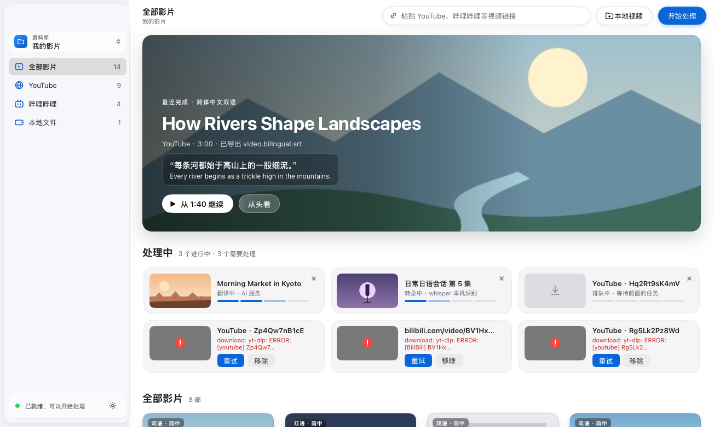
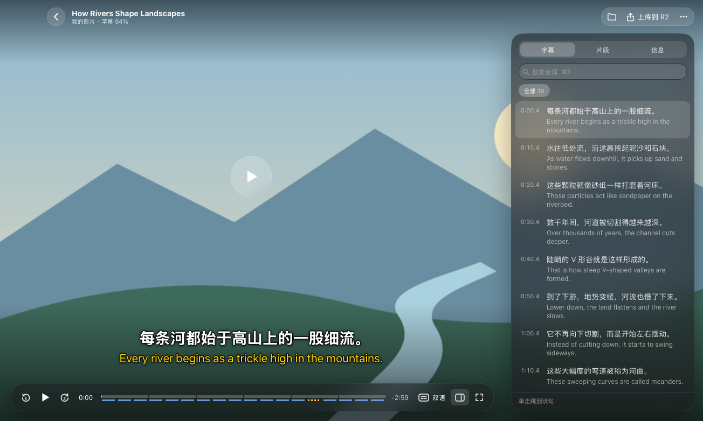
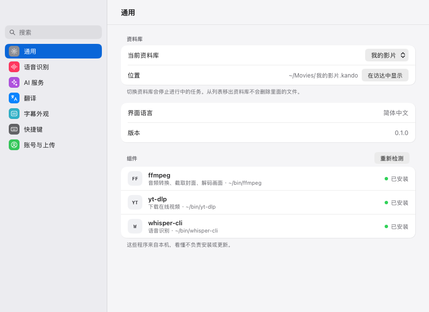
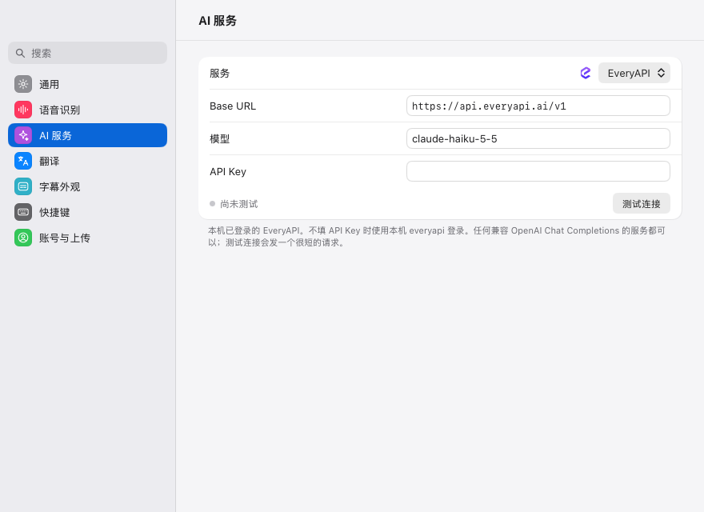

# Kando（看懂）

[](https://github.com/yldm-tech/Kando/actions/workflows/ci.yml)
[](https://github.com/yldm-tech/Kando/actions/workflows/release.yml)
[](https://github.com/yldm-tech/Kando/releases)
[](LICENSE)
[](go.work)
[](#install)
[](https://github.com/yldm-tech/Kando/stargazers)

[English](README.md) · [简体中文](README.zh-CN.md) · 日本語 · [繁體中文](README.zh-TW.md) · [한국어](README.ko.md)

Kando は、ある言語で話されている動画からその言語を学ぶためのデスクトップアプリです。中国語名は「看懂」（「見て分かる」の意）です。YouTube や Bilibili のリンクを貼り付けるか、動画ファイルをウィンドウにドロップすると、Kando は yt-dlp で動画をダウンロードし、whisper.cpp でお使いのコンピューター上で音声を文字起こしし、OpenAI 互換のモデルでセリフを 1 つずつ翻訳し、原文と訳文を同時に画面に表示しながら元の動画を再生します。Go で書かれており、ネイティブのインターフェースは [MyGo](https://github.com/egoist/mygo) と [Breeze UI](https://github.com/yldm-tech/mygo-breeze-ui) で描画しています。Web ビューは使っていません。



現在、インターフェースは簡体字中国語のみです。以下で引用しているラベルはアプリの表示そのままです（例:「設定」›「语音识别」（音声認識）。「設定」はアプリ上では「设置」と表示されます）。

## 機能

- YouTube、Bilibili、そのほか yt-dlp が対応するサイトのリンクを貼り付けて動画を追加できます。ローカルファイル（mp4、mov、mkv、webm などの動画ファイル）を選ぶか、ウィンドウにドラッグすることもできます。ローカルファイルはコピーせず、その場所のまま文字起こしします。
- ジョブはダウンロード、文字起こし、翻訳、書き出しの順に 1 件ずつ実行されます。失敗したジョブには理由と、それを解決する設定へのリンクが表示され、再試行や削除ができます。
- 音声認識は whisper.cpp でお使いのコンピューター上で行い、話されている言語は whisper.cpp が判別します。「設定」›「语音识别」には Tiny（77.7 MB）から Large v3（3.1 GB）まで 7 種類の whisper モデルが並び、選んだものを Hugging Face からダウンロードします。
- 翻訳はデフォルトで EveryAPI を使いますが、OpenAI 互換のチャット API ならどれでも使えます。「設定」›「AI 服务」（AI サービス）には OpenAI、OpenRouter、Groq、DeepSeek、xAI、Mistral、Qwen（DashScope）、Kimi、Zhipu GLM、SiliconFlow、Ollama、LM Studio のプリセットと、カスタムエンドポイントがあります。翻訳先の言語、モデルに直前のセリフも読ませる文脈考慮モード、プロンプトは「設定」›「翻译」（翻訳）で変更できます。
- 処理が完了した動画ごとに、動画と同じ場所に SubRip ファイルが 2 つ作られます。原文のセリフを収めた `<video>.srt` と、各セリフの訳を原文の上に置いた `<video>.bilingual.srt` です（ダウンロードした動画では `video.srt` と `video.bilingual.srt`）。
- プレーヤーでは字幕を二言語、原文のみ、訳文のみ、オフから選べます。字幕の遅延は 0.1 秒刻みで調整でき、スタイルも変更できます。サイドパネルでは、すべてのセリフを一覧・検索でき（セリフをクリックするとその位置へジャンプします）、動画を約 30 秒ずつ 4〜12 個のクリップに分けて表示し、その動画のファイルと入手元も確認できます。どの動画も、前回視聴を止めた位置から再開されます。
- ライブラリは通常のファイルが入った `.kando` フォルダで、Finder やファイルマネージャーで管理できます。複数のライブラリを持ってサイドバーから切り替えられ、サイドバーではライブラリを入手元（YouTube、Bilibili、その他のサイト、ローカルファイル）で絞り込むこともできます。
- 任意で、Google でサインインしたあと、プレーヤーから動画とその二言語字幕を自分のオブジェクトストレージ（Cloudflare R2、Amazon S3、Alibaba Cloud OSS、Tencent Cloud COS、または任意の S3 互換ストレージ）にアップロードできます。[設定項目](#configuration) を参照してください。
- 再生、字幕、ウィンドウ操作のキーボードショートカットがあり、チートシート（⌘/）と「設定」›「快捷键」（キーボードショートカット）に一覧があります。



<a id="install"></a>

## インストール

### ダウンロード

macOS、Windows、Linux 向けのビルドは、バージョンが公開されしだい [GitHub Releases](https://github.com/yldm-tech/Kando/releases) に添付されます。Developer ID やコード署名証明書で署名されていないため、初めて Kando を開くときにシステムが警告を表示します。

- macOS: macOS 15 以降では、一度 Kando を開いてから「システム設定」›「プライバシーとセキュリティ」›「このまま開く」を選びます。macOS 14 以前では、「アプリケーション」フォルダで Kando を Control キーを押しながらクリックし、「開く」を選びます。または、ターミナルで `xattr -dr com.apple.quarantine /Applications/Kando.app` を実行して隔離属性（quarantine）を削除します。
- Windows: SmartScreen のダイアログで「詳細情報」›「実行」を選びます。

### ソースからビルド

Go 1.27.3 以降を用意して、次を実行します。

```sh
git clone https://github.com/yldm-tech/Kando.git
cd Kando
make build
```

`make build` は現在のプラットフォーム向けに `go tool mygo build apps/kando` を実行し、結果を `apps/kando/build/<os>-<arch>/` に書き出します。macOS ではアドホック署名された `Kando.app` と `.dmg`、その他のプラットフォームでは実行ファイルが作られます（Linux ではさらに `.deb`、インストールスクリプト付きの `.tar.gz`、`PKGBUILD` が、Windows では NSIS で作るインストーラーも作られます。NSIS がインストールされていなければ mygo がダウンロードします）。標準の Windows のように `make` がない環境では、リポジトリのルートで `go tool mygo build apps/kando` を直接実行してください。

## 動作要件

Kando は以下のプログラムを実行しますが、それらのインストールや更新は行いません。

| プログラム | 用途 |
| --- | --- |
| `yt-dlp` | オンライン動画のダウンロード。ローカルファイルを含め、すべてのジョブで Kando はこれを必要とします。 |
| `ffmpeg` | 音声の抽出、カバー画像の取得、プレーヤーでの映像のデコード。macOS では、音声は ffmpeg と一緒にインストールされる `ffplay`、または `afplay` で再生します。 |
| `whisper-cli`（whisper.cpp） | 音声認識。 |
| whisper.cpp の ggml モデル | 「設定」›「语音识别」でダウンロードするか、`KANDO_WHISPER_MODEL` でモデルファイルを指定します。 |

macOS で Homebrew を使う場合:

```sh
brew install yt-dlp ffmpeg whisper-cpp
```

Windows と Linux では、同じプログラムをパッケージマネージャーでインストールし、`PATH` に含まれていることを確認してください。Finder やデスクトップのランチャーから開いたアプリには最小限の `PATH` しか渡されないため、Kando は `PATH` に加えて `/opt/homebrew/bin`、`/usr/local/bin`、`/home/linuxbrew/.linuxbrew/bin` も探します。「設定」›「通用」（一般）には見つかったプログラムが表示され、「重新检测」（再検出）で探し直します。

Windows と Linux では、現在プレーヤーは映像のみを表示し、音声は出ません。音声の再生は macOS でのみ実装されています。

## 使い方

1. Kando を開きます。ライブラリがまだない場合は、「新建资料库…」（新しいライブラリを作成）と「打开已有资料库…」（既存のライブラリを開く）が表示されます。新しいライブラリは、変更しなければ macOS では `~/Movies`、それ以外では `~/Videos` に「影视库」（映像ライブラリ）という名前で作られます。
2. 「設定」（⌘,）を開きます。「通用」で、`ffmpeg`、`yt-dlp`、`whisper-cli` が「已安装」（インストール済み）と表示されていることを確認します。
3. 「语音识别」で、whisper モデルの横にある「下载」（ダウンロード）をクリックします。ダウンロードが終わると Kando がそのモデルを選択します。「推荐」（おすすめ）の印が付いているのは「Large v3 Turbo（压缩版）」（压缩版 = 圧縮版）で、574 MB です。Vimpo や hyperframes がすでにダウンロードしたモデルは、コピーせずに選択できます。
4. 「AI 服务」で翻訳を設定します。
   - EveryAPI（デフォルト）: [EveryAPI](https://everyapi.ai) の CLI で一度 `everyapi auth login` を実行してサインインします。Kando は CLI にキーを問い合わせる（`everyapi auth credential`）ため、CLI と同じログイン、ゲートウェイのリージョン、キーの更新をそのまま使い、トークンを貼り付ける必要はありません。デフォルトのモデルは `claude-haiku-5-5` で、ほかのモデルは `everyapi models list` で確認できます。代わりに EveryAPI のキーを「API Key」欄に貼り付けることもできます。
   - ほかのプロバイダー: 「服务」（サービス）で選ぶか、「OpenAI 兼容」（OpenAI 互換）を選んで Base URL を入力し、「模型」（モデル）と「API Key」を設定します（Ollama や LM Studio などのローカルサーバーにはキーは不要です）。「测试连接」（接続テスト）を押すと、短いリクエストを送って設定を確認します。
5. 「翻译」で、デフォルトの翻訳先言語を選びます: 简体中文（デフォルト）、繁体中文、English、日本語、한국어、Español、Français、Deutsch。
6. ウィンドウに戻り、上部のバーにリンクを貼り付けて「开始处理」（処理開始）をクリックするか、「本地视频」（ローカル動画）をクリックするか、動画をウィンドウにドラッグします。サイドバー下部のステータス行は、ジョブに必要なものがすべてそろうと「已就绪，可以开始处理」（準備完了、処理を開始できます）と表示し、そうでない場合は足りないものを示します。

翻訳プロバイダーがレート制限やサーバーエラーを返した場合は、リクエストを送り直します（最初の送信を含めて最大 3 回）。





<a id="configuration"></a>

## 設定項目

以下の項目は、Google のクライアント ID とシークレットを除き、すべてアプリ内でも設定できます（ライブラリはサイドバーから、それ以外は「設定」から）。環境変数を設定すると、アプリに保存された値の代わりにその値が使われます。

| 変数 | デフォルト | 説明 |
| --- | --- | --- |
| `KANDO_WHISPER_MODEL` | 「設定」›「语音识别」で選んだモデル | whisper.cpp の ggml モデルファイルのパス。例: `ggml-small.bin`。 |
| `KANDO_LLM_BASE_URL` | EveryAPI、`https://api.everyapi.ai/v1` | OpenAI 互換プロバイダーの Base URL。例: `https://api.openai.com/v1`、Ollama なら `http://localhost:11434/v1`。設定すると、サインイン中の EveryAPI アカウントは使われません。 |
| `KANDO_LLM_MODEL` | EveryAPI では `claude-haiku-5-5` | 翻訳モデル。カスタムプロバイダーにはデフォルトがないため、ここか「設定」›「AI 服务」で指定します。 |
| `KANDO_LLM_API_KEY` | なし | 翻訳プロバイダー用の Bearer トークン。サインイン中の EveryAPI アカウントより優先されます。 |
| `EVERYAPI_API_KEY` | なし | EveryAPI のキー。`KANDO_LLM_BASE_URL` が未設定で `KANDO_LLM_API_KEY` が空のとき、CLI のログインの代わりに使われます。 |
| `KANDO_OUTPUT_DIR` | 最後に開いたライブラリ | 起動時に開くライブラリのフォルダ。新しい動画と字幕はここに保存されます。 |
| `KANDO_GOOGLE_CLIENT_ID` | なし | 「設定」›「账号与上传」（アカウントとアップロード）で Google にサインインするための OAuth クライアント ID。未設定の場合、サインインボタンは無効になります。設定ファイルには保存されません。 |
| `KANDO_GOOGLE_CLIENT_SECRET` | なし | 同じ OAuth クライアントのクライアントシークレット（省略可）。 |
| `KANDO_STORAGE` | `r2` | アップロード先: `r2`、`s3`（または `aws`）、`oss`（または `aliyun`）、`cos`（または `tencent`）、`compat`（または `s3compat`）。それ以外の値は R2 として扱われます。 |
| `KANDO_R2_ENDPOINT` | なし | Cloudflare R2: アカウント ID、または `https://` で始まる完全なエンドポイント。 |
| `KANDO_R2_BUCKET`、`KANDO_R2_ACCESS_KEY`、`KANDO_R2_SECRET` | なし | Cloudflare R2 のバケットとキー。 |
| `KANDO_S3_REGION` | なし | Amazon S3 のリージョン名。例: `ap-northeast-1`。 |
| `KANDO_S3_BUCKET`、`KANDO_S3_ACCESS_KEY`、`KANDO_S3_SECRET` | なし | Amazon S3 のバケットとキー。 |
| `KANDO_OSS_REGION` | なし | Alibaba Cloud OSS のリージョン名。例: `cn-hangzhou`（内部ネットワークでは `cn-hangzhou-internal`）。 |
| `KANDO_OSS_BUCKET`、`KANDO_OSS_ACCESS_KEY`、`KANDO_OSS_SECRET` | なし | Alibaba Cloud OSS のバケットとキー。 |
| `KANDO_COS_REGION` | なし | Tencent Cloud COS のリージョン名。例: `ap-guangzhou`。 |
| `KANDO_COS_BUCKET`、`KANDO_COS_ACCESS_KEY`、`KANDO_COS_SECRET` | なし | Tencent Cloud COS のバケット（名前に APPID を含みます。例: `video-1250000000`）、SecretId、SecretKey。 |
| `KANDO_S3COMPAT_ENDPOINT` | なし | ほかの S3 互換ストレージの、`https://` で始まる完全なエンドポイント。 |
| `KANDO_S3COMPAT_REGION` | なし | そのストレージの署名用リージョン。MinIO では通常 `us-east-1` です。 |
| `KANDO_S3COMPAT_BUCKET`、`KANDO_S3COMPAT_ACCESS_KEY`、`KANDO_S3COMPAT_SECRET` | なし | そのストレージのバケットとキー。 |
| `KANDO_S3COMPAT_PATH_STYLE` | オフ | `1`、`true`、`yes`、`on` でパス形式のアドレス指定を有効にします（MinIO では必要です）。`0`、`false`、`no`、`off` で無効にします。 |

アップロードは手動です。動画を開き、プレーヤーで「上传到 R2」（R2 にアップロード。ほかのストレージを選んだ場合はその名前）をクリックします。Kando は動画とその二言語字幕を `<Google account email>/<library>/<film folder>/<file>` の下にアップロードします。サインインは誰がアップロードしたかを示すためだけのものです。動画が自動でアップロードされることはありません。

## ライブラリと設定

ライブラリは、名前が `.kando` で終わるフォルダです。ダウンロードした動画はそれぞれ、その中に専用のフォルダ `<title> [<video id>]/` を持ち、そこに `video.mp4`、`cover.jpg`、`video.srt`、`video.bilingual.srt` が入ります。これらは通常のファイルです。Kando はライブラリのフォルダを監視しているため、Finder やファイルマネージャーで追加・削除した動画はライブラリに反映されます。macOS では、`.kando` フォルダは Finder で Kando のマーク入りのフォルダアイコンで表示されます。

動画をライブラリから削除すると、その動画のフォルダがゴミ箱に移動します。ただし、そのフォルダにほかの動画やフォルダも入っている場合は、その動画と字幕だけが移動します。ライブラリのフォルダの外にあるローカル動画はその場所に残り、一覧から消えるだけです。ライブラリを一覧から削除しても、そのフォルダはディスクに残ります。

Kando は自身のファイルをユーザー設定ディレクトリに保存します。macOS では `~/Library/Application Support/Kando`、Windows では `%AppData%\Kando`、Linux では `~/.config/Kando` です。

- `library.json`: 完了済みと処理中のジョブ、および各動画の再生を止めた位置。
- `settings.json`: 設定。API キー、オブジェクトストレージのキー、Google のリフレッシュトークンも平文で含まれます。このファイルは現在のユーザーアカウントだけが読み取れます。
- `window-state.json`: ウィンドウのサイズと位置。
- `models/`: 「設定」›「语音识别」でダウンロードした whisper モデル。

`video.*` という名前ではない動画のカバー画像は、macOS では `~/Library/Caches/Kando/posters`、Windows では `%LocalAppData%\Kando\posters`、Linux では `~/.cache/Kando/posters` にキャッシュされます。

## LingoCut からのアップグレード

Kando は以前 LingoCut という名前でしたが、旧名のファイルや変数を読み込む処理はありません。ライブラリと設定を引き継ぐには、次の手順を行います。

1. アプリを終了します。
2. 設定フォルダの名前を `LingoCut` から `Kando` に変更します。macOS では `~/Library/Application Support/LingoCut`、Windows では `%AppData%\LingoCut`、Linux では `~/.config/LingoCut` です。このフォルダには `library.json`、`settings.json`、`window-state.json` とダウンロード済みのモデルが入っています。
3. 設定フォルダの名前を変えたあと、起動する前に、各ライブラリの名前を `X.lingocut` から `X.kando` に変更します。macOS と Linux では、保存された inode をもとに、名前を変えたライブラリをアプリがすべて追跡します。Windows では、見つからないライブラリ 1 つを同じ親フォルダ内の新しい `.kando` フォルダ 1 つにしか対応付けられないため、フォルダごとに 1 つずつライブラリの名前を変え、変えるたびにアプリを一度起動してください。
4. 環境変数の名前を `LINGOCUT_*` から `KANDO_*` に変更します。
5. Kando を起動し、「設定」›「语音识别」で音声認識モデルを選び直します。モデルファイルはフォルダと一緒に移動しているので「已下载」（ダウンロード済み）と表示されますが、保存された選択はまだ古いパスを指しています。
6. 旧名の残りを削除します: `lingocut.app` と `lingocut Dev.app`、カバー画像のキャッシュ `~/Library/Caches/LingoCut`（Windows では `%LocalAppData%\LingoCut`、Linux では `~/.cache/LingoCut`）、Linux では小文字の `~/.config/lingocut`、そして `make dev` を実行したことがあれば `~/Library/Application Support/lingocut Dev`。

## 開発

Go 1.27.3 以降が必要です。

```sh
make test   # go test for packages/core, packages/media and apps/kando
make dev    # run the app with live reload
make build  # build the app for this platform into apps/kando/build
```

`make dev` は、MyGo の `mygo dev` に `tools/mygo-dev` のパッチを当てたものを実行します。macOS では、リロード時に実行中のウィンドウを先に閉じず、新しいビルドが自身のウィンドウを表示するまで残すため、変更を保存してもアプリが終了したようには見えません。MyGo のアップグレード後にパッチが当たらなくなった場合は警告を出し、標準の `go tool mygo dev` にフォールバックします。その場合は、新しい `cmd/mygo/dev.go` に合わせて `tools/mygo-dev/dev.go.patch` を更新してください。この処理を行う `tools/mygo-dev/dev.sh` は POSIX シェルスクリプトです。

スクリーンショットテストは、固定のデモライブラリから主要な画面を PNG ファイルに描画します。空のダミーのホームフォルダと、ダミーの `ffmpeg`、`yt-dlp`、`whisper-cli` を使うため、ユーザー自身の設定、ライブラリ、ツールは読み込みません。

```sh
KANDO_SCREENSHOTS=/tmp/kando-shots go test ./apps/kando/... -run TestScreenshots
```

リポジトリの構成:

- `apps/kando`: アプリ本体。画面ごとに専用のディレクトリ（`sidebar/`、`films/`、`film/`、`settings/`、`account/`、`cheatsheet/`）があり、`view.go` がウィンドウとそれらをつなぎます。`shelf/` はジョブの記録、`cloud/` は Google サインインとオブジェクトストレージへのアップロード、`brand/` はライブラリの Finder アイコンです。
- `packages/core`: プラットフォームに依存しないジョブ、ステージ、リンクの解析。
- `packages/media`: メディア処理のパイプライン。ダウンロード、文字起こし、翻訳、字幕の書き出し、カバー画像、ライブラリ。
- `tools/mygo-dev`: `make dev` が使う、パッチを当てた `mygo dev`。

[AGENTS.md](AGENTS.md) には、インターフェースをどのようにコンポーネントに分けているかと、各領域が従うルールが書かれています。UI を変更する前に読んでください。

## CI とリリース

[CI](https://github.com/yldm-tech/Kando/actions/workflows/ci.yml) ワークフローは、プルリクエストと `main` をビルドしてテストします。[Release](https://github.com/yldm-tech/Kando/actions/workflows/release.yml) ワークフローは、`main` で CI が成功したあと、または手動で実行されます。前回のタグ以降の Conventional Commits から次のバージョンを決め、`chore(release)` として `main` にコミットしてタグを付け、Developer ID やコード署名証明書なしで macOS、Windows、Linux 向けのパッケージをビルドし、チェックサムを添えて GitHub のリリースを公開します。

## ライセンス

[MIT](LICENSE)
