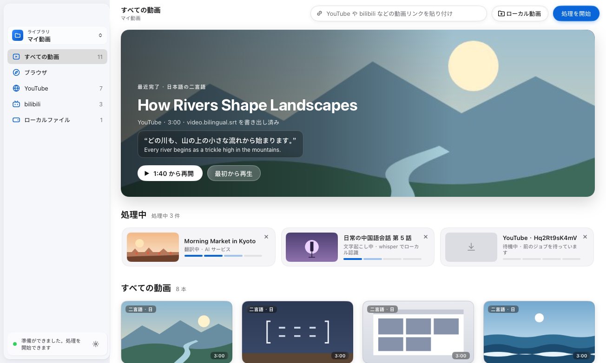
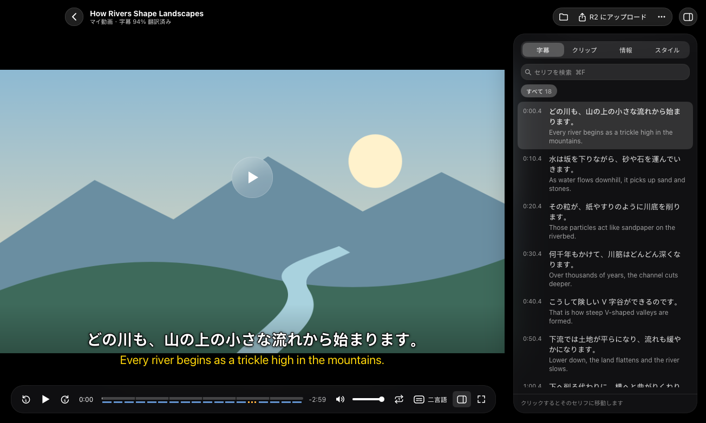
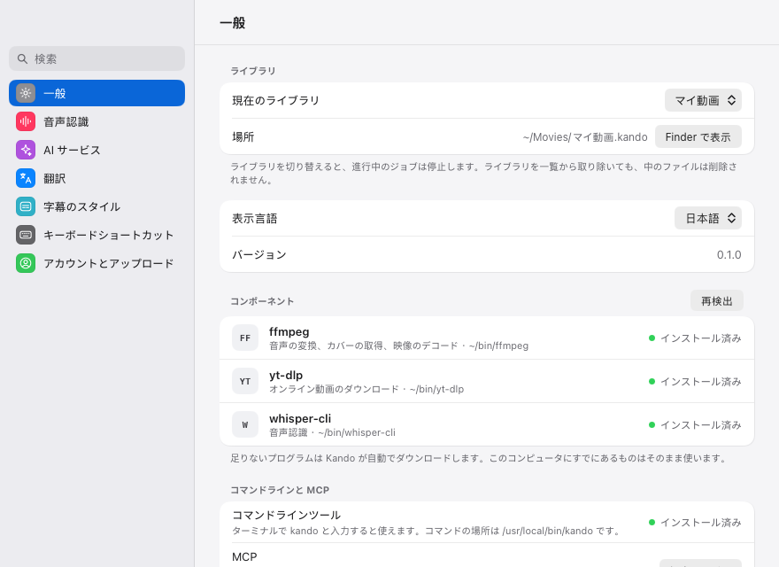
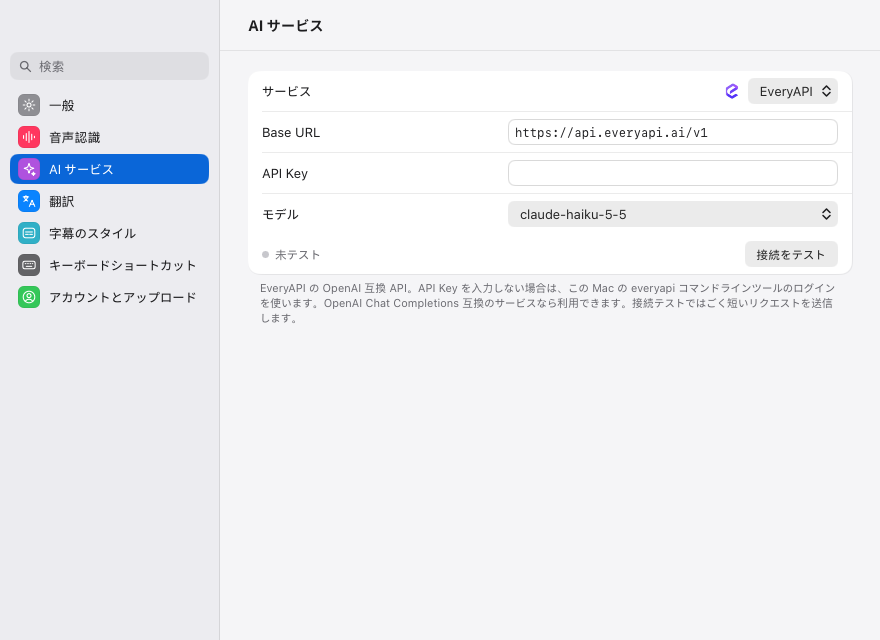

# Kando

[](https://github.com/yldm-tech/Kando/actions/workflows/ci.yml)
[](https://github.com/yldm-tech/Kando/actions/workflows/release.yml)
[](https://github.com/yldm-tech/Kando/releases)
[](LICENSE)
[](go.work)
[](#install)
[](https://github.com/yldm-tech/Kando/stargazers)

[English](README.md) · [简体中文](README.zh-CN.md) · 日本語 · [繁體中文](README.zh-TW.md) · [한국어](README.ko.md)

Kando は、ある言語で話されている動画からその言語を学ぶためのデスクトップアプリです。中国語名は「看懂」（「見て分かる」の意）です。YouTube や Bilibili のリンクを貼り付けるか、動画ファイルをウィンドウにドロップすると、Kando は yt-dlp で動画をダウンロードし、whisper.cpp でお使いのコンピューター上で音声を文字起こしし、OpenAI 互換のモデルでセリフを 1 つずつ翻訳し、原文と訳文を同時に画面に表示しながら元の動画を再生します。Go で書かれており、ネイティブのインターフェースは [MyGo](https://github.com/egoist/mygo) と [Breeze UI](https://github.com/yldm-tech/mygo-breeze-ui) で描画しています。Web ビューは使っていません。



インターフェースは日本語、英語、簡体字中国語、繁体字中国語、韓国語に対応しています。最初は簡体字中国語で表示されるので、「設定」›「一般」›「表示言語」で切り替えてください。ウインドウはすぐに選んだ言語に変わります。以下で引用しているラベルは日本語のインターフェースの表示そのままです。

## 機能

- YouTube、Bilibili、そのほか yt-dlp が対応するサイトのリンクを貼り付けて動画を追加できます（対応サイトはロゴ付きで「ヘルプ」›「対応サイト…」に一覧があります）。ローカルファイル（mp4、mov、mkv、webm などの動画ファイル）を選ぶか、ウィンドウにドラッグすることもできます。ローカルファイルはコピーせず、その場所のまま文字起こしします。
- ジョブはダウンロード、文字起こし、翻訳、書き出しの順に 1 件ずつ実行されます。失敗したジョブには理由と、それを解決する設定へのリンクが表示され、再試行や削除ができます。
- 音声認識は whisper.cpp でお使いのコンピューター上で行い、話されている言語は whisper.cpp が判別します。「設定」›「音声認識」には Tiny（77.7 MB）から Large v3（3.1 GB）まで 7 種類の whisper モデルが並び、選んだものを Hugging Face からダウンロードします。
- 翻訳はデフォルトで EveryAPI を使いますが、OpenAI 互換のチャット API ならどれでも使えます。「設定」›「AI サービス」には OpenAI、OpenRouter、Groq、DeepSeek、xAI、Mistral、Qwen（DashScope）、Kimi、Zhipu GLM、SiliconFlow、Ollama、LM Studio のプリセットと、カスタムエンドポイントがあります。翻訳先の言語、モデルに直前のセリフも読ませる文脈考慮モード、プロンプトは「設定」›「翻訳」で変更できます。
- 処理が完了した動画ごとに、動画と同じ場所に SubRip ファイルが 2 つ作られます。原文のセリフを収めた `<video>.srt` と、各セリフの訳を原文の上に置いた `<video>.bilingual.srt` です（ダウンロードした動画では `video.srt` と `video.bilingual.srt`）。
- プレーヤーでは字幕を二言語、原文のみ、訳文のみ、オフから選べます。字幕の遅延は 0.1 秒刻みで調整でき、スタイルも変更できます。サイドパネルでは、すべてのセリフを一覧・検索でき（セリフをクリックするとその位置へジャンプします）、動画を約 30 秒ずつ 4〜12 個のクリップに分けて表示し、その動画のファイルと入手元も確認できます。どの動画も、前回視聴を止めた位置から再開されます。
- ライブラリは通常のファイルが入った `.kando` フォルダで、Finder やファイルマネージャーで管理できます。複数のライブラリを持ってサイドバーから切り替えられ、サイドバーではライブラリを入手元（YouTube、Bilibili、その他のサイト、ローカルファイル）で絞り込むこともできます。
- 任意で、Google でサインインしたあと、プレーヤーから動画とその二言語字幕を自分のオブジェクトストレージ（Cloudflare R2、Amazon S3、Alibaba Cloud OSS、Tencent Cloud COS、または任意の S3 互換ストレージ）にアップロードできます。[設定項目](#configuration) を参照してください。
- 再生、字幕、ウィンドウ操作のキーボードショートカットがあり、チートシート（⌘/）と「設定」›「キーボードショートカット」に一覧があります。



<a id="install"></a>

## インストール

### ダウンロード

macOS（Apple シリコンと Intel）と Linux（x86-64 と ARM64）向けのビルドは [GitHub Releases](https://github.com/yldm-tech/Kando/releases) にあります。Windows 向けのビルドはまだないため、Windows では下記の手順でソースからビルドしてください。Developer ID やコード署名証明書で署名されていないため、初めて Kando を開くときにシステムが警告を表示します。

- macOS: macOS 15 以降では、一度 Kando を開いてから「システム設定」›「プライバシーとセキュリティ」›「このまま開く」を選びます。macOS 14 以前では、「アプリケーション」フォルダで Kando を Control キーを押しながらクリックし、「開く」を選びます。または、ターミナルで `xattr -dr com.apple.quarantine /Applications/Kando.app` を実行して隔離属性（quarantine）を削除します。
- Windows: SmartScreen のダイアログで「詳細情報」›「実行」を選びます。

### ソースからビルド

Go 1.27.3 以降を用意して、次を実行します。

```sh
git clone https://github.com/yldm-tech/Kando.git
cd Kando
make build
```

`make build` は現在のプラットフォーム向けに `go tool mygo build apps/kando` を実行し、結果を `apps/kando/build/<os>-<arch>/` に書き出します。macOS ではアドホック署名された `Kando.app` と `.dmg`、その他のプラットフォームでは実行ファイルが作られます（Linux ではさらに `.deb`、インストールスクリプト付きの `.tar.gz`、`PKGBUILD` が、Windows では NSIS で作るインストーラーも作られます。NSIS がインストールされていなければ mygo がダウンロードします）。標準の Windows のように `make` がない環境では、リポジトリのルートで `go tool mygo build apps/kando` を直接実行してください。

## 動作要件

Kando は `yt-dlp`、`ffmpeg`、`whisper-cli`（whisper.cpp）を実行します。macOS と Linux では自分でインストールする必要はありません。Kando を開いたときに足りないものがあれば自動でダウンロードし、はじめにガイドに進み具合が表示されます。すでにインストールされているもの（Homebrew で入れたものなど）はそのまま使います。

| プログラム | 用途 | Kando がダウンロードするもの |
| --- | --- | --- |
| `yt-dlp` | オンライン動画のダウンロード。ローカルファイルを含め、すべてのジョブで Kando はこれを必要とします。 | [yt-dlp の公式リリース](https://github.com/yt-dlp/yt-dlp/releases)の単体ファイル版。 |
| `ffmpeg` | 音声の抽出、カバー画像の取得、プレーヤーでの映像のデコード。macOS では、音声はその隣の `ffplay`、または `afplay` で再生します。 | FFmpeg 9.0.2（macOS 版は `ffplay` 付き）。このリポジトリの [tools リリース](https://github.com/yldm-tech/Kando/releases/tag/tools-1)から。 |
| `whisper-cli`（whisper.cpp） | 音声認識。 | whisper.cpp 1.9.5（macOS 版は Metal 対応）。同じリリースから。 |
| whisper.cpp の ggml モデル | はじめにガイドか「設定」›「音声認識」でダウンロードするか、`KANDO_WHISPER_MODEL` でモデルファイルを指定します。 | |

tools リリースは Tools ワークフロー（`.github/workflows/tools.yml`）が `.github/tools.env` で固定したソースからビルドし、Kando はダウンロードしたものをアプリに組み込んだ SHA-256 で検証してから使います。ダウンロードしたプログラムは `settings.json` の隣の `tools` フォルダ（macOS では `~/Library/Application Support/Kando/tools`、Linux では `~/.config/Kando/tools`）に置かれます。Kando はまずここを探し、次に `PATH` と `/opt/homebrew/bin`、`/usr/local/bin`、`/home/linuxbrew/.linuxbrew/bin` を探します。Finder やデスクトップのランチャーから開いたアプリには最小限の `PATH` しか渡されないためです。「設定」›「一般」には使っているプログラムが表示され、足りないものは「ダウンロード」か「再試行」で取得でき、「再検出」で探し直します。`yt-dlp` が古いためにダウンロードに失敗した場合は「アップデートして再試行」が表示され、インストールしたときと同じ方法で更新して再試行します。

Windows ではまだ自動でダウンロードしません。同じプログラムをパッケージマネージャーでインストールし、`PATH` に含まれていることを確認してください。

Windows と Linux では、現在プレーヤーは映像のみを表示し、音声は出ません。音声の再生は macOS でのみ実装されています。

## 使い方

1. Kando を開きます。ライブラリがまだない場合は、「新規ライブラリ…」と「既存のライブラリを開く…」が表示されます。新しいライブラリは、変更しなければ macOS では `~/Movies`、それ以外では `~/Videos` に「動画ライブラリ」という名前で作られます。
2. 足りない `ffmpeg`、`yt-dlp`、`whisper-cli` ははじめにガイドが自動でダウンロードします。「設定」（⌘,）の「一般」に、それぞれのバージョンとともに表示されます。
3. 「音声認識」で、whisper モデルの横にある「ダウンロード」をクリックします。ダウンロードが終わると Kando がそのモデルを選択します。「おすすめ」の印が付いているのは「Large v3 Turbo（圧縮版）」で、574 MB です。Vimpo や hyperframes がすでにダウンロードしたモデルは、コピーせずに選択できます。
4. 「AI サービス」で翻訳を設定します。
   - EveryAPI（デフォルト）: [EveryAPI](https://everyapi.ai) の CLI で一度 `everyapi auth login` を実行してサインインします。Kando は CLI にキーを問い合わせる（`everyapi auth credential`）ため、CLI と同じログイン、ゲートウェイのリージョン、キーの更新をそのまま使い、トークンを貼り付ける必要はありません。デフォルトのモデルは `claude-haiku-5-5` で、ほかのモデルは `everyapi models list` で確認できます。代わりに EveryAPI のキーを「API Key」欄に貼り付けることもできます。
   - ほかのプロバイダー: 「サービス」で選ぶか、「OpenAI 互換」を選んで Base URL を入力し、「モデル」と「API Key」を設定します（Ollama や LM Studio などのローカルサーバーにはキーは不要です）。「接続をテスト」を押すと、短いリクエストを送って設定を確認します。
5. 「翻訳」で、デフォルトの翻訳先言語を選びます: 簡体字中国語（デフォルト）、繁体字中国語、英語、日本語、韓国語、スペイン語、フランス語、ドイツ語。
6. ウィンドウに戻り、上部のバーにリンクを貼り付けて「処理を開始」をクリックするか、「ローカル動画」をクリックするか、動画をウィンドウにドラッグします。サイドバー下部のステータス行は、ジョブに必要なものがすべてそろうと「準備ができました。処理を開始できます」と表示し、そうでない場合は足りないものを示します。

翻訳プロバイダーがレート制限やサーバーエラーを返した場合は、リクエストを送り直します（最初の送信を含めて最大 3 回）。





<a id="command-line-and-mcp"></a>

## コマンドラインと MCP

Kando のプログラムは、コマンドライン `kando` と、AI エージェント向けの MCP サーバーも兼ねています。下の表のコマンドを付けて実行すると Kando アプリを操作し、コマンドなしで実行するといつもどおりウィンドウを開きます。

`kando` コマンドを使えるようにするには:

- macOS: Kando を「アプリケーション」フォルダに移動してから、「設定」›「一般」で「コマンドラインツール」の横にある「インストール」をクリックします。`/usr/local/bin`、`/opt/homebrew/bin`、`~/.local/bin` のうち最初に書き込めるフォルダに、Kando を指す `kando` のリンクを作ります。管理者パスワードは求めず、ほかのプログラムの `kando` を置き換えることもありません。ディスクイメージから直接開いたときや、ダウンロード後に macOS が一時的な場所に移して実行しているとき（App Translocation）は、Kando のパスがすぐに使えなくなるため、カードはリンクを作らずに先に Kando を移動するよう案内します。自分でリンクを作ることもできます: `sudo ln -s /Applications/Kando.app/Contents/MacOS/Kando /usr/local/bin/kando`。
- Linux: `.deb` と `PKGBUILD` はアプリを `/opt/kando` にインストールし、`/opt/kando/kando` を指すリンク `/usr/bin/kando` を追加します。`.tar.gz` に付いているインストールスクリプトはアプリを `~/.local/kando.app` にインストールし、それを指す `~/.local/bin/kando` を作ります。そこに自分で作ったものではない `kando` があれば、そのまま残します。シェルの `PATH` に `~/.local/bin` がなければ追加してください。

| コマンド | 内容 |
| --- | --- |
| `kando status` | 開いているライブラリ、使用中のプログラムとモデル、ジョブを開始できるかどうかを表示します。開始できない場合は足りないものを示します。 |
| `kando list [--source S] [query]` | ライブラリの動画を新しい順に ID 付きで一覧表示します。`--source` は 1 つのソース（`youtube`、`bilibili`、`local`、またはほかのサイトの名前）に絞り込み、query はタイトルにその文字列を含む動画に絞り込みます。 |
| `kando show <film-id>` | 1 本の動画を表示します: ソース、ステージ、動画と字幕のパス。 |
| `kando subtitles <film-id> [--format srt\|text\|json] [--original\|--translation]` | 動画の字幕を SubRip（デフォルト）、1 行 1 字幕のテキスト（`text`）、または JSON で出力します。両方の言語か、片方だけを選べます。 |
| `kando jobs` | ジョブを一覧表示します: 実行中のもの、待機中のもの、終わったものの順です。 |
| `kando add <link-or-file>... [--wait]` | 「処理を開始」と同じようにリンクやローカルの動画ファイルをキューに追加し、各ジョブの ID を出力します。相対パスは現在のディレクトリから解釈されます。 |
| `kando cancel <job-id>` | 実行中のジョブを止めるか、待機中のジョブをキューから外します。 |
| `kando sites [query] [--limit N]` | Kando がダウンロードできるサイトを、名前、ドメイン、または動画のリンクで検索します。 |
| `kando open [film-id]` | Kando を最前面に出し、指定した動画を表示します。ID を省くとライブラリを表示します。 |
| `kando mcp` | 標準入出力で MCP サーバーとして動きます（後述）。 |
| `kando version` | バージョンを出力します。 |
| `kando help [command]` | コマンドの一覧、または 1 つのコマンドの使い方とフラグを表示します。 |

アプリを必要とするコマンドは、`settings.json` と同じフォルダにあるソケット `kando.sock`（macOS では `~/Library/Application Support/Kando/kando.sock`、Linux では `~/.config/Kando/kando.sock`、Windows では `%AppData%\Kando\kando.sock`）を通じてアプリとやり取りします。`KANDO_SOCKET` で別のパスを指定できます。2 つ目の Kando を動かすときもこれが必要で、さらに専用の `HOME` も要ります（[設定項目](#configuration)を参照）。Kando が起動していないときは、コマンドがバックグラウンドで起動し、標準エラー出力に `Starting Kando…` と表示して最大 30 秒待ちます。動画の追加には「処理を開始」と同じもの（開いているライブラリ、プログラム、whisper モデルなど）が必要で、足りないものがあると `kando add` はウィンドウに表示されるのと同じメッセージで失敗します。

アプリとやり取りするコマンドはすべて `--json` を受け付け、アプリの応答をテキストではなく JSON で出力します。追加できなかったソースがあると、`kando add` は終了コード 1 で終わります。`--wait` を付けると、追加したジョブがすべて完了または失敗するまで待ち、ジョブのステージや進捗が変わるたびに 1 行出力し、失敗したジョブが 1 つでもあれば同じく終了コード 1 で終わります。`--json` を付けると、進捗は標準エラー出力に、終了時のジョブは標準出力に出力されます。終了コードは、成功が 0、失敗が 1、コマンドの使い方の誤りが 2 です。

`kando mcp` は標準入出力で動く MCP サーバーです。Kando が起動していないときは、ツールが同じように Kando を起動します。

| ツール | 内容 |
| --- | --- |
| `kando_status` | アプリのバージョン、開いているライブラリ、ジョブを開始できるかどうかと足りないもの、プログラム、音声認識と翻訳のモデル、翻訳先言語、実行中と待機中のジョブ。 |
| `kando_list_films` | 開いているライブラリの動画を新しい順に返します。`source` やタイトル中の語（`query`）で絞り込めます。 |
| `kando_get_film` | ID で指定した 1 本の動画: ステージ、翻訳先言語、動画と字幕のパス。 |
| `kando_get_subtitles` | 処理が終わった動画のタイムスタンプ付き字幕。両方の言語か片方だけ（`which`）、簡潔なテキストか SRT（`format`）を選べ、`max_cues` を指定すると先頭のその行数だけを返します。 |
| `kando_add_videos` | リンクやローカルの動画ファイルをキューに追加し、ジョブと、追加できなかったソースごとにスキップした理由を返します。 |
| `kando_list_jobs` | ジョブのステージ、進捗、ステータス、エラー、完了後は動画の ID とファイルのパス。 |
| `kando_cancel_job` | 実行中のジョブを止めるか、待機中のジョブをキューから外します。 |
| `kando_search_sites` | Kando がダウンロードできるサイトを、名前、ドメイン、または動画のリンクで検索します（`limit` を指定しなければ 20 件）。 |
| `kando_open` | Kando のウィンドウを最前面に出し、動画またはライブラリを表示します。 |

Claude Code にはプログラムのパスを指定して追加します。`kando` が `PATH` にあれば `kando` だけで構いません。

```sh
claude mcp add kando -- /Applications/Kando.app/Contents/MacOS/Kando mcp
```

ほかの MCP クライアントでは、`mcpServers` の設定に同じコマンドを書きます。

```json
{
  "mcpServers": {
    "kando": {
      "command": "/Applications/Kando.app/Contents/MacOS/Kando",
      "args": ["mcp"]
    }
  }
}
```

WebMCP に対応したブラウザでは、ランディングページ [kando.yldm.ai](https://kando.yldm.ai) がブラウザのエージェントに WebMCP ツールを提供します: `search_supported_sites` は Kando があるサイトからダウンロードできるかを調べ、`get_download` はシステムに合ったダウンロードリンクを返し、`get_started` は使い始めるまでの手順を返し、`list_features` は Kando の機能を一覧にします。

<a id="configuration"></a>

## 設定項目

以下の項目は、Google のクライアント ID とシークレット、`KANDO_SOCKET` を除き、すべてアプリ内でも設定できます（ライブラリはサイドバーから、それ以外は「設定」から）。環境変数を設定すると、アプリに保存された値の代わりにその値が使われます。

| 変数 | デフォルト | 説明 |
| --- | --- | --- |
| `KANDO_WHISPER_MODEL` | 「設定」›「音声認識」で選んだモデル | whisper.cpp の ggml モデルファイルのパス。例: `ggml-small.bin`。 |
| `KANDO_LLM_BASE_URL` | EveryAPI、`https://api.everyapi.ai/v1` | OpenAI 互換プロバイダーの Base URL。例: `https://api.openai.com/v1`、Ollama なら `http://localhost:11434/v1`。設定すると、サインイン中の EveryAPI アカウントは使われません。 |
| `KANDO_LLM_MODEL` | EveryAPI では `claude-haiku-5-5` | 翻訳モデル。カスタムプロバイダーにはデフォルトがないため、ここか「設定」›「AI サービス」で指定します。 |
| `KANDO_LLM_API_KEY` | なし | 翻訳プロバイダー用の Bearer トークン。サインイン中の EveryAPI アカウントより優先されます。 |
| `EVERYAPI_API_KEY` | なし | EveryAPI のキー。`KANDO_LLM_BASE_URL` が未設定で `KANDO_LLM_API_KEY` が空のとき、CLI のログインの代わりに使われます。 |
| `KANDO_OUTPUT_DIR` | 最後に開いたライブラリ | 起動時に開くライブラリのフォルダ。新しい動画と字幕はここに保存されます。 |
| `KANDO_SOCKET` | `settings.json` と同じフォルダの `kando.sock` | アプリが待ち受け、`kando` コマンドラインと `kando mcp` が接続するソケットのパス。アプリとコマンドの両方に同じパスを設定します。Kando は 1 人のユーザーにつき 1 つだけ動き、もう一度起動すると最初の Kando が前面に出ます。`KANDO_SOCKET` を設定して起動したものは開発用などの意図した 2 つ目の Kando で、自分のライブラリと設定を使うよう専用の `HOME` も必要です。[コマンドラインと MCP](#command-line-and-mcp) を参照してください。 |
| `KANDO_GOOGLE_CLIENT_ID` | なし | 「設定」›「アカウントとアップロード」で Google にサインインするための OAuth クライアント ID。未設定の場合、サインインボタンは無効になります。設定ファイルには保存されません。 |
| `KANDO_GOOGLE_CLIENT_SECRET` | なし | 同じ OAuth クライアントのクライアントシークレット（省略可）。 |
| `KANDO_STORAGE` | `r2` | アップロード先: `r2`、`s3`（または `aws`）、`oss`（または `aliyun`）、`cos`（または `tencent`）、`compat`（または `s3compat`）。それ以外の値は R2 として扱われます。 |
| `KANDO_R2_ENDPOINT` | なし | Cloudflare R2: アカウント ID、または `https://` で始まる完全なエンドポイント。 |
| `KANDO_R2_BUCKET`、`KANDO_R2_ACCESS_KEY`、`KANDO_R2_SECRET` | なし | Cloudflare R2 のバケットとキー。 |
| `KANDO_S3_REGION` | なし | Amazon S3 のリージョン名。例: `ap-northeast-1`。 |
| `KANDO_S3_BUCKET`、`KANDO_S3_ACCESS_KEY`、`KANDO_S3_SECRET` | なし | Amazon S3 のバケットとキー。 |
| `KANDO_OSS_REGION` | なし | Alibaba Cloud OSS のリージョン名。例: `cn-hangzhou`（内部ネットワークでは `cn-hangzhou-internal`）。 |
| `KANDO_OSS_BUCKET`、`KANDO_OSS_ACCESS_KEY`、`KANDO_OSS_SECRET` | なし | Alibaba Cloud OSS のバケットとキー。 |
| `KANDO_COS_REGION` | なし | Tencent Cloud COS のリージョン名。例: `ap-guangzhou`。 |
| `KANDO_COS_BUCKET`、`KANDO_COS_ACCESS_KEY`、`KANDO_COS_SECRET` | なし | Tencent Cloud COS のバケット（名前に APPID を含みます。例: `video-1250000000`）、SecretId、SecretKey。 |
| `KANDO_S3COMPAT_ENDPOINT` | なし | ほかの S3 互換ストレージの、`https://` で始まる完全なエンドポイント。 |
| `KANDO_S3COMPAT_REGION` | なし | そのストレージの署名用リージョン。MinIO では通常 `us-east-1` です。 |
| `KANDO_S3COMPAT_BUCKET`、`KANDO_S3COMPAT_ACCESS_KEY`、`KANDO_S3COMPAT_SECRET` | なし | そのストレージのバケットとキー。 |
| `KANDO_S3COMPAT_PATH_STYLE` | オフ | `1`、`true`、`yes`、`on` でパス形式のアドレス指定を有効にします（MinIO では必要です）。`0`、`false`、`no`、`off` で無効にします。 |

アップロードは手動です。動画を開き、プレーヤーで「R2 にアップロード」（ほかのストレージを選んだ場合はその名前）をクリックします。Kando は動画とその二言語字幕を `<Google アカウントのメールアドレス>/<ライブラリ>/<動画フォルダ>/<ファイル>` の下にアップロードします。サインインは誰がアップロードしたかを示すためだけのものです。動画が自動でアップロードされることはありません。

## ライブラリと設定

ライブラリは、名前が `.kando` で終わるフォルダです。ダウンロードした動画はそれぞれ、その中に専用のフォルダ `<title> [<video id>]/` を持ち、そこに `video.mp4`、`cover.jpg`、`video.srt`、`video.bilingual.srt` が入ります。これらは通常のファイルです。Kando はライブラリのフォルダを監視しているため、Finder やファイルマネージャーで追加・削除した動画はライブラリに反映されます。macOS では、`.kando` フォルダは Finder で Kando のマーク入りのフォルダアイコンで表示されます。

動画をライブラリから削除すると、その動画のフォルダがゴミ箱に移動します。ただし、そのフォルダにほかの動画やフォルダも入っている場合は、その動画と字幕だけが移動します。ライブラリのフォルダの外にあるローカル動画はその場所に残り、一覧から消えるだけです。ライブラリを一覧から削除しても、そのフォルダはディスクに残ります。

Kando は自身のファイルをユーザー設定ディレクトリに保存します。macOS では `~/Library/Application Support/Kando`、Windows では `%AppData%\Kando`、Linux では `~/.config/Kando` です。

- `library.json`: 完了済みと処理中のジョブ、および各動画の再生を止めた位置。
- `settings.json`: 設定。API キー、オブジェクトストレージのキー、Google のリフレッシュトークンも平文で含まれます。このファイルは現在のユーザーアカウントだけが読み取れます。
- `window-state.json`: ウィンドウのサイズと位置。
- `models/`: 「設定」›「音声認識」でダウンロードした whisper モデル。

`video.*` という名前ではない動画のカバー画像は、macOS では `~/Library/Caches/Kando/posters`、Windows では `%LocalAppData%\Kando\posters`、Linux では `~/.cache/Kando/posters` にキャッシュされます。

## LingoCut からのアップグレード

Kando は以前 LingoCut という名前でしたが、旧名のファイルや変数を読み込む処理はありません。ライブラリと設定を引き継ぐには、次の手順を行います。

1. アプリを終了します。
2. 設定フォルダの名前を `LingoCut` から `Kando` に変更します。macOS では `~/Library/Application Support/LingoCut`、Windows では `%AppData%\LingoCut`、Linux では `~/.config/LingoCut` です。このフォルダには `library.json`、`settings.json`、`window-state.json` とダウンロード済みのモデルが入っています。
3. 設定フォルダの名前を変えたあと、起動する前に、各ライブラリの名前を `X.lingocut` から `X.kando` に変更します。macOS と Linux では、保存された inode をもとに、名前を変えたライブラリをアプリがすべて追跡します。Windows では、見つからないライブラリ 1 つを同じ親フォルダ内の新しい `.kando` フォルダ 1 つにしか対応付けられないため、フォルダごとに 1 つずつライブラリの名前を変え、変えるたびにアプリを一度起動してください。
4. 環境変数の名前を `LINGOCUT_*` から `KANDO_*` に変更します。
5. Kando を起動し、「設定」›「音声認識」で音声認識モデルを選び直します。モデルファイルはフォルダと一緒に移動しているので「ダウンロード済み」と表示されますが、保存された選択はまだ古いパスを指しています。
6. 旧名の残りを削除します: `lingocut.app` と `lingocut Dev.app`、カバー画像のキャッシュ `~/Library/Caches/LingoCut`（Windows では `%LocalAppData%\LingoCut`、Linux では `~/.cache/LingoCut`）、Linux では小文字の `~/.config/lingocut`、そして `make dev` を実行したことがあれば `~/Library/Application Support/lingocut Dev`。

## 開発

Go 1.27.3 以降が必要です。

```sh
make test   # go test for packages/core, packages/media and apps/kando
make dev    # run the app with live reload
make build  # build the app for this platform into apps/kando/build
```

`make dev` は、MyGo の `mygo dev` に `tools/mygo-dev` のパッチを当てたものを実行します。macOS では、リロード時に実行中のウィンドウを先に閉じず、新しいビルドが自身のウィンドウを表示するまで残すため、変更を保存してもアプリが終了したようには見えません。MyGo のアップグレード後にパッチが当たらなくなった場合は警告を出し、標準の `go tool mygo dev` にフォールバックします。その場合は、新しい `cmd/mygo/dev.go` に合わせて `tools/mygo-dev/dev.go.patch` を更新してください。この処理を行う `tools/mygo-dev/dev.sh` は POSIX シェルスクリプトです。

スクリーンショットテストは、固定のデモライブラリから主要な画面を PNG ファイルに描画します。空のダミーのホームフォルダと、ダミーの `ffmpeg`、`yt-dlp`、`whisper-cli` を使うため、ユーザー自身の設定、ライブラリ、ツールは読み込みません。

```sh
KANDO_SCREENSHOTS=/tmp/kando-shots go test ./apps/kando/... -run TestScreenshots
```

`KANDO_SCREENSHOTS_LANG`（`en`、`zh-Hans`、`zh-Hant`、`ja`、`ko`）を指定すると、そのインターフェース言語で描画し、デモ用ライブラリもその言語の読者向けの内容になります。`-run TestScreenshotsReadme` は各言語の README で使う 4 枚の画像を描画します。画像は `docs/assets/<言語>/` にあります。

リポジトリの構成:

- `apps/kando`: アプリ本体。画面ごとに専用のディレクトリ（`sidebar/`、`films/`、`film/`、`settings/`、`account/`、`cheatsheet/`）があり、`view.go` がウィンドウとそれらをつなぎます。`shelf/` はジョブの記録、`cloud/` は Google サインインとオブジェクトストレージへのアップロード、`brand/` はライブラリの Finder アイコンです。
- `packages/core`: プラットフォームに依存しないジョブ、ステージ、リンクの解析。
- `packages/media`: メディア処理のパイプライン。ダウンロード、文字起こし、翻訳、字幕の書き出し、カバー画像、ライブラリ。
- `tools/mygo-dev`: `make dev` が使う、パッチを当てた `mygo dev`。

[AGENTS.md](AGENTS.md) には、インターフェースをどのようにコンポーネントに分けているかと、各領域が従うルールが書かれています。UI を変更する前に読んでください。

## CI とリリース

[CI](https://github.com/yldm-tech/Kando/actions/workflows/ci.yml) ワークフローは、プルリクエストと `main` をビルドしてテストします。[Release](https://github.com/yldm-tech/Kando/actions/workflows/release.yml) ワークフローは、`main` で CI が成功したあと、または手動で実行されます。前回のタグ以降の Conventional Commits から次のバージョンを決め、`chore(release)` として `main` にコミットしてタグを付け、Developer ID やコード署名証明書なしで macOS、Windows、Linux 向けのパッケージをビルドし、チェックサムを添えて GitHub のリリースを公開します。

## ライセンス

[MIT](LICENSE)
