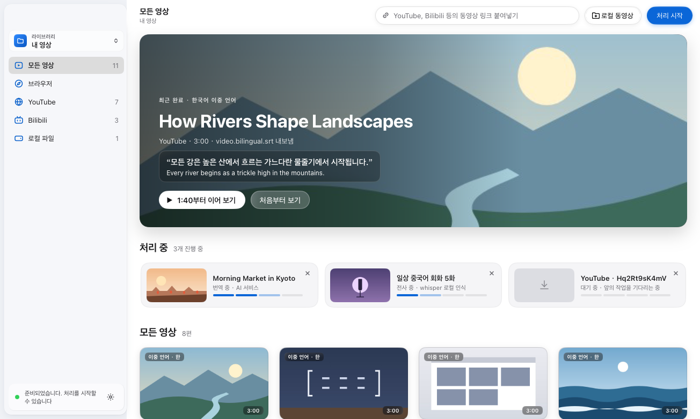
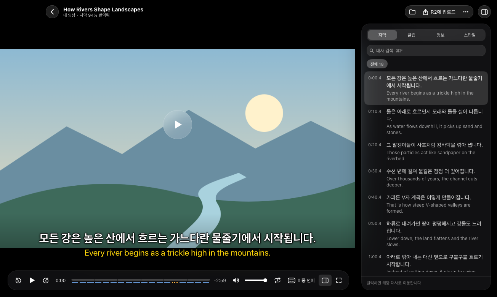
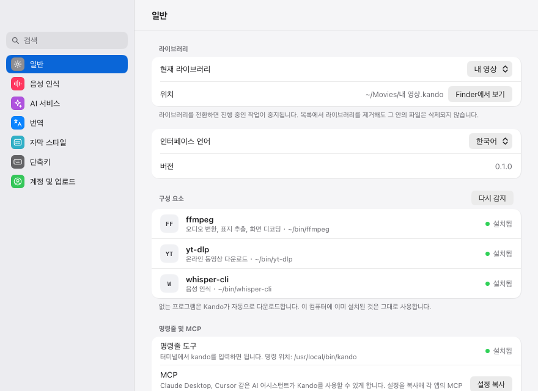
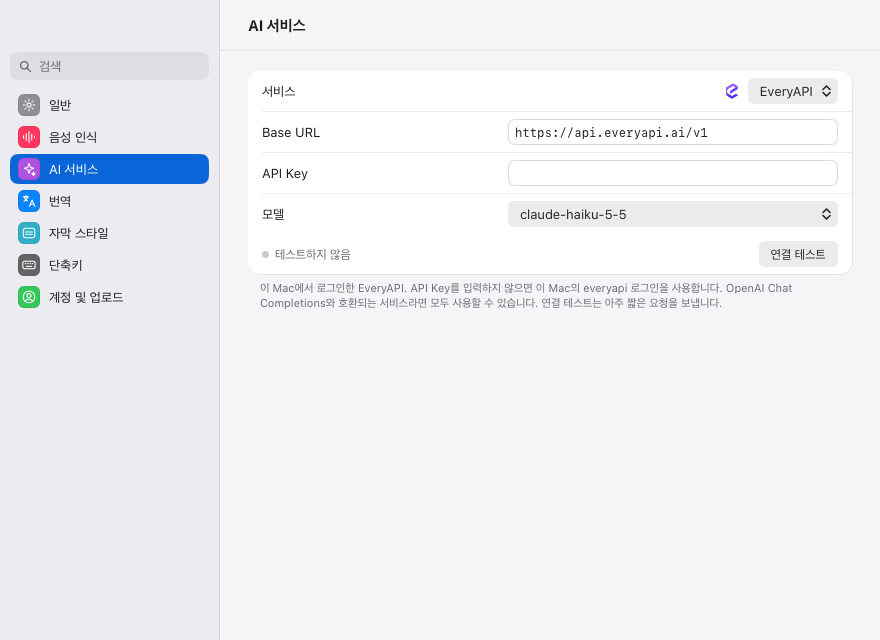

# Kando

[](https://github.com/yldm-tech/Kando/actions/workflows/ci.yml)
[](https://github.com/yldm-tech/Kando/actions/workflows/release.yml)
[](https://github.com/yldm-tech/Kando/releases)
[](LICENSE)
[](go.work)
[](#install)
[](https://github.com/yldm-tech/Kando/stargazers)

[English](README.md) · [简体中文](README.zh-CN.md) · [日本語](README.ja.md) · [繁體中文](README.zh-TW.md) · 한국어

Kando는 배우고 싶은 언어로 된 동영상을 보면서 그 언어를 공부하는 데스크톱 앱입니다. YouTube나 Bilibili 링크를 붙여 넣거나 동영상 파일을 창에 끌어다 놓으면, Kando가 yt-dlp로 동영상을 내려받고, whisper.cpp로 사용자의 컴퓨터에서 음성을 전사하고, OpenAI 호환 모델로 각 대사를 번역한 뒤, 원문 대사와 번역을 화면에 함께 띄워 원본 동영상을 재생합니다. Go로 작성되었고 [MyGo](https://github.com/egoist/mygo)와 [Breeze UI](https://github.com/yldm-tech/mygo-breeze-ui)로 네이티브 인터페이스를 렌더링하며, 웹 뷰는 사용하지 않습니다.



인터페이스는 한국어, 영어, 간체 중국어, 번체 중국어, 일본어로 제공됩니다. 처음에는 간체 중국어로 표시되므로 설정 › 일반 › 인터페이스 언어에서 바꾸세요. 창이 바로 선택한 언어로 바뀝니다. 아래에 인용한 레이블은 한국어 인터페이스에 표시되는 그대로입니다.

## 기능

- YouTube, Bilibili 또는 yt-dlp가 지원하는 다른 사이트의 링크를 붙여 넣거나(지원하는 사이트는 도움말 › 지원하는 웹사이트…에서 로고와 함께 볼 수 있습니다), 로컬 파일(mp4, mov, mkv, webm 등의 동영상 파일)을 고르거나 창에 끌어다 놓아 동영상을 추가합니다. 로컬 파일은 복사하지 않고 원래 위치에 둔 채로 전사합니다.
- 사이드바의 '브라우저'는 내장 브라우저입니다. 사이트를 열고 필요하면 로그인한 다음 '동영상 다운로드'를 클릭하면 보고 있는 페이지가 라이브러리에 추가됩니다. 이후의 다운로드는 '브라우저', 링크 입력란, 명령줄, MCP 어디에서 하든 여기서 로그인한 사이트의 로그인 상태를 그대로 씁니다. '로그인 정보 지우기…'를 누르면 그 모든 사이트에서 로그아웃됩니다.
- 작업은 다운로드, 전사, 번역, 내보내기를 거치며 하나씩 차례로 실행됩니다. 실패한 작업에는 실패 이유와 문제를 해결할 설정으로 가는 링크가 표시되며, 다시 시도하거나 제거할 수 있습니다.
- 음성은 whisper.cpp로 사용자의 컴퓨터에서 인식하며, whisper.cpp가 발화 언어를 자동으로 감지합니다. 설정 › 음성 인식에는 Tiny(77.7 MB)부터 Large v3(3.1 GB)까지 whisper 모델 7개가 나열되어 있으며, 선택한 모델을 Hugging Face에서 내려받습니다.
- 대사는 기본적으로 EveryAPI로 번역하며, OpenAI 호환 채팅 API라면 어떤 것이든 사용할 수 있습니다. 설정 › AI 서비스에는 OpenAI, OpenRouter, Groq, DeepSeek, xAI, Mistral, Qwen(DashScope), Kimi, Zhipu GLM, SiliconFlow, Ollama, LM Studio 프리셋과 사용자 지정 엔드포인트가 있습니다. 대상 언어, 모델이 앞선 대사를 읽도록 하는 문맥 인식 모드, 프롬프트는 설정 › 번역에서 바꿀 수 있습니다.
- 완료된 동영상마다 그 옆에 SubRip 파일 두 개가 생깁니다. 원문 대사가 담긴 `<video>.srt`와, 각 번역을 원문 대사 위에 둔 `<video>.bilingual.srt`입니다(내려받은 동영상은 `video.srt`와 `video.bilingual.srt`).
- 플레이어는 자막을 이중 언어, 원문만, 번역만, 끔 중 하나로 표시하며, 자막 지연은 0.1초 단위로 조정할 수 있고 스타일도 바꿀 수 있습니다. 이전·다음 대사로 이동하거나, 현재 대사를 다시 듣거나, 알아들을 때까지 한 대사를 반복할 수 있습니다. 사이드 패널은 모든 대사를 검색 기능과 함께 나열하고(대사를 클릭하면 해당 위치로 이동), 동영상을 약 30초 길이의 클립 4~12개로 나누며, 영상의 파일과 출처를 보여 줍니다. 각 영상은 시청을 멈춘 곳부터 이어서 재생됩니다.
- 라이브러리는 Finder나 파일 관리자에서 다룰 수 있는 일반 파일로 이루어진 `.kando` 폴더입니다. 여러 개를 두고 사이드바에서 전환할 수 있으며, 사이드바에서는 라이브러리를 출처별(YouTube, Bilibili, 기타 사이트, 로컬 파일)로 걸러 볼 수도 있습니다.
- 선택 사항으로, Google로 로그인한 뒤 플레이어에서 영상 파일과 이중 언어 자막을 자신의 오브젝트 스토리지(Cloudflare R2, Amazon S3, Alibaba Cloud OSS, Tencent Cloud COS 또는 S3 호환 스토리지)에 업로드할 수 있습니다. [구성](#configuration)을 참고하세요.
- 재생, 자막, 창을 다루는 키보드 단축키가 있으며, 단축키 목록(⌘/)과 설정 › 단축키에서 확인할 수 있습니다.
- 버그를 제보할 때 첨부할 수 있는 로그 파일이 있습니다. 도움말 › 로그 파일 보기(또는 명령 팔레트 ⌘K)로 파일을 보여 줍니다. macOS에서는 `~/Library/Logs/Kando/kando.log`, 다른 OS에서는 사용자 설정 폴더 안 `Kando/logs` 폴더의 `kando.log`입니다. 실패한 작업마다 실패한 이유(Kando가 보관하는 키와 AI 서비스 주소는 빼고)와 실패한 도구가 출력한 내용의 마지막 64 KB를 기록합니다. 키처럼 보이는 내용은 모두 `***`로 적습니다. 5 MB를 넘으면 새 파일을 시작하고 그 전의 두 파일을 남깁니다.



<a id="install"></a>

## 설치

<a id="download"></a>

### 다운로드

macOS(Apple 실리콘과 Intel)와 Linux(x86-64와 ARM64)용 빌드는 [GitHub Releases](https://github.com/yldm-tech/Kando/releases)에 있습니다. Windows용 빌드는 아직 없으므로 Windows에서는 아래 설명대로 소스에서 빌드하세요. 사용하는 시스템에 맞는 파일을 고르세요. `<version>`은 릴리스의 버전(예: `0.5.0`)입니다.

- macOS: Apple 실리콘 Mac은 `kando-<version>-arm64.dmg`, Intel Mac은 `kando-<version>-amd64.dmg`. 디스크 이미지를 열고 Kando를 응용 프로그램 폴더로 드래그합니다.
- Debian, Ubuntu와 그 파생 배포판: x86-64는 `kando_<version>_amd64.deb`, ARM64는 `kando_<version>_arm64.deb`. 내려받은 폴더에서 `sudo apt install ./kando_<version>_<arch>.deb`로 설치합니다.
- 그 밖의 Linux 배포판: 릴리스의 설치 스크립트를 실행합니다. 패키지를 직접 내려받을 필요가 없습니다.

  ```sh
  curl -fsSL https://github.com/yldm-tech/Kando/releases/latest/download/install.sh | sh
  ```

  컴퓨터에 맞는 최신 `kando-<version>-linux-<arch>.tar.gz`를 내려받아 서명을 확인하고, root 없이 현재 사용자에게만 Kando를 설치합니다. 앱은 `~/.local/kando.app`에, `kando` 명령은 `~/.local/bin`에 놓이고, 응용 프로그램 메뉴에도 항목이 추가됩니다. 서명을 확인하려면 OpenSSL 3.0 이상(Debian 12, Ubuntu 22.04, Fedora 36 이상)이 필요합니다. 그보다 오래된 OpenSSL에서는 스크립트가 아무것도 내려받지 않고 그 사실을 알려 줍니다. 이때는 같은 릴리스에서 컴퓨터에 맞는 `.tar.gz`와 `install.sh`를 파일 이름을 바꾸지 말고 같은 폴더에 내려받은 뒤 그 폴더에서 `sh install.sh`를 실행하세요. `.tar.gz`의 경로를 넘겨 `sh install.sh <아카이브>`로 실행해도 됩니다. 어느 쪽이든 그 아카이브를 서명 확인 없이 설치합니다. 스크립트를 다시 실행하면 새 버전을 덮어 설치하고, `sh install.sh --uninstall`은 설정과 라이브러리를 남기고 Kando를 제거합니다.

릴리스의 나머지 파일은 설치용이 아닙니다. `checksums.txt`는 모든 파일의 SHA-256 목록이고, `update-*.json` 매니페스트, `.delta` 파일, `darwin` 아카이브는 설치된 Kando가 스스로 업데이트할 때 내려받는 파일입니다([업데이트](#updates) 참고).

0.5.1 이후 릴리스의 macOS 디스크 이미지는 YLDM의 Developer ID로 서명되고 Apple의 공증을 받았으므로 macOS가 경고 없이 Kando를 엽니다.

<a id="updates"></a>

### 업데이트

Kando는 GitHub에 있는 서명된 릴리스로 스스로 업데이트합니다. 실행하고 10초 뒤에 백그라운드에서 확인하고, 그 뒤로는 하루에 한 번 확인합니다. 새 버전이 나오면 릴리스 노트를 보여 주는 창이 열리고 업데이트 설치, 나중에 알림, 이 버전 건너뛰기 중에서 고를 수 있습니다. 업데이트 설치는 새 버전을 내려받아 서명을 확인한 뒤, Kando를 다시 시작해 새 버전으로 바꿀지 묻습니다. 다시 시작하지 않으면 다음에 Kando를 실행할 때 새 버전이 열립니다. 건너뛴 버전은 백그라운드 확인에서 다시 알리지 않지만, 그다음 버전은 알립니다.

바로 확인하려면 macOS에서는 메뉴 막대의 Kando › 업데이트 확인…을 선택합니다. 메뉴 막대가 없는 Linux와 Windows에서는 명령 팔레트(Ctrl+K)에서 업데이트 확인…을 선택합니다. 설정 › 일반의 버전 옆에도 업데이트 확인… 버튼이 있으며, 그 아래에 마지막 확인에서 찾은 새 버전이나 마지막으로 확인한 시각이 표시됩니다. 자동으로 업데이트 확인, 자동으로 업데이트 다운로드 및 설치 스위치도 설정 › 일반에 있습니다. 업데이트를 내려받는 것은 백그라운드 확인뿐이므로 두 번째 스위치는 첫 번째 스위치가 켜져 있을 때만 나타납니다. 두 번째 스위치를 켜면 백그라운드 확인에서 찾은 새 버전을 묻지 않고 설치하며, 다음에 Kando를 실행할 때 새 버전이 열립니다.

자기 파일을 바꿀 수 없는 Kando는 스스로 업데이트하지 않습니다. `.deb`와 `PKGBUILD`가 그렇습니다. 둘 다 패키지 관리자가 관리하는 `/opt/kando`에 Kando를 설치하는데 Kando용 apt 저장소는 없으므로, 업데이트하려면 릴리스에서 새 `.deb`를 내려받아 같은 방법으로 설치하거나, 위의 설치 스크립트로 바꾸세요. 스크립트가 `~/.local/kando.app`에 설치한 Kando는 스스로 업데이트합니다. 이렇게 설치한 Kando에서는 설정 › 일반에 스위치가 나타나지 않고, 업데이트 확인…은 업데이트할 수 없는 이유를 알려 주는 창을 엽니다. Windows용 업데이트는 아직 게시되지 않았습니다.

### 소스에서 빌드

Go 1.27.3 이상에서:

```sh
git clone https://github.com/yldm-tech/Kando.git
cd Kando
make build
```

`make build`는 현재 플랫폼용으로 `go tool mygo build apps/kando`를 실행하고 결과물을 `apps/kando/build/<os>-<arch>/` 아래에 생성합니다. macOS에서는 ad-hoc 서명된 `Kando.app`과 `.dmg`가, 다른 플랫폼에서는 실행 파일이 만들어집니다(Linux에서는 `.deb`, 설치 스크립트가 든 `.tar.gz`, `PKGBUILD`도, Windows에서는 NSIS로 만든 설치 프로그램도 만들어집니다. NSIS가 설치되어 있지 않으면 mygo가 내려받습니다). 기본 Windows처럼 `make`가 없는 환경에서는 저장소 루트에서 `go tool mygo build apps/kando`를 직접 실행하세요.

## 요구 사항

Kando는 `yt-dlp`, `ffmpeg`, `whisper-cli`(whisper.cpp)를 실행합니다. macOS와 Linux에서는 직접 설치할 필요가 없습니다. Kando를 열 때 없는 프로그램이 있으면 자동으로 내려받고, 시작 가이드에 진행 상황이 표시됩니다. 이미 설치한 프로그램(Homebrew로 설치한 것 등)은 그대로 사용합니다.

| 프로그램 | 용도 | Kando가 내려받는 것 |
| --- | --- | --- |
| `yt-dlp` | 온라인 동영상 다운로드. Kando는 로컬 파일을 포함한 모든 작업에 이 프로그램을 요구합니다. | [yt-dlp 공식 릴리스](https://github.com/yt-dlp/yt-dlp/releases)의 단일 파일 빌드. |
| `ffmpeg` | 오디오 추출, 커버 이미지 추출, 플레이어의 화면과 소리 디코딩. 플레이어는 macOS, Linux, Windows 모두에서 시스템 오디오 출력으로 소리를 재생합니다. | FFmpeg 9.0.2(macOS용은 `ffplay` 포함). 이 저장소의 [tools 릴리스](https://github.com/yldm-tech/Kando/releases/tag/tools-1)에서. |
| `whisper-cli` (whisper.cpp) | 음성 인식. | whisper.cpp 1.9.5(macOS용은 Metal 사용). 같은 릴리스에서. |
| whisper.cpp ggml 모델 | 시작 가이드나 설정 › 음성 인식에서 내려받거나, `KANDO_WHISPER_MODEL`로 모델 파일을 지정합니다. | |

tools 릴리스는 Tools 워크플로(`.github/workflows/tools.yml`)가 `.github/tools.env`에 고정된 소스로 빌드하며, Kando는 내려받은 파일을 앱에 들어 있는 SHA-256으로 검증한 뒤에 사용합니다. 내려받은 프로그램은 `settings.json` 옆의 `tools` 폴더(macOS에서는 `~/Library/Application Support/Kando/tools`, Linux에서는 `~/.config/Kando/tools`)에 저장됩니다. Kando는 먼저 이곳을 찾고, 그다음 `PATH`와 `/opt/homebrew/bin`, `/usr/local/bin`, `/home/linuxbrew/.linuxbrew/bin`을 찾습니다. Finder나 데스크톱 런처에서 연 앱은 최소한의 `PATH`만 받기 때문입니다. 설정 › 일반에는 어떤 프로그램을 사용하는지 표시되고, 없는 프로그램은 다운로드나 다시 시도로 받을 수 있으며, 다시 감지를 누르면 다시 찾습니다. `yt-dlp`가 오래되어 다운로드에 실패하면 업데이트 후 다시 시도가 표시되며, 설치한 방식대로 업데이트한 뒤 다시 시도합니다.

Windows에서는 아직 자동으로 내려받지 않습니다. 패키지 관리자로 같은 프로그램을 설치하고 `PATH`에 들어 있는지 확인하세요.

## 시작하기

1. Kando를 엽니다. 아직 라이브러리가 없으면 새로운 라이브러리…와 기존 라이브러리 열기…를 보여 줍니다. 새 라이브러리는 따로 바꾸지 않으면 macOS에서는 `~/Movies`, 그 밖의 플랫폼에서는 `~/Videos`에 영상 라이브러리라는 이름으로 만들어집니다.
2. 시작 가이드가 없는 `ffmpeg`, `yt-dlp`, `whisper-cli`를 자동으로 내려받습니다. 설정(⌘,)을 열면 일반에 각 프로그램과 버전이 표시되고, 인터페이스 언어도 고를 수 있습니다.
3. 음성 인식에서 whisper 모델 옆의 다운로드를 클릭합니다. 다운로드가 끝나면 Kando가 그 모델을 선택합니다. 추천 표시가 붙은 모델은 Large v3 Turbo (압축 버전, 574 MB)입니다. Vimpo나 hyperframes가 이미 내려받은 모델은 복사하지 않고 선택할 수 있습니다.
4. AI 서비스에서 번역을 설정합니다.
   - EveryAPI(기본값): [EveryAPI](https://everyapi.ai) CLI로 `everyapi auth login`을 실행해 한 번 로그인합니다. Kando는 CLI에 키를 요청하므로(`everyapi auth credential`) CLI와 같은 로그인, 게이트웨이 리전, 키 갱신을 사용하며, 토큰을 붙여 넣을 필요가 없습니다. 기본 모델은 `claude-haiku-5-5`이며, `everyapi models list`로 다른 모델을 확인할 수 있습니다. 대신 API Key에 EveryAPI 키를 붙여 넣을 수도 있습니다.
   - 다른 제공자: 서비스에서 고르거나, OpenAI 호환을 고르고 Base URL을 입력한 뒤 모델과 API Key를 채웁니다(Ollama, LM Studio 같은 로컬 서버는 키가 필요 없습니다). 연결 테스트는 짧은 요청을 보내 설정을 확인합니다.
5. 번역에서 기본 대상 언어를 고릅니다: 중국어(간체)(기본값), 중국어(번체), 영어, 일본어, 한국어, 스페인어, 프랑스어, 독일어.
6. 창으로 돌아와 상단 바에 링크를 붙여 넣고 처리 시작을 클릭하거나, 로컬 동영상을 클릭하거나, 동영상을 창에 끌어다 놓습니다. 사이드바 하단의 상태 표시줄은 작업에 필요한 것이 모두 갖춰지면 "준비되었습니다. 처리를 시작할 수 있습니다"라고 표시하고, 그렇지 않으면 무엇이 빠졌는지 알려 줍니다.

번역 제공자에서 속도 제한이나 서버 오류가 발생하면 요청을 다시 보내며, 첫 시도를 포함해 최대 세 번까지 시도합니다.





<a id="command-line-and-mcp"></a>

## 명령줄과 MCP

Kando 프로그램은 명령줄 `kando`이자 AI 에이전트용 MCP 서버이기도 합니다. 아래 표의 명령과 함께 실행하면 Kando 앱을 조작하고, 명령 없이 실행하면 평소처럼 창을 엽니다.

`kando` 명령을 쓰려면:

- macOS: Kando를 응용 프로그램 폴더로 옮긴 다음, 설정 › 일반에서 명령줄 도구 옆의 설치를 클릭합니다. `/usr/local/bin`, `/opt/homebrew/bin`, `~/.local/bin` 중 처음으로 쓸 수 있는 폴더에 Kando를 가리키는 `kando` 링크를 만들며, 관리자 암호를 묻지 않고 다른 프로그램의 `kando`는 바꾸지 않습니다. 디스크 이미지에서 바로 열었거나, 다운로드 후 macOS가 임시 위치로 옮겨 실행할 때(App Translocation)는 Kando의 경로가 곧 사라지므로, 카드는 곧 끊어질 링크를 만드는 대신 먼저 Kando를 옮기라고 안내합니다. 직접 링크를 만들 수도 있습니다: `sudo ln -s /Applications/Kando.app/Contents/MacOS/Kando /usr/local/bin/kando`.
- Linux: `.deb`와 `PKGBUILD`는 앱을 `/opt/kando`에 설치하고 `/opt/kando/kando`를 가리키는 링크 `/usr/bin/kando`를 추가합니다. 설치 스크립트([다운로드](#download) 참고)는 앱을 `~/.local/kando.app`에 설치하고 이를 가리키는 `~/.local/bin/kando`를 만들며, 거기에 스크립트가 만들지 않은 `kando`가 있으면 그대로 둡니다. 셸의 `PATH`에 `~/.local/bin`이 없으면 추가하십시오.
- Windows: Windows에서 링크를 만들려면 관리자 권한이나 개발자 모드가 필요하므로 Kando는 명령을 설치할 수 없습니다. 설정 › 일반의 명령줄 도구 아래에 `Kando.exe`가 있는 폴더가 표시되니, 그 폴더를 `PATH`에 추가하세요. Windows는 파일 이름의 대소문자를 구분하지 않으므로 터미널에서 `kando`를 입력하면 Kando가 실행됩니다.

| 명령 | 하는 일 |
| --- | --- |
| `kando status` | 열려 있는 라이브러리, 사용 중인 프로그램과 모델, 작업을 시작할 수 있는지를 보여 주고, 시작할 수 없으면 무엇이 빠졌는지 알려 줍니다. |
| `kando list [--source S] [query]` | 라이브러리의 영상을 최신순으로 ID와 함께 나열합니다. `--source`는 한 출처(`youtube`, `bilibili`, `local` 또는 다른 사이트 이름)만 남기고, query는 제목에 그 문자열이 들어 있는 영상만 남깁니다. |
| `kando show <film-id>` | 영상 하나를 보여 줍니다: 출처, 단계, 동영상과 자막의 경로. |
| `kando subtitles <film-id> [--format srt\|text\|json] [--original\|--translation]` | 영상의 자막을 SubRip(기본값), 자막 하나당 한 줄인 텍스트(`text`) 또는 JSON으로 출력합니다. 두 언어 모두 또는 한쪽만 고를 수 있습니다. |
| `kando jobs` | 작업을 나열합니다: 실행 중인 작업, 대기 중인 작업, 끝난 작업 순입니다. |
| `kando add <link-or-file>... [--wait]` | 처리 시작과 같이 링크와 로컬 동영상 파일을 대기열에 추가하고 각 작업의 ID를 출력합니다. 상대 경로는 현재 디렉터리를 기준으로 합니다. |
| `kando cancel <job-id>` | 실행 중인 작업을 멈추거나 대기 중인 작업을 대기열에서 뺍니다. |
| `kando retry <job-id> [--wait]` | 다시 시도나 다시 처리와 같이 실패했거나 취소되었거나 완료된 작업을 같은 ID로 다시 대기열에 넣습니다. 창에 보이는 화면은 바꾸지 않습니다. 실행 중이거나 대기 중인 작업은 거절합니다. |
| `kando remove <job-id>` | 제거와 같이 작업을 라이브러리에서 뺍니다. 실행 중인 작업은 먼저 멈춥니다. 파일은 디스크에 남습니다. |
| `kando sites [query] [--limit N]` | Kando가 내려받을 수 있는 웹사이트를 이름, 도메인 또는 동영상 링크로 검색합니다. |
| `kando open [film-id]` | Kando를 맨 앞으로 가져와 지정한 영상을 보여 주고, ID가 없으면 라이브러리를 보여 줍니다. |
| `kando mcp` | 표준 입력과 표준 출력으로 MCP를 제공합니다(아래 참고). |
| `kando version` | 버전을 출력합니다. |
| `kando help [command]` | 명령 목록이나 한 명령의 사용법과 플래그를 보여 줍니다. |

앱이 필요한 명령은 `settings.json`이 있는 폴더의 소켓 `kando.sock`(macOS에서는 `~/Library/Application Support/Kando/kando.sock`, Linux에서는 `~/.config/Kando/kando.sock`, Windows에서는 `%AppData%\Kando\kando.sock`)을 통해 앱과 통신합니다. `KANDO_SOCKET`으로 다른 경로를 지정할 수 있으며, 두 번째 Kando를 실행할 때도 이것과 별도의 `HOME`이 필요합니다([구성](#configuration) 참고). Kando가 실행 중이 아니면 명령이 백그라운드에서 Kando를 시작하고, 표준 오류에 `Starting Kando…`를 출력한 뒤 최대 30초 기다립니다. 동영상을 추가하려면 처리 시작과 같은 것(열린 라이브러리, 프로그램, whisper 모델 등)이 필요하며, 빠진 것이 있으면 `kando add`는 창에 표시되는 것과 같은 메시지로 실패합니다.

앱과 통신하는 명령은 모두 `--json`을 받으며, 앱의 응답을 텍스트 대신 JSON으로 출력합니다. 추가하지 못한 출처가 있으면 `kando add`는 종료 코드 1로 끝납니다. `--wait`를 붙이면 추가한 작업이 모두 완료되거나 실패할 때까지 기다리면서 작업의 단계나 진행률이 바뀔 때마다 한 줄씩 출력하고, 실패한 작업이 하나라도 있으면 마찬가지로 종료 코드 1로 끝납니다. `--json`을 함께 쓰면 진행 상황은 표준 오류로, 끝난 시점의 작업은 표준 출력으로 나갑니다. `kando retry --wait`도 다시 대기열에 넣은 작업을 같은 방식으로 기다립니다. 종료 코드는 성공 0, 실패 1, 명령을 잘못 사용한 경우 2입니다.

`kando mcp`는 표준 입력과 표준 출력으로 동작하는 MCP 서버입니다. Kando가 실행 중이 아니면 도구가 같은 방식으로 Kando를 시작합니다.

| 도구 | 하는 일 |
| --- | --- |
| `kando_status` | 앱 버전, 열려 있는 라이브러리, 작업을 시작할 수 있는지와 빠진 것, 프로그램, 음성 인식과 번역 모델, 대상 언어, 실행 중이거나 대기 중인 작업. |
| `kando_list_films` | 열려 있는 라이브러리의 영상을 최신순으로 돌려주며, `source`나 제목의 단어(`query`)로 거를 수 있습니다. |
| `kando_get_film` | ID로 지정한 영상 하나: 단계, 대상 언어, 동영상과 자막의 경로. |
| `kando_get_subtitles` | 처리가 끝난 영상의 타임스탬프가 붙은 자막. 두 언어 모두 또는 한쪽만(`which`), 간결한 텍스트 또는 SRT(`format`)로 받을 수 있고, `max_cues`를 지정하면 앞에서부터 그 줄 수만 돌려줍니다. |
| `kando_add_videos` | 링크와 로컬 동영상 파일을 대기열에 추가하고, 작업과 추가하지 못한 출처마다 건너뛴 이유를 돌려줍니다. |
| `kando_list_jobs` | 작업의 단계, 진행률, 상태, 오류, 그리고 완료 후에는 영상 ID와 파일 경로. |
| `kando_cancel_job` | 실행 중인 작업을 멈추거나 대기 중인 작업을 대기열에서 뺍니다. |
| `kando_retry_job` | 실패했거나 취소되었거나 완료된 작업을 같은 ID로 다시 대기열에 넣고 그 작업을 돌려줍니다. |
| `kando_remove_job` | 작업을 라이브러리에서 뺍니다. 실행 중인 작업은 먼저 멈추고, 파일은 디스크에 남습니다. |
| `kando_search_sites` | Kando가 내려받을 수 있는 웹사이트를 이름, 도메인 또는 동영상 링크로 검색합니다(`limit`을 지정하지 않으면 20개). |
| `kando_open` | Kando 창을 맨 앞으로 가져와 영상이나 라이브러리를 보여 줍니다. |

Claude Code에는 프로그램 경로로 추가합니다. `kando`가 `PATH`에 있으면 `kando`만 써도 됩니다.

```sh
claude mcp add kando -- /Applications/Kando.app/Contents/MacOS/Kando mcp
```

다른 MCP 클라이언트는 `mcpServers` 설정에 같은 명령을 적습니다.

```json
{
  "mcpServers": {
    "kando": {
      "command": "/Applications/Kando.app/Contents/MacOS/Kando",
      "args": ["mcp"]
    }
  }
}
```

WebMCP를 지원하는 브라우저에서는 랜딩 페이지 [kando.yldm.ai](https://kando.yldm.ai)가 브라우저 에이전트에게 WebMCP 도구를 제공합니다: `search_supported_sites`는 Kando가 어떤 웹사이트에서 내려받을 수 있는지 확인하고, `get_download`는 시스템에 맞는 다운로드 링크를, `get_started`는 시작 단계를 돌려주며, `list_features`는 Kando의 기능을 나열합니다.

<a id="configuration"></a>

## 구성

Google 클라이언트 ID와 시크릿, `KANDO_SOCKET`을 제외한 아래 항목은 모두 앱에서도 설정할 수 있습니다(라이브러리는 사이드바에서, 나머지는 설정에서). 환경 변수가 설정되어 있으면 앱에 저장된 값 대신 그 값을 사용합니다.

| 변수 | 기본값 | 의미 |
| --- | --- | --- |
| `KANDO_WHISPER_MODEL` | 설정 › 음성 인식에서 선택한 모델 | whisper.cpp ggml 모델 파일의 경로(예: `ggml-small.bin`). |
| `KANDO_LLM_BASE_URL` | EveryAPI, `https://api.everyapi.ai/v1` | OpenAI 호환 제공자의 Base URL(예: `https://api.openai.com/v1`, Ollama는 `http://localhost:11434/v1`). 설정하면 로그인한 EveryAPI 계정을 사용하지 않습니다. |
| `KANDO_LLM_MODEL` | EveryAPI에서는 `claude-haiku-5-5` | 번역 모델. 사용자 지정 제공자에는 기본값이 없으므로 여기나 설정 › AI 서비스에서 지정합니다. |
| `KANDO_LLM_API_KEY` | 없음 | 번역 제공자용 Bearer 토큰. 로그인한 EveryAPI 계정보다 우선합니다. |
| `EVERYAPI_API_KEY` | 없음 | EveryAPI 키. `KANDO_LLM_BASE_URL`이 설정되지 않고 `KANDO_LLM_API_KEY`가 비어 있을 때 CLI 로그인 대신 사용합니다. |
| `KANDO_OUTPUT_DIR` | 마지막으로 연 라이브러리 | 시작할 때 열 라이브러리 폴더. 새 동영상과 자막이 이곳에 저장됩니다. |
| `KANDO_SOCKET` | `settings.json` 옆의 `kando.sock` | 앱이 대기하고 `kando` 명령줄과 `kando mcp`가 연결하는 소켓의 경로. 앱과 명령 양쪽에 같은 경로를 설정합니다. Kando는 사용자당 하나만 실행되며, 다시 실행하면 이미 실행 중인 Kando가 앞으로 나옵니다. `KANDO_SOCKET`을 설정해 시작한 것은 개발용처럼 일부러 실행하는 두 번째 Kando이며, 자신의 라이브러리와 설정을 쓰도록 별도의 `HOME`도 필요합니다. [명령줄과 MCP](#command-line-and-mcp)를 참고하세요. |
| `KANDO_GOOGLE_CLIENT_ID` | 없음 | 설정 › 계정 및 업로드에서 로그인할 때 쓰는 Google OAuth 클라이언트 ID. 없으면 로그인 버튼이 비활성화됩니다. 설정 파일에는 저장되지 않습니다. |
| `KANDO_GOOGLE_CLIENT_SECRET` | 없음 | 같은 OAuth 클라이언트의 클라이언트 시크릿(선택 사항). |
| `KANDO_STORAGE` | `r2` | 업로드 대상: `r2`, `s3`(또는 `aws`), `oss`(또는 `aliyun`), `cos`(또는 `tencent`), `compat`(또는 `s3compat`). 그 밖의 값은 R2로 간주합니다. |
| `KANDO_R2_ENDPOINT` | 없음 | Cloudflare R2: 계정 ID 또는 전체 `https://` 엔드포인트. |
| `KANDO_R2_BUCKET`, `KANDO_R2_ACCESS_KEY`, `KANDO_R2_SECRET` | 없음 | Cloudflare R2 버킷과 키. |
| `KANDO_S3_REGION` | 없음 | Amazon S3 리전 이름(예: `ap-northeast-1`). |
| `KANDO_S3_BUCKET`, `KANDO_S3_ACCESS_KEY`, `KANDO_S3_SECRET` | 없음 | Amazon S3 버킷과 키. |
| `KANDO_OSS_REGION` | 없음 | Alibaba Cloud OSS 리전 이름(예: `cn-hangzhou`, 내부 네트워크는 `cn-hangzhou-internal`). |
| `KANDO_OSS_BUCKET`, `KANDO_OSS_ACCESS_KEY`, `KANDO_OSS_SECRET` | 없음 | Alibaba Cloud OSS 버킷과 키. |
| `KANDO_COS_REGION` | 없음 | Tencent Cloud COS 리전 이름(예: `ap-guangzhou`). |
| `KANDO_COS_BUCKET`, `KANDO_COS_ACCESS_KEY`, `KANDO_COS_SECRET` | 없음 | Tencent Cloud COS 버킷(이름에 APPID가 포함됨, 예: `video-1250000000`), SecretId, SecretKey. |
| `KANDO_S3COMPAT_ENDPOINT` | 없음 | 다른 S3 호환 스토리지의 전체 `https://` 엔드포인트. |
| `KANDO_S3COMPAT_REGION` | 없음 | 그 스토리지의 서명 리전. MinIO는 보통 `us-east-1`을 사용합니다. |
| `KANDO_S3COMPAT_BUCKET`, `KANDO_S3COMPAT_ACCESS_KEY`, `KANDO_S3COMPAT_SECRET` | 없음 | 그 스토리지의 버킷과 키. |
| `KANDO_S3COMPAT_PATH_STYLE` | 꺼짐 | `1`, `true`, `yes`, `on`은 MinIO에 필요한 경로 스타일 주소 지정을 켜고, `0`, `false`, `no`, `off`는 끕니다. |

업로드는 수동으로만 합니다. 영상을 열고 플레이어에서 R2에 업로드(다른 스토리지를 골랐다면 그 이름)를 클릭합니다. Kando는 동영상과 이중 언어 자막을 `<Google 계정 이메일>/<라이브러리>/<영상 폴더>/<파일>` 아래에 업로드하며, 로그인은 누가 업로드했는지만 나타냅니다. 동영상은 자동으로 업로드되지 않습니다.

## 라이브러리와 설정

라이브러리는 이름이 `.kando`로 끝나는 폴더입니다. 내려받은 영상마다 그 안에 `<title> [<video id>]/` 폴더가 따로 생기고, 여기에 `video.mp4`, `cover.jpg`, `video.srt`, `video.bilingual.srt`가 들어 있습니다. 모두 일반 파일입니다. Kando가 라이브러리 폴더를 감시하므로 Finder나 파일 관리자에서 추가하거나 삭제한 동영상이 라이브러리에 반영됩니다. macOS에서는 `.kando` 폴더가 Finder에서 Kando 마크가 들어간 폴더 아이콘으로 표시됩니다.

라이브러리에서 영상을 제거하면 그 영상의 폴더가 휴지통으로 이동합니다. 그 폴더에 다른 동영상이나 폴더도 들어 있으면 해당 동영상과 자막만 이동합니다. 라이브러리 폴더 밖에 있는 로컬 동영상은 그 자리에 그대로 남고 목록에서만 빠집니다. 목록에서 라이브러리를 제거해도 그 폴더는 디스크에 남습니다.

Kando는 자체 파일을 사용자 설정 디렉터리에 보관합니다. macOS에서는 `~/Library/Application Support/Kando`, Windows에서는 `%AppData%\Kando`, Linux에서는 `~/.config/Kando`입니다.

- `library.json`: 완료된 작업과 진행 중인 작업, 그리고 각 동영상의 재생이 멈춘 위치.
- `settings.json`: API 키, 오브젝트 스토리지 키, Google 리프레시 토큰을 포함한 설정이 평문으로 저장됩니다. 이 파일은 현재 사용자 계정만 읽을 수 있습니다.
- `window-state.json`: 창 크기와 위치.
- `updater.json`: 업데이트에 관한 선택(설정 › 일반의 두 스위치, 건너뛴 버전)과 Kando가 마지막으로 업데이트를 확인한 시각.
- `models/`: 설정 › 음성 인식에서 내려받은 whisper 모델.

이름이 `video.*`가 아닌 동영상의 커버 이미지는 macOS에서는 `~/Library/Caches/Kando/posters`, Windows에서는 `%LocalAppData%\Kando\posters`, Linux에서는 `~/.cache/Kando/posters`에 캐시됩니다.

## LingoCut에서 업그레이드

Kando의 이전 이름은 LingoCut이었으며, 이전 이름으로 된 폴더, 라이브러리, 환경 변수는 더 이상 읽지 않습니다. 라이브러리와 설정을 유지하려면 다음과 같이 합니다.

1. 앱을 종료합니다.
2. 설정 폴더 이름을 `LingoCut`에서 `Kando`로 바꿉니다. macOS는 `~/Library/Application Support/LingoCut`, Windows는 `%AppData%\LingoCut`, Linux는 `~/.config/LingoCut`입니다. 이 폴더에는 `library.json`, `settings.json`, `window-state.json`, 내려받은 모델이 들어 있습니다.
3. 설정 폴더 이름을 바꾼 뒤, 앱을 실행하기 전에 각 라이브러리 이름을 `X.lingocut`에서 `X.kando`로 바꿉니다. macOS와 Linux에서는 저장된 inode 덕분에 앱이 이름이 바뀐 라이브러리를 모두 따라갈 수 있습니다. Windows에서는 앱이 사라진 라이브러리 하나를 같은 상위 폴더에 있는 새 `.kando` 폴더 하나와만 짝지을 수 있으므로, 한 폴더에서 한 번에 라이브러리 하나씩 이름을 바꾸고 바꿀 때마다 앱을 한 번 실행하세요.
4. 각 환경 변수 이름을 `LINGOCUT_*`에서 `KANDO_*`로 바꿉니다.
5. Kando를 실행하고 설정 › 음성 인식에서 음성 인식 모델을 다시 선택합니다. 모델 파일은 폴더와 함께 옮겨져 다운로드됨으로 표시되지만, 저장된 선택은 여전히 이전 경로를 가리킵니다.
6. 이전 이름으로 남은 것을 삭제합니다. `lingocut.app`과 `lingocut Dev.app`, 커버 이미지 캐시 `~/Library/Caches/LingoCut`(Windows는 `%LocalAppData%\LingoCut`, Linux는 `~/.cache/LingoCut`), Linux의 소문자 `~/.config/lingocut`, 그리고 `make dev`를 실행한 적이 있다면 `~/Library/Application Support/lingocut Dev`입니다.

## 개발

Go 1.27.3 이상이 필요합니다.

```sh
make test   # go test for packages/core, packages/media and apps/kando
make dev    # run the app with live reload
make build  # build the app for this platform into apps/kando/build
```

`make dev`는 `tools/mygo-dev`로 패치한 MyGo의 `mygo dev`를 실행합니다. macOS에서는 리로드할 때 실행 중인 창을 먼저 종료하지 않고 새 빌드가 자기 창을 띄울 때까지 유지하므로, 변경 사항을 저장해도 앱이 종료되는 것처럼 보이지 않습니다. MyGo를 업그레이드한 뒤 패치가 더 이상 적용되지 않으면 경고를 표시하고 기본 `go tool mygo dev`로 돌아갑니다. 그때는 새 `cmd/mygo/dev.go`에 맞춰 `tools/mygo-dev/dev.go.patch`를 갱신하세요. 이를 실행하는 `tools/mygo-dev/dev.sh`는 POSIX 셸 스크립트입니다.

스크린샷 테스트는 고정된 데모 라이브러리로 주요 화면을 PNG 파일로 렌더링합니다. 가짜 `ffmpeg`, `yt-dlp`, `whisper-cli`가 있는 빈 가짜 홈 폴더에서 실행되므로 사용자의 설정, 라이브러리, 도구를 읽지 않습니다.

```sh
KANDO_SCREENSHOTS=/tmp/kando-shots go test ./apps/kando/... -run TestScreenshots
```

`KANDO_SCREENSHOTS_LANG`(`en`, `zh-Hans`, `zh-Hant`, `ja`, `ko`)을 지정하면 해당 인터페이스 언어로 렌더링하고, 데모 라이브러리도 그 언어 사용자에게 맞는 내용으로 바뀝니다. `-run TestScreenshotsReadme`는 각 언어 README에 쓰이는 이미지 4장을 렌더링하며, 이미지는 `docs/assets/<언어>/`에 있습니다.

저장소 구성:

- `apps/kando`: 앱. 화면마다 자체 디렉터리가 있으며(`sidebar/`, `films/`, `film/`, `settings/`, `account/`, `cheatsheet/`), `view.go`가 창과 이 화면들을 연결합니다. `shelf/`는 작업 기록, `cloud/`는 Google 로그인과 오브젝트 스토리지 업로드, `brand/`는 라이브러리의 Finder 아이콘입니다.
- `packages/core`: 플랫폼에 독립적인 작업, 단계, 링크 파싱.
- `packages/media`: 미디어 파이프라인(다운로드, 전사, 번역, 자막 내보내기, 커버, 라이브러리).
- `tools/mygo-dev`: `make dev`가 사용하는 패치된 `mygo dev`.

[AGENTS.md](AGENTS.md)에는 인터페이스를 컴포넌트로 나누는 방식과 각 영역이 따르는 규칙이 설명되어 있습니다. UI를 바꾸기 전에 읽어 보세요.

## CI와 릴리스

[CI](https://github.com/yldm-tech/Kando/actions/workflows/ci.yml) 워크플로는 풀 리퀘스트와 `main`을 빌드하고 테스트합니다. [Release](https://github.com/yldm-tech/Kando/actions/workflows/release.yml) 워크플로는 `main`에서 CI가 통과한 뒤 또는 수동으로 실행됩니다. 마지막 태그 이후의 Conventional Commits로 다음 버전을 정해 `main`에 `chore(release)`로 커밋하고 태그를 붙인 뒤, Developer ID나 코드 서명 인증서 없이 macOS, Windows, Linux용 패키지를 빌드하고, 설치된 Kando가 내려받을 업데이트에 서명한 뒤, macOS와 Linux용 패키지를 체크섬과 함께 GitHub 릴리스로 게시합니다. Windows용 설치 프로그램은 빌드되지만 아직 게시되지 않습니다.

## 라이선스

[MIT](LICENSE)
