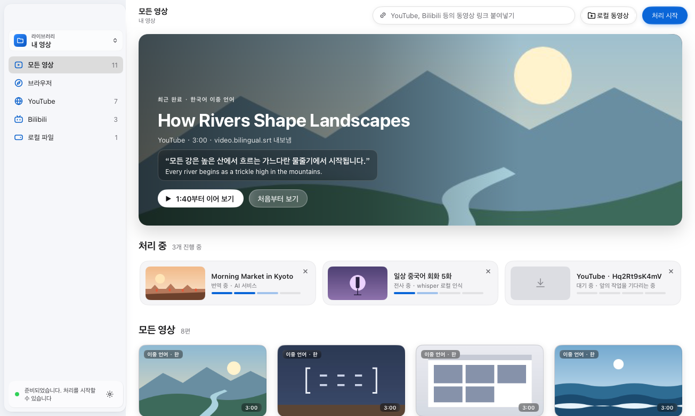
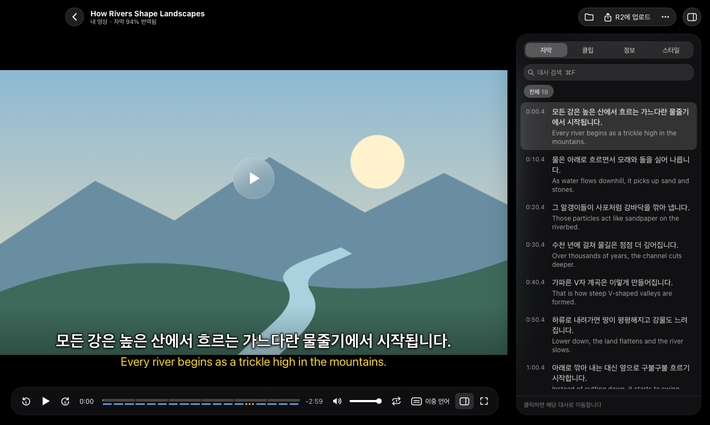
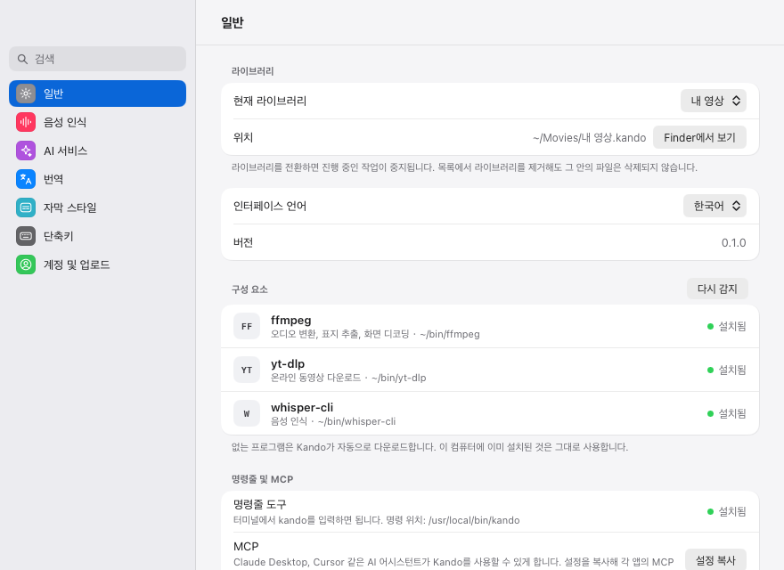
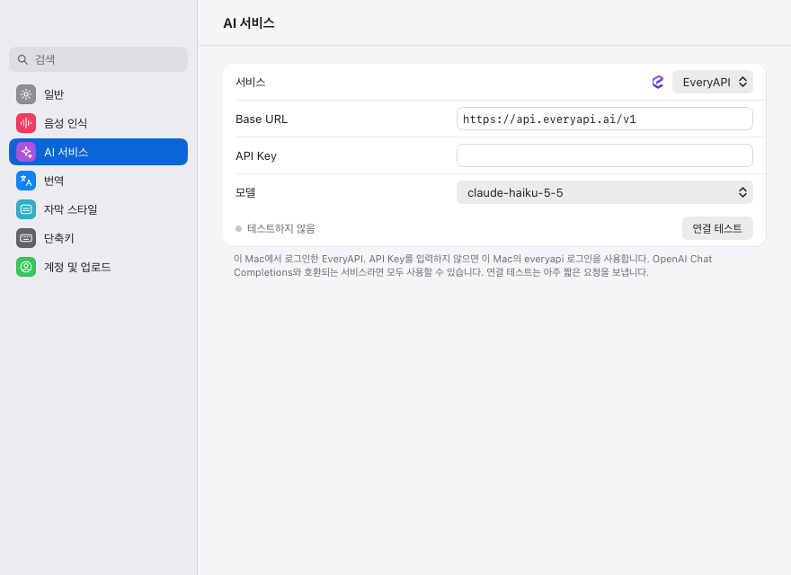

# Kando

[](https://github.com/yldm-tech/Kando/actions/workflows/ci.yml)
[](https://github.com/yldm-tech/Kando/actions/workflows/release.yml)
[](https://github.com/yldm-tech/Kando/releases)
[](LICENSE.md)
[](go.work)
[](#install)
[](https://github.com/yldm-tech/Kando/stargazers)
[](https://x.com/suzukaze_haduki)
[](https://github.com/sponsors/houko)

[English](README.md) · [简体中文](README.zh-CN.md) · [日本語](README.ja.md) · [繁體中文](README.zh-TW.md) · 한국어

Kando는 배우고 싶은 언어로 된 동영상을 보면서 그 언어를 공부하는 데스크톱 앱입니다. YouTube나 Bilibili 링크를 붙여 넣거나 동영상 파일이나 동영상이 든 폴더를 창에 끌어다 놓으면, Kando가 yt-dlp로 동영상을 내려받고, whisper.cpp로 사용자의 컴퓨터에서 음성을 전사하고, OpenAI 호환 모델로 각 대사를 번역한 뒤, 원문 대사와 번역을 화면에 함께 띄워 원본 동영상을 재생합니다. Go로 작성되었고 [NSGo](https://github.com/nsgo-dev/nsgo)로 네이티브 인터페이스를 렌더링하며, 웹 뷰는 사용하지 않습니다.



인터페이스는 한국어, 영어, 간체 중국어, 번체 중국어, 일본어로 제공됩니다. 처음에는 간체 중국어로 표시되므로 설정 › 일반 › 인터페이스 언어에서 바꾸세요. 창이 바로 선택한 언어로 바뀝니다. 아래에 인용한 레이블은 한국어 인터페이스에 표시되는 그대로입니다.

## 기능

- YouTube, Bilibili 또는 yt-dlp가 지원하는 다른 사이트의 링크를 붙여 넣거나(지원하는 사이트는 도움말 › 지원하는 웹사이트…에서 로고와 함께 볼 수 있습니다), 로컬 파일(mp4, mov, mkv, webm 등의 동영상 파일)을 고르거나 창에 끌어다 놓아 동영상을 추가합니다. 로컬 파일은 복사하지 않고 원래 위치에 둔 채로 전사합니다. 창에 끌어다 놓은 폴더에서는 그 안의 동영상과 바로 아래 각 폴더의 동영상을 이름 순서(숫자는 크기 순서라 Episode 2가 Episode 10보다 먼저)로 추가합니다. 동영상이 아닌 파일은 빼고, 그 수를 메시지 표시줄에 알려 줍니다.
- 재생목록이나 채널 링크를 붙여 넣으면 Kando가 그 동영상 목록을 불러와 모두 몇 개이고 그중 몇 개가 이미 라이브러리에 있는지 알려 주고, 확인하면 동영상마다 별도의 작업으로 추가합니다. 채널에서는 최신 동영상 50개를 가져옵니다. YouTube 재생목록 안의 동영상 링크는 그 동영상만 추가하며, 이어서 메시지 표시줄에 '재생목록 전체 추가'가 나타납니다. 공백이나 줄바꿈으로 구분한 여러 링크를 한 번에 붙여 넣으면 함께 추가됩니다.
- 사이드바의 ‘브라우저’는 내장 브라우저입니다. 사이트를 열고 필요하면 로그인한 다음 ‘동영상 다운로드’를 클릭하면 보고 있는 페이지가 라이브러리에 추가됩니다. 재생목록이나 채널 페이지에서는 ‘동영상 모두 다운로드’가 됩니다. YouTube, Bilibili, Vimeo, TED, 니코니코 동화, Dailymotion, TikTok에서는 페이지 안에도 Kando의 버튼이 나타납니다. 동영상 아래의 ‘동영상 다운로드’와, 페이지에 나열된 동영상 썸네일마다 붙는 ‘+’입니다. ‘+’는 동영상이 대기 중이거나 처리 중일 때는 시계로, 라이브러리에 들어가면 체크 표시로 바뀌며, 라이브러리에 있는 동영상을 클릭하면 라이브러리에서 보여 줍니다. 링크 입력란 옆과 빈 라이브러리 페이지에 있는 ‘사이트 둘러보기’를 누르면 이 브라우저가 열립니다. [브라우저 확장 프로그램](#browser-extension)을 쓰면 평소 쓰는 브라우저에도 같은 버튼이 나타납니다. ‘설정 › 일반 › 브라우저 로그인’에서 Chrome, Edge, Firefox, Safari 같은 브라우저를 고르면 ‘브라우저’와 다운로드가 그 브라우저의 로그인을 사용합니다. YouTube, Bilibili, TED, NHK, 니코니코 동화, BBC, Vimeo, Dailymotion, TikTok, X의 페이지는 그 브라우저에서처럼 로그인된 채로 열리고, 멤버십 전용 동영상과 연령 확인이 필요한 동영상도 처음부터 다운로드됩니다. Kando는 그 사이트들의 쿠키와 YouTube 로그인에 쓰이는 Google 쿠키만 복사하고 다른 사이트의 쿠키는 복사하지 않습니다. 브라우저가 어떤 쿠키를 페이지 스크립트에서 숨기는지(HttpOnly)를 yt-dlp가 알려 주지 않으므로, Kando는 사이트가 그렇게 설정하는 것을 확인한 쿠키에만 표시를 하고 나머지는 스크립트가 읽을 수 있게 둡니다. 사이트 자체 스크립트가 그중 일부를 읽기 때문입니다. 쿠키는 브라우저를 고를 때, 실행 후 ‘브라우저’를 처음 열 때, ‘브라우저’ 시작 페이지에서 ‘로그인 새로 고침’을 클릭할 때만 복사합니다. 그래서 Mac에서 키체인이 Chrome, Edge, Brave의 키를 묻는 것도 이때뿐이고 Kando를 실행할 때는 묻지 않습니다. 설정을 꺼도 ‘브라우저’의 페이지가 받은 로그인은 지워지지 않습니다([nsgo-dev/nsgo#112](https://github.com/nsgo-dev/nsgo/issues/112)). Safari의 로그인에는 Kando의 전체 디스크 접근 권한이 필요하고, Windows의 Chrome 로그인은 아직 읽을 수 없으며, Google은 평소 브라우저보다 일찍 다시 로그인하라고 할 수 있습니다. ‘브라우저’ 안에서 직접 로그인한 상태는 아직 다운로드에 쓰이지 않습니다([nsgo-dev/nsgo#112](https://github.com/nsgo-dev/nsgo/issues/112)). 설정이 꺼져 있으면 로그인이 필요한 동영상은 다운로드에 실패하며, Kando가 대신 브라우저에 로그인된 계정을 쓰도록 제안합니다.
- 작업은 다운로드, 전사, 번역, 내보내기를 거치며 하나씩 차례로 실행됩니다. 실패한 작업에는 실패 이유와 문제를 해결할 설정으로 가는 링크가 표시되며, 다시 시도하거나 제거할 수 있습니다. 동영상은 다운로드가 끝나면 작업이 계속되는 동안에도 카드에서 볼 수 있고, 전사가 끝나면 원문 자막이 표시됩니다.
- 음성은 whisper.cpp로 사용자의 컴퓨터에서 인식하며, whisper.cpp가 발화 언어를 자동으로 감지합니다. 설정 › 음성 인식에는 Tiny(77.7 MB)부터 Large v3(3.1 GB)까지 whisper 모델 7개가 나열되어 있으며, 선택한 모델을 Hugging Face에서 내려받습니다. 다운로드 소스를 hf-mirror.com으로 바꾸면 그 미러에서 내려받습니다(중국 본토처럼 Hugging Face에 접속하기 어려운 곳에서 유용합니다). Hugging Face에서 내려받지 못했을 때는 오류 옆의 ‘hf-mirror.com에서 다운로드’가 다운로드 소스를 바꾸고 모델을 다시 내려받습니다. 어느 소스에서 받든 Kando에 고정된 모델의 SHA-256과 크기로 검사합니다.
- 대사는 기본적으로 EveryAPI로 번역하며, OpenAI 호환 채팅 API라면 어떤 것이든 사용할 수 있습니다. 설정 › AI 서비스에는 OpenAI, OpenRouter, Groq, DeepSeek, xAI, Mistral, Qwen(DashScope), Kimi, Zhipu GLM, SiliconFlow, Ollama, LM Studio 프리셋과 사용자 지정 엔드포인트가 있습니다. 대상 언어, 모델이 앞선 대사를 읽도록 하는 문맥 인식 모드, 프롬프트는 설정 › 번역에서 바꿀 수 있습니다. 번역이 없는 완료된 영상(AI 서비스를 설정하지 않았을 때 등)에는 ‘번역’이 있습니다. AI 서비스를 설정해 두면 영상 그리드 위의 ‘N편 번역’으로 그리드에 보이는 그런 영상을 한꺼번에 번역할 수 있고, AI 서비스를 설정할 때 메시지 표시줄에도 같은 버튼이 나타납니다. 영상 메뉴와 플레이어의 ‘⋯’ 메뉴에 있는 ‘다시 번역할 언어’는 다시 내려받거나 전사하지 않고 다른 언어로 번역하며, ‘번역 안 된 대사 번역’은 번역에 실패한 대사만 번역합니다.
- 완료된 동영상마다 그 옆에 SubRip 파일 두 개가 생깁니다. 원문 대사가 담긴 `<video>.srt`와, 각 번역을 원문 대사 위에 둔 `<video>.bilingual.srt`입니다(내려받은 동영상은 `video.srt`와 `video.bilingual.srt`). 로컬 동영상 옆에 Kando가 쓰지 않은 `<video>.srt`가 이미 있으면 그 파일은 그대로 두고, Kando의 전사는 `<video>.kando.srt`에 저장합니다.
- 번역하기 전에 AI 서비스가 전사를 교정합니다. 영상 제목과 다른 대사를 참고해 음성 인식이 잘못 들은 말(소리가 같은 말, 이름, 영상 주제의 용어 등)을 고칩니다. Kando는 한 단어를 다른 단어로 바꾸는 수정만 받아들이므로 대사가 다르게 고쳐 쓰이지 않으며, 같은 수정이 두 대사 이상에 있으면 영상의 같은 말을 모두 고칩니다. 자막 언어로 말하는 영상(대상 언어가 한국어인 한국어 영상 등)은 교정만 하고 번역하지 않으며, 자막은 그 영상 자신의 대사입니다. 교정 기능 이전에 처리한 영상은 ‘다시 번역할 언어’나 ‘번역 안 된 대사 번역’을 쓰면 먼저 교정됩니다.
- 플레이어는 자막을 이중 언어, 원문만, 번역만, 끔 중 하나로 표시하며, 자막 지연은 0.1초 단위로 조정할 수 있고 스타일은 사이드 패널이나 설정 › 자막 스타일에서 바꿀 수 있습니다. 이전·다음 대사로 이동하거나(A, D), 현재 대사를 다시 듣거나(R), 알아들을 때까지 한 대사를 반복할 수 있고(L), ‘반복을 다음 대사까지 늘리기’(Shift+L)로 다음 대사까지 반복에 넣어 한 문장이나 대화를 통째로 되풀이할 수 있습니다. ‘대사마다 일시 정지’(P)는 따라 말하거나 받아 적을 수 있게 대사가 끝날 때마다 멈추며, Space로 이어서 재생합니다. ‘이 대사를 이중 언어로 보기’(T)는 자막 표시 방식과 관계없이 지금 재생 중인 대사를 두 언어로 보여 줍니다. 사이드 패널은 모든 대사를 검색 기능과 함께 나열하고(대사를 클릭하면 해당 위치로 이동), 동영상을 대사가 시작하는 곳에서 끊어 최대 12개의 클립으로 나누며, 영상의 파일과 출처를 보여 줍니다. 각 영상은 시청을 멈춘 곳부터 이어서 재생됩니다.
- 학습 도구는 지금 재생 중인 대사, 또는 방금 들은 대사에 적용됩니다. ‘이 대사 저장’(B, 또는 사이드 패널에서 대사의 오른쪽 클릭 메뉴)은 대사를 라이브러리의 저장한 대사에 넣고, 학습 › 저장한 대사…에서 목록을 볼 수 있으며, 하나를 클릭하면 그 영상을 그 대사부터 재생합니다. ‘복습’(N)은 복습할 때가 된 대사를 하나씩 보여 줍니다. 대사의 소리가 재생되고 원문이 나오며, ‘번역 보기’(Space)로 번역을 보고, ‘다시’(1)나 ‘알아요’(2)로 기억했는지 답합니다. 기억한 대사는 1일 뒤, 이어서 3, 7, 14, 30, 60일 간격으로, 그 뒤로는 60일마다 다시 나옵니다. 기억하지 못한 대사는 그 복습이 끝나기 전에 다시 나옵니다. 목록 아래와 파일 메뉴의 ‘Anki로 내보내기…’는 대사마다 노트 하나씩 Anki의 Basic 노트 유형에 맞춘 `Kando Saved Lines.txt`(앞면은 원문, 뒷면은 번역, 대사의 소리, 영상 안의 위치)와, ffmpeg로 잘라 낸 각 대사의 소리를 담은 `Kando Saved Lines audio` 폴더를 씁니다. 폴더의 파일을 Anki의 `collection.media` 폴더에 복사한 다음 Anki에서 `Kando Saved Lines.txt`를 가져옵니다. ‘이 대사 설명’(I, 또는 대사의 오른쪽 클릭 메뉴)은 AI 서비스가 대사의 뜻, 핵심 단어, 문법을 사이드 패널에서 설명하게 합니다. 대사를 선택했을 때(E)는 I가 선택한 대사를 설명합니다.
- 명령 팔레트(⌘K, Windows와 Linux에서는 Ctrl+K)는 어떤 명령이든 실행하고, 제목으로 영상을 열거나 설정의 각 섹션을 열며, 라이브러리 전체에서 대사를 찾습니다. 플레이어에서는 그 영상의 대사를 검색하고, ‘이 영상에 질문’으로 영상에 대한 질문에 답합니다. 보여 주는 대사도 AI 서비스에 보내는 대사도 시청한 곳까지의 것뿐이라 뒷내용을 미리 알려 주지 않습니다. Kando에 메뉴 막대가 없는 Windows와 Linux에서는 사이드바 아래쪽의 ‘명령’ 버튼으로 팔레트를 열 수 있고, 메뉴 막대의 명령은 모두 그 안에 있습니다.
- 라이브러리는 Finder나 파일 관리자에서 다룰 수 있는 일반 파일로 이루어진 `.kando` 폴더입니다. 여러 개를 두고 사이드바에서 전환할 수 있으며, 사이드바에서는 라이브러리를 출처별(YouTube, Bilibili, 기타 사이트, 로컬 파일)로 걸러 볼 수도 있고, 영상의 언어가 둘 이상인 라이브러리는 ‘언어’에서 영상에서 말하는 언어별로도 걸러 볼 수 있습니다. 영상 그리드는 최근 추가순, 최근 시청, 제목, 출처, 음성 언어로 정렬할 수 있습니다. 음성 인식이 영상의 언어를 잘못 알아들었다면 플레이어의 정보 탭에 있는 인식 언어에서 맞는 언어를 고른 뒤 ‘다시 인식: <언어>’를 누릅니다.
- 선택 사항으로, 플레이어에서 영상 파일과 이중 언어 자막을 자신의 오브젝트 스토리지(Cloudflare R2, Amazon S3, Alibaba Cloud OSS, Tencent Cloud COS 또는 S3 호환 스토리지)에 업로드할 수 있습니다. [구성](#configuration)을 참고하세요.
- 재생, 자막, 학습, 창을 다루는 키보드 단축키가 있으며, 단축키 목록(⌘/, Windows와 Linux에서는 Ctrl+/)과 설정 › 단축키에서 확인할 수 있습니다.
- 창은 시스템의 라이트 또는 다크 모드를 따릅니다. 플레이어, 명령 팔레트, 단축키 목록은 항상 다크입니다.
- 버그를 제보할 때 첨부할 수 있는 로그 파일이 있습니다. 도움말 › 로그 파일 보기(또는 명령 팔레트)로 파일을 보여 줍니다. `kando.log`는 macOS에서는 `~/Library/Logs/ai.yldm.kando`, Windows에서는 `%LOCALAPPDATA%\ai.yldm.kando\Logs`, Linux에서는 `~/.local/state/ai.yldm.kando`에 있습니다. 실패한 작업마다 실패한 이유(Kando가 보관하는 키와 AI 서비스 주소는 빼고)와 실패한 도구가 출력한 내용의 마지막 64 KB를 기록합니다. 키처럼 보이는 내용은 모두 `***`로 적습니다. 5 MB를 넘으면 새 파일을 시작하고 그 전의 두 파일을 남깁니다.



<a id="install"></a>

## 설치

<a id="download"></a>

### 다운로드

macOS(Apple 실리콘과 Intel), Windows(x86-64와 ARM64), Linux(x86-64와 ARM64)용 빌드는 [GitHub Releases](https://github.com/yldm-tech/Kando/releases)에 있습니다. 사용하는 시스템에 맞는 파일을 고르세요. `<version>`은 릴리스의 버전(예: `0.5.0`)입니다.

- macOS: Apple 실리콘 Mac은 `kando-<version>-macos-arm64.dmg`, Intel Mac은 `kando-<version>-macos-x64.dmg`. 디스크 이미지를 열고 Kando를 응용 프로그램 폴더로 드래그합니다.
- Windows: 대부분의 PC는 `kando-<version>-windows-x64-setup.exe`, Arm 기반 Windows PC는 `kando-<version>-windows-arm64-setup.exe`. 설치 프로그램을 실행합니다. 아직 서명되지 않아 실행 전에 SmartScreen 경고가 뜰 수 있으니, ‘추가 정보’를 누른 뒤 ‘실행’을 누르세요.
- Debian, Ubuntu와 그 파생 배포판: x86-64는 `kando-<version>-linux-x64.deb`, ARM64는 `kando-<version>-linux-arm64.deb`. 내려받은 폴더에서 `sudo apt install ./kando-<version>-linux-<arch>.deb`로 설치합니다.
- Arch Linux와 그 파생 배포판: `kando-<version>-linux-<arch>.pkg.tar.gz`를 `sudo pacman -U ./kando-<version>-linux-<arch>.pkg.tar.gz`로 설치합니다.
- 그 밖의 Linux 배포판: `kando-<version>-linux-<arch>.AppImage`는 설치 없이 실행됩니다. `chmod +x`로 실행 권한을 준 뒤 여세요. GTK 4는 시스템에 있는 것을 씁니다.

Linux에서는 플레이어가 GTK 4의 GStreamer 미디어 백엔드로 동영상을 재생하지만, 패키지가 아직 이를 함께 설치하지 않습니다([nsgo-dev/nsgo#139](https://github.com/nsgo-dev/nsgo/issues/139)). Debian과 Ubuntu에서는 `sudo apt install libgtk-4-media-gstreamer gstreamer1.0-plugins-good gstreamer1.0-plugins-bad gstreamer1.0-libav`로 설치하세요. 그 밖의 배포판에서는 GTK 4의 GStreamer 백엔드와 GStreamer의 good, bad, libav 플러그인을 설치하세요.

릴리스의 설치 스크립트를 실행해도 됩니다. 컴퓨터에 맞는 패키지를 내려받아 `.sha256`으로 확인한 뒤 설치합니다. macOS에서는 디스크 이미지의 앱을 `/Applications`(쓸 수 없으면 `~/Applications`)에, Linux에서는 `pacman`이 있으면 Arch 패키지를, 없으면 `apt`로 Debian 패키지를, 모두 `sudo`로 설치합니다.

```sh
curl -fsSL https://github.com/yldm-tech/Kando/releases/latest/download/install.sh | sh
```

Windows에서는 PowerShell에서 `irm https://github.com/yldm-tech/Kando/releases/latest/download/install.ps1 | iex`를 실행하면 설치 프로그램을 조용히 실행합니다. 스크립트를 다시 실행하면 설치된 버전 위에 최신 버전을 덮어 설치합니다.

릴리스의 나머지 파일은 설치용이 아닙니다. `checksums.txt`는 모든 파일의 SHA-256 목록이고, 각 파일 옆의 `.sha256`은 설치 스크립트가 그 파일을 확인할 때 쓰며, `appcast-*.xml`은 설치된 Kando가 업데이트를 확인할 때 읽는 피드입니다([업데이트](#updates) 참고).

0.5.1 이후 릴리스의 macOS 디스크 이미지는 YLDM의 Developer ID로 서명되고 Apple의 공증을 받았으므로 macOS가 경고 없이 Kando를 엽니다.

<a id="updates"></a>

### 업데이트

Kando는 GitHub에 있는 서명된 릴리스로 스스로 업데이트합니다. macOS와 Windows에서는 Kando에 포함된 업데이터(macOS는 Sparkle, Windows는 WinSparkle)가 백그라운드에서 대략 하루에 한 번 확인합니다. 새 버전이 나오면 그 창에서 업데이트 설치, 나중에 알림, 이 버전 건너뛰기 중에서 고를 수 있고, 업데이트 설치는 새 버전을 내려받아 서명을 확인한 뒤 설치하고 Kando를 다시 시작합니다. 이 창에는 아직 릴리스 노트가 표시되지 않습니다([nsgo-dev/nsgo#32](https://github.com/nsgo-dev/nsgo/issues/32)). 릴리스 노트는 해당 릴리스 페이지에 있습니다.

바로 확인하려면 macOS에서는 메뉴 막대의 Kando › 업데이트 확인…을 선택합니다. 메뉴 막대가 없는 Linux와 Windows에서는 명령 팔레트(Ctrl+K)에서 업데이트 확인…을 선택합니다. 설정 › 일반의 버전 옆에도 업데이트 확인… 버튼이 있습니다.

Linux에서는 Kando를 실행할 때와 Kando로 돌아올 때 같은 피드를 하루에 한 번까지 확인합니다. 새 버전이 나오면 물어보며, `.deb`로 설치했다면 업데이트를 누를 때 새 패키지를 내려받아 서명을 확인하고, 암호를 입력하면 `dpkg`로 설치합니다. Arch 패키지와 AppImage는 그 자리에서 업데이트되지 않습니다. 업데이트를 누르면 해당 릴리스 페이지가 열리므로, 처음 설치한 방법대로 새 버전을 설치하거나 설치 스크립트를 다시 실행하세요.

### 소스에서 빌드

Go 1.27.4 이상에서:

```sh
git clone https://github.com/yldm-tech/Kando.git
cd Kando
make build
```

`make build`는 현재 플랫폼용으로 `go tool nsgo build`를 실행하고(`make build TARGET=windows_x64`처럼 `TARGET=`으로 다른 플랫폼도 빌드합니다), 앱은 `apps/kando/build/`에, 배포할 파일은 `apps/kando/build/releases/`에 생성합니다. macOS에서는 ad-hoc 서명된 `Kando.app`과 `.dmg`가, Windows에서는 프로그램과, `makensis`가 설치되어 있으면 NSIS 설치 프로그램(없으면 어느 시스템에서나 컴파일할 수 있는 `.nsi` 스크립트)이, Linux에서는 프로그램, `.deb`, Arch용 `.pkg.tar.gz`, `.AppImage`가 만들어집니다. 릴리스와 마찬가지로 `nodra_nomygo` 태그(`apps/kando/nsgo.yaml`의 `build.tags`가 앱의 모든 빌드, 개발 실행, 테스트에 붙입니다)로 빌드해 앱이 쓰지 않는 코드를 넣지 않습니다. 기본 Windows처럼 `make`가 없는 환경에서는 저장소 루트에서 `go tool nsgo build -target windows_x64 apps/kando`를 직접 실행하세요.

## 요구 사항

Kando는 `yt-dlp`, `ffmpeg`, `whisper-cli`(whisper.cpp)를 실행합니다. macOS와 Linux에서는 직접 설치할 필요가 없습니다. Kando를 열 때 없는 프로그램이 있으면 자동으로 내려받고, 시작 가이드에 진행 상황이 표시됩니다. macOS에서는 직접 설치한 프로그램(Homebrew로 설치한 것 등)이 있어도 Kando 내장 버전을 우선 사용하므로, 그 프로그램이 의존하는 라이브러리가 업데이트되어도 Kando는 영향을 받지 않습니다. 내장 버전 다운로드가 끝나기 전에는 설치된 것을 사용하며, 설정 › 일반에서 설치된 것을 쓰도록 바꿀 수도 있습니다. Linux에서는 yt-dlp는 Kando 내장 버전을, `ffmpeg`와 `whisper-cli`는 시스템에 설치된 것이 실행되면 그것을 사용합니다. Kando는 각 프로그램을 한 번 실행해 시작되는지 확인하고, 시작되지 않는 프로그램은 설정 › 일반, 사이드바, 그 때문에 멈춘 동영상 카드에 이유를 표시하고 Kando 내장 버전을 쓸 수 있게 합니다. Kando 내장 yt-dlp는 하루에 한 번 업데이트를 확인합니다.

| 프로그램 | 용도 | Kando가 내려받는 것 |
| --- | --- | --- |
| `yt-dlp` | 온라인 동영상 다운로드. Kando는 로컬 파일을 포함한 모든 작업에 이 프로그램을 요구합니다. | [yt-dlp 공식 릴리스](https://github.com/yt-dlp/yt-dlp/releases)의 단일 파일 빌드. |
| `ffmpeg` | 오디오 추출, 커버 이미지 추출, 복습과 Anki 내보내기에 쓸 저장한 대사의 소리 잘라 내기. 시스템 플레이어가 그대로 열 수 없는 동영상은 플레이어용 MP4 사본을 만들어 Kando의 캐시 폴더에 둡니다. | FFmpeg 9.0.2(macOS용은 `ffplay` 포함). 이 저장소의 [tools 릴리스](https://github.com/yldm-tech/Kando/releases/tag/tools-1)에서. |
| `whisper-cli` (whisper.cpp) | 음성 인식. | whisper.cpp 1.9.5(macOS용은 Metal 사용). 같은 릴리스에서. |
| whisper.cpp ggml 모델 | 시작 가이드나 설정 › 음성 인식에서 내려받거나, `KANDO_WHISPER_MODEL`로 모델 파일을 지정합니다. | |

tools 릴리스는 Tools 워크플로(`.github/workflows/tools.yml`)가 `.github/tools.env`에 고정된 소스로 빌드하며, Kando는 내려받은 파일을 앱에 들어 있는 SHA-256으로 검증한 뒤에 사용합니다. 내려받은 프로그램은 `settings.json` 옆의 `tools` 폴더(macOS에서는 `~/Library/Application Support/Kando/tools`, Linux에서는 `~/.config/Kando/tools`)에 저장됩니다. Kando는 먼저 이곳을 찾고, 그다음 `PATH`와 `/opt/homebrew/bin`, `/usr/local/bin`, `/home/linuxbrew/.linuxbrew/bin`을 찾습니다. Finder나 데스크톱 런처에서 연 앱은 최소한의 `PATH`만 받기 때문입니다. 설정 › 일반에는 어떤 프로그램을 사용하는지 표시되고, 없는 프로그램은 다운로드나 다시 시도로 받을 수 있으며, 다시 감지를 누르면 다시 찾습니다. `yt-dlp`가 오래되어 다운로드에 실패하면 업데이트 후 다시 시도가 표시되며, 설치한 방식대로 업데이트한 뒤 다시 시도합니다.

Windows에서는 아직 자동으로 내려받지 않습니다. [Scoop](https://scoop.sh)으로 `scoop install yt-dlp ffmpeg whisper-cpp`를 실행해 설치하거나, 각 프로그램의 빌드([yt-dlp.exe](https://github.com/yt-dlp/yt-dlp/releases/latest), [gyan.dev의 FFmpeg](https://www.gyan.dev/ffmpeg/builds/), [whisper.cpp 릴리스](https://github.com/ggml-org/whisper.cpp/releases)의 `whisper-bin-x64.zip`)를 받아 그 폴더를 `PATH`에 추가하세요. 설정 › 일반과 시작 가이드는 없는 프로그램마다 그 페이지 링크를 보여 줍니다. Kando는 `PATH` 외에도 winget(`%LocalAppData%\Microsoft\WinGet\Links`), Scoop(`~\scoop\shims`), Chocolatey(`%ProgramData%\chocolatey\bin`)가 프로그램을 두는 폴더를 찾으므로, Kando를 연 뒤에 설치한 프로그램도 ‘다시 감지’로 찾습니다.

## 시작하기

1. Kando를 엽니다. 아직 라이브러리가 없으면 새로운 라이브러리…와 기존 라이브러리 열기…를 보여 줍니다. 새 라이브러리는 따로 바꾸지 않으면 macOS에서는 `~/Movies`, 그 밖의 플랫폼에서는 `~/Videos`에 영상 라이브러리라는 이름으로 만들어집니다.
2. 시작 가이드가 없는 `ffmpeg`, `yt-dlp`, `whisper-cli`를 자동으로 내려받습니다. 설정(⌘,)을 열면 일반에 각 프로그램과 버전이 표시되고, 인터페이스 언어도 고를 수 있습니다.
3. 음성 인식에서 whisper 모델 옆의 다운로드를 클릭합니다. 다운로드가 끝나면 Kando가 그 모델을 선택합니다. 추천 표시가 붙은 모델은 Large v3 Turbo (압축 버전, 574 MB)입니다. Vimpo나 hyperframes가 이미 내려받은 모델은 복사하지 않고 선택할 수 있습니다.
4. AI 서비스에서 번역을 설정합니다.
   - EveryAPI(기본값): [EveryAPI](https://everyapi.ai) CLI로 `everyapi auth login`을 실행해 한 번 로그인합니다. Kando는 CLI에 키를 요청하므로(`everyapi auth credential`) CLI와 같은 로그인, 게이트웨이 리전, 키 갱신을 사용하며, 토큰을 붙여 넣을 필요가 없습니다. 기본 모델은 `claude-haiku-5-5`이며, `everyapi models list`로 다른 모델을 확인할 수 있습니다. 대신 API Key에 EveryAPI 키를 붙여 넣을 수도 있습니다.
   - 다른 제공자: 서비스에서 고르거나, OpenAI 호환을 고르고 Base URL을 입력한 뒤 모델과 API Key를 채웁니다(Ollama, LM Studio 같은 로컬 서버는 키가 필요 없습니다). 연결 테스트는 짧은 요청을 보내 설정을 확인합니다. 칸 옆의 API Key 받기를 누르면 해당 서비스에서 키를 만드는 페이지가 열립니다. Kando는 사용한 서비스마다 모델과 키를 기억하므로, 그 서비스를 다시 고르면 그대로 돌아옵니다. 키는 그 키를 입력했던 호스트에만 보냅니다. 시작 가이드의 두 번째 단계에서도 서비스 선택, API Key 입력, 연결 테스트를 할 수 있습니다.
5. 번역에서 기본 대상 언어를 고릅니다: 중국어(간체)(기본값), 중국어(번체), 영어, 일본어, 한국어, 스페인어, 프랑스어, 독일어.
6. 창으로 돌아와 상단 바에 링크를 붙여 넣고 처리 시작을 클릭하거나, 로컬 동영상을 클릭하거나, 동영상을 창에 끌어다 놓습니다. 사이드바 하단의 상태 표시줄은 작업에 필요한 것이 모두 갖춰지면 "준비되었습니다. 처리를 시작할 수 있습니다"라고 표시하고, 그렇지 않으면 무엇이 빠졌는지 알려 줍니다.

번역 제공자에서 속도 제한이나 서버 오류가 발생하면 요청을 다시 보내며, 첫 시도를 포함해 최대 세 번까지 시도합니다.





<a id="command-line-and-mcp"></a>

## 명령줄과 MCP

Kando 프로그램은 명령줄 `kando`이자 AI 에이전트용 MCP 서버이기도 합니다. 아래 표의 명령과 함께 실행하면 Kando 앱을 조작하고, 명령 없이 실행하면 평소처럼 창을 엽니다.

`kando` 명령을 쓰려면:

- macOS: Kando를 응용 프로그램 폴더로 옮긴 다음, 설정 › 일반에서 명령줄 도구 옆의 설치를 클릭합니다. `/usr/local/bin`, `/opt/homebrew/bin`, `~/.local/bin` 중 처음으로 쓸 수 있는 폴더에 Kando를 가리키는 `kando` 링크를 만들며, 관리자 암호를 묻지 않고 다른 프로그램의 `kando`는 바꾸지 않습니다. 디스크 이미지에서 바로 열었거나, 다운로드 후 macOS가 임시 위치로 옮겨 실행할 때(App Translocation)는 Kando의 경로가 곧 사라지므로, 카드는 곧 끊어질 링크를 만드는 대신 먼저 Kando를 옮기라고 안내합니다. 직접 링크를 만들 수도 있습니다: `sudo ln -s /Applications/Kando.app/Contents/MacOS/Kando /usr/local/bin/kando`.
- Linux: `.deb`와 Arch 패키지(설치 스크립트도 이것을 설치합니다. [다운로드](#download) 참고)는 앱을 `/opt/kando`에 설치하고 이를 가리키는 링크 `/usr/bin/kando`를 추가합니다.
- Windows: Windows에서 링크를 만들려면 관리자 권한이나 개발자 모드가 필요하므로 Kando는 명령을 설치할 수 없습니다. 설정 › 일반의 명령줄 도구 아래에 `Kando.exe`가 있는 폴더가 표시되니, 그 폴더를 `PATH`에 추가하세요. Windows는 파일 이름의 대소문자를 구분하지 않으므로 터미널에서 `kando`를 입력하면 Kando가 실행됩니다.

| 명령 | 하는 일 |
| --- | --- |
| `kando status` | 열려 있는 라이브러리, 사용 중인 프로그램과 모델, 작업을 시작할 수 있는지를 보여 주고, 시작할 수 없으면 무엇이 빠졌는지 알려 줍니다. Kando가 아는 모든 라이브러리도 영상 수와 함께 나열하고, 열려 있는 라이브러리를 표시합니다. |
| `kando list [--source S] [--language L] [query]` | 라이브러리의 영상을 최신순으로 ID와 함께 나열합니다. `--source`는 한 출처(`youtube`, `bilibili`, `local` 또는 다른 사이트 이름)만 남기고, `--language`는 사이드바의 언어처럼 영상에서 들리는 언어의 코드(`ja`, `en`)로 거르며, query는 제목에 그 문자열이 들어 있는 영상만 남깁니다. |
| `kando show <film-id>` | 영상 하나를 보여 줍니다: 출처, 단계, 동영상과 자막의 경로, 영상에서 들리는 언어, 번역되지 않은 줄의 수(전혀 번역되지 않았다면 그 이유), 어디까지 봤는지. 작업 ID로도 그 작업이 만드는 영상을 가리킬 수 있고, 동영상 파일의 경로로도 그 영상을 가리킬 수 있습니다. |
| `kando subtitles <film-id> [--format srt\|text\|json] [--original\|--translation] [--from T] [--to T] [--until watched]` | 영상의 자막을 SubRip(기본값), 자막 하나당 한 줄인 텍스트(`text`, `[hh:mm:ss] 번역 \| 원문`) 또는 JSON으로 출력합니다. 두 언어 모두 또는 한쪽만 고를 수 있습니다. `--from`과 `--to`는 그 사이에 시작하는 자막만 남기고(초, `mm:ss` 또는 `hh:mm:ss`), `--until watched`는 재생한 곳까지의 자막만 남깁니다. |
| `kando search <words> [--film ID] [--until watched] [--limit N]` | 라이브러리 전체나 영상 하나에서 원문이나 번역에 그 단어가 들어 있는 자막을 찾아, 줄마다 영상과 시간을 보여 줍니다. `--until watched`를 붙이면 본 곳까지만 찾습니다. |
| `kando jobs [job-id]` | 작업을 나열합니다: 실행 중인 작업, 대기 중인 작업, 끝난 작업 순입니다. ID를 주면 그 작업만 보여 줍니다. |
| `kando add <link-or-file>... [--wait] [--yes]` | 처리 시작이나 창에 끌어다 놓기와 같이 링크, 로컬 동영상 파일, 폴더를 대기열에 추가하고 각 작업의 ID를 출력합니다. 상대 경로는 현재 디렉터리를 기준으로 합니다. 재생목록이나 채널 링크는 그 동영상(채널은 최신 50개)을, 폴더는 그 안과 바로 아래 폴더의 동영상을 이름순으로, 무엇이 들어 있는지 알려 주고 물어본 뒤 라이브러리에 아직 없는 것만 추가합니다. `--yes`를 붙이면 묻지 않고 추가하며, 물어볼 터미널이 없을 때는 이것이 필요합니다. AI 서비스가 설정되어 있지 않으면 자막이 원래 언어로만 만들어진다고 알려 줍니다. |
| `kando cancel <job-id>` | 실행 중인 작업을 멈추거나 대기 중인 작업을 대기열에서 뺍니다. |
| `kando retry <job-id> [--wait]` | 다시 시도나 다시 처리와 같이 실패했거나 취소되었거나 완료된 작업을 같은 ID로 다시 대기열에 넣습니다. 창에 보이는 화면은 바꾸지 않습니다. 완료된 영상은 자막의 언어로, 번역되지 않았던 영상은 Kando에서 설정한 대상 언어로 다시 번역합니다. 실행 중이거나 대기 중인 작업은 거절합니다. 완료된 영상을 다시 처리하다 실패하거나 취소되면 영상은 원래 자막을 그대로 두고, 작업은 실패 또는 취소로 보고됩니다. |
| `kando translate <film-id> [--wait]` | 번역 안 된 대사 번역과 같이, 완료된 영상에서 번역되지 않은 줄을 다시 내려받거나 받아쓰지 않고 번역합니다. 전혀 번역되지 않은 영상은 모든 줄을 번역합니다. 번역되지 않은 줄이 없거나 아직 처리 중인 영상은 거절합니다. |
| `kando remove <job-id>` | 제거와 같이 작업을 라이브러리에서 뺍니다. 실행 중인 작업은 먼저 멈춥니다. 파일은 디스크에 남습니다. |
| `kando move <film-id> --to <library>` | 라이브러리로 이동과 같이 처리가 끝난 동영상을 Kando가 아는 다른 라이브러리로 옮깁니다. 라이브러리는 `kando status`에 나오는 이름이나 그 폴더로 지정하며, 옮긴 곳에서의 동영상 ID와 그 라이브러리의 폴더를 출력합니다. 처리 중인 동영상은 거부됩니다. |
| `kando subscriptions [list \| add <link> \| check <id>]` | 라이브러리가 구독하는 채널, Bilibili 스페이스와 컬렉션, 재생목록을 창에서 확인을 기다리는 새 동영상 수와 함께 보여 줍니다. `add`로 구독하고(구독할 때 있던 동영상은 새 동영상이 아님), `check`로 '지금 확인'처럼 새 동영상을 바로 확인합니다. 자동으로 추가하는 구독은 확인할 때마다 새 동영상을 최대 3개까지 대기열에 추가하고, 나머지는 구독 페이지에서 기다립니다. |
| `kando sites [query] [--limit N]` | Kando가 내려받을 수 있는 웹사이트를 이름, 도메인 또는 동영상 링크로 검색합니다. |
| `kando open [film-id] [--at T]` | Kando를 맨 앞으로 가져와 지정한 영상을 보여 주고, ID가 없으면 라이브러리를 보여 줍니다. `--at`을 붙이면 `kando search`로 찾은 줄처럼 자막의 그 시간부터 재생합니다. 처리 중인 영상은 동영상 파일이 디스크에 있으면 카드의 보기처럼 재생하고, 아직 볼 수 없는 영상은 대신 라이브러리를 보여 주고 그 사실을 알려 줍니다. 창에 대화상자가 열려 있는 동안에는 실패하고 아무것도 바꾸지 않습니다. |
| `kando plugin (validate <file-or-folder> \| list \| install <file>) [--json]` | 앱 없이 동작합니다. `validate`는 플러그인 팩(`.zip` 파일 또는 폴더)을 팩 형식에 맞는지 검사하고 ID, 종류, 버전, 이름, 내용 해시를 출력하며, 통과하지 못하면 그 이유를 출력합니다. `list`는 `settings.json`과 같은 폴더에 있는 `plugins` 폴더의 팩을 각각 켜져 있는지와 함께 나열하고, 올바른 팩이 아닌 폴더도 알려 줍니다. `install`은 팩 파일을 같은 방식으로 검사한 뒤 Kando에 넘기며, Kando는 다음에 시작하거나 앞으로 나올 때 그 내용을 보여 주고 확인을 받은 뒤에만 설치합니다. 설정 › 플러그인에서도 설치할 수 있습니다. |
| `kando mcp` | 표준 입력과 표준 출력으로 MCP를 제공합니다(아래 참고). |
| `kando version` | 버전을 출력합니다. |
| `kando help [command]` | 명령 목록이나 한 명령의 사용법과 플래그를 보여 줍니다. |

앱이 필요한 명령은 `settings.json`이 있는 폴더의 소켓 `kando.sock`(macOS에서는 `~/Library/Application Support/Kando/kando.sock`, Linux에서는 `~/.config/Kando/kando.sock`, Windows에서는 `%AppData%\Kando\kando.sock`)을 통해 앱과 통신합니다. `KANDO_SOCKET`으로 다른 경로를 지정할 수 있으며, 두 번째 Kando를 실행할 때도 이것과 별도의 `HOME`이 필요합니다([구성](#configuration) 참고). Kando가 실행 중이 아니면 명령이 백그라운드에서 Kando를 시작하고, 표준 오류에 `Starting Kando…`를 출력한 뒤 최대 30초 기다립니다. 동영상을 추가하려면 처리 시작과 같은 것(열린 라이브러리, 프로그램, whisper 모델 등)이 필요하며, 빠진 것이 있으면 `kando add`는 창에 표시되는 것과 같은 메시지로 실패합니다.

앱과 통신하는 명령은 모두 `--json`을 받으며, 앱의 응답을 텍스트 대신 JSON으로 출력하고, 오류도 표준 출력에 `{"error": {"code": ..., "message": ...}}`로 출력합니다. 명령줄, MCP 서버, 그리고 이들에 대한 앱의 응답은 창의 표시 언어와 관계없이 영어입니다. 제목, 대상 언어 같은 이름은 그대로 둡니다. 추가하지 못한 출처가 있으면 `kando add`는 종료 코드 1로 끝납니다. 라이브러리에 이미 있는 영상은 추가된 것으로 보고 그 작업을 출력하며 `--wait`에서는 그 작업도 기다리므로, 같은 명령을 다시 실행해도 성공합니다. `--wait`를 붙이면 추가한 작업이 모두 완료되거나 실패할 때까지 기다리면서 작업의 단계나 진행률이 바뀔 때마다 한 줄씩 출력하고, 실패한 작업이나, 완료되었지만 영상을 번역하지 못한 작업(AI 서비스가 키를 거절한 경우 등)이 하나라도 있으면 마찬가지로 종료 코드 1로 끝납니다. 그 작업의 줄에는 `complete, not translated`와 이유가 나오며, 원인을 고친 뒤 `kando translate`로 번역할 수 있습니다. `--json`을 함께 쓰면 진행 상황은 표준 오류로, 끝난 시점의 작업은 `translation_error`와 번역되지 않은 줄 수 `untranslated`와 함께 표준 출력으로 나갑니다. `kando retry --wait`와 `kando translate --wait`도 대기열에 넣은 작업을 같은 방식으로 기다립니다. 종료 코드는 성공 0, 실패 1, 명령을 잘못 사용한 경우 2, Kando가 준비되지 않은 경우(라이브러리가 열려 있지 않거나 작업에 필요한 것이 빠진 경우) 3, 그 ID의 영상이나 작업이 없는 경우 4, Kando가 실행 중이 아니고 시작할 수도 없는 경우 5입니다.

`kando mcp`는 표준 입력과 표준 출력으로 동작하는 MCP 서버입니다. Kando가 실행 중이 아니면 도구가 같은 방식으로 Kando를 시작합니다.

| 도구 | 하는 일 |
| --- | --- |
| `kando_status` | 앱 버전, 열려 있는 라이브러리, 작업을 시작할 수 있는지와 빠진 것, 프로그램, 음성 인식과 번역 모델, 대상 언어, 실행 중이거나 대기 중인 작업, 그리고 Kando가 아는 모든 라이브러리와 그 영상 수. 다른 도구는 열려 있는 라이브러리만 봅니다. |
| `kando_list_films` | 열려 있는 라이브러리의 영상을 최신순으로 돌려주며, `source`, 제목의 단어(`query`), 영상에서 들리는 언어(`spoken_language`)로 거를 수 있습니다. |
| `kando_get_film` | ID, 그 영상을 만드는 작업의 ID, 또는 동영상 파일의 경로로 지정한 영상 하나: 단계, 대상 언어, 영상에서 들리는 언어(`spoken_language`)와 사용자가 지정한 언어(`speech_language`), 번역되지 않은 줄의 수(`untranslated`), 전혀 번역되지 않았다면 그 이유(`translation_error`), 동영상과 자막의 경로, 어디까지 봤는지(`resume_ms`, `watched_ms`). |
| `kando_get_subtitles` | 처리가 끝난 영상의 타임스탬프가 붙은 자막. 두 언어 모두 또는 한쪽만(`which`), 간결한 텍스트 또는 SRT(`format`)로 받을 수 있습니다. `from_ms`와 `to_ms`로 영상의 일부를, `until: "watched"`로 사용자가 본 곳까지만 읽고, `max_cues`로 한 페이지씩 읽으면 이어 읽을 `next_from_ms`를 돌려줍니다. |
| `kando_search_subtitles` | 라이브러리 전체나 영상 하나(`film_id`)에서 `query`가 들어 있는 자막을 찾습니다. 줄마다 영상과 `start_ms`가 붙어 있어 `kando_open`에 `at_ms`로 넘길 수 있습니다(`limit`를 지정하지 않으면 50줄, `until: "watched"`는 위와 같음). |
| `kando_add_videos` | 링크와 로컬 동영상 파일을 대기열에 추가하고, 작업과 추가하지 못한 출처마다 건너뛴 이유, 그리고 자막이 번역되지 않을 때(AI 서비스가 없을 때 등)는 `note`를 돌려줍니다. 라이브러리에 이미 있는 영상은 `skipped`에 `job_id`, `stage`, `film_id`와 함께 돌아오므로 같은 요청을 반복해도 안전합니다. 재생목록이나 채널 링크, 폴더는 건너뜁니다. `kando_list_playlist`로 목록을 불러온 뒤 그 동영상을 추가하세요. |
| `kando_list_playlist` | 재생목록이나 채널 링크의 동영상(채널은 최신 50개), 또는 로컬 폴더의 동영상(창에 끌어다 놓을 때와 같은 것)을 링크, 제목, 길이, 라이브러리에 이미 있는지와 함께 돌려주어, 에이전트가 추가하기 전에 개수를 알릴 수 있게 합니다. |
| `kando_list_jobs` | 작업의 단계, 진행률, 상태, 오류, 그리고 완료 후에는 영상 ID, 파일 경로, 번역되지 않은 줄의 수(`untranslated`), 완료되었지만 영상을 번역하지 못한 작업은 `translation_error`. 완료된 영상을 다시 처리하다 실패하거나 취소된 작업은 `failed`이며, 영상은 그대로입니다. |
| `kando_get_job` | ID로 지정한 작업 하나. 내용은 `kando_list_jobs`와 같으며, 작업을 따라갈 때 폴링합니다. |
| `kando_cancel_job` | 실행 중인 작업을 멈추거나 대기 중인 작업을 대기열에서 뺍니다. |
| `kando_retry_job` | 실패했거나 취소되었거나 완료된 작업을 같은 ID로 다시 대기열에 넣고 그 작업을 돌려줍니다. |
| `kando_translate_film` | 완료된 영상에서 번역되지 않은 줄을 번역하고(전혀 번역되지 않은 영상은 모든 줄) 그 작업을 돌려줍니다. |
| `kando_remove_job` | 작업을 라이브러리에서 뺍니다. 실행 중인 작업은 먼저 멈추고, 파일은 디스크에 남습니다. |
| `kando_move_film` | 처리가 끝난 동영상을 Kando가 아는 다른 라이브러리(`to`, 이름이나 폴더)로 파일, 작업, 재생 위치, 자막 지연과 위치, 제목, 저장한 대사와 함께 옮기고, 옮긴 곳에서의 ID를 돌려줍니다. |
| `kando_list_subscriptions` | 열린 라이브러리의 구독과 규칙, 상태, 마지막 확인, 사용자의 확인을 기다리는 새 동영상. |
| `kando_subscribe` | 열린 라이브러리에서 채널, Bilibili 스페이스나 컬렉션, 재생목록을 구독합니다. 구독할 때 있던 동영상은 새 동영상이 아닙니다. 이미 구독한 것은 `already`와 함께 돌려줍니다. |
| `kando_check_subscription` | 구독의 새 동영상을 바로 확인하고 새 동영상 수, `queued`(자동으로 추가하는 구독은 최대 `add_per_check`개), 확인을 기다리는 `held`, 규칙에 맞지 않아 건너뛴 `skipped`를 돌려줍니다. |
| `kando_search_sites` | Kando가 내려받을 수 있는 웹사이트를 이름, 도메인 또는 동영상 링크로 검색합니다(`limit`을 지정하지 않으면 20개). |
| `kando_open` | Kando 창을 맨 앞으로 가져와 영상이나 라이브러리를 보여 주고, `at_ms`를 지정하면 영상의 그 줄부터 재생합니다. `shown`과 `reason`이 실제로 보여 준 것을 알려 줍니다. 처리 중인 영상은 동영상 파일이 디스크에 있으면 재생하고, 아직 볼 수 없는 영상은 대신 라이브러리를 보여 줍니다(`in_queue`). 창에 대화상자가 열려 있는 동안에는 `not_ready`로 실패합니다. |

Claude Code에는 프로그램 경로로 추가합니다. `kando`가 `PATH`에 있으면 `kando`만 써도 됩니다.

```sh
claude mcp add kando -- /Applications/Kando.app/Contents/MacOS/Kando mcp
```

다른 MCP 클라이언트는 `mcpServers` 설정에 같은 명령을 적습니다.

```json
{
  "mcpServers": {
    "kando": {
      "command": "/Applications/Kando.app/Contents/MacOS/Kando",
      "args": ["mcp"]
    }
  }
}
```

WebMCP를 지원하는 브라우저에서는 랜딩 페이지 [kando.yldm.ai](https://kando.yldm.ai)가 브라우저 에이전트에게 WebMCP 도구를 제공합니다: `search_supported_sites`는 Kando가 어떤 웹사이트에서 내려받을 수 있는지 확인하고, `get_download`는 시스템에 맞는 다운로드 링크를, `get_started`는 시작 단계를 돌려주며, `list_features`는 Kando의 기능을 나열합니다.

<a id="browser-extension"></a>

## 브라우저 확장 프로그램

Kando 확장 프로그램은 Kando 내장 브라우저의 ‘동영상 다운로드’와 + 버튼을 YouTube, bilibili 등 Kando 브라우저가 아는 동영상 사이트의 페이지에 넣어 줍니다. 로그인해 둔 Chrome, Edge, Brave, Vivaldi, Arc, Chromium, Firefox에서 쓸 수 있습니다. 툴바 버튼으로 현재 탭의 동영상을 추가하거나 Kando에서 볼 수 있고, 동영상 링크의 오른쪽 클릭 메뉴에는 ‘동영상을 Kando에 추가’가 있습니다. 확장 프로그램은 네이티브 메시징(native messaging)으로 이 컴퓨터의 Kando와만 통신하며, Kando가 실행 중이 아니면 실행합니다.

1. 설정 › 일반 › 브라우저 확장 프로그램에서 ‘연결’을 클릭합니다. Kando가 찾은 브라우저에 자신을 등록합니다(‘연결 해제’로 되돌릴 수 있습니다).
2. ‘확장 프로그램 폴더 보기’를 클릭한 뒤 그 폴더를 로드합니다. Chrome과 Edge는 확장 프로그램 › 개발자 모드 › 압축해제된 확장 프로그램을 로드합니다. Firefox는 `about:debugging` › 이 Firefox › 임시 부가 기능 로드에서 폴더 안의 `manifest.json`을 고릅니다. Firefox는 종료하면 임시 부가 기능을 제거합니다.

Chrome 웹 스토어와 addons.mozilla.org 등록은 추후 제공됩니다. 각 릴리스에는 Chromium 계열 브라우저용과 Firefox용으로 압축한 확장 프로그램 zip도 첨부됩니다.

<a id="configuration"></a>

## 구성

Google 클라이언트 ID와 시크릿, `KANDO_SOCKET`을 제외한 아래 항목은 모두 앱에서도 설정할 수 있습니다(라이브러리는 사이드바에서, 나머지는 설정에서). 환경 변수가 설정되어 있으면 앱에 저장된 값 대신 그 값을 사용합니다.

| 변수 | 기본값 | 의미 |
| --- | --- | --- |
| `KANDO_WHISPER_MODEL` | 설정 › 음성 인식에서 선택한 모델 | whisper.cpp ggml 모델 파일의 경로(예: `ggml-small.bin`). |
| `KANDO_LLM_BASE_URL` | EveryAPI, `https://api.everyapi.ai/v1` | OpenAI 호환 제공자의 Base URL(예: `https://api.openai.com/v1`, Ollama는 `http://localhost:11434/v1`). 설정하면 로그인한 EveryAPI 계정을 사용하지 않습니다. |
| `KANDO_LLM_MODEL` | EveryAPI에서는 `claude-haiku-5-5` | 번역 모델. 사용자 지정 제공자에는 기본값이 없으므로 여기나 설정 › AI 서비스에서 지정합니다. |
| `KANDO_LLM_API_KEY` | 없음 | 번역 제공자용 Bearer 토큰. 로그인한 EveryAPI 계정보다 우선합니다. |
| `EVERYAPI_API_KEY` | 없음 | EveryAPI 키. `KANDO_LLM_BASE_URL`이 설정되지 않고 `KANDO_LLM_API_KEY`가 비어 있을 때 CLI 로그인 대신 사용합니다. |
| `KANDO_OUTPUT_DIR` | 마지막으로 연 라이브러리 | 시작할 때 열 라이브러리 폴더. 새 동영상과 자막이 이곳에 저장됩니다. |
| `KANDO_SOCKET` | `settings.json` 옆의 `kando.sock` | 앱이 대기하고 `kando` 명령줄과 `kando mcp`가 연결하는 소켓의 경로. 앱과 명령 양쪽에 같은 경로를 설정합니다. Kando는 사용자당 하나만 실행되며, 다시 실행하면 이미 실행 중인 Kando가 앞으로 나옵니다. macOS에서 `KANDO_SOCKET`을 설정해 시작한 것은 개발용처럼 일부러 실행하는 두 번째 Kando이며, 자신의 라이브러리와 설정을 쓰도록 별도의 `HOME`도 필요합니다. Windows와 Linux에서는 이렇게 시작한 Kando도 아직 실행 중인 Kando에 넘겨지므로([nsgo-dev/nsgo#332](https://github.com/nsgo-dev/nsgo/issues/332)), 먼저 자신의 Kando를 종료하세요. [명령줄과 MCP](#command-line-and-mcp)를 참고하세요. |
| `KANDO_GOOGLE_CLIENT_ID` | 없음 | 설정 › 계정 및 업로드에서 로그인할 때 쓰는 Google OAuth 클라이언트 ID. 없으면 계정 카드가 표시되지 않습니다. 설정 파일에는 저장되지 않습니다. |
| `KANDO_GOOGLE_CLIENT_SECRET` | 없음 | 같은 OAuth 클라이언트의 클라이언트 시크릿(선택 사항). |
| `KANDO_STORAGE` | `r2` | 업로드 대상: `r2`, `s3`(또는 `aws`), `oss`(또는 `aliyun`), `cos`(또는 `tencent`), `compat`(또는 `s3compat`). 그 밖의 값은 R2로 간주합니다. |
| `KANDO_R2_ENDPOINT` | 없음 | Cloudflare R2: 계정 ID 또는 전체 `https://` 엔드포인트. |
| `KANDO_R2_BUCKET`, `KANDO_R2_ACCESS_KEY`, `KANDO_R2_SECRET` | 없음 | Cloudflare R2 버킷과 키. |
| `KANDO_S3_REGION` | 없음 | Amazon S3 리전 이름(예: `ap-northeast-1`). |
| `KANDO_S3_BUCKET`, `KANDO_S3_ACCESS_KEY`, `KANDO_S3_SECRET` | 없음 | Amazon S3 버킷과 키. |
| `KANDO_OSS_REGION` | 없음 | Alibaba Cloud OSS 리전 이름(예: `cn-hangzhou`, 내부 네트워크는 `cn-hangzhou-internal`). |
| `KANDO_OSS_BUCKET`, `KANDO_OSS_ACCESS_KEY`, `KANDO_OSS_SECRET` | 없음 | Alibaba Cloud OSS 버킷과 키. |
| `KANDO_COS_REGION` | 없음 | Tencent Cloud COS 리전 이름(예: `ap-guangzhou`). |
| `KANDO_COS_BUCKET`, `KANDO_COS_ACCESS_KEY`, `KANDO_COS_SECRET` | 없음 | Tencent Cloud COS 버킷(이름에 APPID가 포함됨, 예: `video-1250000000`), SecretId, SecretKey. |
| `KANDO_S3COMPAT_ENDPOINT` | 없음 | 다른 S3 호환 스토리지의 전체 `https://` 또는 `http://` 엔드포인트(네트워크 안의 MinIO 서버 등). |
| `KANDO_S3COMPAT_REGION` | 없음 | 그 스토리지의 서명 리전. MinIO는 보통 `us-east-1`을 사용합니다. |
| `KANDO_S3COMPAT_BUCKET`, `KANDO_S3COMPAT_ACCESS_KEY`, `KANDO_S3COMPAT_SECRET` | 없음 | 그 스토리지의 버킷과 키. |
| `KANDO_S3COMPAT_PATH_STYLE` | 꺼짐 | `1`, `true`, `yes`, `on`은 MinIO에 필요한 경로 스타일 주소 지정을 켜고, `0`, `false`, `no`, `off`는 끕니다. |

업로드는 수동으로만 합니다. 영상을 열고 플레이어에서 R2에 업로드(다른 스토리지를 골랐다면 그 이름)를 클릭합니다. Kando는 동영상과 이중 언어 자막을 `kando/<라이브러리>/<영상 폴더>/<파일>` 아래에, Google로 로그인한 경우에는 `<Google 계정 이메일>/<라이브러리>/<영상 폴더>/<파일>` 아래에 업로드합니다. 로그인은 필수가 아닙니다. 동영상은 자동으로 업로드되지 않습니다. 업로드에는 시간 제한이 없어 다 보내거나 취소할 때까지 계속되며, 스토리지가 1분 동안 데이터를 받지 않으면 중단합니다. 5 GiB를 넘는 파일은 한 번의 업로드로 저장할 수 있는 크기를 넘으므로 아무것도 보내기 전에 실패합니다. 업로드에 실패하면 키 오류, 버킷 없음, 리전 오류, 네트워크 연결 없음 같은 이유를 알려 주고, 설정이 원인이면 ‘설정 열기’도 보여 주며, 오류 전체는 로그 파일에 남깁니다.

## 라이브러리와 설정

라이브러리는 이름이 `.kando`로 끝나는 폴더입니다. 내려받은 영상마다 그 안에 `<title> [<video id>]/` 폴더가 따로 생기고, 여기에 `video.mp4`, `cover.jpg`, `video.srt`, `video.bilingual.srt`가 들어 있습니다. 모두 일반 파일입니다. Kando가 라이브러리 폴더를 감시하므로 Finder나 파일 관리자에서 추가하거나 삭제한 동영상이 라이브러리에 반영됩니다. macOS에서는 `.kando` 폴더가 Finder에서 Kando 마크가 들어간 폴더 아이콘으로 표시됩니다. 저장한 대사는 각 대사의 다음 복습 시점과 함께 라이브러리 폴더 맨 위의 `saved-lines.json`에 보관되므로 라이브러리와 함께 옮겨 갑니다.

동영상의 ⋯ 메뉴와 동영상을 연 동안의 파일 메뉴에 있는 라이브러리로 이동은 동영상을 Kando가 아는 다른 라이브러리로 옮깁니다. 동영상의 폴더, 또는 동영상과 자막과 Kando가 그 옆에 두는 파일이 다른 라이브러리의 폴더로 옮겨지며, 같은 이름이 있으면 번호가 붙습니다. 작업, 재생 위치, 자막 지연과 위치, 붙인 제목, 저장한 대사도 함께 옮겨집니다. 다른 드라이브에 있는 라이브러리로는 먼저 복사하며 진행 상황은 메시지 바에 표시되고, 복사가 실패하거나 취소되면 동영상은 원래 자리에 남습니다. 라이브러리 폴더 밖의 로컬 동영상은 그 자리에 남고 목록에서만 옮겨집니다. 처리 중인 동영상은 옮길 수 없습니다. 옮긴 뒤에는 메시지 바에서 다른 라이브러리를 열거나 실행을 취소할 수 있습니다.

라이브러리에서 영상을 제거하면 그 영상의 폴더가 휴지통으로 이동합니다. 그 폴더에 다른 동영상이나 폴더도 들어 있으면 해당 동영상과 자막만 이동합니다. 라이브러리 폴더 밖에 있는 로컬 동영상은 그 자리에 그대로 남고 목록에서만 빠집니다. 목록에서 라이브러리를 제거해도 그 폴더는 디스크에 남습니다.

Finder처럼 포스터와 목록 모두에서 여러 영상을 한 번에 선택할 수 있습니다. ⌘-클릭(Windows와 Linux에서는 Ctrl-클릭)으로 영상을 더하거나 빼고, ⇧-클릭으로 그 영상까지 선택하며, ⇧↑와 ⇧↓로 목록의 선택을 넓히거나 좁히고, ⌘A로 보이는 영상을 모두 선택하고, Esc로 선택을 해제합니다. 포스터를 그냥 클릭하면 지금처럼 영상이 열립니다. 선택한 영상에서 오른쪽 클릭하거나 ⋯를 누를 때와 파일 메뉴는 선택한 영상 모두에 적용됩니다: 다 본 것으로/안 본 것으로 표시, 다시 처리, 다시 번역, 라이브러리로 이동, 라이브러리에서 제거. 확인은 개수를 적어 한 번만 묻습니다. 각 영상은 하나일 때처럼 하나씩 처리되거나 대기열에 들어가고, 할 수 없는 영상이 있어도 나머지는 계속되며, 메시지 막대는 마지막에 한 번만 몇 편을 했는지와 처음 하지 못한 영상의 이유를 알려 줍니다. 선택한 영상이 어떤 폴더의 동영상 전부이면 그 폴더째 이동하거나 휴지통으로 갑니다. 여러 영상을 옮긴 뒤 실행 취소하면 모두 되돌아옵니다.

Kando는 자체 파일을 사용자 설정 디렉터리에 보관합니다. macOS에서는 `~/Library/Application Support/Kando`, Windows에서는 `%AppData%\Kando`, Linux에서는 `~/.config/Kando`입니다.

- `library.json`: 완료된 작업과 진행 중인 작업, 그리고 각 동영상의 재생이 멈춘 위치.
- `settings.json`: 사용한 AI 서비스마다의 API 키, 오브젝트 스토리지 키, Google 리프레시 토큰을 포함한 설정과 각 창의 크기와 위치가 평문으로 저장됩니다. 이 파일은 현재 사용자 계정만 읽을 수 있습니다.
- `models/`: 설정 › 음성 인식에서 내려받은 whisper 모델.

이름이 `video.*`가 아닌 동영상의 커버 이미지는 macOS에서는 `~/Library/Caches/Kando/posters`, Windows에서는 `%LocalAppData%\Kando\posters`, Linux에서는 `~/.cache/Kando/posters`에 캐시됩니다.

### 비공개 라이브러리

라이브러리에 암호를 설정할 수 있습니다. 라이브러리 전환기 메뉴의 ‘암호 설정…’으로 설정하고, 그곳의 ‘암호 변경…’과 ‘암호 제거…’는 먼저 현재 암호를 묻습니다. 그 라이브러리로 전환할 때와 Kando가 그 라이브러리를 연 채로 시작할 때, Kando는 라이브러리를 보여 주기 전에 암호를 묻습니다. 종료할 때, 다른 라이브러리를 열 때, 파일 › 지금 잠그기를 선택할 때 다시 잠깁니다. 잠겨 있는 동안 그 영상은 어디에도 나오지 않습니다. 윈도우, 알림, Dock 배지, 지금 재생 중 어디에도 표시되지 않으며, 명령줄과 MCP 서버도 잠겨 있다고만 답합니다. 페어링한 휴대폰에서도 보이지 않으며, 영상을 이 라이브러리로 옮길 때도 암호를 묻습니다.

이것은 Kando 안의 잠금이며 암호화가 아닙니다. 라이브러리의 동영상과 자막은 Finder나 다른 앱에서 열 수 있는 일반 파일 그대로입니다. 잠금은 암호의 솔트가 적용된 PBKDF2-SHA256 키로 이 컴퓨터의 `library.json`에 보관되며 암호 자체는 보관되지 않습니다. 따라서 라이브러리 폴더를 다른 컴퓨터에 복사해 열면 잠금이 없고, `library.json`을 편집할 수 있는 사람은 잠금을 없앨 수 있습니다. 잊어버린 암호는 복구할 수 없습니다. Kando를 종료한 상태에서 `library.json`의 `locks` 아래에 있는 그 라이브러리 항목을 지우면 잠금이 사라집니다.

## LingoCut에서 업그레이드

Kando의 이전 이름은 LingoCut이었으며, 이전 이름으로 된 폴더, 라이브러리, 환경 변수는 더 이상 읽지 않습니다. 라이브러리와 설정을 유지하려면 다음과 같이 합니다.

1. 앱을 종료합니다.
2. 설정 폴더 이름을 `LingoCut`에서 `Kando`로 바꿉니다. macOS는 `~/Library/Application Support/LingoCut`, Windows는 `%AppData%\LingoCut`, Linux는 `~/.config/LingoCut`입니다. 이 폴더에는 `library.json`, `settings.json`, `window-state.json`, 내려받은 모델이 들어 있습니다.
3. 설정 폴더 이름을 바꾼 뒤, 앱을 실행하기 전에 각 라이브러리 이름을 `X.lingocut`에서 `X.kando`로 바꿉니다. macOS와 Linux에서는 저장된 inode 덕분에 앱이 이름이 바뀐 라이브러리를 모두 따라갈 수 있습니다. Windows에서는 앱이 사라진 라이브러리 하나를 같은 상위 폴더에 있는 새 `.kando` 폴더 하나와만 짝지을 수 있으므로, 한 폴더에서 한 번에 라이브러리 하나씩 이름을 바꾸고 바꿀 때마다 앱을 한 번 실행하세요.
4. 각 환경 변수 이름을 `LINGOCUT_*`에서 `KANDO_*`로 바꿉니다.
5. Kando를 실행하고 설정 › 음성 인식에서 음성 인식 모델을 다시 선택합니다. 모델 파일은 폴더와 함께 옮겨져 다운로드됨으로 표시되지만, 저장된 선택은 여전히 이전 경로를 가리킵니다.
6. 이전 이름으로 남은 것을 삭제합니다. `lingocut.app`과 `lingocut Dev.app`, 커버 이미지 캐시 `~/Library/Caches/LingoCut`(Windows는 `%LocalAppData%\LingoCut`, Linux는 `~/.cache/LingoCut`), Linux의 소문자 `~/.config/lingocut`, 그리고 `make dev`를 실행한 적이 있다면 `~/Library/Application Support/lingocut Dev`입니다.

## 개발

Go 1.27.4 이상이 필요합니다.

```sh
make test   # go test for packages/core, packages/media and apps/kando
make dev    # run the app with live reload
make build  # build the app for this platform into apps/kando/build
```

`make dev`는 `go tool nsgo dev apps/kando`를 실행합니다. 앱을 빌드해 열고, Go 파일을 저장할 때마다 다시 빌드해 앱을 다시 시작합니다.

스크린샷 테스트는 고정된 데모 라이브러리로 주요 화면을 실행합니다. 가짜 `ffmpeg`, `yt-dlp`, `whisper-cli`가 있는 빈 가짜 홈 폴더에서 실행되므로 사용자의 설정, 라이브러리, 도구를 읽지 않습니다. `go test`는 창 없이 실행해 각 화면을 진행하고 확인하지만 이미지는 그리지 않습니다. NSGo의 창 없는 테스터는 픽셀을 렌더링하지 않기 때문입니다. `KANDO_SCREENSHOTS`를 설정하지 않으면 건너뜁니다.

```sh
KANDO_SCREENSHOTS=1 go test ./apps/kando/... -run TestScreenshots
```

PNG 파일은 같은 테스트를 macOS의 실제 창에서 실행해 만들며, `apps/kando/.nsgo/test/screenshots/macos/`에 저장됩니다.

```sh
go tool nsgo test -target macos -run TestScreenshots -env KANDO_SCREENSHOTS=1 apps/kando
```

`KANDO_SCREENSHOTS_LANG`(`en`, `zh-Hans`, `zh-Hant`, `ja`, `ko`, 또 하나의 `-env`로 넘깁니다)을 지정하면 해당 인터페이스 언어로 렌더링하고, 데모 라이브러리도 그 언어 사용자에게 맞는 내용으로 바뀝니다. `-run TestScreenshotsReadme`는 각 언어 README에 쓰이는 이미지 4장을 렌더링하며, 이미지는 `docs/assets/<언어>/`에 있습니다. `KANDO_SCREENSHOTS_DARK=1`을 지정하면 다크 모드로 렌더링하며, 각 이미지는 `<장면>-dark.png`로 저장됩니다.

저장소 구성:

- `apps/kando`: 앱. 화면마다 자체 디렉터리가 있으며(`sidebar/`, `films/`, `film/`, `settings/`, `account/`, `cheatsheet/`), `view.go`가 창과 이 화면들을 연결합니다. `shelf/`는 작업 기록, `cloud/`는 Google 로그인과 오브젝트 스토리지 업로드, `brand/`는 라이브러리의 Finder 아이콘입니다.
- `packages/core`: 플랫폼에 독립적인 작업, 단계, 링크 파싱.
- `packages/media`: 미디어 파이프라인(다운로드, 전사, 번역, 자막 내보내기, 커버, 라이브러리).

[AGENTS.md](AGENTS.md)에는 인터페이스를 컴포넌트로 나누는 방식과 각 영역이 따르는 규칙이 설명되어 있습니다. UI를 바꾸기 전에 읽어 보세요.

## CI와 릴리스

[CI](https://github.com/yldm-tech/Kando/actions/workflows/ci.yml) 워크플로는 풀 리퀘스트와 `main`을 빌드하고 테스트합니다. [Release](https://github.com/yldm-tech/Kando/actions/workflows/release.yml) 워크플로는 `main`에서 CI가 통과한 뒤 또는 수동으로 실행됩니다. 마지막 태그 이후의 Conventional Commits로 다음 버전을 정해 `main`에 `chore(release)`로 커밋하고 태그를 붙인 뒤, Developer ID나 코드 서명 인증서 없이 macOS, Windows, Linux용 패키지를 빌드하고, 설치된 Kando가 내려받을 업데이트에 서명한 뒤, 패키지를 체크섬과 함께 GitHub 릴리스로 게시합니다.

## 라이선스

[FSL-1.1-ALv2](LICENSE.md): 경쟁 제품으로 만드는 것 외에는 자유롭게 사용, 수정, 실행할 수 있습니다. 각 버전은 출시 2년 뒤 Apache 2.0이 됩니다.
