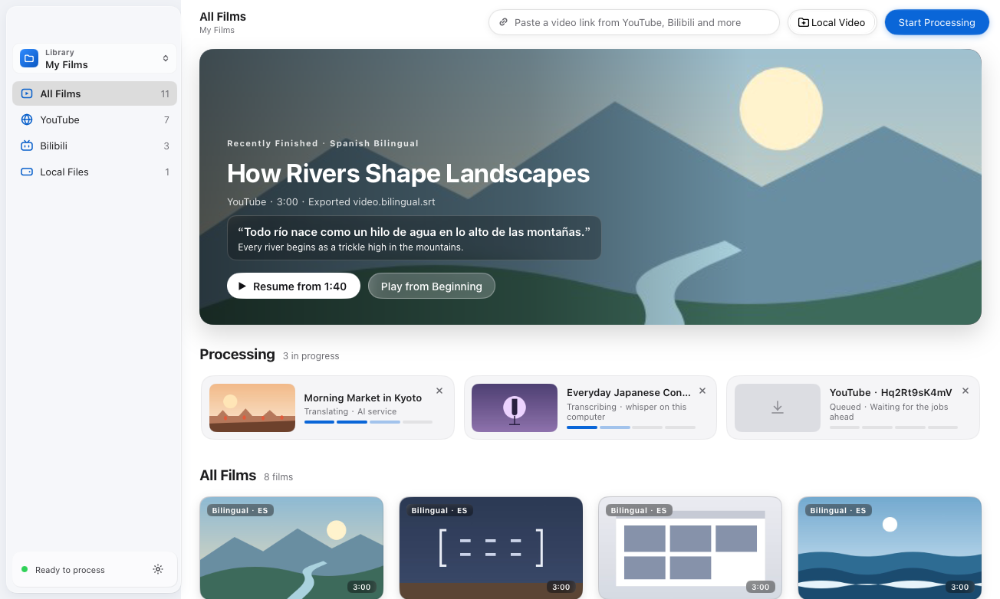
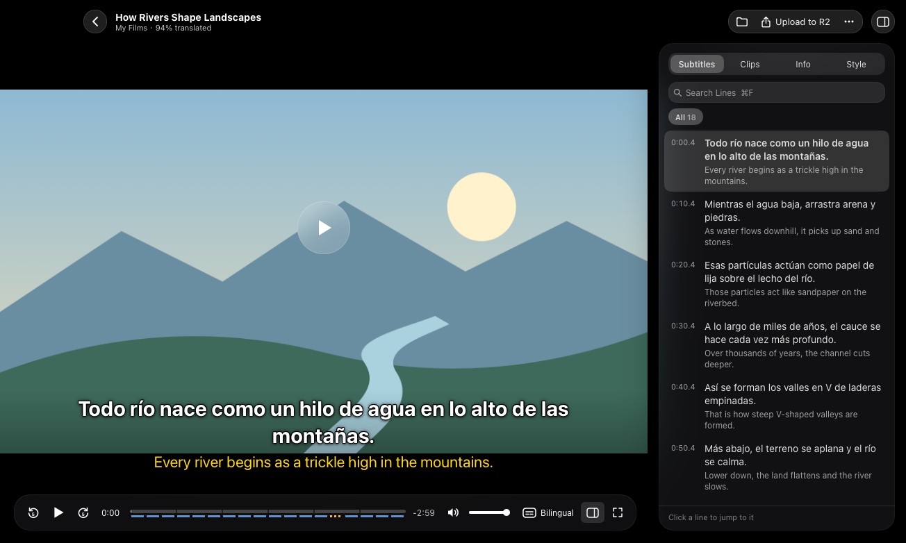
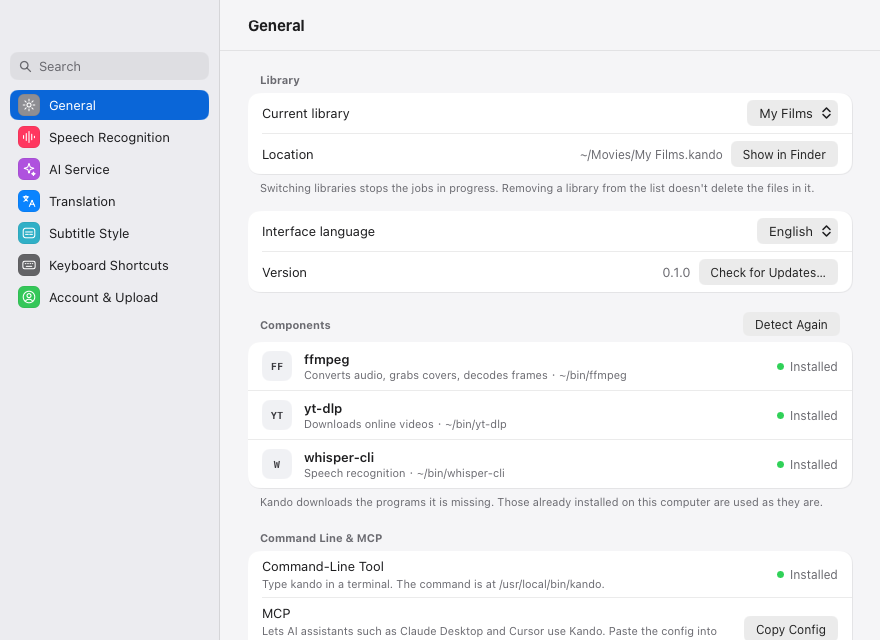
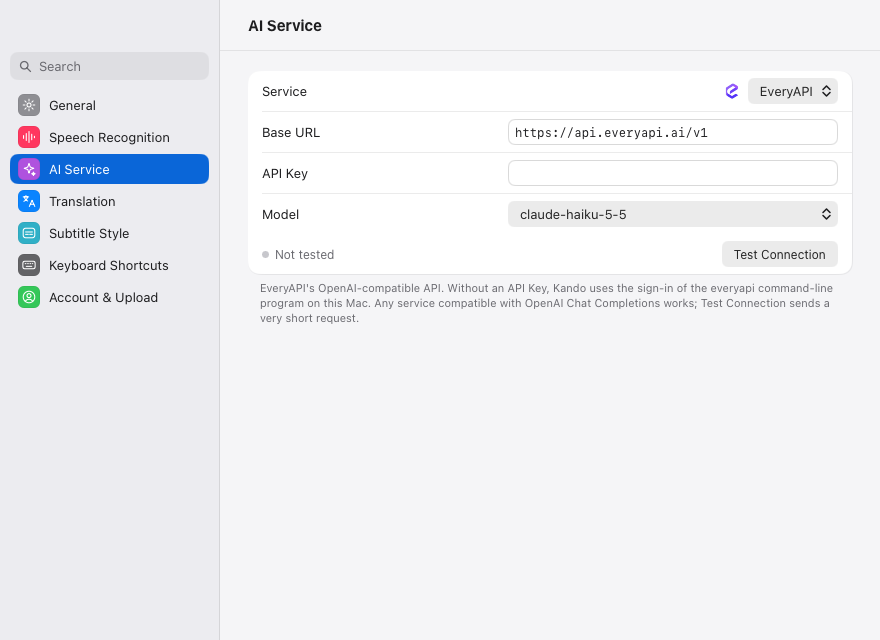

# Kando

[](https://github.com/yldm-tech/Kando/actions/workflows/ci.yml)
[](https://github.com/yldm-tech/Kando/actions/workflows/release.yml)
[](https://github.com/yldm-tech/Kando/releases)
[](LICENSE)
[](go.work)
[](#install)
[](https://github.com/yldm-tech/Kando/stargazers)
[](https://x.com/suzukaze_haduki)
[](https://github.com/sponsors/houko)

English · [简体中文](README.zh-CN.md) · [日本語](README.ja.md) · [繁體中文](README.zh-TW.md) · [한국어](README.ko.md)

Kando is a desktop app for learning a language from videos in that language. Paste a YouTube or Bilibili link, or drop a video file or a folder of videos on the window: Kando downloads the video with yt-dlp, transcribes the speech on your own computer with whisper.cpp, translates each line through an OpenAI-compatible model, and plays the original video with the original line and its translation on screen together. It is written in Go and draws its native interface with [NSGo](https://github.com/nsgo-dev/nsgo); there is no web view.



The interface is in English, Simplified Chinese, Traditional Chinese, Japanese and Korean. Kando starts in Simplified Chinese; choose another language in Settings › General › Interface language, and the window changes at once. The labels quoted below are those of the English interface.

## Features

- Add a video by pasting a link from YouTube, Bilibili or any other site yt-dlp supports (Help › Supported Websites… lists them, with their logos), or pick a local file (mp4, mov, mkv, webm and other video files) or drag it onto the window. Local files are transcribed where they are, not copied. A folder dropped on the window adds the videos in it and in the folders directly inside it, in the order of their names, numbers by value (Episode 2 before Episode 10); files that are not videos are left out, and the message bar says how many.
- Paste a playlist or a channel link and Kando lists its videos, says how many there are and how many the library already has, and adds each as a job of its own once you confirm; a channel gives its 50 most recent videos. A link to one video of a YouTube playlist adds that video, and the message bar then offers to add the whole playlist. Several links pasted at once, separated by spaces or line breaks, are added together.
- Browse, in the sidebar, is a built-in browser: open a site, sign in if it needs it, and click Download Video to add the page you are on, or Download Videos on a playlist's or a channel's page. On YouTube, Bilibili, Vimeo, TED, Niconico, Dailymotion and TikTok, the pages get Kando's own buttons too: Download Video under the video, and a + over each video thumbnail a page lists, which shows a clock while the video waits or is processed and a check once it is in the library; clicking a video the library has shows it there. Browse Sites, beside the link field and on the page of an empty library, opens the browser. The [browser extension](#browser-extension) puts the same buttons into your own browser. Downloads do not use the sign-in you made there yet ([nsgo-dev/nsgo#112](https://github.com/nsgo-dev/nsgo/issues/112)): a video that needs a signed-in account fails, and Kando offers to use the account you are signed in to in your browser instead.
- Jobs run one after another through download, transcription, translation and export. A failed job says why, links to the setting that fixes it, and can be retried or removed. A video can be watched from its card once it is downloaded, while the job goes on, with its original lines once they are transcribed.
- Speech is recognized on your computer with whisper.cpp, which detects the spoken language. Settings › Speech Recognition lists seven whisper models, from Tiny (77.7 MB) to Large v3 (3.1 GB), and downloads the one you choose from Hugging Face, or from its mirror hf-mirror.com when Download Source says so (useful where Hugging Face is hard to reach, as in mainland China). When a download from Hugging Face fails, Download from hf-mirror.com next to the error switches the source and downloads the model again. Every download is checked against the model's SHA-256 and size pinned in Kando, whichever source served it.
- Lines are translated by EveryAPI by default, or by any OpenAI-compatible chat API: Settings › AI Service has presets for OpenAI, OpenRouter, Groq, DeepSeek, xAI, Mistral, Qwen (DashScope), Kimi, Zhipu GLM, SiliconFlow, Ollama and LM Studio, plus a custom endpoint. The target language, a context-aware mode that lets the model read the preceding lines, and the prompt can be changed in Settings › Translation. A finished film that has no translation, as when no AI service was set up, has Translate, and once an AI service is set up, Translate N Films above the grid of films translates every such film it shows, as the message bar offers when you set the service up; Translate Again Into, in a film's menu and the player's ⋯ menu, translates it into another language without downloading or transcribing it again; and Translate Missing Lines translates only the lines that failed.
- Each finished video gets two SubRip files next to it: `<video>.srt` with the original lines and `<video>.bilingual.srt` with each translation above its original line (`video.srt` and `video.bilingual.srt` for a downloaded video). When a local video already has a `<video>.srt` that Kando did not write, Kando leaves it as it is and keeps its own transcript in `<video>.kando.srt`.
- The player shows the subtitles as bilingual, original only, translation only or off, with a delay you can adjust in 0.1-second steps and a style you can change in the side panel or in Settings › Subtitle Style. You can move to the previous or next line (A, D), hear a line again (R), loop one line until you have caught it (L) and extend the loop over the next line for a whole sentence or exchange (Extend Loop to Next Line, Shift+L), have the film pause after each line, for shadowing it or writing it down (Pause After Each Line, P; Space plays on), and show the line playing in both languages whatever the subtitle mode (T). Its side panel lists every line with search (click a line to jump to it), splits the video into up to 12 clips that each start on a line, and shows the film's files and source. Each film resumes where you stopped watching.
- Study tools act on the line playing, or the one just heard. Save Line (B, or a line's right-click menu in the side panel) keeps it in the library's saved lines, which Study › Saved Lines… lists; a click on one plays its film from that line. Review Saved Lines (N) goes through the ones due, one at a time: the line's sound plays and its original shows, Show Translation (Space) reveals the translation, and Again (1) or Good (2) says whether you knew it. A line you knew comes back after 1 day, then after 3, 7, 14, 30 and 60 days, and every 60 days after that; one you did not comes back before the review ends. Export for Anki…, under the list and in the File menu, writes `Kando Saved Lines.txt`, a note per line for Anki's Basic note type (the original on the front; the translation, the line's sound and where it is in the film on the back), and a `Kando Saved Lines audio` folder with each line's sound, cut with ffmpeg: copy its files into Anki's `collection.media` folder, then import the notes with Anki's File › Import. Explain Line (E, or a line's right-click menu) has the AI service explain the line's meaning, key words and grammar in the command palette.
- The command palette (⌘K, or Ctrl+K on Windows and Linux) runs any command, opens a film by its title or a section of Settings, and finds subtitle lines across the library; in the player it searches the film's lines, and answers a question about the film with Ask this film. It lists and sends the AI service only the lines up to where you have watched, so it gives nothing away. On Windows and Linux, where Kando has no menu bar, the Commands button at the bottom of the sidebar opens it, and the menu bar's commands are in it.
- Libraries are `.kando` folders of ordinary files you can manage in Finder or a file manager. You can keep several and switch between them from the sidebar, which also filters a library by source: YouTube, Bilibili, other sites and local files; and, once its films are in more than one language, by the language heard in them, under Languages. The grid of films sorts by Recently Added, Recently Watched, Title, Source or Spoken Language. When speech recognition misheard a film's language, choose the right one under Spoken Language in the player's Info tab, then Transcribe Again in that language.
- Optional upload of a film's video and bilingual subtitles to your own object storage (Cloudflare R2, Amazon S3, Alibaba Cloud OSS, Tencent Cloud COS or any S3-compatible store), from the player. See [Configuration](#configuration).
- Keyboard shortcuts for playback, subtitles, study and windows, listed in a cheat sheet (⌘/, or Ctrl+/ on Windows and Linux) and in Settings › Keyboard Shortcuts.
- The window follows the system's light or dark appearance; the player, the command palette and the cheat sheet are always dark.
- A log file for bug reports: Help › Show Log File (or the command palette) reveals it. It is `~/Library/Logs/Kando/kando.log` on macOS, and `kando.log` in the `Kando/logs` folder of the user's configuration folder elsewhere; it records why each failed job failed, without the keys Kando holds or the AI service's address, and the end of what the tool that failed printed (its last 64 KB). Anything shaped like a key is written as `***`. Past 5 MB a new file starts, and the two before it are kept.



## Install

### Download

Builds for macOS (Apple silicon and Intel), Windows (x86-64 and ARM64) and Linux (x86-64 and ARM64) are on [GitHub Releases](https://github.com/yldm-tech/Kando/releases). Pick the file for your system, where `<version>` is the release's version, such as `0.5.0`:

- macOS: `kando-<version>-macos-arm64.dmg` for Apple silicon, `kando-<version>-macos-x64.dmg` for Intel. Open the disk image and drag Kando to Applications.
- Windows: `kando-<version>-windows-x64-setup.exe` for most PCs, `kando-<version>-windows-arm64-setup.exe` for a Windows on Arm PC. Run the installer. It is not signed yet, so SmartScreen may warn before it runs: choose More info, then Run anyway.
- Debian, Ubuntu and their derivatives: `kando-<version>-linux-x64.deb` for x86-64, `kando-<version>-linux-arm64.deb` for ARM64. Install it with `sudo apt install ./kando-<version>-linux-<arch>.deb` in the folder you downloaded it to.
- Arch Linux and its derivatives: `kando-<version>-linux-<arch>.pkg.tar.gz`, installed with `sudo pacman -U ./kando-<version>-linux-<arch>.pkg.tar.gz`.
- Other Linux distributions: `kando-<version>-linux-<arch>.AppImage` runs without installing: make it executable with `chmod +x` and open it. It takes GTK 4 from the system.

On Linux the player plays videos through GTK 4's GStreamer media backend, which the packages do not install yet ([nsgo-dev/nsgo#139](https://github.com/nsgo-dev/nsgo/issues/139)): on Debian and Ubuntu, install it with `sudo apt install libgtk-4-media-gstreamer gstreamer1.0-plugins-good gstreamer1.0-plugins-bad gstreamer1.0-libav`; on other distributions, install GTK 4's GStreamer backend and GStreamer's good, bad and libav plugins.

Or run the release's install script, which downloads the package for your machine, checks it against its `.sha256` and installs it: on macOS the app from the disk image into `/Applications` (or `~/Applications` when it cannot write there), on Linux the Arch package with `pacman`, else the Debian one with `apt`, through `sudo`:

```sh
curl -fsSL https://github.com/yldm-tech/Kando/releases/latest/download/install.sh | sh
```

On Windows, `irm https://github.com/yldm-tech/Kando/releases/latest/download/install.ps1 | iex` in PowerShell runs the installer silently. Running a script again installs the latest version over the one installed.

The other files of a release are not for installing: `checksums.txt` lists the SHA-256 of every file, the `.sha256` beside each file is what the install scripts check it against, and the `appcast-*.xml` feeds are what installed copies of Kando update from (see [Updates](#updates)).

The macOS disk images of releases newer than 0.5.1 are signed with YLDM's Developer ID and notarized by Apple, so macOS opens Kando without a warning.

### Updates

Kando updates itself from the signed releases on GitHub. On macOS and Windows the updater bundled with Kando, Sparkle on macOS and WinSparkle on Windows, checks in the background about once a day; when a new version is out, its window offers Install Update, Remind Me Later and Skip This Version, and Install Update downloads the new version, checks its signature, installs it and relaunches Kando. The window does not show the release notes yet ([nsgo-dev/nsgo#32](https://github.com/nsgo-dev/nsgo/issues/32)); they are on the release's page.

To check now, choose Kando › Check for Updates… in the menu bar on macOS, or Check for Updates… in the command palette (Ctrl+K) on Linux and Windows, which have no menu bar; Settings › General also has a Check for Updates… button next to Version.

On Linux, Kando checks the same feed when it opens and when you come back to it, at most once a day. When a new version is out it asks; if Kando was installed from the `.deb`, Update downloads the new package, checks its signature and installs it with `dpkg` once you enter your password. The Arch package and the AppImage are not updated in place: Update opens the release's page, so install the new version the way you installed the first, or run the install script again.

### Build from source

With Go 1.27.4 or later:

```sh
git clone https://github.com/yldm-tech/Kando.git
cd Kando
make build
```

`make build` runs `go tool nsgo build` for the platform you are on (`TARGET=` builds others, such as `make build TARGET=windows_x64`) and writes the app under `apps/kando/build/` and what to hand out under `apps/kando/build/releases/`: on macOS an ad-hoc signed `Kando.app` and a `.dmg`; on Windows the program, and its NSIS installer when `makensis` is installed (otherwise the `.nsi` script, which compiles anywhere); on Linux the program, a `.deb`, an Arch `.pkg.tar.gz` and an `.AppImage`. It sets `GOFLAGS=-tags=nodra_nomygo`, which leaves code the app does not use out of it, as releases do. Without `make`, as on a stock Windows, run `go tool nsgo build -target windows_x64 apps/kando` from the repository root.

## Requirements

Kando runs `yt-dlp`, `ffmpeg` and `whisper-cli` (whisper.cpp). On macOS and Linux there is nothing to install: when Kando opens and one of them is missing, it downloads it, and the Getting Started guide shows the progress. Programs you already installed, such as with Homebrew, are used as they are.

| Program | Used for | What Kando downloads |
| --- | --- | --- |
| `yt-dlp` | Downloading online videos. Kando asks for it for every job, local files included. | The standalone build from the [yt-dlp release](https://github.com/yt-dlp/yt-dlp/releases). |
| `ffmpeg` | Extracting the audio and grabbing covers; cutting the sound of saved lines for the review and the Anki export; and, for a video the system's player cannot open as it is, making an MP4 copy for the player, kept in Kando's cache folder. | FFmpeg 9.0.2, with `ffplay` on macOS, from this repository's [tools release](https://github.com/yldm-tech/Kando/releases/tag/tools-1). |
| `whisper-cli` (whisper.cpp) | Speech recognition. | whisper.cpp 1.9.5, with Metal on macOS, from the same release. |
| A whisper.cpp ggml model | Download one in the Getting Started guide or Settings › Speech Recognition, or point `KANDO_WHISPER_MODEL` at a model file. | |

The tools release is built by the Tools workflow (`.github/workflows/tools.yml`) from the sources pinned in `.github/tools.env`, and Kando checks each download against a SHA-256 pinned in the app before using it. Downloads go to the `tools` folder beside `settings.json` (`~/Library/Application Support/Kando/tools` on macOS, `~/.config/Kando/tools` on Linux). Kando looks there first, then on `PATH` and in `/opt/homebrew/bin`, `/usr/local/bin` and `/home/linuxbrew/.linuxbrew/bin`, because apps opened from Finder or a desktop launcher get a minimal `PATH`. Settings › General shows which program is used, offers Download or Retry for one that is missing, and Detect Again looks again. If a download fails because `yt-dlp` is out of date, Kando offers Update and Retry, which updates it the way it was installed and retries.

On Windows Kando does not download them yet. Install them with [Scoop](https://scoop.sh): `scoop install yt-dlp ffmpeg whisper-cpp`; or from their own builds, [yt-dlp.exe](https://github.com/yt-dlp/yt-dlp/releases/latest), [FFmpeg from gyan.dev](https://www.gyan.dev/ffmpeg/builds/) and `whisper-bin-x64.zip` from the [whisper.cpp releases](https://github.com/ggml-org/whisper.cpp/releases), with their folder added to `PATH`. Settings › General and the Getting Started guide link each missing program to its page. Besides `PATH`, Kando looks in the folders where winget (`%LocalAppData%\Microsoft\WinGet\Links`), Scoop (`~\scoop\shims`) and Chocolatey (`%ProgramData%\chocolatey\bin`) put the programs they install, so Detect Again finds one installed after Kando started.

## Getting started

1. Open Kando. With no library yet, it offers New Library… (named Film Library in `~/Movies` on macOS or `~/Videos` elsewhere unless you change it) and Open Existing Library….
2. The Getting Started guide downloads `ffmpeg`, `yt-dlp` and `whisper-cli` if they are missing. Open Settings (⌘,): General shows them with their versions, and has the interface language.
3. In Speech Recognition, click Download next to a whisper model; Kando selects it when the download finishes. The one marked Recommended is Large v3 Turbo (Compressed), 574 MB. Models that Vimpo or hyperframes already downloaded can be selected without copying.
4. In AI Service, set up translation:
   - EveryAPI (the default): sign in once with the [EveryAPI](https://everyapi.ai) CLI, `everyapi auth login`. Kando asks the CLI for the key (`everyapi auth credential`), so it uses the same login, gateway region and key refresh as the CLI, and you do not paste a token. The default model is `claude-haiku-5-5`; `everyapi models list` shows the others. You can also paste an EveryAPI key into API Key instead.
   - Another provider: choose it under Service, or choose OpenAI Compatible and enter its Base URL, then fill in Model and API Key (local servers such as Ollama and LM Studio need no key). Test Connection sends a short request to check the settings. Get API Key next to the field opens the page where the service makes one. Kando remembers the model and key of each service you use, so choosing one again brings them back, and a key is sent only to the host it was entered for. The second step of the Getting Started guide offers the service, its API Key and Test Connection too.
5. In Translation, pick the default target language: Simplified Chinese (the default), Traditional Chinese, English, Japanese, Korean, Spanish, French or German.
6. Back in the window, paste a link into the top bar and click Start Processing, or click Local Video or drag a video onto the window. The status line at the bottom of the sidebar says Ready to process when everything a job needs is in place, and otherwise names what is missing.

When the translation provider answers with a rate limit or a server error, Kando sends the request again, up to three attempts in all.





## Command line and MCP

The Kando program is also a command line, `kando`, and an MCP server for AI agents. Run with one of the commands below, it drives the Kando app; run with no command, it opens the window as usual.

To get the `kando` command:

- macOS: move Kando to Applications, then click Install next to Command-Line Tool in Settings › General. It links `kando` to the app in the first of `/usr/local/bin`, `/opt/homebrew/bin` and `~/.local/bin` it can write to, without asking for an administrator password, and never replaces a `kando` of another program. Kando opened from its disk image, or from where macOS translocated it after a download, runs from a path that goes away, so the card asks you to move it first instead of installing a link that would break. Or link it yourself: `sudo ln -s /Applications/Kando.app/Contents/MacOS/Kando /usr/local/bin/kando`.
- Linux: the `.deb` and the Arch package, which the install script (see [Download](#download)) installs too, put the app in `/opt/kando` and add `/usr/bin/kando`, a link to it.
- Windows: Kando cannot install the command, as making a link on Windows needs administrator rights or developer mode. Under Command-Line Tool, Settings › General names the folder that holds `Kando.exe`; add that folder to `PATH`, and `kando` in a terminal runs it, as Windows ignores the case of file names.

| Command | What it does |
| --- | --- |
| `kando status` | Shows the open library, the programs and models in use, and whether a job can start, or what is missing, and lists every library Kando knows with how many films it holds, the open one marked. |
| `kando list [--source S] [--language L] [query]` | Lists the library's films, newest first, with their ids. `--source` keeps one source (`youtube`, `bilibili`, `local` or another site's name); `--language` keeps the films heard in a language, by its code (`ja`, `en`), as the sidebar's languages do; the query keeps the films whose title contains it. |
| `kando show <film-id>` | Shows one film: its source, stage, the paths of its video and subtitles, the language heard in it, how many lines are untranslated and, for a film that was not translated at all, why, and how far you have watched it. A job's id names the film it makes, and a video's path names its film. |
| `kando subtitles <film-id> [--format srt\|text\|json] [--original\|--translation] [--from T] [--to T] [--until watched]` | Prints a film's subtitles, as SubRip (the default), one line per subtitle (`text`, `[hh:mm:ss] translation \| original`) or JSON, both languages or only one. `--from` and `--to` keep the lines that start between them (seconds, `mm:ss` or `hh:mm:ss`); `--until watched` keeps only the lines up to how far you have played the film. |
| `kando search <words> [--film ID] [--until watched] [--limit N]` | Finds the subtitle lines that contain the words, in the original or the translation, across the library or in one film, with each line's film and time. `--until watched` keeps only what you have watched. |
| `kando jobs [job-id]` | Lists the jobs: the running one, the waiting ones, then the finished ones; with an id, shows that job alone. |
| `kando add <link-or-file>... [--wait] [--yes]` | Queues links, local video files and folders, as Start Processing and dropping them on the window do, and prints each job's id. Relative paths are taken from the current directory. A playlist or channel link adds its videos (a channel's 50 most recent), and a folder the videos in it and in the folders directly in it, in their names' order, without those the library has, after saying what it holds and asking; `--yes` adds them without asking, and without a terminal to ask on it is needed. Without an AI service set up, it says the subtitles will be in the original language only. |
| `kando cancel <job-id>` | Stops a running job, or takes a waiting one out of the queue. |
| `kando retry <job-id> [--wait]` | Queues a failed, canceled or finished job again under the same id, as Retry and Process Again do, without changing what the window shows. A finished film is translated again into the language its subtitles are in, or into the target language set in Kando if it was not translated. A running or waiting job is refused. When processing a finished film again fails or is canceled, the film keeps the subtitles it had, and the job is reported as failed or canceled. |
| `kando translate <film-id> [--wait]` | Translates the lines a finished film's translation left untranslated, as Translate Missing Lines does, without downloading or transcribing it again: every line of a film that was not translated at all. A film with no untranslated line, or still being processed, is refused. |
| `kando remove <job-id>` | Takes a job off the library, as Remove does, stopping it first when it is running. Its files stay on disk. |
| `kando move <film-id> --to <library>` | Moves a finished film to another library Kando knows, named as `kando status` lists it or by its folder, as Move to Library does, and prints its id there and that library's folder. A film still being processed is refused. |
| `kando sites [query] [--limit N]` | Searches the websites Kando downloads from, by name, domain or a video link. |
| `kando open [film-id] [--at T]` | Brings Kando to the front, showing a film, or the library without an id. `--at` plays the film from that time of its subtitles, such as a line `kando search` found. A film still being processed plays once its video is on disk, as its card's Watch does; one that cannot be watched yet shows the library instead, with a note. While a dialog is open in the window, it fails and changes nothing. |
| `kando mcp` | Serves MCP on standard input and output (see below). |
| `kando version` | Prints the version. |
| `kando help [command]` | Lists the commands, or shows one command's usage and its flags. |

A command that needs the app connects to it through a socket, `kando.sock` in the folder that holds `settings.json` (`~/Library/Application Support/Kando/kando.sock` on macOS, `~/.config/Kando/kando.sock` on Linux, `%AppData%\Kando\kando.sock` on Windows); `KANDO_SOCKET` sets another path, which a second copy of Kando also needs, with its own `HOME` (see [Configuration](#configuration)). When Kando is not running, the command starts it in the background, prints `Starting Kando…` to standard error, and waits up to 30 seconds for it. Adding videos needs what Start Processing needs, such as an open library, the programs and a whisper model; when something is missing, `kando add` fails with the message the window shows for it.

Every command that talks to the app takes `--json`, which prints the app's answer as JSON instead of text, and an error as `{"error": {"code": ..., "message": ...}}` on standard output. The command line, the MCP server and the app's answers to them are in English whatever language the window shows; titles, target languages and other names stay as they are. `kando add` exits with 1 when a source could not be added; a video the library already has counts as added, so it prints that video's job, waits for it with `--wait`, and running the same command again succeeds. With `--wait` it stays until every added job is complete or failed, printing a line whenever one's stage or progress changes, and also exits with 1 when any of them failed, or completed without translating its film, as when the AI service refused its key: that job's line says `complete, not translated` and why, and `kando translate` translates it once that is fixed; with `--json` the progress goes to standard error and the jobs as they ended to standard output, each with `translation_error` and its count of `untranslated` lines. `kando retry --wait` and `kando translate --wait` wait for the job they queued in the same way. Exit codes are 0 for success, 1 for a failure, 2 for a command used wrongly, 3 when Kando is not ready (no library is open, or something a job needs is missing), 4 when no film or job has the id, and 5 when Kando is not running and could not be started.

`kando mcp` is an MCP server on standard input and output. Its tools start Kando the same way when it is not running:

| Tool | What it does |
| --- | --- |
| `kando_status` | The app's version, the open library, whether a job can start and what is missing, the programs, the speech and translation models, the target language, the running job and how many wait, and every library Kando knows with how many films it holds. The other tools see only the open library. |
| `kando_list_films` | The open library's films, newest first, filtered by `source`, by words of the title (`query`) or by the language heard in them (`spoken_language`). |
| `kando_get_film` | One film by its id, by the id of the job that makes it, or by its video's path: its stage, target language, the language heard in it (`spoken_language`) and the one the user named (`speech_language`), how many lines are `untranslated` and, for a film that was not translated at all, why (`translation_error`), the paths of its video and subtitles, and how far it was watched (`resume_ms`, `watched_ms`). |
| `kando_get_subtitles` | A finished film's subtitles with timestamps, both languages or one (`which`), as compact text or SRT (`format`). `from_ms` and `to_ms` read part of the film, `until: "watched"` only what the user has watched, and `max_cues` a page at a time, with `next_from_ms` to read on. |
| `kando_search_subtitles` | The subtitle lines that contain `query`, across the library or in one film (`film_id`), each with its film and `start_ms`, which `kando_open` takes as `at_ms` (50 lines unless `limit` is set; `until: "watched"` as above). |
| `kando_add_videos` | Queues links and local video files; returns the jobs, why each source that was not added was skipped, and a `note` when their subtitles will not be translated, as without an AI service. A video the library already has comes back under `skipped` with its `job_id`, `stage` and `film_id`, so asking again is safe. A playlist or channel link, or a folder, is skipped: list it with `kando_list_playlist` and add its videos. |
| `kando_list_playlist` | The videos of a playlist or channel link (a channel's 50 most recent), or of a local folder as dropping it adds them, with their links, titles, durations and whether the library has them, so the agent can say how many there are before adding them. |
| `kando_list_jobs` | The jobs, with their stage, progress, status, error, and once complete the film id, file paths, `untranslated` lines and `translation_error` for one that completed without translating its film. A job that processed a finished film again and failed or was canceled is `failed`, its film kept as it was. |
| `kando_get_job` | One job by its id, as `kando_list_jobs` lists it; poll it to follow a job. |
| `kando_cancel_job` | Stops a running job, or takes a waiting one out of the queue. |
| `kando_retry_job` | Queues a failed, canceled or finished job again under the same id; returns the job. |
| `kando_translate_film` | Translates the lines a finished film's translation left untranslated, every line of one that was not translated; returns its job. |
| `kando_remove_job` | Takes a job off the library, stopping it first when it is running; its files stay on disk. |
| `kando_move_film` | Moves a finished film to another library Kando knows (`to`, its name or its folder), with its files, its job, where it stopped, its subtitle delay and place, its title and its saved lines; returns its id there. |
| `kando_search_sites` | Searches the websites Kando downloads from, by name, domain or a video link (20 results unless `limit` is set). |
| `kando_open` | Brings the Kando window to the front, showing a film or the library, from a line of the film when `at_ms` is set. `shown` and `reason` say what it shows: a film still being processed plays once its video is on disk, and one that cannot be watched yet shows the library (`in_queue`). While a dialog is open in the window, it fails with `not_ready`. |

Add it to Claude Code with the path of the program, `kando` once it is on `PATH`:

```sh
claude mcp add kando -- /Applications/Kando.app/Contents/MacOS/Kando mcp
```

Other MCP clients take the same command in their `mcpServers` setting:

```json
{
  "mcpServers": {
    "kando": {
      "command": "/Applications/Kando.app/Contents/MacOS/Kando",
      "args": ["mcp"]
    }
  }
}
```

The landing page, [kando.yldm.ai](https://kando.yldm.ai), gives browser agents WebMCP tools in browsers that support WebMCP: `search_supported_sites` checks whether Kando downloads from a website, `get_download` gives the download link for a system, `get_started` returns the setup steps, and `list_features` lists what Kando does.

## Browser extension

Kando's extension puts the same Download Video and + buttons as Kando's own browser into the pages of YouTube, bilibili and the other video sites Kando's browser knows, in Chrome, Edge, Brave, Vivaldi, Arc, Chromium or Firefox, where you are signed in. The toolbar button adds the tab's video or shows it in Kando, and the menu on a link to a video has Add Video to Kando. The extension talks only to Kando on your computer, through native messaging, and opens Kando when it is not running.

1. In Settings › General › Browser Extension, click Connect. Kando registers itself with the browsers it finds (Disconnect undoes it).
2. Click Show Extension Folder, then load that folder: in Chrome and Edge, Extensions › Developer mode › Load unpacked; in Firefox, `about:debugging` › This Firefox › Load Temporary Add-on, picking its `manifest.json`. Firefox removes a temporary add-on when it quits.

Listings in the Chrome Web Store and on addons.mozilla.org are to come. Each release also attaches the extension zipped for Chromium browsers and for Firefox.

## Configuration

Everything below except the Google client id and secret and `KANDO_SOCKET` can also be set in the app (the library from the sidebar, the rest in Settings). An environment variable, when set, takes the place of the value saved in the app.

| Variable | Default | Meaning |
| --- | --- | --- |
| `KANDO_WHISPER_MODEL` | the model chosen in Settings › Speech Recognition | Path of a whisper.cpp ggml model file, such as `ggml-small.bin`. |
| `KANDO_LLM_BASE_URL` | EveryAPI, `https://api.everyapi.ai/v1` | Base URL of an OpenAI-compatible provider, such as `https://api.openai.com/v1`, or `http://localhost:11434/v1` for Ollama. When it is set, the signed-in EveryAPI account is not used. |
| `KANDO_LLM_MODEL` | `claude-haiku-5-5` on EveryAPI | Translation model. With a custom provider there is no default: set it here or in Settings › AI Service. |
| `KANDO_LLM_API_KEY` | none | Bearer token for the translation provider. It overrides the signed-in EveryAPI account. |
| `EVERYAPI_API_KEY` | none | EveryAPI key, used when `KANDO_LLM_BASE_URL` is unset and `KANDO_LLM_API_KEY` is empty, instead of the CLI login. |
| `KANDO_OUTPUT_DIR` | the library opened last | Library folder to open at launch, where new videos and subtitles go. |
| `KANDO_SOCKET` | `kando.sock` beside `settings.json` | Path of the socket the app listens on and the `kando` command line and `kando mcp` connect to. Set it to the same path for the app and for the commands. Only one copy of Kando runs for a user, and launching another brings the first one forward. On macOS a copy started with `KANDO_SOCKET` set is a second copy on purpose, as for development, and needs its own `HOME` too, so that it keeps its own library and settings; on Windows and Linux such a copy is handed to the running one for now ([nsgo-dev/nsgo#332](https://github.com/nsgo-dev/nsgo/issues/332)), so quit your own Kando first. See [Command line and MCP](#command-line-and-mcp). |
| `KANDO_GOOGLE_CLIENT_ID` | none | Google OAuth client id for signing in on Settings › Account & Upload. Without it the account card is hidden. It is never saved to the settings file. |
| `KANDO_GOOGLE_CLIENT_SECRET` | none | Optional client secret for the same OAuth client. |
| `KANDO_STORAGE` | `r2` | Where uploads go: `r2`, `s3` (or `aws`), `oss` (or `aliyun`), `cos` (or `tencent`), `compat` (or `s3compat`). Any other value means R2. |
| `KANDO_R2_ENDPOINT` | none | Cloudflare R2: an account id or a full `https://` endpoint. |
| `KANDO_R2_BUCKET`, `KANDO_R2_ACCESS_KEY`, `KANDO_R2_SECRET` | none | Cloudflare R2 bucket and keys. |
| `KANDO_S3_REGION` | none | Amazon S3 region name, such as `ap-northeast-1`. |
| `KANDO_S3_BUCKET`, `KANDO_S3_ACCESS_KEY`, `KANDO_S3_SECRET` | none | Amazon S3 bucket and keys. |
| `KANDO_OSS_REGION` | none | Alibaba Cloud OSS region name, such as `cn-hangzhou` (`cn-hangzhou-internal` for the internal network). |
| `KANDO_OSS_BUCKET`, `KANDO_OSS_ACCESS_KEY`, `KANDO_OSS_SECRET` | none | Alibaba Cloud OSS bucket and keys. |
| `KANDO_COS_REGION` | none | Tencent Cloud COS region name, such as `ap-guangzhou`. |
| `KANDO_COS_BUCKET`, `KANDO_COS_ACCESS_KEY`, `KANDO_COS_SECRET` | none | Tencent Cloud COS bucket (its name includes the APPID, such as `video-1250000000`), SecretId and SecretKey. |
| `KANDO_S3COMPAT_ENDPOINT` | none | Full `https://` or `http://` endpoint of another S3-compatible store, such as a MinIO server on your network. |
| `KANDO_S3COMPAT_REGION` | none | Signing region of that store; MinIO usually uses `us-east-1`. |
| `KANDO_S3COMPAT_BUCKET`, `KANDO_S3COMPAT_ACCESS_KEY`, `KANDO_S3COMPAT_SECRET` | none | Bucket and keys of that store. |
| `KANDO_S3COMPAT_PATH_STYLE` | off | `1`, `true`, `yes` or `on` turns on path-style addressing, which MinIO needs; `0`, `false`, `no` or `off` turns it off. |

Uploading is manual: open a film and click Upload to R2 (or the store you chose) in the player. Kando uploads the video and its bilingual subtitles under `kando/<library>/<film folder>/<file>`, or under `<Google account email>/<library>/<film folder>/<file>` when signed in with Google; signing in is optional. Videos are never uploaded automatically. An upload has no time limit: it runs until it is sent or canceled, and gives up when the storage takes no data for a minute. A file over 5 GiB, more than one upload can store, fails before anything is sent. A failed upload says why, such as wrong keys, a missing bucket, a wrong region or no network, with Open Settings when a setting is the cause, and the log file gets the whole error.

## Libraries and settings

A library is a folder whose name ends in `.kando`. Each downloaded film gets its own folder inside it, `<title> [<video id>]/`, holding `video.mp4`, `cover.jpg`, `video.srt` and `video.bilingual.srt`. They are ordinary files: Kando watches the library folder, so videos added or removed in Finder or a file manager show up in the library. On macOS a `.kando` folder gets a folder icon with the Kando mark in Finder. The lines you save are kept in `saved-lines.json` at the top of the library folder, with when each is next due for review, so they move with the library.

Move to Library, in a film's ⋯ and in the File menu while it is open, moves the film to another library Kando knows: its folder, or its video, subtitles and the files Kando keeps beside them, moves into the other library's folder, renamed with a number when the name is taken there, and its job, where it stopped, its subtitle delay and place, the title given to it and its saved lines go with it. To a library on another drive it is copied first, with its progress in the message bar, and stays where it was if the copy fails or is canceled. A local video outside the library folder stays where it is and moves only in the list. A film still being processed cannot be moved. The message bar then opens the other library or undoes the move.

Removing a film from the library moves the film's folder to the Trash, or only its video and subtitles when that folder holds other videos or folders too; a local video outside the library folder stays where it is and only leaves the list. Removing a library from the list leaves its folder on disk.

Kando keeps its own files in the user config directory, `~/Library/Application Support/Kando` on macOS, `%AppData%\Kando` on Windows and `~/.config/Kando` on Linux:

- `library.json`: the jobs, finished and in progress, and where each video stopped playing.
- `settings.json`: the settings, including the API key of each AI service you used, the object storage keys and the Google refresh token, in plain text, and the windows' sizes and positions. The file is readable only by your user.
- `models/`: whisper models downloaded in Settings › Speech Recognition.

Cover images of videos that are not named `video.*` are cached in `~/Library/Caches/Kando/posters` on macOS, `%LocalAppData%\Kando\posters` on Windows and `~/.cache/Kando/posters` on Linux.

### Private libraries

A library can have a password: Set Password… in the library switcher's menu gives it one, and Change Password… and Remove Password… there ask for it first. Kando asks for the password before it shows the library, when you switch to it and when it starts with that library open, and locks it again when you quit, when another library opens, and with File › Lock Now. While it is locked, nothing of its films shows: not in the window, notifications, the Dock badge or Now Playing, and the command line and the MCP server answer that it is locked. Paired phones do not see it, and moving a film into it asks for its password.

This is a lock in Kando, not encryption. The library's videos and subtitles stay ordinary files that Finder or any other app opens, and the lock is kept on this computer in `library.json` as a salted PBKDF2-SHA256 key of the password, never the password itself, so a copy of the library folder on another computer opens without it, and anyone who can edit `library.json` can remove it. A forgotten password cannot be recovered; with Kando closed, deleting the library's entry under `locks` in `library.json` removes the lock.

## Upgrading from LingoCut

Kando was called LingoCut, and nothing reads the old names. To keep your libraries and settings:

1. Quit the app.
2. Rename the config folder from `LingoCut` to `Kando`: `~/Library/Application Support/LingoCut` on macOS, `%AppData%\LingoCut` on Windows, `~/.config/LingoCut` on Linux. It holds `library.json`, `settings.json`, `window-state.json` and the downloaded models.
3. Rename each library from `X.lingocut` to `X.kando`, after renaming the config folder and before launching. On macOS and Linux the saved inodes let the app follow every renamed library. On Windows the app can only match one missing library to one new `.kando` folder in the same parent folder, so rename one library per folder at a time and launch the app once after each rename.
4. Rename each environment variable from `LINGOCUT_*` to `KANDO_*`.
5. Launch Kando and choose the speech model again in Settings › Speech Recognition: the model file moved with the folder and shows as downloaded, but the saved choice still points at the old path.
6. Delete what is left of the old name: `lingocut.app` and `lingocut Dev.app`; the poster cache `~/Library/Caches/LingoCut` (`%LocalAppData%\LingoCut` on Windows, `~/.cache/LingoCut` on Linux); on Linux the lowercase `~/.config/lingocut`; and, if you ran `make dev`, `~/Library/Application Support/lingocut Dev`.

## Development

Requires Go 1.27.4 or later.

```sh
make test   # go test for packages/core, packages/media and apps/kando
make dev    # run the app with live reload
make build  # build the app for this platform into apps/kando/build
```

`make dev` runs `go tool nsgo dev apps/kando`, which builds the app, opens it, and builds and restarts it each time you save a Go file.

The screenshot tests run the main scenes from a fixed demo library, in an empty fake home folder with fake `ffmpeg`, `yt-dlp` and `whisper-cli`, so they do not read your settings, libraries or tools. `go test` runs them headless, where they play each scene and check it but draw no pictures, as NSGo's headless tester renders no pixels; they are skipped unless `KANDO_SCREENSHOTS` is set:

```sh
KANDO_SCREENSHOTS=1 go test ./apps/kando/... -run TestScreenshots
```

The PNG files come from the same tests run in real windows on macOS, which saves them in `apps/kando/.nsgo/test/screenshots/macos/`:

```sh
go tool nsgo test -target macos -run TestScreenshots -env KANDO_SCREENSHOTS=1 apps/kando
```

`KANDO_SCREENSHOTS_LANG` (`en`, `zh-Hans`, `zh-Hant`, `ja` or `ko`, given with another `-env`) renders them in that interface language, with a demo library for its reader; `-run TestScreenshotsReadme` renders the four pictures of the READMEs, kept in `docs/assets/<language>/`. `KANDO_SCREENSHOTS_DARK=1` renders them in the dark appearance, each saved as `<scene>-dark.png`.

Repository layout:

- `apps/kando`: the app. Each screen has its own directory (`sidebar/`, `films/`, `film/`, `settings/`, `account/`, `cheatsheet/`); `view.go` connects the window to them. `shelf/` is the job record, `cloud/` is Google sign-in and object storage upload, and `brand/` is the Finder icon of a library.
- `packages/core`: platform-independent jobs, stages and link parsing.
- `packages/media`: the media pipeline: download, transcription, translation, subtitle export, covers and libraries.

[AGENTS.md](AGENTS.md) describes how the interface is split into components and the rules each area follows; read it before changing the UI.

## CI and releases

The [CI](https://github.com/yldm-tech/Kando/actions/workflows/ci.yml) workflow builds and tests pull requests and `main`. The [Release](https://github.com/yldm-tech/Kando/actions/workflows/release.yml) workflow runs after CI passes on `main`, or by hand: it picks the next version from the Conventional Commits since the last tag, commits it to `main` as `chore(release)`, tags it, builds packages for macOS, Windows and Linux without a Developer ID or code-signing certificate, signs the updates that installed copies of Kando download, and publishes a GitHub release with the packages and their checksums.

## License

[MIT](LICENSE)
