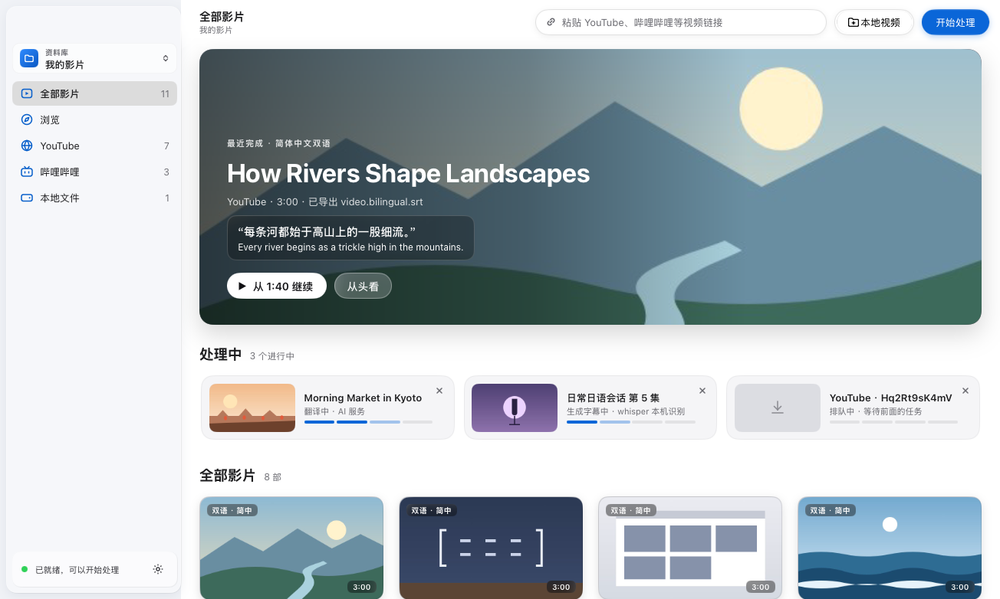
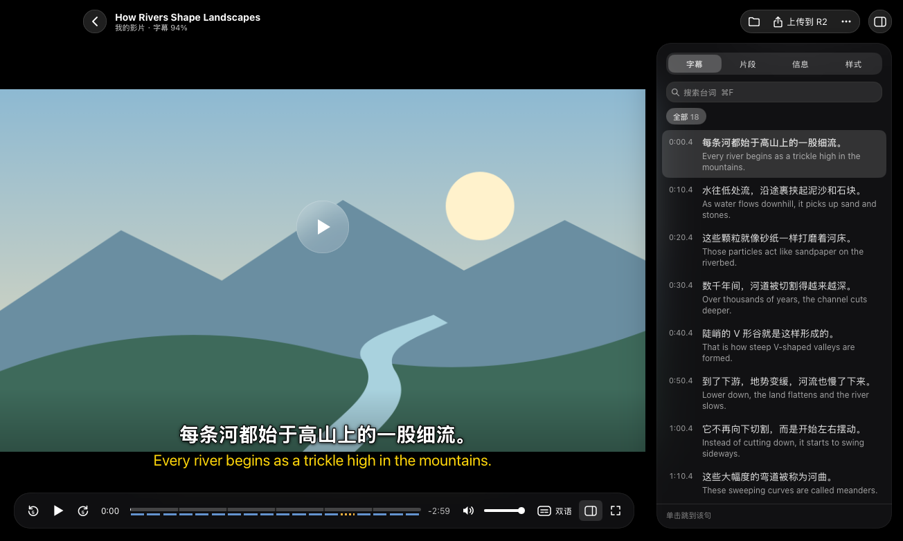
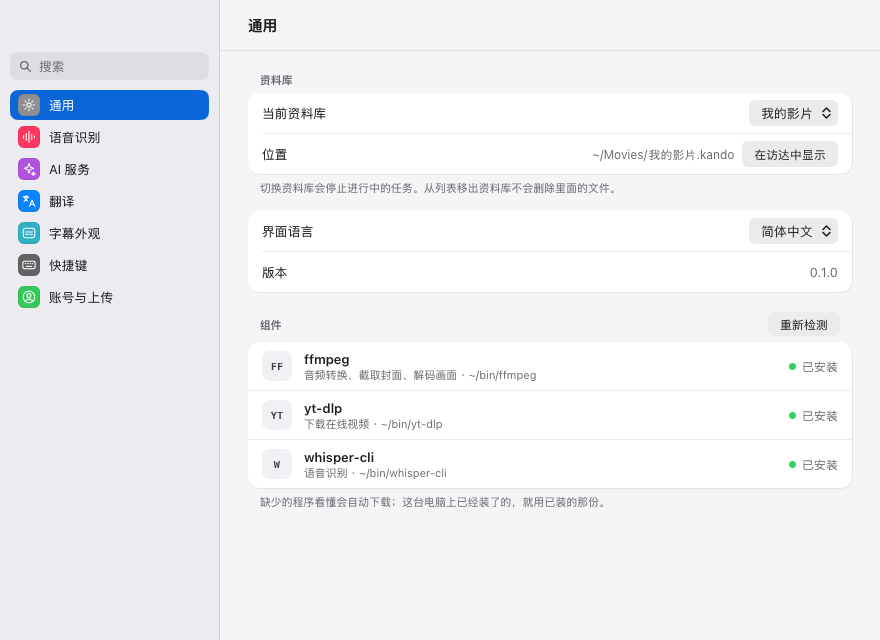
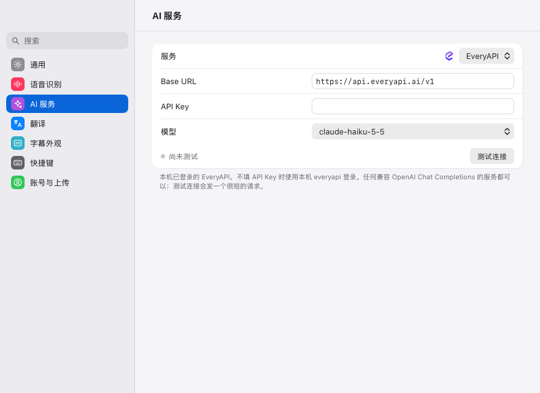

# 看懂（Kando）

[](https://github.com/yldm-tech/Kando/actions/workflows/ci.yml)
[](https://github.com/yldm-tech/Kando/actions/workflows/release.yml)
[](https://github.com/yldm-tech/Kando/releases)
[](LICENSE.md)
[](go.work)
[](#install)
[](https://github.com/yldm-tech/Kando/stargazers)
[](https://x.com/suzukaze_haduki)
[](https://github.com/sponsors/houko)

[English](README.md) · 简体中文 · [日本語](README.ja.md) · [繁體中文](README.zh-TW.md) · [한국어](README.ko.md)

看懂是一款用原声视频学外语的桌面应用。粘贴 YouTube 或哔哩哔哩链接，或者把视频文件或一整个视频文件夹拖到窗口上：看懂会用 yt-dlp 下载视频，在本机用 whisper.cpp 转录语音，再通过 OpenAI 兼容模型逐句翻译，然后播放原视频，屏幕上同时显示原文和译文。它用 Go 编写，原生界面由 [NSGo](https://github.com/nsgo-dev/nsgo) 绘制，没有使用 Web 视图。



界面支持简体中文、繁体中文、英文、日文和韩文，默认是简体中文；在“设置 › 通用 › 界面语言”中切换，窗口会立即换成所选语言。下文引用的界面文字都与简体中文界面一致。

## 功能

- 添加视频：粘贴 YouTube、哔哩哔哩或 yt-dlp 支持的其他任何网站的链接（“帮助 › 支持的网站…”列出了全部网站及其标志），或者选择本地文件（mp4、mov、mkv、webm 等视频文件），也可以直接拖到窗口上。本地文件在原位置转录，不会被复制。拖到窗口上的文件夹会加入其中的视频以及它下一层各文件夹里的视频，按文件名排序，数字按大小排（Episode 2 在 Episode 10 之前）；不是视频的文件会被跳过，消息栏会说明跳过了几个。
- 粘贴合集或频道的链接，看懂会列出其中的视频，说明共有多少个、资料库里已有多少个，确认后把每个视频作为单独的任务加入；频道只取最新的 50 个视频。YouTube 合集中某个视频的链接只加入这个视频，之后消息栏会提供“加入整个合集”。一次粘贴多个链接（用空格或换行分隔）会一起加入。
- 侧栏的“浏览”是内置浏览器：打开网站，需要时先登录，然后点“下载视频”把当前网页加入资料库；在合集或频道的网页上则是“下载这些视频”。在 YouTube、哔哩哔哩、Vimeo、TED、niconico、Dailymotion 和 TikTok 上，网页里也会出现看懂自己的按钮：视频下方的“下载视频”，以及网页列出的每个视频缩略图上的“+”；视频等待或处理中时它显示为时钟，进入资料库后显示为对勾，点击资料库已有的视频会在资料库中显示它。链接输入框旁边和空资料库页面上的“浏览网站”会打开这个浏览器。[浏览器扩展](#browser-extension)会把同样的按钮放进你自己的浏览器。在“设置 › 通用 › 浏览器登录”里选一个浏览器（如 Chrome、Edge、Firefox 或 Safari），“浏览”和下载就都用它的登录：YouTube、哔哩哔哩、TED、NHK、niconico、BBC、Vimeo、Dailymotion、TikTok 和 X 的网页打开时已按你在那里的状态登录，会员专享和需要年龄验证的视频第一次就能下载。看懂只复制这些网站的 Cookie，以及 YouTube 登录用的 Google 的 Cookie，不复制其他任何网站的。yt-dlp 不会告诉看懂哪些 Cookie 是浏览器不让网页脚本读取的（HttpOnly），所以看懂只给它见过网站这样设置的那些加上标记，其余的网页脚本可以读取，网站自己的脚本也要读其中一些。看懂只在你选择浏览器时、每次启动后第一次打开“浏览”时，以及你点“浏览”起始页上的“刷新登录”时复制，所以在 Mac 上钥匙串询问 Chrome、Edge 或 Brave 的密钥只会在这些时候出现，不会在看懂启动时出现。关掉这个设置不会清除“浏览”里的网页已经拿到的登录（[nsgo-dev/nsgo#112](https://github.com/nsgo-dev/nsgo/issues/112)）。Safari 的登录需要给看懂“完全磁盘访问权限”，Windows 上的 Chrome 暂时读不了，Google 也可能比你的浏览器更早要求重新登录。在“浏览”里直接登录的状态暂时还用不到下载上（[nsgo-dev/nsgo#112](https://github.com/nsgo-dev/nsgo/issues/112)）：没开这个设置时，需要登录账号的视频会下载失败，看懂会提示改用你在浏览器里已登录的账号。
- 任务按顺序逐个处理，依次经过下载、转录、翻译和导出。失败的任务会显示原因，并给出对应设置项的入口，可以重试或移除。视频下载完成后就可以从它的卡片开始观看，任务继续在后台进行，转录完成后显示原文字幕。
- 语音识别由 whisper.cpp 在你的电脑上完成，它会检测说话的语言。“设置 › 语音识别”列出七个 whisper 模型，从 Tiny（77.7 MB）到 Large v3（3.1 GB），你选中的模型会从 Hugging Face 下载；把“下载源”换成 hf-mirror.com 则从这个镜像下载（适合中国大陆等连不上 Hugging Face 的地方）。从 Hugging Face 下载失败时，错误旁的“从 hf-mirror.com 下载”会切换下载源并重新下载该模型。无论从哪里下载，都会按 Kando 内置的模型 SHA-256 和大小校验。
- 台词默认由 EveryAPI 翻译，也可以使用任何 OpenAI 兼容的聊天 API：“设置 › AI 服务”提供 OpenAI、OpenRouter、Groq、DeepSeek、xAI、Mistral、通义千问（DashScope）、Kimi、智谱 GLM、硅基流动、Ollama 和 LM Studio 的预设，还可以自定义接口地址。目标语言、“智能翻译”（让模型参考前面几句台词）和提示词，都可以在“设置 › 翻译”中修改。没有翻译的已完成影片（例如当时还没有设置 AI 服务）会提供“翻译”；设置好 AI 服务后，影片网格上方的“翻译 N 部影片”会翻译网格中所有这类影片，刚设置好 AI 服务时消息栏也会提供同样的操作；影片菜单和播放器“⋯”菜单中的“重新翻译为”会把它翻译成另一种语言，无需重新下载或转录；“补译未译的句子”只翻译翻译失败的句子。
- 每个处理完成的视频旁边会生成两个 SubRip 字幕文件：`<video>.srt` 是原文字幕，`<video>.bilingual.srt` 中每句译文位于对应原文上方（下载的视频则是 `video.srt` 和 `video.bilingual.srt`）。如果本地视频旁已经有一个不是看懂写的 `<video>.srt`，看懂不会动它，而是把自己的转录保存在 `<video>.kando.srt` 中。
- 翻译之前，AI 服务会先校对转录：根据视频标题和其他台词，改正语音识别听错的词，比如同音字、人名和视频主题的术语。看懂只采纳“把一个词换成另一个词”的改动，所以不会改写台词；同一个改正出现在两句以上时，全片其他相同的地方也会一起改正。说的正是目标语言的视频（比如目标语言为简体中文的普通话视频）只校对、不翻译，字幕就是它自己的台词。在校对功能之前处理完成的影片，使用“重新翻译为”或“补译未译的句子”时会先校对。
- 播放器可以把字幕显示为双语、仅原文、仅译文或关闭，字幕延迟可按 0.1 秒步进调整，样式可以在侧边面板或“设置 › 字幕外观”中修改。可以跳到上一句、下一句（A、D），重听本句（R），单句循环直到听懂为止（L），并用“循环延伸到下一句”（Shift+L）把下一句也加进循环，反复听完整的一句话或一段对话；“逐句暂停”（P）让影片在每句结束时暂停，方便跟读或记下来，按空格继续；无论字幕模式如何，“本句显示双语”（T）都会把正在播放的这句以双语显示。侧边面板列出全部台词并支持搜索（单击某句即可跳转），把视频切分成最多 12 个从某句台词开始的片段，并显示影片的文件和来源。每部影片都会从你上次停下的位置继续播放。
- 学习工具作用于正在播放的这句，或刚听完的那句。“收藏这句”（B，或侧边面板中台词的右键菜单）把它保存到资料库的收藏中，“学习 › 收藏的句子…”会列出它们，点击一句即可从这句开始播放它所在的影片。“复习”（N）逐句过一遍到期的句子：播放这句的声音并显示原文，“显示译文”（空格）显示译文，然后用“再来一次”（1）或“记住了”（2）说明你是否记得。记住的句子会在 1 天后再出现，然后依次相隔 3、7、14、30 和 60 天，之后每 60 天一次；没记住的会在本次复习结束前再出现。列表下方和“文件”菜单中的“导出到 Anki…”会写出 `Kando Saved Lines.txt`，每句一条笔记，适用于 Anki 的 Basic 笔记类型（正面是原文；背面是译文、这句的声音和它在影片中的位置），以及 `Kando Saved Lines audio` 文件夹，里面是用 ffmpeg 剪出的每句声音：把其中的文件复制到 Anki 的 `collection.media` 文件夹，再在 Anki 中导入 `Kando Saved Lines.txt`。“讲解这句”（I，或台词的右键菜单）会让 AI 服务在侧边面板中讲解这句的意思、关键词和语法；选中了一句（E）时，I 讲解选中的那句。
- 在播放器里改正台词：E 选中正在播放的这句；Return 编辑它的译文和原文，⌃⌥← → 和 ⌃⌥⇧← → 调整起点和终点，⌘⌫ 标为无语音，这些都可以用“编辑 › 撤销”撤回。“这句不对”（⇧E）让 AI 服务结合前后几句和本片术语重新翻译这句，你从它给的写法里选一个，或者保持不变。一处修改涉及的词在全片其他句子里也有时，看懂会问要不要一起改（⌘↩）、先查看（⇧⌘↩）还是只改这一处（Esc）；改的是术语表译过的词时，术语也会一起改并锁定。修改和字幕文件分开保存，重新翻译影片也不会冲掉。
- 命令面板（⌘K，Windows 和 Linux 上是 Ctrl+K）可以运行任何命令，按标题打开影片或打开某个设置分区，并在整个资料库中查找台词；在播放器中，它搜索这部影片的台词，并用“问这部影片”回答关于影片的问题。它只列出、也只把你看到的位置之前的台词发给 AI 服务，不会剧透。Windows 和 Linux 上看懂没有菜单栏，侧栏底部的“命令”按钮会打开命令面板，菜单栏里的命令都能在其中找到。
- 资料库是 `.kando` 文件夹，里面都是普通文件，可以在访达或文件管理器中管理。可以同时保留多个资料库，并在侧栏中切换；侧栏还能按来源筛选当前资料库中的影片：YouTube、哔哩哔哩、其他网站和本地文件；资料库中的影片有不止一种语言时，还能在“语言”下按影片中说的语言筛选。影片网格可以按“最近添加”“最近观看”“标题”“来源”或“原声语言”排序。如果语音识别把影片的语言认错了，在播放器“信息”页的“识别语言”中选对语言，再点“用<语言>重新识别”。
- 可选：在播放器中把影片的视频和双语字幕上传到你自己的对象存储（Cloudflare R2、Amazon S3、阿里云 OSS、腾讯云 COS 或任何 S3 兼容存储）。参见[配置](#configuration)。
- 播放、字幕、学习和窗口都有键盘快捷键，可以在“快捷键速查”（⌘/，Windows 和 Linux 上是 Ctrl+/）和“设置 › 快捷键”中查看。
- 窗口跟随系统的浅色或深色外观；播放器、命令面板和快捷键速查始终是深色的。
- 反馈问题时可以附上日志文件：“帮助 › 显示日志文件”（或命令面板）会在访达中显示它。日志文件 `kando.log` 在 macOS 上位于 `~/Library/Logs/ai.yldm.kando`，Windows 上位于 `%LOCALAPPDATA%\ai.yldm.kando\Logs`，Linux 上位于 `~/.local/state/ai.yldm.kando`。日志记下每个失败任务的原因（不含看懂保存的密钥和 AI 服务的地址）和出错工具输出的最后 64 KB，形似密钥的内容都写成 `***`。文件超过 5 MB 时另起一份，保留之前的两份。



<a id="install"></a>

## 安装

<a id="download"></a>

### 下载

macOS（Apple 芯片和 Intel）、Windows（x86-64 和 ARM64）和 Linux（x86-64 和 ARM64）的安装包在 [GitHub Releases](https://github.com/yldm-tech/Kando/releases) 上。按你的系统选择文件，其中 `<version>` 是该版本的版本号，例如 `0.5.0`：

- macOS：Apple 芯片的 Mac 选 `kando-<version>-macos-arm64.dmg`，Intel 的 Mac 选 `kando-<version>-macos-x64.dmg`。打开磁盘映像，把看懂拖到“应用程序”文件夹。
- Windows：大多数电脑选 `kando-<version>-windows-x64-setup.exe`，ARM 处理器的 Windows 电脑选 `kando-<version>-windows-arm64-setup.exe`，下载后运行安装程序。安装程序已签名，但证书刚开始使用、还没有积累信誉时，SmartScreen 仍可能在运行前弹出警告：点“更多信息”，再点“仍要运行”。
- Debian、Ubuntu 及其衍生发行版：x86-64 选 `kando-<version>-linux-x64.deb`，ARM64 选 `kando-<version>-linux-arm64.deb`。在下载所在的文件夹中用 `sudo apt install ./kando-<version>-linux-<arch>.deb` 安装。
- Arch Linux 及其衍生发行版：选 `kando-<version>-linux-<arch>.pkg.tar.gz`，用 `sudo pacman -U ./kando-<version>-linux-<arch>.pkg.tar.gz` 安装。
- 其他 Linux 发行版：`kando-<version>-linux-<arch>.AppImage` 不用安装，用 `chmod +x` 加上可执行权限后直接打开。它使用系统自带的 GTK 4。

在 Linux 上，播放器通过 GTK 4 的 GStreamer 媒体后端播放视频，而安装包暂时不会自动装上它（[nsgo-dev/nsgo#139](https://github.com/nsgo-dev/nsgo/issues/139)）：Debian 和 Ubuntu 上用 `sudo apt install libgtk-4-media-gstreamer gstreamer1.0-plugins-good gstreamer1.0-plugins-bad gstreamer1.0-libav` 安装；其他发行版请安装 GTK 4 的 GStreamer 后端，以及 GStreamer 的 good、bad 和 libav 插件。

也可以运行该版本附带的安装脚本，它会下载适合你机器的安装包，按 `.sha256` 校验后安装：在 macOS 上把磁盘映像里的应用装进 `/Applications`（没有写入权限时装进 `~/Applications`），在 Linux 上用 `pacman` 安装 Arch 软件包，没有 `pacman` 时用 `apt` 安装 Debian 软件包，都通过 `sudo` 进行：

```sh
curl -fsSL https://github.com/yldm-tech/Kando/releases/latest/download/install.sh | sh
```

在 Windows 上，在 PowerShell 中运行 `irm https://github.com/yldm-tech/Kando/releases/latest/download/install.ps1 | iex`，它会静默运行安装程序。再次运行脚本会用最新版本覆盖已安装的版本。

版本中的其他文件不是用来安装的：`checksums.txt` 列出每个文件的 SHA-256，每个文件旁的 `.sha256` 是安装脚本校验它用的，`appcast-*.xml` 是已安装的看懂检查更新时读取的（参见[更新](#updates)）。

0.5.1 之后发布的 macOS 安装包用 YLDM 的 Developer ID 签名，并经过 Apple 公证，打开看懂时 macOS 不会再发出警告。

<a id="updates"></a>

### 更新

看懂会从 GitHub 上已签名的版本自动更新。在 macOS 和 Windows 上，看懂内置的更新组件（macOS 上是 Sparkle，Windows 上是 WinSparkle）在后台大约每天检查一次；有新版本时，它的窗口提供“安装更新”“稍后提醒我”和“跳过这个版本”，“安装更新”会下载新版本、校验签名、安装并重新启动看懂。这个窗口暂时不显示更新说明（[nsgo-dev/nsgo#32](https://github.com/nsgo-dev/nsgo/issues/32)），更新说明请看该版本的发布页面。

要立即检查，在 macOS 上选择菜单栏中的“看懂 › 检查更新…”；Linux 和 Windows 没有菜单栏，请在命令面板（Ctrl+K）中选择“检查更新…”。“设置 › 通用”中“版本”旁边也有“检查更新…”按钮。

在 Linux 上，看懂在打开时和你回到看懂时检查同一个更新源，每天最多一次。有新版本时它会询问；如果是用 `.deb` 安装的，点“更新”会下载新的软件包、校验签名，并在你输入密码后用 `dpkg` 安装。Arch 软件包和 AppImage 不能原地更新：“更新”会打开该版本的发布页面，请按第一次安装的方式安装新版本，或者再运行一次安装脚本。

### 从源码构建

需要 Go 1.27.4 或更高版本：

```sh
git clone https://github.com/yldm-tech/Kando.git
cd Kando
make build
```

`make build` 会针对当前平台运行 `go tool nsgo build`（用 `TARGET=` 构建其他平台，例如 `make build TARGET=windows_x64`），把应用写入 `apps/kando/build/`，把用来分发的文件写入 `apps/kando/build/releases/`：在 macOS 上是经过临时签名（ad-hoc）的 `Kando.app` 和一个 `.dmg`；在 Windows 上是程序本身，安装了 `makensis` 时还有 NSIS 安装程序（否则是在任何系统上都能编译的 `.nsi` 脚本）；在 Linux 上是程序本身、一个 `.deb`、一个 Arch 的 `.pkg.tar.gz` 和一个 `.AppImage`。它会带上 `nodra_nomygo` 标签（`apps/kando/nsgo.yaml` 的 `build.tags` 给应用的每次构建、开发运行和测试都加上它），和正式版本一样把应用用不到的代码排除在外。没有 `make` 时（例如未额外安装工具的 Windows），在仓库根目录直接运行 `go tool nsgo build -target windows_x64 apps/kando`。

## 运行依赖

看懂会调用 `yt-dlp`、`ffmpeg` 和 `whisper-cli`（whisper.cpp）。在 macOS 和 Linux 上不用自己安装：看懂打开时如果缺少其中哪个，会自动下载，入门引导里会显示下载进度。在 macOS 上，即使你自己装过（比如用 Homebrew），看懂也优先用自己下载的那份，这样那些程序依赖的库被升级时也不会影响看懂：自带的下载完成之前先用你装的，在「设置 › 通用」里也可以改回用你装的。在 Linux 上，yt-dlp 用看懂自带的，`ffmpeg` 和 `whisper-cli` 只要系统里装的能运行就用装的。看懂会把每个程序运行一次，确认它能启动；启动不了的，「设置 › 通用」、侧栏和被它卡住的视频卡片上都会写明原因，并提供改用看懂自带的。看懂自带的 yt-dlp 每天检查一次更新。

| 程序 | 用途 | 看懂下载的版本 |
| --- | --- | --- |
| `yt-dlp` | 下载在线视频。每个任务都需要它，本地文件也不例外。 | [yt-dlp 官方发布](https://github.com/yt-dlp/yt-dlp/releases)的单文件版。 |
| `ffmpeg` | 提取音频、截取封面；为复习和 Anki 导出剪出收藏句子的声音；系统播放器无法直接打开某个视频时，为它生成一份 MP4 副本供播放器播放，存放在看懂的缓存文件夹中。 | FFmpeg 9.0.2（macOS 版带 `ffplay`），来自本仓库的 [tools 发布](https://github.com/yldm-tech/Kando/releases/tag/tools-1)。 |
| `whisper-cli`（whisper.cpp） | 语音识别。 | whisper.cpp 1.9.5（macOS 版启用 Metal），来自同一个发布。 |
| 一个 whisper.cpp ggml 模型 | 在入门引导或“设置 › 语音识别”中下载，或者用 `KANDO_WHISPER_MODEL` 指向一个模型文件。 | |

tools 发布由 Tools 工作流（`.github/workflows/tools.yml`）按 `.github/tools.env` 里固定的源码构建，看懂使用每个下载前都会用内置的 SHA-256 校验。下载的程序放在 `settings.json` 旁边的 `tools` 文件夹里（macOS 上是 `~/Library/Application Support/Kando/tools`，Linux 上是 `~/.config/Kando/tools`）。看懂先在这里找，再找 `PATH` 以及 `/opt/homebrew/bin`、`/usr/local/bin` 和 `/home/linuxbrew/.linuxbrew/bin`，因为从访达或桌面启动器打开的应用只能拿到精简的 `PATH`。“设置 › 通用”会显示用的是哪个程序，缺少的可以点“下载”或“重试”，点击“重新检测”可以重新查找。如果因为 `yt-dlp` 版本过旧而下载失败，看懂会提供“更新并重试”，按原来的安装方式更新它并重试。

在 Windows 上看懂暂时还不会自动下载。可以用 [Scoop](https://scoop.sh) 运行 `scoop install yt-dlp ffmpeg whisper-cpp` 安装；或下载各程序自己的版本（[yt-dlp.exe](https://github.com/yt-dlp/yt-dlp/releases/latest)、[gyan.dev 的 FFmpeg](https://www.gyan.dev/ffmpeg/builds/)、[whisper.cpp 发行版](https://github.com/ggml-org/whisper.cpp/releases)里的 `whisper-bin-x64.zip`），并把所在文件夹加入 `PATH`。“设置 › 通用”和入门引导会为每个缺少的程序附上它的下载页面链接。除了 `PATH`，看懂也会在 winget（`%LocalAppData%\Microsoft\WinGet\Links`）、Scoop（`~\scoop\shims`）和 Chocolatey（`%ProgramData%\chocolatey\bin`）存放程序的文件夹里查找，所以看懂打开后才安装的程序，点“重新检测”也能找到。

## 快速上手

1. 打开看懂。还没有资料库时，它会提供“新建资料库…”和“打开已有资料库…”。新建的资料库默认名为“影视库”，在 macOS 上位于 `~/Movies`，在其他系统上位于 `~/Videos`，可以自行修改。
2. 入门引导会自动下载缺少的 `ffmpeg`、`yt-dlp` 和 `whisper-cli`。打开设置（⌘,），“通用”里会显示它们和各自的版本。
3. 在“语音识别”中，点击某个 whisper 模型旁的“下载”；下载完成后看懂会自动选用它。标为“推荐”的是 Large v3 Turbo（压缩版），大小 574 MB。Vimpo 或 hyperframes 已经下载过的模型可以直接选用，无需复制。
4. 在“AI 服务”中设置翻译：
   - EveryAPI（默认）：运行一次 `everyapi auth login`，用 [EveryAPI](https://everyapi.ai) CLI 登录。看懂会向 CLI 获取密钥（`everyapi auth credential`），因此登录状态、网关区域和密钥刷新都与 CLI 保持一致，无需手动粘贴密钥。默认模型是 `claude-haiku-5-5`，其他模型可以用 `everyapi models list` 查看。也可以直接把 EveryAPI 密钥粘贴到“API Key”中。
   - 其他服务商：在“服务”中选择它，或者选择“OpenAI 兼容”并填写它的 Base URL，然后填写“模型”和“API Key”（Ollama、LM Studio 等本地服务不需要密钥）。“测试连接”会发送一个简短的请求来检查设置。字段旁的“获取 API Key”会打开该服务创建密钥的页面。看懂会记住你用过的每个服务的模型和密钥，再次选择它时会恢复；密钥只会发给当初填写它时的那个主机。入门引导的第二步也可以选择服务、填写 API Key 并测试连接。
5. 在“翻译”中选择默认目标语言：简体中文（默认）、繁体中文、English、日本語、한국어、Español、Français 或 Deutsch。
6. 回到主窗口，把链接粘贴到顶栏的输入框并点击“开始处理”，或者点击“本地视频”，也可以把视频拖到窗口上。任务所需的一切都就绪时，侧栏底部的状态行会显示“已就绪，可以开始处理”，否则会指出缺少什么。

遇到翻译服务商限流或返回服务器错误时，看懂会自动重新发送请求，连同第一次最多尝试三次。





<a id="command-line-and-mcp"></a>

## 命令行与 MCP

看懂的程序本身也是命令行工具 `kando`，同时也是供 AI 智能体使用的 MCP 服务器。带下表中的命令运行时，它会操作看懂应用；不带命令运行时，它照常打开窗口。

获取 `kando` 命令：

- macOS：先把看懂移到“应用程序”文件夹，再在“设置 › 通用”中点击“命令行工具”旁的“安装”。它会在 `/usr/local/bin`、`/opt/homebrew/bin`、`~/.local/bin` 中第一个可写入的文件夹里创建指向看懂的 `kando` 链接，不会要求输入管理员密码，也不会替换其他程序的 `kando`。直接从磁盘映像打开，或下载后被 macOS 放到临时位置（App Translocation）运行时，看懂所在的路径很快就会失效，这时卡片会提示先移动看懂，而不是安装一个日后失效的链接。也可以自己创建链接：`sudo ln -s /Applications/Kando.app/Contents/MacOS/Kando /usr/local/bin/kando`。
- Linux：`.deb` 和 Arch 软件包（安装脚本也安装它们，参见[下载](#download)）把应用安装到 `/opt/kando`，并添加指向它的链接 `/usr/bin/kando`。
- Windows：看懂无法安装这个命令，因为在 Windows 上创建链接需要管理员权限或开发者模式。“设置 › 通用”的“命令行工具”下会显示 `Kando.exe` 所在的文件夹；把这个文件夹加入 `PATH` 后，在终端中输入 `kando` 就会运行它，因为 Windows 的文件名不区分大小写。

| 命令 | 作用 |
| --- | --- |
| `kando status` | 显示当前打开的资料库、正在使用的程序和模型，以及能否开始任务；不能时说明缺少什么。还会列出看懂知道的每个资料库及其影片数，并标出当前打开的那个。 |
| `kando list [--source S] [--language L] [query]` | 按从新到旧列出资料库中的影片及其 ID。`--source` 只保留一个来源（`youtube`、`bilibili`、`local` 或其他网站的名称）；`--language` 只保留说某种语言的影片，用语言代码表示（`ja`、`en`），与侧栏的语言筛选相同；query 只保留标题中包含它的影片。 |
| `kando show <film-id>` | 显示一部影片：来源、所处阶段、视频和字幕的路径、视频中说的语言、有多少句未翻译（完全没有翻译时说明原因），以及看到了哪里。任务 ID 也可以指代它生成的影片，视频的路径也可以指代它的影片。 |
| `kando subtitles <film-id> [--format srt\|text\|json] [--original\|--translation] [--from T] [--to T] [--until watched]` | 输出影片的字幕，格式可以是 SubRip（默认）、每条字幕一行的文本（`text`，`[hh:mm:ss] 译文 \| 原文`）或 JSON，可以输出双语，也可以只输出其中一种。`--from` 和 `--to` 只保留在这段时间内开始的字幕（秒、`mm:ss` 或 `hh:mm:ss`）；`--until watched` 只保留到你播放到的位置为止的字幕。 |
| `kando search <words> [--film ID] [--until watched] [--limit N]` | 在整个资料库或某一部影片中查找原文或译文包含这些词的字幕，并给出每条所在的影片和时间。`--until watched` 只查已经看过的部分。 |
| `kando jobs [job-id]` | 列出任务：先是正在运行的，然后是等待中的，最后是已结束的；带 ID 时只显示这个任务。 |
| `kando add <link-or-file>... [--wait] [--yes]` | 像“开始处理”和把它们拖进窗口一样，把链接、本地视频文件和文件夹加入队列，并输出每个任务的 ID。相对路径以当前目录为准。合集或频道的链接会加入其中的视频（频道取最新的 50 个），文件夹会按名称顺序加入其中以及下一层文件夹中的视频，都不包括资料库已有的，先说明里面有什么并询问；`--yes` 不询问直接加入，没有终端可以询问时必须加上它。没有设置 AI 服务时，会提示字幕将只有原文。 |
| `kando cancel <job-id>` | 停止正在运行的任务，或把等待中的任务移出队列。 |
| `kando retry <job-id> [--wait]` | 像“重试”和“重新处理”一样，以同一个 ID 把失败、已取消或已完成的任务重新加入队列，不改变窗口显示的内容。已完成的影片会再次翻译成其字幕所用的语言；没有翻译过的则翻译成看懂中设置的目标语言。正在运行或等待中的任务会被拒绝。重新处理已完成的影片失败或被取消时，影片保留原来的字幕，任务报告为失败或已取消。 |
| `kando translate <film-id> [--wait]` | 像“补译未译的句子”一样，翻译已完成影片中未译的句子，不重新下载或转写：完全没有翻译的影片会翻译每一句。没有未译句子或仍在处理中的影片会被拒绝。 |
| `kando remove <job-id>` | 像“移除”一样把任务从资料库中去掉，正在运行的任务会先停止。它的文件留在磁盘上。 |
| `kando move <film-id> --to <library>` | 像“移到资料库”一样把处理完的影片移到看懂知道的另一个资料库，资料库用 `kando status` 列出的名称或它的文件夹指定，并输出影片在那里的 ID 和那个资料库的文件夹。仍在处理中的影片会被拒绝。 |
| `kando subscriptions [list \| add <link> \| check <id>]` | 列出资料库订阅的频道、B 站空间和合集、播放列表，以及各有几个新视频在窗口里等你确认；`add` 订阅一个（订阅时已有的视频不算新视频），`check` 像「立即检查」一样马上检查新视频。自动加入的订阅每次检查最多加入 3 个新视频，其余的在订阅页等你确认。 |
| `kando sites [query] [--limit N]` | 按名称、域名或视频链接搜索看懂支持下载的网站。 |
| `kando open [film-id] [--at T]` | 把看懂窗口调到最前面，显示指定的影片；不带 ID 时显示资料库。`--at` 从字幕中的这个时间开始播放，例如 `kando search` 找到的某一句。仍在处理中的影片在视频已在磁盘上时就会播放，与卡片上的“观看”相同；还不能观看的会改为显示资料库，并给出提示。窗口中有对话框打开时，它会失败且不做任何改变。 |
| `kando plugin (validate <file-or-folder> \| list \| install <file>) [--json]` | 不需要应用运行。`validate` 按插件包的格式检查一个插件包（`.zip` 文件或文件夹），输出它的 ID、种类、版本、名称和内容哈希，不通过时输出原因；脚本插件还会按看懂的官方密钥验证签名，并输出它的来源和签名者（开发者模式打包的插件只能在应用里验证，开发者密钥只保存在应用里）。`list` 列出 `settings.json` 所在文件夹里 `plugins` 文件夹中的插件包及各自是否启用，并指出其中不是有效插件包的文件夹。`install` 用同样的检查验过一个插件包文件后交给看懂，看懂下次启动或回到前台时显示它是什么，你确认后才安装。也可以在 设置 › 插件 里安装。 |
| `kando mcp` | 在标准输入和标准输出上提供 MCP 服务（见下文）。 |
| `kando version` | 输出版本号。 |
| `kando help [command]` | 列出所有命令，或显示某个命令的用法和选项。 |

需要应用的命令通过套接字与它通信，套接字是 `settings.json` 所在文件夹中的 `kando.sock`（macOS 上是 `~/Library/Application Support/Kando/kando.sock`，Linux 上是 `~/.config/Kando/kando.sock`，Windows 上是 `%AppData%\Kando\kando.sock`）；`KANDO_SOCKET` 可以指定其他路径，运行第二个看懂时也需要它，并且还要有单独的 `HOME`（参见[配置](#configuration)）。看懂没有运行时，命令会在后台启动它，向标准错误输出 `Starting Kando…`，并最多等待 30 秒。添加视频需要的条件和“开始处理”相同，例如已打开资料库、程序齐全、已有 whisper 模型；缺少某项时，`kando add` 会失败，并给出窗口中对应的提示。

所有与应用通信的命令都支持 `--json`，以 JSON 而不是文本输出应用的应答，出错时也会在标准输出上输出 `{"error": {"code": ..., "message": ...}}`。无论窗口显示哪种语言，命令行、MCP 服务器以及应用对它们的应答都使用英文；标题、目标语言等名称保持原样。有来源未能加入时，`kando add` 以 1 退出；资料库中已有的视频算作已加入，会输出它的任务，加上 `--wait` 时也会等待它，所以重复运行同一条命令也会成功。加上 `--wait` 时，它会一直等到所有新加的任务完成或失败，每当某个任务的阶段或进度变化时输出一行；只要有任务失败，或完成了却没有翻译影片（例如 AI 服务拒绝了密钥），同样以 1 退出：这个任务的那一行会写 `complete, not translated` 及原因，问题解决后可以用 `kando translate` 翻译它。加上 `--json` 时，进度输出到标准错误，结束时的任务输出到标准输出，每个任务带有 `translation_error` 和未译句数 `untranslated`。`kando retry --wait` 和 `kando translate --wait` 以同样的方式等待它们加入队列的任务。退出码：0 表示成功，1 表示失败，2 表示命令用法有误，3 表示看懂还没准备好（没有打开资料库，或缺少任务需要的东西），4 表示没有这个 ID 的影片或任务，5 表示看懂没有运行且无法启动。

`kando mcp` 是在标准输入和标准输出上运行的 MCP 服务器。看懂没有运行时，它的工具也会同样地启动它：

| 工具 | 作用 |
| --- | --- |
| `kando_status` | 应用版本、当前打开的资料库、能否开始任务以及缺少什么、各个程序、语音识别和翻译模型、目标语言、正在运行和等待中的任务，以及看懂知道的每个资料库及其影片数。其他工具只能看到当前打开的资料库。 |
| `kando_list_films` | 按从新到旧列出当前资料库的影片，可按 `source`、标题中的文字（`query`）或影片中说的语言（`spoken_language`）筛选。 |
| `kando_get_film` | 按 ID、生成它的任务 ID 或视频的路径获取一部影片：所处阶段、目标语言、影片中说的语言（`spoken_language`）和用户指定的语言（`speech_language`）、未译句数 `untranslated`、完全没有翻译时的原因（`translation_error`）、视频和字幕的路径，以及看到了哪里（`resume_ms`、`watched_ms`）。 |
| `kando_get_subtitles` | 已完成影片的带时间戳字幕，可以是双语或其中一种（`which`），格式为紧凑文本或 SRT（`format`）。`from_ms` 和 `to_ms` 读取影片的一部分，`until: "watched"` 只读取用户已经看过的部分，`max_cues` 每次读取一页，并给出继续读取用的 `next_from_ms`。 |
| `kando_search_subtitles` | 在整个资料库或某一部影片（`film_id`）中查找包含 `query` 的字幕，每条都带有所在影片和 `start_ms`，可以作为 `at_ms` 交给 `kando_open`（未设置 `limit` 时返回 50 条；`until: "watched"` 同上）。 |
| `kando_add_videos` | 把链接和本地视频文件加入队列；返回这些任务、每个未能加入的来源被跳过的原因，以及字幕不会被翻译时（例如没有 AI 服务）的 `note`。资料库中已有的视频会出现在 `skipped` 中，并带有它的 `job_id`、`stage` 和 `film_id`，所以重复请求是安全的。合集或频道的链接以及文件夹会被跳过：先用 `kando_list_playlist` 列出，再加入其中的视频。 |
| `kando_list_playlist` | 合集或频道链接中的视频（频道取最新的 50 个），或本地文件夹中像拖进窗口那样会加入的视频，包括链接、标题、时长以及资料库里是否已有，方便智能体在加入前说明共有多少个。 |
| `kando_list_jobs` | 列出任务，包括阶段、进度、状态、错误，完成后还有影片 ID、文件路径、未译句数 `untranslated`，以及完成了却没有翻译影片时的 `translation_error`。重新处理已完成影片失败或被取消的任务为 `failed`，影片保持原样。 |
| `kando_get_job` | 按 ID 获取一个任务，内容与 `kando_list_jobs` 中的相同；可以轮询它来跟踪任务。 |
| `kando_cancel_job` | 停止正在运行的任务，或把等待中的任务移出队列。 |
| `kando_retry_job` | 以同一个 ID 把失败、已取消或已完成的任务重新加入队列，并返回这个任务。 |
| `kando_translate_film` | 翻译已完成影片中未译的句子，完全没有翻译的影片会翻译每一句；返回它的任务。 |
| `kando_remove_job` | 把任务从资料库中去掉，正在运行的任务会先停止；它的文件留在磁盘上。 |
| `kando_move_film` | 把处理完的影片移到看懂知道的另一个资料库（`to`，名称或文件夹），连同它的文件、任务、播放位置、字幕偏移和位置、标题和收藏的句子；返回它在那里的 ID。 |
| `kando_list_subscriptions` | 当前资料库的订阅，包括规则、状态、上次检查和等你确认的新视频。 |
| `kando_subscribe` | 让当前资料库订阅一个频道、B 站空间或合集、播放列表；订阅时已有的视频不算新视频。已订阅的会带 `already` 返回。 |
| `kando_check_subscription` | 马上检查一个订阅的新视频，返回新视频数、`queued`（自动加入的最多 `add_per_check` 个）、等你确认的 `held` 和被规则跳过的 `skipped`。 |
| `kando_search_sites` | 按名称、域名或视频链接搜索看懂支持下载的网站（未设置 `limit` 时返回 20 个结果）。 |
| `kando_open` | 把看懂窗口调到最前面，显示一部影片或资料库；设置 `at_ms` 时从影片的某一句开始播放。`shown` 和 `reason` 说明实际显示的内容：仍在处理中的影片在视频已在磁盘上时就会播放，还不能观看的会改为显示资料库（`in_queue`）。窗口中有对话框打开时，它会以 `not_ready` 失败。 |

在 Claude Code 中添加时填写程序的路径；`kando` 已在 `PATH` 中时直接写 `kando` 即可：

```sh
claude mcp add kando -- /Applications/Kando.app/Contents/MacOS/Kando mcp
```

其他 MCP 客户端在 `mcpServers` 设置中填写同样的命令：

```json
{
  "mcpServers": {
    "kando": {
      "command": "/Applications/Kando.app/Contents/MacOS/Kando",
      "args": ["mcp"]
    }
  }
}
```

在支持 WebMCP 的浏览器中，官网 [kando.yldm.ai](https://kando.yldm.ai) 会为浏览器中的智能体提供 WebMCP 工具：`search_supported_sites` 查询看懂是否支持从某个网站下载，`get_download` 给出适合某个系统的下载链接，`get_started` 返回上手步骤，`list_features` 列出看懂的功能。

<a id="browser-extension"></a>

## 浏览器扩展

看懂的扩展把看懂内置浏览器里的“下载视频”和 + 按钮放进 YouTube、哔哩哔哩等看懂浏览器认识的视频网站页面，在你已登录的 Chrome、Edge、Brave、Vivaldi、Arc、Chromium 或 Firefox 里使用。工具栏按钮可以加入当前标签页的视频或在看懂中显示它，视频链接的右键菜单里有“把视频加入看懂”。扩展只通过本机消息（native messaging）和你电脑上的看懂通信，看懂没打开时会自动打开它。

1. 在“设置 › 通用 › 浏览器扩展”里点“连接”，看懂会在找到的浏览器里登记自己（“断开连接”可以撤销）。
2. 点“显示扩展文件夹”，然后载入这个文件夹：Chrome 和 Edge 在扩展程序 › 开发者模式 › 加载已解压的扩展程序；Firefox 在 `about:debugging` › 此 Firefox › 临时载入附加组件，选择其中的 `manifest.json`。Firefox 退出后会移除临时附加组件。

Chrome 应用商店和 addons.mozilla.org 的上架版本稍后提供。每个版本的发布也附带分别为 Chromium 系浏览器和 Firefox 打包的扩展 zip。

<a id="configuration"></a>

## 配置

除 Google 客户端 ID、客户端密钥和 `KANDO_SOCKET` 外，下表各项也都可以在应用内设置（资料库在侧栏中切换，其他项在“设置”中修改）。环境变量一旦设置，就会覆盖应用中保存的值。

| 变量 | 默认值 | 含义 |
| --- | --- | --- |
| `KANDO_WHISPER_MODEL` | 在“设置 › 语音识别”中选择的模型 | whisper.cpp ggml 模型文件的路径，例如 `ggml-small.bin`。 |
| `KANDO_LLM_BASE_URL` | EveryAPI，`https://api.everyapi.ai/v1` | OpenAI 兼容服务商的 Base URL，例如 `https://api.openai.com/v1`，Ollama 则是 `http://localhost:11434/v1`。设置后不再使用已登录的 EveryAPI 账号。 |
| `KANDO_LLM_MODEL` | EveryAPI 上为 `claude-haiku-5-5` | 翻译模型。使用自定义服务商时没有默认值：需要在这里或“设置 › AI 服务”中设置。 |
| `KANDO_LLM_API_KEY` | 无 | 翻译服务商的 API 密钥（以 Bearer 方式发送）。它优先于已登录的 EveryAPI 账号。 |
| `EVERYAPI_API_KEY` | 无 | EveryAPI 密钥，在 `KANDO_LLM_BASE_URL` 未设置且 `KANDO_LLM_API_KEY` 为空时使用，代替 CLI 登录。 |
| `KANDO_OUTPUT_DIR` | 上次打开的资料库 | 启动时打开的资料库文件夹，新的视频和字幕都存放在这里。 |
| `KANDO_SOCKET` | `settings.json` 旁的 `kando.sock` | 应用监听、`kando` 命令行和 `kando mcp` 连接的套接字路径。应用和命令需要设置成同一个路径。同一个用户只运行一个看懂，再次启动只会把已运行的那个带到前台。在 macOS 上，设置了 `KANDO_SOCKET` 启动的是有意运行的第二个看懂（例如开发时），它还需要单独的 `HOME`，才能使用自己的资料库和设置；在 Windows 和 Linux 上，这样启动的看懂暂时也会交给已运行的那个（[nsgo-dev/nsgo#332](https://github.com/nsgo-dev/nsgo/issues/332)），请先退出自己的看懂。参见[命令行与 MCP](#command-line-and-mcp)。 |
| `KANDO_GOOGLE_CLIENT_ID` | 无 | 用于在“设置 › 账号与上传”中登录的 Google OAuth 客户端 ID。不设置时不显示账号卡片。它永远不会保存到设置文件中。 |
| `KANDO_GOOGLE_CLIENT_SECRET` | 无 | 同一 OAuth 客户端的客户端密钥，可选。 |
| `KANDO_STORAGE` | `r2` | 上传目标：`r2`、`s3`（或 `aws`）、`oss`（或 `aliyun`）、`cos`（或 `tencent`）、`compat`（或 `s3compat`）。其他任何值都按 R2 处理。 |
| `KANDO_R2_ENDPOINT` | 无 | Cloudflare R2：账号 ID 或完整的 `https://` 端点。 |
| `KANDO_R2_BUCKET`、`KANDO_R2_ACCESS_KEY`、`KANDO_R2_SECRET` | 无 | Cloudflare R2 的存储桶和密钥。 |
| `KANDO_S3_REGION` | 无 | Amazon S3 区域名称，例如 `ap-northeast-1`。 |
| `KANDO_S3_BUCKET`、`KANDO_S3_ACCESS_KEY`、`KANDO_S3_SECRET` | 无 | Amazon S3 的存储桶和密钥。 |
| `KANDO_OSS_REGION` | 无 | 阿里云 OSS 地域名称，例如 `cn-hangzhou`（内网使用 `cn-hangzhou-internal`）。 |
| `KANDO_OSS_BUCKET`、`KANDO_OSS_ACCESS_KEY`、`KANDO_OSS_SECRET` | 无 | 阿里云 OSS 的存储桶和密钥。 |
| `KANDO_COS_REGION` | 无 | 腾讯云 COS 地域名称，例如 `ap-guangzhou`。 |
| `KANDO_COS_BUCKET`、`KANDO_COS_ACCESS_KEY`、`KANDO_COS_SECRET` | 无 | 腾讯云 COS 的存储桶（名称包含 APPID，例如 `video-1250000000`）、SecretId 和 SecretKey。 |
| `KANDO_S3COMPAT_ENDPOINT` | 无 | 其他 S3 兼容存储的完整 `https://` 或 `http://` 端点，例如你局域网中的 MinIO 服务器。 |
| `KANDO_S3COMPAT_REGION` | 无 | 该存储的签名区域；MinIO 通常使用 `us-east-1`。 |
| `KANDO_S3COMPAT_BUCKET`、`KANDO_S3COMPAT_ACCESS_KEY`、`KANDO_S3COMPAT_SECRET` | 无 | 该存储的存储桶和密钥。 |
| `KANDO_S3COMPAT_PATH_STYLE` | 关闭 | `1`、`true`、`yes` 或 `on` 开启路径样式寻址（MinIO 需要）；`0`、`false`、`no` 或 `off` 关闭。 |

上传需要手动进行：打开一部影片，在播放器中点击“上传到 R2”（或你选择的存储）。看懂会把视频及其双语字幕上传到 `kando/<资料库>/<影片文件夹>/<文件>` 下，登录 Google 后则是 `<Google 账号邮箱>/<资料库>/<影片文件夹>/<文件>`；登录不是必需的。视频永远不会自动上传。上传没有时间限制：它会一直进行到传完或被取消；如果存储一分钟都没有收到数据，就会放弃。超过 5 GiB 的文件超出了单次上传能存储的大小，会在发送任何数据之前失败。上传失败时会说明原因，例如密钥错误、存储桶不存在、区域不对或没有网络；如果是设置的问题，会附上“打开设置”，完整的错误写入日志文件。

## 资料库与设置

资料库是名称以 `.kando` 结尾的文件夹。每部下载的影片在其中都有自己的文件夹 `<title> [<video id>]/`，里面是 `video.mp4`、`cover.jpg`、`video.srt` 和 `video.bilingual.srt`。它们都是普通文件：看懂会监视资料库文件夹，所以在访达或文件管理器中添加或删除的视频都会反映到资料库中。在 macOS 上，`.kando` 文件夹在访达中会显示为带有看懂标志的文件夹图标。你收藏的句子保存在资料库文件夹顶层的 `saved-lines.json` 中，连同每句下次复习的时间，所以它们会跟着资料库一起移动。

影片 ⋯ 菜单和影片打开时“文件”菜单里的“移到资料库”会把影片移到看懂知道的另一个资料库：它的文件夹，或它的视频、字幕和看懂放在旁边的文件，会移进另一个资料库的文件夹，名称已被占用时加上编号；它的任务、播放位置、字幕偏移和位置、取的标题和收藏的句子都会一起过去。移到其他磁盘上的资料库时会先复制，消息栏显示进度，复制失败或取消时影片留在原处。资料库文件夹之外的本地视频留在原处，只在列表中移动。仍在处理中的影片不能移动。完成后可以从消息栏打开另一个资料库或撤销。

从资料库移除影片时，会把影片的文件夹移到废纸篓；如果该文件夹里还有其他视频或文件夹，则只移走这部影片的视频和字幕。资料库文件夹之外的本地视频会留在原处，只是从列表中消失。从列表中移除资料库时，它在磁盘上的文件夹会保留。

可以像在访达里一样同时选中多部影片，海报和列表里都行：⌘ 点按（Windows 和 Linux 上是 Ctrl 点按）加入或去掉一部影片，⇧ 点按选中到它为止的影片，⇧↑ 和 ⇧↓ 扩大或缩小列表里的选择，⌘A 选中显示的全部影片，Esc 取消选择。直接点按海报仍是打开影片。在选中的影片上右键或点 ⋯，以及“文件”菜单，都作用于全部选中的影片：标记为已看完或未看、重新处理、重新翻译为、移到资料库和从资料库移除，确认框写明数量，只问一次。每部影片照单独操作时那样逐个完成或排进队列；某一部做不了时其余的照常继续，消息栏最后只说一次做成了几部，以及第一部没做成的原因。选中的影片正好是某个文件夹里的全部视频时，会连同这个文件夹一起移动或移到废纸篓。移动多部影片后撤销，会把它们全部移回。

看懂把自己的文件放在用户配置目录中（macOS 上是 `~/Library/Application Support/Kando`，Windows 上是 `%AppData%\Kando`，Linux 上是 `~/.config/Kando`），包括：

- `library.json`：所有任务（已完成的和进行中的），以及每个视频上次播放到的位置。
- `settings.json`：设置以及各窗口的大小和位置，包括你用过的每个 AI 服务的 API 密钥、对象存储密钥和 Google 刷新令牌，均以明文保存。该文件仅当前用户可读。
- `models/`：在“设置 › 语音识别”中下载的 whisper 模型。

文件名不是 `video.*` 的视频，其封面图缓存在 `~/Library/Caches/Kando/posters`（macOS）、`%LocalAppData%\Kando\posters`（Windows）和 `~/.cache/Kando/posters`（Linux）中。

### 私密资料库

资料库可以设置密码：在资料库切换器的菜单中选“设置密码…”；那里的“更改密码…”和“移除密码…”会先要求输入当前密码。切换到这个资料库时，以及看懂启动时打开的正是它时，看懂会先要求输入密码才显示它；退出、打开其他资料库，或选“文件 › 立即锁定”后，它会再次锁定。锁定期间，它的影片不会出现在任何地方：窗口、通知、程序坞图标上的数字和“正在播放”里都没有，命令行和 MCP 服务器也只会回答它已锁定。配对的手机看不到它，把影片移进这个资料库时也会先要求输入密码。

这是看懂里的锁，不是加密。资料库里的视频和字幕仍是访达或任何应用都能打开的普通文件；锁以密码的加盐 PBKDF2-SHA256 密钥保存在这台电脑的 `library.json` 中，从不保存密码本身。所以把资料库文件夹拷到另一台电脑上打开时不会有锁，能编辑 `library.json` 的人也能去掉它。忘记的密码无法找回；在看懂关闭时删除 `library.json` 里 `locks` 下这个资料库的条目即可去掉锁。

## 从 LingoCut 升级

看懂以前叫 LingoCut，新版本不会再读取任何使用旧名称的路径或变量。要保留原有的资料库和设置，请按以下步骤操作：

1. 退出应用。
2. 把配置文件夹从 `LingoCut` 重命名为 `Kando`：macOS 上是 `~/Library/Application Support/LingoCut`，Windows 上是 `%AppData%\LingoCut`，Linux 上是 `~/.config/LingoCut`。其中包含 `library.json`、`settings.json`、`window-state.json` 和已下载的模型。
3. 在重命名配置文件夹之后、启动应用之前，把每个资料库从 `X.lingocut` 重命名为 `X.kando`。在 macOS 和 Linux 上，应用可以通过保存的文件索引节点（inode）找到每个改名后的资料库。在 Windows 上，应用只能把一个找不到的资料库匹配到同一父文件夹中的一个新 `.kando` 文件夹，所以同一个父文件夹中一次只重命名一个资料库，每改一个就启动一次应用。
4. 把每个环境变量从 `LINGOCUT_*` 重命名为 `KANDO_*`。
5. 启动看懂，并在“设置 › 语音识别”中重新选择 whisper 模型：模型文件已随文件夹一起移动，会显示为“已下载”，但保存的选择仍指向旧路径。
6. 删除旧名称留下的内容：`lingocut.app` 和 `lingocut Dev.app`；封面缓存 `~/Library/Caches/LingoCut`（Windows 上是 `%LocalAppData%\LingoCut`，Linux 上是 `~/.cache/LingoCut`）；Linux 上的小写目录 `~/.config/lingocut`；如果运行过 `make dev`，还有 `~/Library/Application Support/lingocut Dev`。

## 开发

需要 Go 1.27.4 或更高版本。

```sh
make test   # 运行 packages/core、packages/media 和 apps/kando 的 go test
make dev    # 以热重载方式运行应用
make build  # 为当前平台构建应用，输出到 apps/kando/build
```

`make dev` 运行 `go tool nsgo dev apps/kando`：它会构建并打开应用，每次保存 Go 文件后重新构建并重启应用。

截图测试会从一个固定的演示资料库运行主要场景，运行时使用空的模拟主目录以及模拟的 `ffmpeg`、`yt-dlp` 和 `whisper-cli`，因此不会读取你的设置、资料库或工具。`go test` 以无界面方式运行它们：会走完并检查每个场景，但不生成图片，因为 NSGo 的无界面测试器不渲染像素；没有设置 `KANDO_SCREENSHOTS` 时会跳过：

```sh
KANDO_SCREENSHOTS=1 go test ./apps/kando/... -run TestScreenshots
```

PNG 文件要在 macOS 上用真实窗口运行同样的测试来生成，保存在 `apps/kando/.nsgo/test/screenshots/macos/`：

```sh
go tool nsgo test -target macos -run TestScreenshots -env KANDO_SCREENSHOTS=1 apps/kando
```

设置 `KANDO_SCREENSHOTS_LANG`（`en`、`zh-Hans`、`zh-Hant`、`ja` 或 `ko`，用另一个 `-env` 传入）会以对应的界面语言渲染，演示资料库也换成该语言读者的内容；`-run TestScreenshotsReadme` 渲染各语言 README 用的四张图，保存在 `docs/assets/<语言>/`。设置 `KANDO_SCREENSHOTS_DARK=1` 会以深色外观渲染，每张图保存为 `<场景>-dark.png`。

仓库结构：

- `apps/kando`：应用本体。每个界面有自己的目录（`sidebar/`、`films/`、`film/`、`settings/`、`account/`、`cheatsheet/`）；`view.go` 把窗口和它们连接起来。`shelf/` 是任务记录，`cloud/` 负责 Google 登录和对象存储上传，`brand/` 是资料库在访达中的图标。
- `packages/core`：与平台无关的任务、阶段和链接解析。
- `packages/media`：媒体处理流水线，包括下载、转录、翻译、字幕导出、封面和资料库。

[AGENTS.md](AGENTS.md) 说明了界面如何拆分成组件，以及各部分遵循的规则；修改界面前请先阅读。

## CI 与发布

[CI](https://github.com/yldm-tech/Kando/actions/workflows/ci.yml) 工作流会对拉取请求和 `main` 分支进行构建和测试。[Release](https://github.com/yldm-tech/Kando/actions/workflows/release.yml) 工作流在 `main` 分支的 CI 通过后运行，也可以手动触发：它根据上一个标签以来的 约定式提交（Conventional Commits）确定下一个版本号，以 `chore(release)` 提交到 `main`，打上标签，在不使用 Developer ID 或代码签名证书的情况下构建 macOS、Windows 和 Linux 的安装包，为已安装的看懂要下载的更新签名，并把安装包连同校验和一起发布到 GitHub Releases。

## 许可证

[FSL-1.1-ALv2](LICENSE.md)：除了做竞品，可以随意使用、修改和运行；每个版本发布两年后转为 Apache 2.0。
