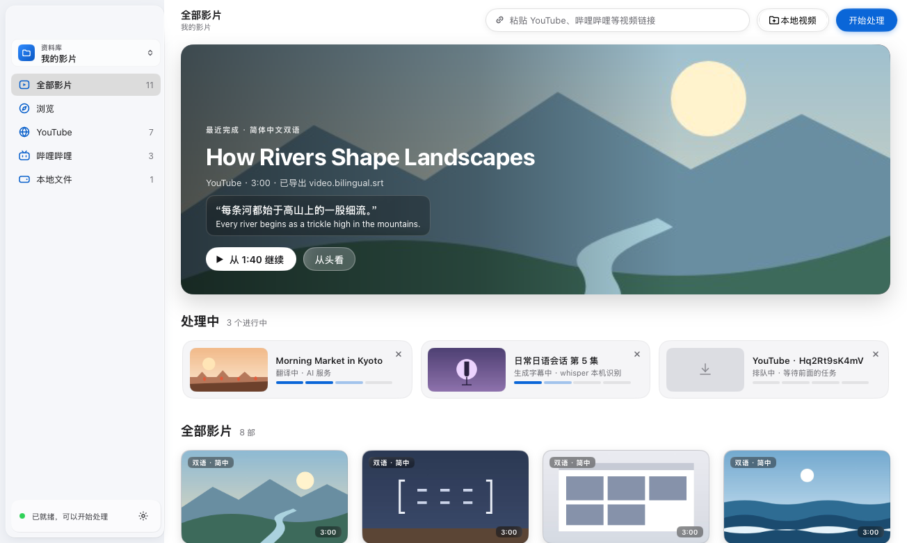
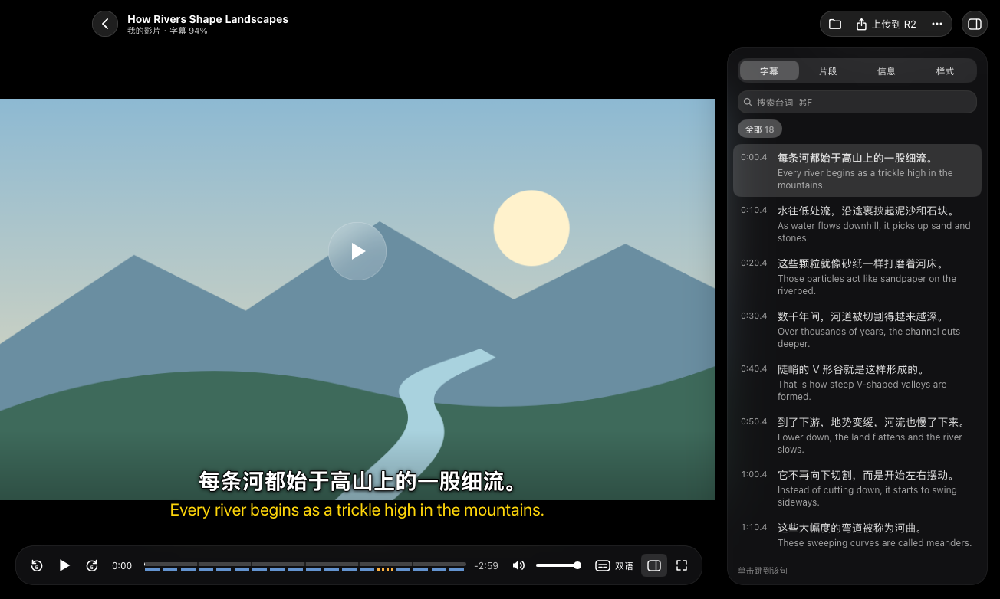
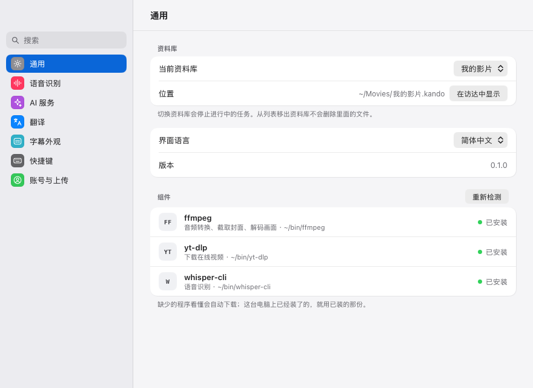
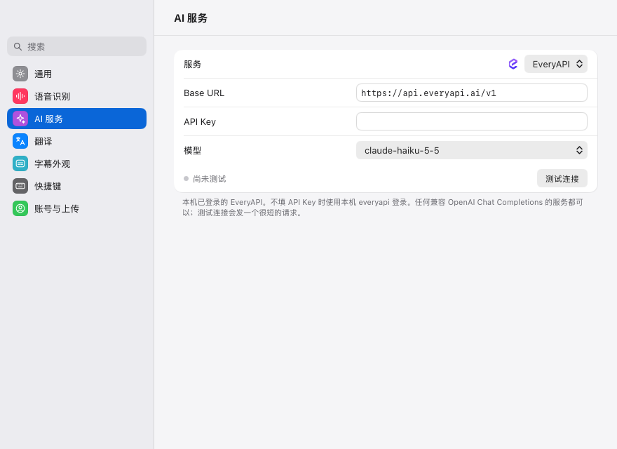

# 看懂（Kando）

[](https://github.com/yldm-tech/Kando/actions/workflows/ci.yml)
[](https://github.com/yldm-tech/Kando/actions/workflows/release.yml)
[](https://github.com/yldm-tech/Kando/releases)
[](LICENSE)
[](go.work)
[](#install)
[](https://github.com/yldm-tech/Kando/stargazers)

[English](README.md) · 简体中文 · [日本語](README.ja.md) · [繁體中文](README.zh-TW.md) · [한국어](README.ko.md)

看懂是一款用原声视频学外语的桌面应用。粘贴 YouTube 或哔哩哔哩链接，或者把视频文件拖到窗口上：看懂会用 yt-dlp 下载视频，在本机用 whisper.cpp 转录语音，再通过 OpenAI 兼容模型逐句翻译，然后播放原视频，屏幕上同时显示原文和译文。它用 Go 编写，原生界面由 [MyGo](https://github.com/egoist/mygo) 和 [Breeze UI](https://github.com/yldm-tech/mygo-breeze-ui) 绘制，没有使用 Web 视图。



界面支持简体中文、繁体中文、英文、日文和韩文，默认是简体中文；在“设置 › 通用 › 界面语言”中切换，窗口会立即换成所选语言。下文引用的界面文字都与简体中文界面一致。

## 功能

- 添加视频：粘贴 YouTube、哔哩哔哩或 yt-dlp 支持的其他任何网站的链接（“帮助 › 支持的网站…”列出了全部网站及其标志），或者选择本地文件（mp4、mov、mkv、webm 等视频文件），也可以直接拖到窗口上。本地文件在原位置转录，不会被复制。
- 任务按顺序逐个处理，依次经过下载、转录、翻译和导出。失败的任务会显示原因，并给出对应设置项的入口，可以重试或移除。
- 语音识别由 whisper.cpp 在你的电脑上完成，它会检测说话的语言。“设置 › 语音识别”列出七个 whisper 模型，从 Tiny（77.7 MB）到 Large v3（3.1 GB），你选中的模型会从 Hugging Face 下载。
- 台词默认由 EveryAPI 翻译，也可以使用任何 OpenAI 兼容的聊天 API：“设置 › AI 服务”提供 OpenAI、OpenRouter、Groq、DeepSeek、xAI、Mistral、通义千问（DashScope）、Kimi、智谱 GLM、硅基流动、Ollama 和 LM Studio 的预设，还可以自定义接口地址。目标语言、“智能翻译”（让模型参考前面几句台词）和提示词，都可以在“设置 › 翻译”中修改。
- 每个处理完成的视频旁边会生成两个 SubRip 字幕文件：`<video>.srt` 是原文字幕，`<video>.bilingual.srt` 中每句译文位于对应原文上方（下载的视频则是 `video.srt` 和 `video.bilingual.srt`）。
- 播放器可以把字幕显示为双语、仅原文、仅译文或关闭，字幕延迟可按 0.1 秒步进调整，样式也可以修改。可以跳到上一句、下一句，重听本句，或单句循环直到听懂为止。侧边面板列出全部台词并支持搜索（单击某句即可跳转），把视频切分成 4 到 12 个约 30 秒的片段，并显示影片的文件和来源。每部影片都会从你上次停下的位置继续播放。
- 资料库是 `.kando` 文件夹，里面都是普通文件，可以在访达或文件管理器中管理。可以同时保留多个资料库，并在侧栏中切换；侧栏还能按来源筛选当前资料库中的影片：YouTube、哔哩哔哩、其他网站和本地文件。
- 可选：登录 Google 后，在播放器中把影片的视频和双语字幕上传到你自己的对象存储（Cloudflare R2、Amazon S3、阿里云 OSS、腾讯云 COS 或任何 S3 兼容存储）。参见[配置](#configuration)。
- 播放、字幕和窗口都有键盘快捷键，可以在“快捷键速查”（⌘/）和“设置 › 快捷键”中查看。
- 反馈问题时可以附上日志文件：“帮助 › 显示日志文件”（或命令面板 ⌘K）会在访达中显示它。macOS 上是 `~/Library/Logs/Kando/kando.log`，其他系统在用户配置目录的 `Kando/logs` 文件夹里。日志记下每个失败任务的原因（不含看懂保存的密钥和 AI 服务的地址）和出错工具输出的最后 64 KB，形似密钥的内容都写成 `***`。文件超过 5 MB 时另起一份，保留之前的两份。



<a id="install"></a>

## 安装

<a id="download"></a>

### 下载

macOS（Apple 芯片和 Intel）和 Linux（x86-64 和 ARM64）的安装包在 [GitHub Releases](https://github.com/yldm-tech/Kando/releases) 上；目前还没有 Windows 安装包，在 Windows 上请按下文从源码构建。按你的系统选择文件，其中 `<version>` 是该版本的版本号，例如 `0.5.0`：

- macOS：Apple 芯片的 Mac 选 `kando-<version>-arm64.dmg`，Intel 的 Mac 选 `kando-<version>-amd64.dmg`。打开磁盘映像，把看懂拖到“应用程序”文件夹。
- Debian、Ubuntu 及其衍生发行版：x86-64 选 `kando_<version>_amd64.deb`，ARM64 选 `kando_<version>_arm64.deb`。在下载所在的文件夹中用 `sudo apt install ./kando_<version>_<arch>.deb` 安装。
- 其他 Linux 发行版：运行该版本附带的安装脚本，不需要自己下载安装包：

  ```sh
  curl -fsSL https://github.com/yldm-tech/Kando/releases/latest/download/install.sh | sh
  ```

  它会为你的机器下载最新的 `kando-<version>-linux-<arch>.tar.gz`，校验它的签名，然后只为当前用户安装看懂，不需要 root：应用装在 `~/.local/kando.app`，`kando` 命令放在 `~/.local/bin`，并在应用程序菜单中添加一项。校验签名需要 OpenSSL 3.0 或更高版本（Debian 12、Ubuntu 22.04、Fedora 36 及更高版本）；OpenSSL 版本更旧时，脚本什么也不下载，并会说明原因。这时请从同一个版本中把适合你机器的 `.tar.gz` 和 `install.sh` 下载到同一个文件夹，不要改文件名，在那里运行 `sh install.sh`；也可以运行 `sh install.sh <安装包>`，传入 `.tar.gz` 的路径。两种方式都会安装这个安装包，但不校验签名。再次运行脚本会用新版本覆盖旧版本；`sh install.sh --uninstall` 会移除看懂，并保留它的设置和资料库。

版本中的其他文件不是用来安装的：`checksums.txt` 列出每个文件的 SHA-256，而 `update-*.json` 清单、`.delta` 文件和 `darwin` 压缩包是已安装的看懂自动更新时下载的（参见[更新](#updates)）。

0.5.1 之后发布的 macOS 安装包用 YLDM 的 Developer ID 签名，并经过 Apple 公证，打开看懂时 macOS 不会再发出警告。

<a id="updates"></a>

### 更新

看懂会从 GitHub 上已签名的版本自动更新。它在打开 10 秒后在后台检查一次，之后每天检查一次；有新版本时，会弹出窗口显示更新说明，并提供“安装更新”“稍后提醒我”和“跳过这个版本”。“安装更新”会下载新版本、校验签名，然后提示重新启动看懂进入新版本；不重新启动的话，下次打开看懂时就是新版本。跳过的版本不会再由后台检查提示，但之后的新版本仍会提示。

要立即检查，在 macOS 上选择菜单栏中的“看懂 › 检查更新…”；Linux 和 Windows 没有菜单栏，请在命令面板（Ctrl+K）中选择“检查更新…”。“设置 › 通用”中“版本”旁边也有“检查更新…”按钮，下方会显示上次检查发现的新版本，或上次检查的时间。“自动检查更新”和“自动下载并安装更新”两个开关也在“设置 › 通用”中。只有打开前者时才会显示后者，因为只有后台检查会下载更新；打开后者后，后台检查发现新版本会直接安装，不再询问，下次打开看懂时生效。

无法替换自身文件的看懂不会自动更新。`.deb` 和 `PKGBUILD` 就是这种情况：它们把看懂安装在由包管理器管理的 `/opt/kando` 中，而看懂没有 apt 软件源，所以更新时请从新版本下载 `.deb` 并按同样方式安装，或者改用上面的安装脚本，它安装在 `~/.local/kando.app` 的看懂可以自动更新。这样安装的看懂在“设置 › 通用”中不显示这两个开关，“检查更新…”会打开一个窗口说明无法更新的原因。Windows 目前还没有发布更新。

### 从源码构建

需要 Go 1.27.3 或更高版本：

```sh
git clone https://github.com/yldm-tech/Kando.git
cd Kando
make build
```

`make build` 会针对当前平台运行 `go tool mygo build apps/kando`，并把结果写入 `apps/kando/build/<os>-<arch>/`：在 macOS 上是经过临时签名（ad-hoc）的 `Kando.app` 和一个 `.dmg`，在其他平台上是一个可执行文件（Linux 另外生成一个 `.deb`、一个附带安装脚本的 `.tar.gz` 和一个 `PKGBUILD`；Windows 另外生成一个用 NSIS 制作的安装程序，未安装 NSIS 时 mygo 会自动下载）。没有 `make` 时（例如未额外安装工具的 Windows），在仓库根目录直接运行 `go tool mygo build apps/kando`。

## 运行依赖

看懂会调用 `yt-dlp`、`ffmpeg` 和 `whisper-cli`（whisper.cpp）。在 macOS 和 Linux 上不用自己安装：看懂打开时如果缺少其中哪个，会自动下载，入门引导里会显示下载进度。已经装好的（比如用 Homebrew 装的）会直接使用。

| 程序 | 用途 | 看懂下载的版本 |
| --- | --- | --- |
| `yt-dlp` | 下载在线视频。每个任务都需要它，本地文件也不例外。 | [yt-dlp 官方发布](https://github.com/yt-dlp/yt-dlp/releases)的单文件版。 |
| `ffmpeg` | 提取音频、截取封面，以及在播放器中解码画面和声音；播放器在 macOS、Linux 和 Windows 上都通过系统的音频输出播放声音。 | FFmpeg 9.0.2（macOS 版带 `ffplay`），来自本仓库的 [tools 发布](https://github.com/yldm-tech/Kando/releases/tag/tools-1)。 |
| `whisper-cli`（whisper.cpp） | 语音识别。 | whisper.cpp 1.9.5（macOS 版启用 Metal），来自同一个发布。 |
| 一个 whisper.cpp ggml 模型 | 在入门引导或“设置 › 语音识别”中下载，或者用 `KANDO_WHISPER_MODEL` 指向一个模型文件。 | |

tools 发布由 Tools 工作流（`.github/workflows/tools.yml`）按 `.github/tools.env` 里固定的源码构建，看懂使用每个下载前都会用内置的 SHA-256 校验。下载的程序放在 `settings.json` 旁边的 `tools` 文件夹里（macOS 上是 `~/Library/Application Support/Kando/tools`，Linux 上是 `~/.config/Kando/tools`）。看懂先在这里找，再找 `PATH` 以及 `/opt/homebrew/bin`、`/usr/local/bin` 和 `/home/linuxbrew/.linuxbrew/bin`，因为从访达或桌面启动器打开的应用只能拿到精简的 `PATH`。“设置 › 通用”会显示用的是哪个程序，缺少的可以点“下载”或“重试”，点击“重新检测”可以重新查找。如果因为 `yt-dlp` 版本过旧而下载失败，看懂会提供“更新并重试”，按原来的安装方式更新它并重试。

在 Windows 上看懂暂时还不会自动下载：请用包管理器安装同样的程序，并确保它们在 `PATH` 中。

## 快速上手

1. 打开看懂。还没有资料库时，它会提供“新建资料库…”和“打开已有资料库…”。新建的资料库默认名为“影视库”，在 macOS 上位于 `~/Movies`，在其他系统上位于 `~/Videos`，可以自行修改。
2. 入门引导会自动下载缺少的 `ffmpeg`、`yt-dlp` 和 `whisper-cli`。打开设置（⌘,），“通用”里会显示它们和各自的版本。
3. 在“语音识别”中，点击某个 whisper 模型旁的“下载”；下载完成后看懂会自动选用它。标为“推荐”的是 Large v3 Turbo（压缩版），大小 574 MB。Vimpo 或 hyperframes 已经下载过的模型可以直接选用，无需复制。
4. 在“AI 服务”中设置翻译：
   - EveryAPI（默认）：运行一次 `everyapi auth login`，用 [EveryAPI](https://everyapi.ai) CLI 登录。看懂会向 CLI 获取密钥（`everyapi auth credential`），因此登录状态、网关区域和密钥刷新都与 CLI 保持一致，无需手动粘贴密钥。默认模型是 `claude-haiku-5-5`，其他模型可以用 `everyapi models list` 查看。也可以直接把 EveryAPI 密钥粘贴到“API Key”中。
   - 其他服务商：在“服务”中选择它，或者选择“OpenAI 兼容”并填写它的 Base URL，然后填写“模型”和“API Key”（Ollama、LM Studio 等本地服务不需要密钥）。“测试连接”会发送一个简短的请求来检查设置。
5. 在“翻译”中选择默认目标语言：简体中文（默认）、繁体中文、English、日本語、한국어、Español、Français 或 Deutsch。
6. 回到主窗口，把链接粘贴到顶栏的输入框并点击“开始处理”，或者点击“本地视频”，也可以把视频拖到窗口上。任务所需的一切都就绪时，侧栏底部的状态行会显示“已就绪，可以开始处理”，否则会指出缺少什么。

遇到翻译服务商限流或返回服务器错误时，看懂会自动重新发送请求，连同第一次最多尝试三次。





<a id="command-line-and-mcp"></a>

## 命令行与 MCP

看懂的程序本身也是命令行工具 `kando`，同时也是供 AI 智能体使用的 MCP 服务器。带下表中的命令运行时，它会操作看懂应用；不带命令运行时，它照常打开窗口。

获取 `kando` 命令：

- macOS：先把看懂移到“应用程序”文件夹，再在“设置 › 通用”中点击“命令行工具”旁的“安装”。它会在 `/usr/local/bin`、`/opt/homebrew/bin`、`~/.local/bin` 中第一个可写入的文件夹里创建指向看懂的 `kando` 链接，不会要求输入管理员密码，也不会替换其他程序的 `kando`。直接从磁盘映像打开，或下载后被 macOS 放到临时位置（App Translocation）运行时，看懂所在的路径很快就会失效，这时卡片会提示先移动看懂，而不是安装一个日后失效的链接。也可以自己创建链接：`sudo ln -s /Applications/Kando.app/Contents/MacOS/Kando /usr/local/bin/kando`。
- Linux：`.deb` 和 `PKGBUILD` 把应用安装到 `/opt/kando`，并添加指向 `/opt/kando/kando` 的链接 `/usr/bin/kando`。安装脚本（参见[下载](#download)）把应用安装到 `~/.local/kando.app`，并创建指向它的 `~/.local/bin/kando`；那里已有不是它创建的 `kando` 时则保留原样。如果 shell 的 `PATH` 里没有 `~/.local/bin`，请把它加进去。
- Windows：看懂无法安装这个命令，因为在 Windows 上创建链接需要管理员权限或开发者模式。“设置 › 通用”的“命令行工具”下会显示 `Kando.exe` 所在的文件夹；把这个文件夹加入 `PATH` 后，在终端中输入 `kando` 就会运行它，因为 Windows 的文件名不区分大小写。

| 命令 | 作用 |
| --- | --- |
| `kando status` | 显示当前打开的资料库、正在使用的程序和模型，以及能否开始任务；不能时说明缺少什么。 |
| `kando list [--source S] [query]` | 按从新到旧列出资料库中的影片及其 ID。`--source` 只保留一个来源（`youtube`、`bilibili`、`local` 或其他网站的名称）；query 只保留标题中包含它的影片。 |
| `kando show <film-id>` | 显示一部影片：来源、所处阶段，以及视频和字幕的路径。 |
| `kando subtitles <film-id> [--format srt\|text\|json] [--original\|--translation]` | 输出影片的字幕，格式可以是 SubRip（默认）、每条字幕一行的文本（`text`）或 JSON，可以输出双语，也可以只输出其中一种。 |
| `kando jobs` | 列出任务：先是正在运行的，然后是等待中的，最后是已结束的。 |
| `kando add <link-or-file>... [--wait]` | 像“开始处理”一样把链接和本地视频文件加入队列，并输出每个任务的 ID。相对路径以当前目录为准。 |
| `kando cancel <job-id>` | 停止正在运行的任务，或把等待中的任务移出队列。 |
| `kando retry <job-id> [--wait]` | 像“重试”和“重新处理”一样，以同一个 ID 把失败、已取消或已完成的任务重新加入队列，不改变窗口显示的内容。正在运行或等待中的任务会被拒绝。 |
| `kando remove <job-id>` | 像“移除”一样把任务从资料库中去掉，正在运行的任务会先停止。它的文件留在磁盘上。 |
| `kando sites [query] [--limit N]` | 按名称、域名或视频链接搜索看懂支持下载的网站。 |
| `kando open [film-id]` | 把看懂窗口调到最前面，显示指定的影片；不带 ID 时显示资料库。 |
| `kando mcp` | 在标准输入和标准输出上提供 MCP 服务（见下文）。 |
| `kando version` | 输出版本号。 |
| `kando help [command]` | 列出所有命令，或显示某个命令的用法和选项。 |

需要应用的命令通过套接字与它通信，套接字是 `settings.json` 所在文件夹中的 `kando.sock`（macOS 上是 `~/Library/Application Support/Kando/kando.sock`，Linux 上是 `~/.config/Kando/kando.sock`，Windows 上是 `%AppData%\Kando\kando.sock`）；`KANDO_SOCKET` 可以指定其他路径，运行第二个看懂时也需要它，并且还要有单独的 `HOME`（参见[配置](#configuration)）。看懂没有运行时，命令会在后台启动它，向标准错误输出 `Starting Kando…`，并最多等待 30 秒。添加视频需要的条件和“开始处理”相同，例如已打开资料库、程序齐全、已有 whisper 模型；缺少某项时，`kando add` 会失败，并给出窗口中对应的提示。

所有与应用通信的命令都支持 `--json`，以 JSON 而不是文本输出应用的应答。有来源未能加入时，`kando add` 以 1 退出。加上 `--wait` 时，它会一直等到所有新加的任务完成或失败，每当某个任务的阶段或进度变化时输出一行；只要有任务失败，同样以 1 退出。加上 `--json` 时，进度输出到标准错误，结束时的任务输出到标准输出。`kando retry --wait` 以同样的方式等待重新加入队列的任务。退出码：0 表示成功，1 表示失败，2 表示命令用法有误。

`kando mcp` 是在标准输入和标准输出上运行的 MCP 服务器。看懂没有运行时，它的工具也会同样地启动它：

| 工具 | 作用 |
| --- | --- |
| `kando_status` | 应用版本、当前打开的资料库、能否开始任务以及缺少什么、各个程序、语音识别和翻译模型、目标语言，以及正在运行和等待中的任务。 |
| `kando_list_films` | 按从新到旧列出当前资料库的影片，可按 `source` 或标题中的文字（`query`）筛选。 |
| `kando_get_film` | 按 ID 获取一部影片：所处阶段、目标语言，以及视频和字幕的路径。 |
| `kando_get_subtitles` | 已完成影片的带时间戳字幕，可以是双语或其中一种（`which`），格式为紧凑文本或 SRT（`format`）；设置 `max_cues` 时只返回开头的若干条。 |
| `kando_add_videos` | 把链接和本地视频文件加入队列；返回这些任务，以及每个未能加入的来源被跳过的原因。 |
| `kando_list_jobs` | 列出任务，包括阶段、进度、状态、错误，完成后还有影片 ID 和文件路径。 |
| `kando_cancel_job` | 停止正在运行的任务，或把等待中的任务移出队列。 |
| `kando_retry_job` | 以同一个 ID 把失败、已取消或已完成的任务重新加入队列，并返回这个任务。 |
| `kando_remove_job` | 把任务从资料库中去掉，正在运行的任务会先停止；它的文件留在磁盘上。 |
| `kando_search_sites` | 按名称、域名或视频链接搜索看懂支持下载的网站（未设置 `limit` 时返回 20 个结果）。 |
| `kando_open` | 把看懂窗口调到最前面，显示一部影片或资料库。 |

在 Claude Code 中添加时填写程序的路径；`kando` 已在 `PATH` 中时直接写 `kando` 即可：

```sh
claude mcp add kando -- /Applications/Kando.app/Contents/MacOS/Kando mcp
```

其他 MCP 客户端在 `mcpServers` 设置中填写同样的命令：

```json
{
  "mcpServers": {
    "kando": {
      "command": "/Applications/Kando.app/Contents/MacOS/Kando",
      "args": ["mcp"]
    }
  }
}
```

在支持 WebMCP 的浏览器中，官网 [kando.yldm.ai](https://kando.yldm.ai) 会为浏览器中的智能体提供 WebMCP 工具：`search_supported_sites` 查询看懂是否支持从某个网站下载，`get_download` 给出适合某个系统的下载链接，`get_started` 返回上手步骤，`list_features` 列出看懂的功能。

<a id="configuration"></a>

## 配置

除 Google 客户端 ID、客户端密钥和 `KANDO_SOCKET` 外，下表各项也都可以在应用内设置（资料库在侧栏中切换，其他项在“设置”中修改）。环境变量一旦设置，就会覆盖应用中保存的值。

| 变量 | 默认值 | 含义 |
| --- | --- | --- |
| `KANDO_WHISPER_MODEL` | 在“设置 › 语音识别”中选择的模型 | whisper.cpp ggml 模型文件的路径，例如 `ggml-small.bin`。 |
| `KANDO_LLM_BASE_URL` | EveryAPI，`https://api.everyapi.ai/v1` | OpenAI 兼容服务商的 Base URL，例如 `https://api.openai.com/v1`，Ollama 则是 `http://localhost:11434/v1`。设置后不再使用已登录的 EveryAPI 账号。 |
| `KANDO_LLM_MODEL` | EveryAPI 上为 `claude-haiku-5-5` | 翻译模型。使用自定义服务商时没有默认值：需要在这里或“设置 › AI 服务”中设置。 |
| `KANDO_LLM_API_KEY` | 无 | 翻译服务商的 API 密钥（以 Bearer 方式发送）。它优先于已登录的 EveryAPI 账号。 |
| `EVERYAPI_API_KEY` | 无 | EveryAPI 密钥，在 `KANDO_LLM_BASE_URL` 未设置且 `KANDO_LLM_API_KEY` 为空时使用，代替 CLI 登录。 |
| `KANDO_OUTPUT_DIR` | 上次打开的资料库 | 启动时打开的资料库文件夹，新的视频和字幕都存放在这里。 |
| `KANDO_SOCKET` | `settings.json` 旁的 `kando.sock` | 应用监听、`kando` 命令行和 `kando mcp` 连接的套接字路径。应用和命令需要设置成同一个路径。同一个用户只运行一个看懂，再次启动只会把已运行的那个带到前台；设置了 `KANDO_SOCKET` 启动的是有意运行的第二个看懂（例如开发时），它还需要单独的 `HOME`，才能使用自己的资料库和设置。参见[命令行与 MCP](#command-line-and-mcp)。 |
| `KANDO_GOOGLE_CLIENT_ID` | 无 | 用于在“设置 › 账号与上传”中登录的 Google OAuth 客户端 ID。不设置时登录按钮不可用。它永远不会保存到设置文件中。 |
| `KANDO_GOOGLE_CLIENT_SECRET` | 无 | 同一 OAuth 客户端的客户端密钥，可选。 |
| `KANDO_STORAGE` | `r2` | 上传目标：`r2`、`s3`（或 `aws`）、`oss`（或 `aliyun`）、`cos`（或 `tencent`）、`compat`（或 `s3compat`）。其他任何值都按 R2 处理。 |
| `KANDO_R2_ENDPOINT` | 无 | Cloudflare R2：账号 ID 或完整的 `https://` 端点。 |
| `KANDO_R2_BUCKET`、`KANDO_R2_ACCESS_KEY`、`KANDO_R2_SECRET` | 无 | Cloudflare R2 的存储桶和密钥。 |
| `KANDO_S3_REGION` | 无 | Amazon S3 区域名称，例如 `ap-northeast-1`。 |
| `KANDO_S3_BUCKET`、`KANDO_S3_ACCESS_KEY`、`KANDO_S3_SECRET` | 无 | Amazon S3 的存储桶和密钥。 |
| `KANDO_OSS_REGION` | 无 | 阿里云 OSS 地域名称，例如 `cn-hangzhou`（内网使用 `cn-hangzhou-internal`）。 |
| `KANDO_OSS_BUCKET`、`KANDO_OSS_ACCESS_KEY`、`KANDO_OSS_SECRET` | 无 | 阿里云 OSS 的存储桶和密钥。 |
| `KANDO_COS_REGION` | 无 | 腾讯云 COS 地域名称，例如 `ap-guangzhou`。 |
| `KANDO_COS_BUCKET`、`KANDO_COS_ACCESS_KEY`、`KANDO_COS_SECRET` | 无 | 腾讯云 COS 的存储桶（名称包含 APPID，例如 `video-1250000000`）、SecretId 和 SecretKey。 |
| `KANDO_S3COMPAT_ENDPOINT` | 无 | 其他 S3 兼容存储的完整 `https://` 端点。 |
| `KANDO_S3COMPAT_REGION` | 无 | 该存储的签名区域；MinIO 通常使用 `us-east-1`。 |
| `KANDO_S3COMPAT_BUCKET`、`KANDO_S3COMPAT_ACCESS_KEY`、`KANDO_S3COMPAT_SECRET` | 无 | 该存储的存储桶和密钥。 |
| `KANDO_S3COMPAT_PATH_STYLE` | 关闭 | `1`、`true`、`yes` 或 `on` 开启路径样式寻址（MinIO 需要）；`0`、`false`、`no` 或 `off` 关闭。 |

上传需要手动进行：打开一部影片，在播放器中点击“上传到 R2”（或你选择的存储）。看懂会把视频及其双语字幕上传到 `<Google 账号邮箱>/<资料库>/<影片文件夹>/<文件>` 下；登录只用于标明是谁上传的。视频永远不会自动上传。

## 资料库与设置

资料库是名称以 `.kando` 结尾的文件夹。每部下载的影片在其中都有自己的文件夹 `<title> [<video id>]/`，里面是 `video.mp4`、`cover.jpg`、`video.srt` 和 `video.bilingual.srt`。它们都是普通文件：看懂会监视资料库文件夹，所以在访达或文件管理器中添加或删除的视频都会反映到资料库中。在 macOS 上，`.kando` 文件夹在访达中会显示为带有看懂标志的文件夹图标。

从资料库移除影片时，会把影片的文件夹移到废纸篓；如果该文件夹里还有其他视频或文件夹，则只移走这部影片的视频和字幕。资料库文件夹之外的本地视频会留在原处，只是从列表中消失。从列表中移除资料库时，它在磁盘上的文件夹会保留。

看懂把自己的文件放在用户配置目录中（macOS 上是 `~/Library/Application Support/Kando`，Windows 上是 `%AppData%\Kando`，Linux 上是 `~/.config/Kando`），包括：

- `library.json`：所有任务（已完成的和进行中的），以及每个视频上次播放到的位置。
- `settings.json`：设置，包括 API 密钥、对象存储密钥和 Google 刷新令牌，均以明文保存。该文件仅当前用户可读。
- `window-state.json`：窗口大小和位置。
- `updater.json`：你对更新的选择（“设置 › 通用”中的两个开关、跳过的版本）以及看懂上次检查更新的时间。
- `models/`：在“设置 › 语音识别”中下载的 whisper 模型。

文件名不是 `video.*` 的视频，其封面图缓存在 `~/Library/Caches/Kando/posters`（macOS）、`%LocalAppData%\Kando\posters`（Windows）和 `~/.cache/Kando/posters`（Linux）中。

## 从 LingoCut 升级

看懂以前叫 LingoCut，新版本不会再读取任何使用旧名称的路径或变量。要保留原有的资料库和设置，请按以下步骤操作：

1. 退出应用。
2. 把配置文件夹从 `LingoCut` 重命名为 `Kando`：macOS 上是 `~/Library/Application Support/LingoCut`，Windows 上是 `%AppData%\LingoCut`，Linux 上是 `~/.config/LingoCut`。其中包含 `library.json`、`settings.json`、`window-state.json` 和已下载的模型。
3. 在重命名配置文件夹之后、启动应用之前，把每个资料库从 `X.lingocut` 重命名为 `X.kando`。在 macOS 和 Linux 上，应用可以通过保存的文件索引节点（inode）找到每个改名后的资料库。在 Windows 上，应用只能把一个找不到的资料库匹配到同一父文件夹中的一个新 `.kando` 文件夹，所以同一个父文件夹中一次只重命名一个资料库，每改一个就启动一次应用。
4. 把每个环境变量从 `LINGOCUT_*` 重命名为 `KANDO_*`。
5. 启动看懂，并在“设置 › 语音识别”中重新选择 whisper 模型：模型文件已随文件夹一起移动，会显示为“已下载”，但保存的选择仍指向旧路径。
6. 删除旧名称留下的内容：`lingocut.app` 和 `lingocut Dev.app`；封面缓存 `~/Library/Caches/LingoCut`（Windows 上是 `%LocalAppData%\LingoCut`，Linux 上是 `~/.cache/LingoCut`）；Linux 上的小写目录 `~/.config/lingocut`；如果运行过 `make dev`，还有 `~/Library/Application Support/lingocut Dev`。

## 开发

需要 Go 1.27.3 或更高版本。

```sh
make test   # 运行 packages/core、packages/media 和 apps/kando 的 go test
make dev    # 以热重载方式运行应用
make build  # 为当前平台构建应用，输出到 apps/kando/build
```

`make dev` 运行的是经 `tools/mygo-dev` 打过补丁的 MyGo `mygo dev`：在 macOS 上，重新加载时会保留正在运行的窗口，等新构建的窗口出现后再替换，而不是先退出旧窗口，所以保存改动时不会看起来像应用退出了。如果 MyGo 升级后补丁无法应用，它会发出警告并回退到原版的 `go tool mygo dev`；这时请对照新的 `cmd/mygo/dev.go` 更新 `tools/mygo-dev/dev.go.patch`。它背后的 `tools/mygo-dev/dev.sh` 是一个 POSIX 兼容的 shell 脚本。

截图测试会从一个固定的演示资料库把主要场景渲染成 PNG 文件，运行时使用空的模拟主目录以及模拟的 `ffmpeg`、`yt-dlp` 和 `whisper-cli`，因此不会读取你的设置、资料库或工具：

```sh
KANDO_SCREENSHOTS=/tmp/kando-shots go test ./apps/kando/... -run TestScreenshots
```

设置 `KANDO_SCREENSHOTS_LANG`（`en`、`zh-Hans`、`zh-Hant`、`ja` 或 `ko`）会以对应的界面语言渲染，演示资料库也换成该语言读者的内容；`-run TestScreenshotsReadme` 渲染各语言 README 用的四张图，保存在 `docs/assets/<语言>/`。

仓库结构：

- `apps/kando`：应用本体。每个界面有自己的目录（`sidebar/`、`films/`、`film/`、`settings/`、`account/`、`cheatsheet/`）；`view.go` 把窗口和它们连接起来。`shelf/` 是任务记录，`cloud/` 负责 Google 登录和对象存储上传，`brand/` 是资料库在访达中的图标。
- `packages/core`：与平台无关的任务、阶段和链接解析。
- `packages/media`：媒体处理流水线，包括下载、转录、翻译、字幕导出、封面和资料库。
- `tools/mygo-dev`：`make dev` 背后打过补丁的 `mygo dev`。

[AGENTS.md](AGENTS.md) 说明了界面如何拆分成组件，以及各部分遵循的规则；修改界面前请先阅读。

## CI 与发布

[CI](https://github.com/yldm-tech/Kando/actions/workflows/ci.yml) 工作流会对拉取请求和 `main` 分支进行构建和测试。[Release](https://github.com/yldm-tech/Kando/actions/workflows/release.yml) 工作流在 `main` 分支的 CI 通过后运行，也可以手动触发：它根据上一个标签以来的 约定式提交（Conventional Commits）确定下一个版本号，以 `chore(release)` 提交到 `main`，打上标签，在不使用 Developer ID 或代码签名证书的情况下构建 macOS、Windows 和 Linux 的安装包，为已安装的看懂要下载的更新签名，并把 macOS 和 Linux 的安装包连同校验和一起发布到 GitHub Releases。Windows 安装程序已经构建，但还没有发布。

## 许可证

[MIT](LICENSE)
