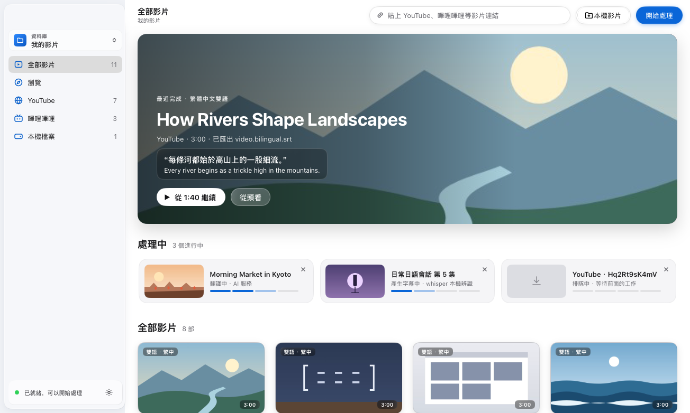
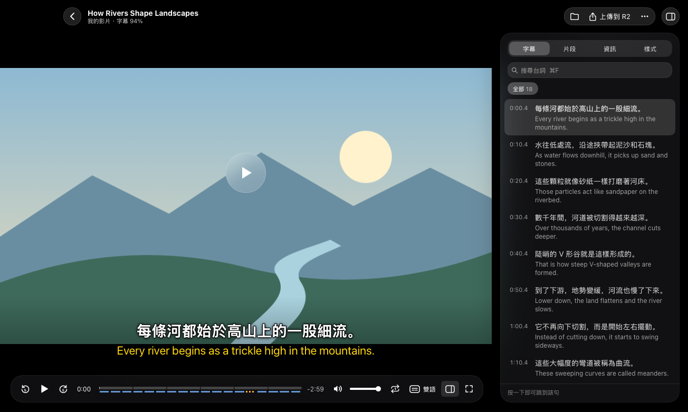
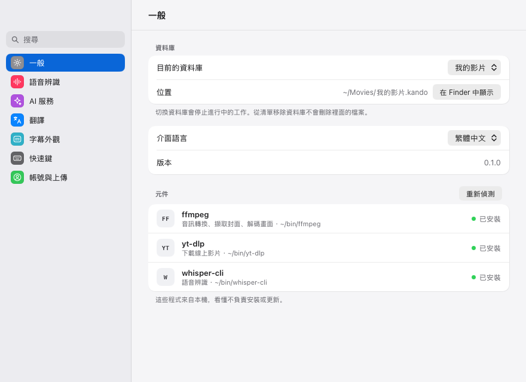
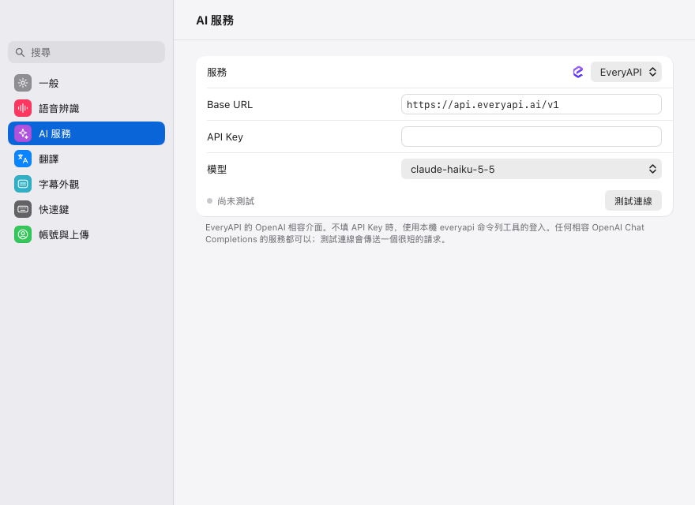

# 看懂（Kando）

[](https://github.com/yldm-tech/Kando/actions/workflows/ci.yml)
[](https://github.com/yldm-tech/Kando/actions/workflows/release.yml)
[](https://github.com/yldm-tech/Kando/releases)
[](LICENSE)
[](go.work)
[](#install)
[](https://github.com/yldm-tech/Kando/stargazers)
[](https://x.com/suzukaze_haduki)
[](https://github.com/sponsors/houko)

[English](README.md) · [简体中文](README.zh-CN.md) · [日本語](README.ja.md) · 繁體中文 · [한국어](README.ko.md)

看懂是一款桌面應用程式，讓你透過某種語言的影片來學習那種語言。貼上 YouTube 或嗶哩嗶哩的連結，或把影片檔或整個影片資料夾拖曳到視窗上：看懂會用 yt-dlp 下載影片，用 whisper.cpp 在你自己的電腦上轉錄語音，透過 OpenAI 相容的模型翻譯每一句台詞，再播放原始影片，並在畫面上同時顯示原文台詞與譯文。它以 Go 撰寫，使用 [NSGo](https://github.com/nsgo-dev/nsgo) 繪製原生介面，沒有使用網頁檢視（web view）。



介面支援繁體中文、簡體中文、英文、日文和韓文，預設為簡體中文；在「設定 › 一般 › 介面語言」中切換，視窗會立即改用所選語言。下文引用的標籤都與繁體中文介面一致。

## 功能

- 新增影片的方式：貼上 YouTube、嗶哩嗶哩或其他 yt-dlp 支援之網站的連結（「輔助說明 › 支援的網站…」列出全部網站及其標誌），或選擇本機檔案（mp4、mov、mkv、webm 及其他影片檔），也可以把檔案拖曳到視窗上。本機檔案會在原處轉錄，不會被複製。拖曳到視窗上的資料夾會加入其中的影片，以及它下一層各資料夾裡的影片，依檔名排序，數字依大小排（Episode 2 在 Episode 10 之前）；不是影片的檔案會被略過，訊息列會說明略過了幾個。
- 貼上合集或頻道的連結，看懂會列出其中的影片，說明共有多少個、資料庫裡已有多少個，確認後把每個影片當成獨立的工作加入；頻道只取最新的 50 個影片。YouTube 合集中某個影片的連結只加入這個影片，之後訊息列會提供「加入整個合集」。一次貼上多個連結（以空格或換行分隔）會一起加入。
- 側欄的「瀏覽」是內建瀏覽器：打開網站，需要時先登入，然後點「下載影片」把目前的網頁加入資料庫；在合集或頻道的網頁上則是「下載這些影片」。在 YouTube、嗶哩嗶哩、Vimeo、TED、niconico、Dailymotion 和 TikTok 上，網頁裡也會出現看懂自己的按鈕：影片下方的「下載影片」，以及網頁列出的每個影片縮圖上的「+」；影片等待或處理中時它顯示為時鐘，進入資料庫後顯示為勾號，按一下資料庫已有的影片會在資料庫中顯示它。連結輸入框旁邊和空資料庫頁面上的「瀏覽網站」會打開這個瀏覽器。[瀏覽器擴充功能](#browser-extension)會把同樣的按鈕放進你自己的瀏覽器。在「設定 › 一般 › 瀏覽器登入」裡選一個瀏覽器（如 Chrome、Edge、Firefox 或 Safari），「瀏覽」和下載就都用它的登入：YouTube、嗶哩嗶哩、TED、NHK、niconico、BBC、Vimeo、Dailymotion、TikTok 和 X 的網頁打開時已按你在那裡的狀態登入，會員專屬和需要年齡驗證的影片第一次就能下載。看懂只複製這些網站的 Cookie，以及 YouTube 登入用的 Google 的 Cookie，不複製其他任何網站的。yt-dlp 不會告訴看懂哪些 Cookie 是瀏覽器不讓網頁指令碼讀取的（HttpOnly），所以看懂只給它見過網站這樣設定的那些加上標記，其餘的網頁指令碼可以讀取，網站自己的指令碼也要讀其中一些。看懂只在你選擇瀏覽器時、每次啟動後第一次打開「瀏覽」時，以及你按「瀏覽」起始頁上的「重新整理登入」時複製，所以在 Mac 上鑰匙圈詢問 Chrome、Edge 或 Brave 的密鑰只會在這些時候出現，不會在看懂啟動時出現。關掉這個設定不會清除「瀏覽」裡的網頁已經拿到的登入（[nsgo-dev/nsgo#112](https://github.com/nsgo-dev/nsgo/issues/112)）。Safari 的登入需要給看懂「完整磁碟取用權」，Windows 上的 Chrome 暫時讀不了，Google 也可能比你的瀏覽器更早要求重新登入。在「瀏覽」裡直接登入的狀態暫時還用不到下載上（[nsgo-dev/nsgo#112](https://github.com/nsgo-dev/nsgo/issues/112)）：沒開這個設定時，需要登入帳號的影片會下載失敗，看懂會提示改用你在瀏覽器中已登入的帳號。
- 工作會依序經過下載、轉錄、翻譯和匯出各階段。失敗的工作會說明原因，附上能修正問題的設定項目連結，並可重試或移除。影片下載完成後就可以從它的卡片開始觀看，工作繼續在背景進行，轉錄完成後顯示原文字幕。
- 語音辨識在你的電腦上以 whisper.cpp 進行，whisper.cpp 會自動偵測影片所說的語言。「設定 › 語音辨識」列出七個 whisper 模型，從 Tiny（77.7 MB）到 Large v3（3.1 GB），並從 Hugging Face 下載你選擇的那一個；把「下載來源」換成 hf-mirror.com 則改從這個鏡像下載（適合中國大陸等連不上 Hugging Face 的地方）。從 Hugging Face 下載失敗時，錯誤旁的「從 hf-mirror.com 下載」會切換下載來源並重新下載該模型。無論從哪裡下載，都會以 Kando 內建的模型 SHA-256 與大小校驗。
- 台詞預設由 EveryAPI 翻譯，也可以使用任何 OpenAI 相容的聊天 API：「設定 › AI 服務」內建 OpenAI、OpenRouter、Groq、DeepSeek、xAI、Mistral、通义千问（Qwen／DashScope）、Kimi、智谱 GLM（Zhipu）、硅基流动（SiliconFlow）、Ollama 和 LM Studio 的預設選項，另可自訂端點。目標語言、讓模型參考前面幾句台詞的情境感知模式，以及提示詞，都可以在「設定 › 翻譯」中修改。沒有翻譯的已完成影片（例如當時還沒有設定 AI 服務）會提供「翻譯」；設定好 AI 服務後，影片格狀檢視上方的「翻譯 N 部影片」會翻譯其中所有這類影片，剛設定好 AI 服務時訊息列也會提供同樣的操作；影片選單和播放器「⋯」選單中的「重新翻譯為」會把它翻譯成另一種語言，不必重新下載或轉錄；「補譯未譯的句子」只翻譯翻譯失敗的句子。
- 每部處理完成的影片旁邊會產生兩個 SubRip 字幕檔：`<video>.srt` 是原文台詞，`<video>.bilingual.srt` 則把每句譯文放在原文台詞上方（下載的影片則是 `video.srt` 和 `video.bilingual.srt`）。如果本機影片旁已經有一個不是看懂寫的 `<video>.srt`，看懂不會動它，而是把自己的轉錄存在 `<video>.kando.srt` 中。
- 播放器可將字幕顯示為雙語、僅原文、僅譯文或關閉，延遲可以 0.1 秒為單位調整，樣式可以在側邊面板或「設定 › 字幕外觀」中變更。可以跳到上一句、下一句（A、D），重聽本句（R），單句循環直到聽懂為止（L），並用「循環延伸到下一句」（Shift+L）把下一句也加進循環，反覆聽完整的一句話或一段對話；「逐句暫停」（P）讓影片在每句結束時暫停，方便跟讀或記下來，按空白鍵繼續；不論字幕模式為何，「本句顯示雙語」（T）都會把正在播放的這句以雙語顯示。側邊面板列出所有台詞並可搜尋（按一下台詞即可跳到該處），把影片切成最多 12 個從某句台詞開始的片段，並顯示影片的檔案與來源。每部影片都會從你上次停止觀看的地方繼續播放。
- 學習工具作用於正在播放的這句，或剛聽完的那句。「收藏這句」（B，或側邊面板中台詞的右鍵選單）把它存進資料庫的收藏，「學習 › 收藏的句子…」會列出它們，按一下其中一句即可從這句開始播放它所在的影片。「複習」（N）逐句過一遍到期的句子：播放這句的聲音並顯示原文，「顯示譯文」（空白鍵）顯示譯文，然後用「再來一次」（1）或「記住了」（2）表示你是否記得。記住的句子會在 1 天後再出現，然後依次相隔 3、7、14、30 和 60 天，之後每 60 天一次；沒記住的會在這次複習結束前再出現。清單下方和「檔案」選單中的「匯出到 Anki…」會寫出 `Kando Saved Lines.txt`，每句一則筆記，適用於 Anki 的 Basic 筆記類型（正面是原文；背面是譯文、這句的聲音和它在影片中的位置），以及 `Kando Saved Lines audio` 資料夾，裡面是用 ffmpeg 剪出的每句聲音：把其中的檔案複製到 Anki 的 `collection.media` 資料夾，再在 Anki 中匯入 `Kando Saved Lines.txt`。「講解這句」（E，或台詞的右鍵選單）會讓 AI 服務在指令面板中講解這句的意思、關鍵字和文法。
- 指令面板（⌘K，Windows 和 Linux 上是 Ctrl+K）可以執行任何指令，依標題開啟影片或開啟某個設定區塊，並在整個資料庫中尋找台詞；在播放器中，它搜尋這部影片的台詞，並用「問這部影片」回答關於影片的問題。它只列出、也只把你看到的位置之前的台詞傳給 AI 服務，不會爆雷。Windows 和 Linux 上看懂沒有選單列，側邊欄底部的「指令」按鈕會打開指令面板，選單列中的指令都能在其中找到。
- 資料庫是由一般檔案組成的 `.kando` 資料夾，可以在 Finder 或檔案管理員中管理。你可以保留多個資料庫，並從側邊欄切換；側邊欄也能依來源篩選資料庫：YouTube、嗶哩嗶哩、其他網站和本機檔案；資料庫中的影片有不只一種語言時，還能在「語言」下依影片中說的語言篩選。影片格狀檢視可以依「最近加入」「最近觀看」「標題」「來源」或「原聲語言」排序。如果語音辨識把影片的語言認錯了，在播放器「資訊」分頁的「辨識語言」中選對語言，再按「用<語言>重新辨識」。
- 可選擇從播放器把影片檔與雙語字幕檔上傳到你自己的物件儲存空間（Cloudflare R2、Amazon S3、阿里雲 OSS、騰訊雲 COS，或任何 S3 相容的儲存服務）。請參閱[組態設定](#configuration)。
- 播放、字幕、學習與視窗都有鍵盤快速鍵，列在速查表（⌘/，Windows 和 Linux 上是 Ctrl+/）和「設定 › 快速鍵」中。
- 視窗會跟隨系統的淺色或深色外觀；播放器、指令面板和速查表一律是深色的。
- 回報問題時可以附上記錄檔：「輔助說明 › 顯示記錄檔」（或指令面板）會在 Finder 中顯示它。macOS 上是 `~/Library/Logs/Kando/kando.log`，其他系統在使用者設定目錄的 `Kando/logs` 資料夾裡。記錄檔記下每個失敗任務的原因（不含看懂儲存的金鑰和 AI 服務的位址）和出錯工具輸出的最後 64 KB，看起來像金鑰的內容都寫成 `***`。檔案超過 5 MB 時另起一份，保留之前的兩份。



<a id="install"></a>

## 安裝

<a id="download"></a>

### 下載

macOS（Apple 晶片和 Intel）、Windows（x86-64 和 ARM64）和 Linux（x86-64 和 ARM64）的建置版本在 [GitHub Releases](https://github.com/yldm-tech/Kando/releases) 上。請依你的系統選擇檔案，其中 `<version>` 是該版本的版本號，例如 `0.5.0`：

- macOS：Apple 晶片的 Mac 選 `kando-<version>-macos-arm64.dmg`，Intel 的 Mac 選 `kando-<version>-macos-x64.dmg`。開啟磁碟映像檔，把看懂拖到「應用程式」檔案夾。
- Windows：大多數電腦選 `kando-<version>-windows-x64-setup.exe`，ARM 處理器的 Windows 電腦選 `kando-<version>-windows-arm64-setup.exe`，下載後執行安裝程式。安裝程式暫時沒有簽署，SmartScreen 可能會在執行前跳出警告：按「其他資訊」，再按「仍要執行」。
- Debian、Ubuntu 及其衍生發行版：x86-64 選 `kando-<version>-linux-x64.deb`，ARM64 選 `kando-<version>-linux-arm64.deb`。在下載所在的資料夾中以 `sudo apt install ./kando-<version>-linux-<arch>.deb` 安裝。
- Arch Linux 及其衍生發行版：選 `kando-<version>-linux-<arch>.pkg.tar.gz`，以 `sudo pacman -U ./kando-<version>-linux-<arch>.pkg.tar.gz` 安裝。
- 其他 Linux 發行版：`kando-<version>-linux-<arch>.AppImage` 不需安裝，以 `chmod +x` 加上執行權限後直接開啟。它使用系統內建的 GTK 4。

在 Linux 上，播放器透過 GTK 4 的 GStreamer 媒體後端播放影片，而安裝套件暫時不會自動裝上它（[nsgo-dev/nsgo#139](https://github.com/nsgo-dev/nsgo/issues/139)）：Debian 和 Ubuntu 上以 `sudo apt install libgtk-4-media-gstreamer gstreamer1.0-plugins-good gstreamer1.0-plugins-bad gstreamer1.0-libav` 安裝；其他發行版請安裝 GTK 4 的 GStreamer 後端，以及 GStreamer 的 good、bad 和 libav 外掛程式。

也可以執行該版本附帶的安裝指令碼，它會下載適合你電腦的套件，依 `.sha256` 檢查後安裝：在 macOS 上把磁碟映像檔裡的應用程式裝進 `/Applications`（沒有寫入權限時裝進 `~/Applications`），在 Linux 上以 `pacman` 安裝 Arch 套件，沒有 `pacman` 時以 `apt` 安裝 Debian 套件，都透過 `sudo` 進行：

```sh
curl -fsSL https://github.com/yldm-tech/Kando/releases/latest/download/install.sh | sh
```

在 Windows 上，在 PowerShell 中執行 `irm https://github.com/yldm-tech/Kando/releases/latest/download/install.ps1 | iex`，它會以靜默方式執行安裝程式。再次執行指令碼會以最新版本覆蓋已安裝的版本。

版本中的其他檔案不是用來安裝的：`checksums.txt` 列出每個檔案的 SHA-256，每個檔案旁的 `.sha256` 是安裝指令碼檢查它用的，`appcast-*.xml` 是已安裝的看懂檢查更新時讀取的（請參閱[更新](#updates)）。

0.5.1 之後發布的 macOS 安裝檔以 YLDM 的 Developer ID 簽署，並經過 Apple 公證，開啟看懂時 macOS 不會再發出警告。

<a id="updates"></a>

### 更新

看懂會從 GitHub 上已簽署的版本自動更新。在 macOS 和 Windows 上，看懂內建的更新元件（macOS 上是 Sparkle，Windows 上是 WinSparkle）在背景大約每天檢查一次；有新版本時，它的視窗提供「安裝更新項目」「稍後提醒我」和「略過此版本」，「安裝更新項目」會下載新版本、檢查簽章、安裝並重新啟動看懂。這個視窗暫時不顯示版本說明（[nsgo-dev/nsgo#32](https://github.com/nsgo-dev/nsgo/issues/32)），版本說明請見該版本的發布頁面。

要立即檢查，在 macOS 上選擇選單列中的「看懂 › 檢查更新…」；Linux 和 Windows 沒有選單列，請在命令面板（Ctrl+K）中選擇「檢查更新…」。「設定 › 一般」中「版本」旁邊也有「檢查更新…」按鈕。

在 Linux 上，看懂會在開啟時和你回到看懂時檢查同一個更新來源，每天最多一次。有新版本時它會詢問；如果是以 `.deb` 安裝的，點「更新」會下載新的套件、檢查簽章，並在你輸入密碼後以 `dpkg` 安裝。Arch 套件和 AppImage 無法就地更新：「更新」會開啟該版本的發布頁面，請以第一次安裝的方式安裝新版本，或再執行一次安裝指令碼。

### 從原始碼建置

需要 Go 1.27.4 或更新版本：

```sh
git clone https://github.com/yldm-tech/Kando.git
cd Kando
make build
```

`make build` 會針對你目前所在的平台執行 `go tool nsgo build`（以 `TARGET=` 建置其他平台，例如 `make build TARGET=windows_x64`），把應用程式寫到 `apps/kando/build/`，把用來發布的檔案寫到 `apps/kando/build/releases/`：在 macOS 上是以 ad-hoc 方式簽署的 `Kando.app` 和一個 `.dmg`；在 Windows 上是程式本身，安裝了 `makensis` 時還有 NSIS 安裝程式（否則是在任何系統上都能編譯的 `.nsi` 指令碼）；在 Linux 上是程式本身、一個 `.deb`、一個 Arch 的 `.pkg.tar.gz` 和一個 `.AppImage`。它會設定 `GOFLAGS=-tags=nodra_nomygo`，和正式版本一樣把應用程式用不到的程式碼排除在外。沒有 `make` 時（例如預設的 Windows），請在存放庫根目錄直接執行 `go tool nsgo build -target windows_x64 apps/kando`。

## 系統需求

看懂會執行 `yt-dlp`、`ffmpeg` 和 `whisper-cli`（whisper.cpp）。在 macOS 和 Linux 上不必自己安裝：看懂開啟時若缺少其中任何一個，會自動下載，入門導覽中會顯示下載進度。已經安裝好的（例如用 Homebrew 安裝的）會直接使用。

| 程式 | 用途 | 看懂下載的版本 |
| --- | --- | --- |
| `yt-dlp` | 下載線上影片。每個工作都需要它，本機檔案也不例外。 | [yt-dlp 官方發佈](https://github.com/yt-dlp/yt-dlp/releases)的單一檔案版。 |
| `ffmpeg` | 擷取音訊、產生封面；為複習和 Anki 匯出剪出收藏句子的聲音；系統播放器無法直接開啟某部影片時，為它產生一份 MP4 副本供播放器播放，存放在看懂的快取資料夾中。 | FFmpeg 9.0.2（macOS 版附 `ffplay`），來自本儲存庫的 [tools 發佈](https://github.com/yldm-tech/Kando/releases/tag/tools-1)。 |
| `whisper-cli`（whisper.cpp） | 語音辨識。 | whisper.cpp 1.9.5（macOS 版啟用 Metal），來自同一個發佈。 |
| 一個 whisper.cpp ggml 模型 | 在入門導覽或「設定 › 語音辨識」中下載一個，或把 `KANDO_WHISPER_MODEL` 指向一個模型檔。 | |

tools 發佈由 Tools 工作流程（`.github/workflows/tools.yml`）依 `.github/tools.env` 中固定的原始碼建置，看懂使用每個下載前都會以內建的 SHA-256 驗證。下載的程式放在 `settings.json` 旁的 `tools` 資料夾（macOS 上是 `~/Library/Application Support/Kando/tools`，Linux 上是 `~/.config/Kando/tools`）。看懂會先在這裡找，再找 `PATH` 以及 `/opt/homebrew/bin`、`/usr/local/bin` 和 `/home/linuxbrew/.linuxbrew/bin`，因為從 Finder 或桌面啟動器開啟的應用程式只會拿到精簡的 `PATH`。「設定 › 一般」會顯示使用的是哪個程式，缺少的可以按「下載」或「重試」，按「重新偵測」會再找一次。若因 `yt-dlp` 版本過舊而下載失敗，看懂會提供「更新並重試」，依原本的安裝方式更新它並重試。

在 Windows 上看懂暫時還不會自動下載。可以用 [Scoop](https://scoop.sh) 執行 `scoop install yt-dlp ffmpeg whisper-cpp` 安裝；或下載各程式自己的版本（[yt-dlp.exe](https://github.com/yt-dlp/yt-dlp/releases/latest)、[gyan.dev 的 FFmpeg](https://www.gyan.dev/ffmpeg/builds/)、[whisper.cpp 發行版](https://github.com/ggml-org/whisper.cpp/releases)中的 `whisper-bin-x64.zip`），並把所在資料夾加入 `PATH`。「設定 › 一般」和入門導覽會為每個缺少的程式附上它的下載頁面連結。除了 `PATH`，看懂也會在 winget（`%LocalAppData%\Microsoft\WinGet\Links`）、Scoop（`~\scoop\shims`）和 Chocolatey（`%ProgramData%\chocolatey\bin`）放置程式的資料夾中尋找，所以看懂開啟後才安裝的程式，按「重新偵測」也能找到。

## 開始使用

1. 開啟看懂。還沒有任何資料庫時，它會提供「新增資料庫…」和「打開現有資料庫…」兩個選項。新資料庫預設命名為「影視庫」，在 macOS 上位於 `~/Movies`，其他平台位於 `~/Videos`，可以自行更改。
2. 入門導覽會自動下載缺少的 `ffmpeg`、`yt-dlp` 和 `whisper-cli`。開啟「設定」（⌘,），「一般」中會顯示它們和各自的版本。
3. 在「語音辨識」中，按一下某個 whisper 模型旁的「下載」；下載完成後，看懂會選用它。標示「推薦」的是「Large v3 Turbo（壓縮版）」，574 MB。Vimpo 或 hyperframes 已經下載的模型可以直接選用，不必複製。
4. 在「AI 服務」中設定翻譯：
   - EveryAPI（預設）：執行 `everyapi auth login`，用 [EveryAPI](https://everyapi.ai) CLI 登入一次。看懂會向 CLI 取得金鑰（`everyapi auth credential`），因此會沿用 CLI 的登入狀態、閘道區域與金鑰更新，你不必貼上權杖。預設模型是 `claude-haiku-5-5`；`everyapi models list` 會列出其他模型。你也可以改為把 EveryAPI 金鑰貼到「API Key」中。
   - 其他供應商：在「服務」中選擇它，或選擇「OpenAI 相容」並輸入它的「Base URL」，然後填寫「模型」和「API Key」（Ollama、LM Studio 等本機伺服器不需要金鑰）。「測試連線」會送出一個簡短的請求來檢查設定。欄位旁的「取得 API Key」會開啟該服務建立金鑰的頁面。看懂會記住你用過的每個服務的模型和金鑰，再次選擇它時會恢復；金鑰只會傳給當初填入它時的那個主機。入門導覽的第二步也可以選擇服務、填入 API Key 並測試連線。
5. 在「翻譯」中選擇預設目標語言：簡體中文（預設）、繁體中文、English、日本語、한국어、Español、Français 或 Deutsch。
6. 回到主視窗，把連結貼到頂端列並按一下「開始處理」，或按一下「本機影片」，或把影片拖曳到視窗上。當工作所需的一切都就緒時，側邊欄底部的狀態列會顯示「已就緒，可以開始處理」，否則會指出缺少什麼。

翻譯供應商回傳速率限制或伺服器錯誤時，看懂會重新送出請求，連同第一次最多嘗試三次。





<a id="command-line-and-mcp"></a>

## 命令列與 MCP

看懂的程式本身也是命令列工具 `kando`，同時也是供 AI 代理使用的 MCP 伺服器。帶著下表中的命令執行時，它會操作看懂應用程式；不帶命令執行時，它照常開啟視窗。

取得 `kando` 命令：

- macOS：先把看懂移到「應用程式」檔案夾，再在「設定 › 一般」中按一下「命令列工具」旁的「安裝」。它會在 `/usr/local/bin`、`/opt/homebrew/bin`、`~/.local/bin` 中第一個可寫入的資料夾裡建立指向看懂的 `kando` 連結，不會要求輸入管理者密碼，也不會取代其他程式的 `kando`。直接從磁碟映像檔開啟，或下載後被 macOS 放到暫存位置（App Translocation）執行時，看懂所在的路徑很快就會失效，這時卡片會提示先移動看懂，而不是安裝一個日後失效的連結。也可以自行建立連結：`sudo ln -s /Applications/Kando.app/Contents/MacOS/Kando /usr/local/bin/kando`。
- Linux：`.deb` 和 Arch 套件（安裝指令碼也會安裝它們，請參閱[下載](#download)）會把應用程式安裝到 `/opt/kando`，並加入指向它的連結 `/usr/bin/kando`。
- Windows：看懂無法安裝這個命令，因為在 Windows 上建立連結需要系統管理員權限或開發人員模式。「設定 › 一般」的「命令列工具」下會顯示 `Kando.exe` 所在的資料夾；把這個資料夾加入 `PATH` 後，在終端機中輸入 `kando` 就會執行它，因為 Windows 的檔名不區分大小寫。

| 命令 | 作用 |
| --- | --- |
| `kando status` | 顯示目前開啟的資料庫、正在使用的程式和模型，以及能否開始工作；不能時說明缺少什麼。還會列出看懂知道的每個資料庫及其影片數，並標出目前開啟的那個。 |
| `kando list [--source S] [--language L] [query]` | 依從新到舊列出資料庫中的影片及其 ID。`--source` 只保留一個來源（`youtube`、`bilibili`、`local` 或其他網站的名稱）；`--language` 只保留說某種語言的影片，以語言代碼表示（`ja`、`en`），與側欄的語言篩選相同；query 只保留標題中包含它的影片。 |
| `kando show <film-id>` | 顯示一部影片：來源、所處階段、影片檔和字幕的路徑、影片中說的語言、有多少句未翻譯（完全沒有翻譯時說明原因），以及看到了哪裡。工作 ID 也可以指稱它產生的影片，影片檔的路徑也可以指稱它的影片。 |
| `kando subtitles <film-id> [--format srt\|text\|json] [--original\|--translation] [--from T] [--to T] [--until watched]` | 輸出影片的字幕，格式可以是 SubRip（預設）、每則字幕一行的文字（`text`，`[hh:mm:ss] 譯文 \| 原文`）或 JSON，可以輸出雙語，也可以只輸出其中一種。`--from` 和 `--to` 只保留在這段時間內開始的字幕（秒、`mm:ss` 或 `hh:mm:ss`）；`--until watched` 只保留到你播放到的位置為止的字幕。 |
| `kando search <words> [--film ID] [--until watched] [--limit N]` | 在整個資料庫或某一部影片中尋找原文或譯文包含這些詞的字幕，並列出每則所在的影片和時間。`--until watched` 只找已經看過的部分。 |
| `kando jobs [job-id]` | 列出工作：先是正在執行的，接著是等待中的，最後是已結束的；帶 ID 時只顯示這個工作。 |
| `kando add <link-or-file>... [--wait] [--yes]` | 和「開始處理」以及把它們拖進視窗一樣，把連結、本機影片檔和資料夾加入佇列，並輸出每個工作的 ID。相對路徑以目前目錄為準。合集或頻道的連結會加入其中的影片（頻道取最新的 50 個），資料夾會依名稱順序加入其中以及下一層資料夾中的影片，都不包括資料庫已有的，先說明裡面有什麼並詢問；`--yes` 不詢問直接加入，沒有終端機可以詢問時必須加上它。沒有設定 AI 服務時，會提示字幕將只有原文。 |
| `kando cancel <job-id>` | 停止正在執行的工作，或把等待中的工作移出佇列。 |
| `kando retry <job-id> [--wait]` | 和「重試」與「重新處理」一樣，以同一個 ID 把失敗、已取消或已完成的工作重新加入佇列，不改變視窗顯示的內容。已完成的影片會再次翻譯成其字幕所用的語言；沒有翻譯過的則翻譯成看懂中設定的目標語言。正在執行或等待中的工作會被拒絕。重新處理已完成的影片失敗或被取消時，影片保留原來的字幕，工作回報為失敗或已取消。 |
| `kando translate <film-id> [--wait]` | 和「補譯未譯的句子」一樣，翻譯已完成影片中未譯的句子，不重新下載或轉寫：完全沒有翻譯的影片會翻譯每一句。沒有未譯句子或仍在處理中的影片會被拒絕。 |
| `kando remove <job-id>` | 和「移除」一樣把工作從資料庫中拿掉，正在執行的工作會先停止。它的檔案留在磁碟上。 |
| `kando move <film-id> --to <library>` | 和「移到資料庫」一樣把處理完的影片移到看懂知道的另一個資料庫，資料庫用 `kando status` 列出的名稱或它的資料夾指定，並輸出影片在那裡的 ID 和那個資料庫的資料夾。仍在處理中的影片會被拒絕。 |
| `kando sites [query] [--limit N]` | 依名稱、網域或影片連結搜尋看懂支援下載的網站。 |
| `kando open [film-id] [--at T]` | 把看懂視窗移到最前面，顯示指定的影片；不帶 ID 時顯示資料庫。`--at` 從字幕中的這個時間開始播放，例如 `kando search` 找到的某一句。仍在處理中的影片在影片檔已在磁碟上時就會播放，和卡片上的「觀看」相同；還不能觀看的會改為顯示資料庫，並給出提示。視窗中有對話框開著時，它會失敗且不做任何改變。 |
| `kando mcp` | 在標準輸入和標準輸出上提供 MCP 服務（見下文）。 |
| `kando version` | 輸出版本號碼。 |
| `kando help [command]` | 列出所有命令，或顯示某個命令的用法和選項。 |

需要應用程式的命令會透過 socket 與它通訊，socket 是 `settings.json` 所在資料夾中的 `kando.sock`（macOS 是 `~/Library/Application Support/Kando/kando.sock`，Linux 是 `~/.config/Kando/kando.sock`，Windows 是 `%AppData%\Kando\kando.sock`）；`KANDO_SOCKET` 可以指定其他路徑，執行第二個看懂時也需要它，而且還要有獨立的 `HOME`（請參閱[組態設定](#configuration)）。看懂沒有在執行時，命令會在背景啟動它，向標準錯誤輸出 `Starting Kando…`，並最多等待 30 秒。加入影片需要的條件和「開始處理」相同，例如已開啟資料庫、程式齊全、已有 whisper 模型；缺少某項時，`kando add` 會失敗，並顯示視窗中對應的訊息。

所有與應用程式通訊的命令都支援 `--json`，以 JSON 而非文字輸出應用程式的回應，出錯時也會在標準輸出上輸出 `{"error": {"code": ..., "message": ...}}`。無論視窗顯示哪種語言，命令列、MCP 伺服器以及應用程式對它們的回應都使用英文；標題、目標語言等名稱保持原樣。有來源未能加入時，`kando add` 會以 1 結束；資料庫中已有的影片算作已加入，會輸出它的工作，加上 `--wait` 時也會等待它，所以重複執行同一條命令也會成功。加上 `--wait` 時，它會一直等到所有新加入的工作完成或失敗，每當某個工作的階段或進度變化時輸出一行；只要有工作失敗，或完成了卻沒有翻譯影片（例如 AI 服務拒絕了金鑰），同樣以 1 結束：這個工作的那一行會寫 `complete, not translated` 及原因，問題解決後可以用 `kando translate` 翻譯它。加上 `--json` 時，進度輸出到標準錯誤，結束時的工作輸出到標準輸出，每個工作附有 `translation_error` 和未譯句數 `untranslated`。`kando retry --wait` 和 `kando translate --wait` 以同樣的方式等待它們加入佇列的工作。結束代碼：0 表示成功，1 表示失敗，2 表示命令用法有誤，3 表示看懂還沒準備好（沒有開啟資料庫，或缺少工作需要的東西），4 表示沒有這個 ID 的影片或工作，5 表示看懂沒有執行且無法啟動。

`kando mcp` 是在標準輸入和標準輸出上執行的 MCP 伺服器。看懂沒有在執行時，它的工具也會同樣地啟動它：

| 工具 | 作用 |
| --- | --- |
| `kando_status` | 應用程式版本、目前開啟的資料庫、能否開始工作以及缺少什麼、各個程式、語音辨識和翻譯模型、目標語言、正在執行和等待中的工作，以及看懂知道的每個資料庫及其影片數。其他工具只能看到目前開啟的資料庫。 |
| `kando_list_films` | 依從新到舊列出目前資料庫的影片，可依 `source`、標題中的文字（`query`）或影片中說的語言（`spoken_language`）篩選。 |
| `kando_get_film` | 依 ID、產生它的工作 ID 或影片檔的路徑取得一部影片：所處階段、目標語言、影片中說的語言（`spoken_language`）和使用者指定的語言（`speech_language`）、未譯句數 `untranslated`、完全沒有翻譯時的原因（`translation_error`）、影片檔和字幕的路徑，以及看到了哪裡（`resume_ms`、`watched_ms`）。 |
| `kando_get_subtitles` | 已完成影片的含時間戳記字幕，可以是雙語或其中一種（`which`），格式為精簡文字或 SRT（`format`）。`from_ms` 和 `to_ms` 讀取影片的一部分，`until: "watched"` 只讀取使用者已經看過的部分，`max_cues` 每次讀取一頁，並給出繼續讀取用的 `next_from_ms`。 |
| `kando_search_subtitles` | 在整個資料庫或某一部影片（`film_id`）中尋找包含 `query` 的字幕，每則都附有所在影片和 `start_ms`，可以當作 `at_ms` 交給 `kando_open`（未設定 `limit` 時回傳 50 則；`until: "watched"` 同上）。 |
| `kando_add_videos` | 把連結和本機影片檔加入佇列；回傳這些工作、每個未能加入的來源被略過的原因，以及字幕不會被翻譯時（例如沒有 AI 服務）的 `note`。資料庫中已有的影片會出現在 `skipped` 中，並附有它的 `job_id`、`stage` 和 `film_id`，所以重複請求是安全的。合集或頻道的連結以及資料夾會被略過：先用 `kando_list_playlist` 列出，再加入其中的影片。 |
| `kando_list_playlist` | 合集或頻道連結中的影片（頻道取最新的 50 個），或本機資料夾中像拖進視窗那樣會加入的影片，包括連結、標題、長度以及資料庫裡是否已有，方便代理程式在加入前說明共有多少個。 |
| `kando_list_jobs` | 列出工作，包括階段、進度、狀態、錯誤，完成後還有影片 ID、檔案路徑、未譯句數 `untranslated`，以及完成了卻沒有翻譯影片時的 `translation_error`。重新處理已完成影片失敗或被取消的工作為 `failed`，影片保持原樣。 |
| `kando_get_job` | 依 ID 取得一個工作，內容與 `kando_list_jobs` 中的相同；可以輪詢它來追蹤工作。 |
| `kando_cancel_job` | 停止正在執行的工作，或把等待中的工作移出佇列。 |
| `kando_retry_job` | 以同一個 ID 把失敗、已取消或已完成的工作重新加入佇列，並回傳這個工作。 |
| `kando_translate_film` | 翻譯已完成影片中未譯的句子，完全沒有翻譯的影片會翻譯每一句；回傳它的工作。 |
| `kando_remove_job` | 把工作從資料庫中拿掉，正在執行的工作會先停止；它的檔案留在磁碟上。 |
| `kando_move_film` | 把處理完的影片移到看懂知道的另一個資料庫（`to`，名稱或資料夾），連同它的檔案、工作、播放位置、字幕偏移和位置、標題和收藏的句子；回傳它在那裡的 ID。 |
| `kando_search_sites` | 依名稱、網域或影片連結搜尋看懂支援下載的網站（未設定 `limit` 時回傳 20 個結果）。 |
| `kando_open` | 把看懂視窗移到最前面，顯示一部影片或資料庫；設定 `at_ms` 時從影片的某一句開始播放。`shown` 和 `reason` 說明實際顯示的內容：仍在處理中的影片在影片檔已在磁碟上時就會播放，還不能觀看的會改為顯示資料庫（`in_queue`）。視窗中有對話框開著時，它會以 `not_ready` 失敗。 |

在 Claude Code 中加入時填寫程式的路徑；`kando` 已在 `PATH` 中時直接寫 `kando` 即可：

```sh
claude mcp add kando -- /Applications/Kando.app/Contents/MacOS/Kando mcp
```

其他 MCP 用戶端在 `mcpServers` 設定中填寫同樣的命令：

```json
{
  "mcpServers": {
    "kando": {
      "command": "/Applications/Kando.app/Contents/MacOS/Kando",
      "args": ["mcp"]
    }
  }
}
```

在支援 WebMCP 的瀏覽器中，官網 [kando.yldm.ai](https://kando.yldm.ai) 會為瀏覽器中的代理提供 WebMCP 工具：`search_supported_sites` 查詢看懂是否支援從某個網站下載，`get_download` 提供適合某個系統的下載連結，`get_started` 回傳開始使用的步驟，`list_features` 列出看懂的功能。

<a id="browser-extension"></a>

## 瀏覽器擴充功能

看懂的擴充功能把看懂內建瀏覽器裡的「下載影片」和 + 按鈕放進 YouTube、嗶哩嗶哩等看懂瀏覽器認得的影片網站頁面，在你已登入的 Chrome、Edge、Brave、Vivaldi、Arc、Chromium 或 Firefox 中使用。工具列按鈕可以加入目前分頁的影片或在看懂中顯示它，影片連結的右鍵選單裡有「把影片加入看懂」。擴充功能只透過原生訊息（native messaging）與你電腦上的看懂通訊，看懂沒開啟時會自動開啟它。

1. 在「設定 › 一般 › 瀏覽器擴充功能」中按「連接」，看懂會在找到的瀏覽器中登記自己（「中斷連接」可以撤銷）。
2. 按「顯示擴充功能資料夾」，然後載入這個資料夾：Chrome 和 Edge 在擴充功能 › 開發人員模式 › 載入未封裝項目；Firefox 在 `about:debugging` › 這個 Firefox › 載入暫時性附加元件，選擇其中的 `manifest.json`。Firefox 結束後會移除暫時性附加元件。

Chrome 線上應用程式商店和 addons.mozilla.org 的上架版本稍後提供。每個版本的發布也附上分別為 Chromium 系瀏覽器和 Firefox 打包的擴充功能 zip。

<a id="configuration"></a>

## 組態設定

下列所有項目，除了 Google 用戶端 ID、用戶端密鑰和 `KANDO_SOCKET` 之外，也都可以在應用程式中設定（資料庫在側邊欄設定，其餘在「設定」中）。環境變數一旦設定，就會取代應用程式中儲存的值。

| 變數 | 預設值 | 說明 |
| --- | --- | --- |
| `KANDO_WHISPER_MODEL` | 在「設定 › 語音辨識」中選擇的模型 | whisper.cpp ggml 模型檔的路徑，例如 `ggml-small.bin`。 |
| `KANDO_LLM_BASE_URL` | EveryAPI，`https://api.everyapi.ai/v1` | OpenAI 相容供應商的 Base URL，例如 `https://api.openai.com/v1`，或 Ollama 的 `http://localhost:11434/v1`。設定後，就不會使用已登入的 EveryAPI 帳號。 |
| `KANDO_LLM_MODEL` | 在 EveryAPI 上為 `claude-haiku-5-5` | 翻譯模型。使用自訂供應商時沒有預設值：請在這裡或「設定 › AI 服務」中設定。 |
| `KANDO_LLM_API_KEY` | 無 | 翻譯供應商的 Bearer 權杖。它會覆寫已登入的 EveryAPI 帳號。 |
| `EVERYAPI_API_KEY` | 無 | EveryAPI 金鑰，在 `KANDO_LLM_BASE_URL` 未設定且 `KANDO_LLM_API_KEY` 為空時使用，取代 CLI 登入。 |
| `KANDO_OUTPUT_DIR` | 上次開啟的資料庫 | 啟動時要開啟的資料庫資料夾，新的影片和字幕都會放在這裡。 |
| `KANDO_SOCKET` | `settings.json` 旁的 `kando.sock` | 應用程式監聽、`kando` 命令列和 `kando mcp` 連線的 socket 路徑。應用程式和命令要設定成同一個路徑。同一個使用者只會執行一個看懂，再次啟動只會把已執行的那個帶到前景。在 macOS 上，設定了 `KANDO_SOCKET` 啟動的是刻意執行的第二個看懂（例如開發時），它還需要獨立的 `HOME`，才能使用自己的資料庫和設定；在 Windows 和 Linux 上，這樣啟動的看懂暫時也會交給已執行的那個（[nsgo-dev/nsgo#332](https://github.com/nsgo-dev/nsgo/issues/332)），請先結束自己的看懂。請參閱[命令列與 MCP](#command-line-and-mcp)。 |
| `KANDO_GOOGLE_CLIENT_ID` | 無 | 用於在「設定 › 帳號與上傳」登入的 Google OAuth 用戶端 ID。沒有設定時，不會顯示帳號卡片。它永遠不會儲存到設定檔中。 |
| `KANDO_GOOGLE_CLIENT_SECRET` | 無 | 選填，同一個 OAuth 用戶端的用戶端密鑰。 |
| `KANDO_STORAGE` | `r2` | 上傳的目的地：`r2`、`s3`（或 `aws`）、`oss`（或 `aliyun`）、`cos`（或 `tencent`）、`compat`（或 `s3compat`）。其他任何值都視為 R2。 |
| `KANDO_R2_ENDPOINT` | 無 | Cloudflare R2：帳號 ID 或完整的 `https://` 端點。 |
| `KANDO_R2_BUCKET`、`KANDO_R2_ACCESS_KEY`、`KANDO_R2_SECRET` | 無 | Cloudflare R2 的儲存貯體和金鑰。 |
| `KANDO_S3_REGION` | 無 | Amazon S3 區域名稱，例如 `ap-northeast-1`。 |
| `KANDO_S3_BUCKET`、`KANDO_S3_ACCESS_KEY`、`KANDO_S3_SECRET` | 無 | Amazon S3 的儲存貯體和金鑰。 |
| `KANDO_OSS_REGION` | 無 | 阿里雲 OSS 區域名稱，例如 `cn-hangzhou`（內部網路使用 `cn-hangzhou-internal`）。 |
| `KANDO_OSS_BUCKET`、`KANDO_OSS_ACCESS_KEY`、`KANDO_OSS_SECRET` | 無 | 阿里雲 OSS 的儲存貯體和金鑰。 |
| `KANDO_COS_REGION` | 無 | 騰訊雲 COS 區域名稱，例如 `ap-guangzhou`。 |
| `KANDO_COS_BUCKET`、`KANDO_COS_ACCESS_KEY`、`KANDO_COS_SECRET` | 無 | 騰訊雲 COS 的儲存貯體（名稱包含 APPID，例如 `video-1250000000`）、SecretId 和 SecretKey。 |
| `KANDO_S3COMPAT_ENDPOINT` | 無 | 其他 S3 相容儲存服務的完整 `https://` 或 `http://` 端點，例如你區域網路中的 MinIO 伺服器。 |
| `KANDO_S3COMPAT_REGION` | 無 | 該儲存服務的簽章區域；MinIO 通常使用 `us-east-1`。 |
| `KANDO_S3COMPAT_BUCKET`、`KANDO_S3COMPAT_ACCESS_KEY`、`KANDO_S3COMPAT_SECRET` | 無 | 該儲存服務的儲存貯體和金鑰。 |
| `KANDO_S3COMPAT_PATH_STYLE` | 關閉 | `1`、`true`、`yes` 或 `on` 會開啟 MinIO 所需的路徑樣式定址；`0`、`false`、`no` 或 `off` 會關閉它。 |

上傳需要手動進行：開啟一部影片，在播放器中按一下「上傳到 R2」，或你所選儲存服務對應的按鈕。看懂會把影片和它的雙語字幕上傳到 `kando/<資料庫>/<影片資料夾>/<檔案>` 底下，使用 Google 登入後則是 `<Google 帳號電子郵件>/<資料庫>/<影片資料夾>/<檔案>`；登入不是必要的。影片永遠不會自動上傳。上傳沒有時間限制：它會一直進行到傳完或被取消；如果儲存服務一分鐘都沒有收到資料，就會放棄。超過 5 GiB 的檔案超出了單次上傳能儲存的大小，會在送出任何資料之前失敗。上傳失敗時會說明原因，例如金鑰錯誤、儲存貯體不存在、區域不對或沒有網路；如果是設定的問題，會附上「打開設定」，完整的錯誤寫入記錄檔。

## 資料庫與設定

資料庫是名稱以 `.kando` 結尾的資料夾。每部下載的影片在其中都有自己的資料夾 `<title> [<video id>]/`，內含 `video.mp4`、`cover.jpg`、`video.srt` 和 `video.bilingual.srt`。它們都是一般檔案：看懂會監看資料庫資料夾，因此在 Finder 或檔案管理員中新增或移除的影片都會反映在資料庫中。在 macOS 上，`.kando` 資料夾在 Finder 中會顯示帶有看懂標誌的資料夾圖示。你收藏的句子存在資料庫資料夾最上層的 `saved-lines.json` 中，連同每句下次複習的時間，所以它們會跟著資料庫一起移動。

影片 ⋯ 選單和影片開啟時「檔案」選單裡的「移到資料庫」會把影片移到看懂知道的另一個資料庫：它的資料夾，或它的影片檔、字幕檔和看懂放在旁邊的檔案，會移進另一個資料庫的資料夾，名稱已被使用時加上編號；它的工作、播放位置、字幕偏移和位置、取的標題和收藏的句子都會一起過去。移到其他磁碟上的資料庫時會先複製，訊息列顯示進度，複製失敗或取消時影片留在原處。資料庫資料夾之外的本機影片留在原處，只在清單中移動。仍在處理中的影片不能移動。完成後可以從訊息列打開另一個資料庫或還原。

從資料庫移除影片時，會把該影片的資料夾移到垃圾桶；如果那個資料夾裡還有其他影片或資料夾，則只移走它的影片檔和字幕檔。位於資料庫資料夾之外的本機影片會留在原處，只會從清單中移除。從清單中移除資料庫時，它的資料夾會保留在磁碟上。

看懂把自己的檔案放在使用者設定目錄中，macOS 是 `~/Library/Application Support/Kando`，Windows 是 `%AppData%\Kando`，Linux 是 `~/.config/Kando`：

- `library.json`：工作（包括已完成和進行中的），以及每部影片停止播放的位置。
- `settings.json`：各項設定以及各視窗的大小和位置，包括你用過的每個 AI 服務的 API 金鑰、物件儲存金鑰和 Google 更新權杖，皆以純文字儲存。這個檔案只有你的使用者帳號可以讀取。
- `models/`：在「設定 › 語音辨識」中下載的 whisper 模型。

檔名不是 `video.*` 的影片，其封面圖片會快取在 macOS 的 `~/Library/Caches/Kando/posters`、Windows 的 `%LocalAppData%\Kando\posters` 和 Linux 的 `~/.cache/Kando/posters`。

### 私密資料庫

資料庫可以設定密碼：在資料庫切換器的選單中選「設定密碼…」；那裡的「更改密碼…」和「移除密碼…」會先要求輸入目前的密碼。切換到這個資料庫時，以及看懂啟動時打開的正是它時，看懂會先要求輸入密碼才顯示它；結束、打開其他資料庫，或選「檔案 › 立即鎖定」後，它會再次鎖定。鎖定期間，它的影片不會出現在任何地方：視窗、通知、Dock 圖像上的數字和「正在播放」裡都沒有，命令列和 MCP 伺服器也只會回答它已鎖定。配對的手機看不到它，把影片移進這個資料庫時也會先要求輸入密碼。

這是看懂裡的鎖，不是加密。資料庫裡的影片和字幕仍是 Finder 或任何 App 都能打開的一般檔案；鎖以密碼的加鹽 PBKDF2-SHA256 金鑰儲存在這台電腦的 `library.json` 中，從不儲存密碼本身。所以把資料庫資料夾拷到另一台電腦上打開時不會有鎖，能編輯 `library.json` 的人也能去掉它。忘記的密碼無法找回；在看懂關閉時刪除 `library.json` 裡 `locks` 下這個資料庫的項目即可去掉鎖。

## 從 LingoCut 升級

看懂以前叫做 LingoCut，新版不會再讀取任何舊名稱。若要保留你的資料庫和設定：

1. 結束應用程式。
2. 把設定資料夾從 `LingoCut` 重新命名為 `Kando`：macOS 是 `~/Library/Application Support/LingoCut`，Windows 是 `%AppData%\LingoCut`，Linux 是 `~/.config/LingoCut`。其中存放著 `library.json`、`settings.json`、`window-state.json` 和已下載的模型。
3. 在重新命名設定資料夾之後、啟動應用程式之前，把每個資料庫從 `X.lingocut` 重新命名為 `X.kando`。在 macOS 和 Linux 上，應用程式能透過儲存的 inode 追蹤每個重新命名過的資料庫。在 Windows 上，應用程式只能把一個找不到的資料庫對應到同一個上層資料夾中的一個新 `.kando` 資料夾，所以每個資料夾一次只重新命名一個資料庫，並在每次重新命名後啟動應用程式一次。
4. 把每個環境變數從 `LINGOCUT_*` 重新命名為 `KANDO_*`。
5. 啟動看懂，並在「設定 › 語音辨識」中重新選擇語音模型：模型檔已隨資料夾一起搬移並顯示為「已下載」，但儲存的選擇仍指向舊路徑。
6. 刪除舊名稱留下的東西：`lingocut.app` 和 `lingocut Dev.app`；封面快取 `~/Library/Caches/LingoCut`（Windows 是 `%LocalAppData%\LingoCut`，Linux 是 `~/.cache/LingoCut`）；Linux 上小寫的 `~/.config/lingocut`；若曾執行 `make dev`，還有 `~/Library/Application Support/lingocut Dev`。

## 開發

需要 Go 1.27.4 或更新版本。

```sh
make test   # go test for packages/core, packages/media and apps/kando
make dev    # run the app with live reload
make build  # build the app for this platform into apps/kando/build
```

`make dev` 會執行 `go tool nsgo dev apps/kando`：它會建置並開啟應用程式，每次儲存 Go 檔案後重新建置並重新啟動應用程式。

螢幕截圖測試會從固定的示範資料庫執行主要畫面，並在空的模擬家目錄（home）中使用假的 `ffmpeg`、`yt-dlp` 和 `whisper-cli`，因此不會讀取你的設定、資料庫或工具。`go test` 以無介面方式執行它們：會走完並檢查每個畫面，但不產生圖片，因為 NSGo 的無介面測試器不算繪像素；沒有設定 `KANDO_SCREENSHOTS` 時會略過：

```sh
KANDO_SCREENSHOTS=1 go test ./apps/kando/... -run TestScreenshots
```

PNG 檔要在 macOS 上以真實視窗執行同樣的測試來產生，存放在 `apps/kando/.nsgo/test/screenshots/macos/`：

```sh
go tool nsgo test -target macos -run TestScreenshots -env KANDO_SCREENSHOTS=1 apps/kando
```

設定 `KANDO_SCREENSHOTS_LANG`（`en`、`zh-Hans`、`zh-Hant`、`ja` 或 `ko`，以另一個 `-env` 傳入）會以對應的介面語言繪製，示範資料庫也會換成該語言讀者的內容；`-run TestScreenshotsReadme` 會繪製各語言 README 使用的四張圖，存放在 `docs/assets/<語言>/`。設定 `KANDO_SCREENSHOTS_DARK=1` 會以深色外觀繪製，每張圖存為 `<場景>-dark.png`。

存放庫結構：

- `apps/kando`：應用程式本身。每個畫面都有自己的目錄（`sidebar/`、`films/`、`film/`、`settings/`、`account/`、`cheatsheet/`）；`view.go` 把視窗與它們連接起來。`shelf/` 是工作記錄，`cloud/` 是 Google 登入與物件儲存上傳，`brand/` 是資料庫在 Finder 中的圖示。
- `packages/core`：與平台無關的工作、階段和連結解析。
- `packages/media`：媒體處理流程：下載、轉錄、翻譯、字幕匯出、封面和資料庫。

[AGENTS.md](AGENTS.md) 說明介面如何拆分為元件，以及各區塊遵循的規則；修改介面之前請先閱讀。

## CI 與版本發布

[CI](https://github.com/yldm-tech/Kando/actions/workflows/ci.yml) 工作流程會建置並測試 Pull Request 和 `main`。[Release](https://github.com/yldm-tech/Kando/actions/workflows/release.yml) 工作流程會在 `main` 的 CI 通過後執行，也可以手動執行：它依照上一個標籤之後的 Conventional Commits 決定下一個版本號，以 `chore(release)` 提交到 `main` 並加上標籤，在不使用 Developer ID 或程式碼簽署憑證的情況下建置 macOS、Windows 和 Linux 的套件，為已安裝的看懂要下載的更新簽署，再把套件附上檢查碼發布 GitHub Release。

## 授權

[MIT](LICENSE)
