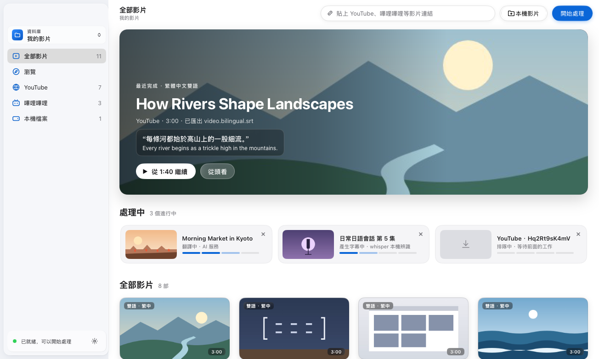
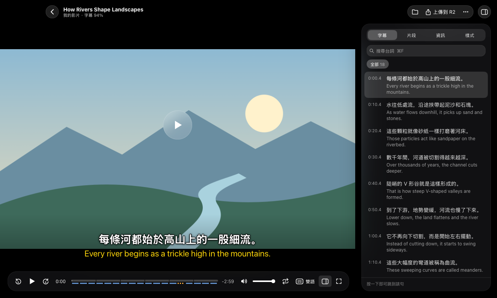
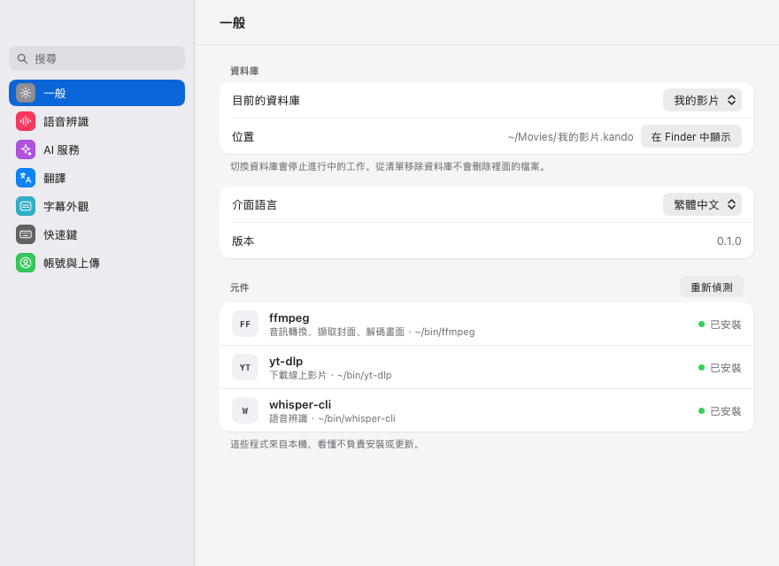
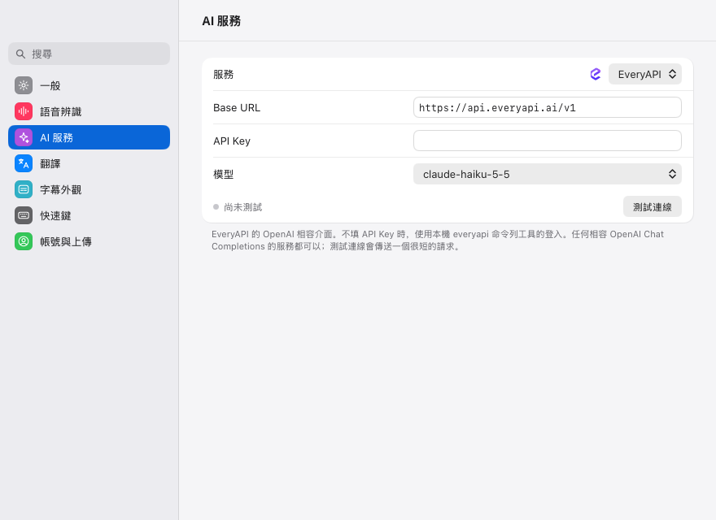

# 看懂（Kando）

[](https://github.com/yldm-tech/Kando/actions/workflows/ci.yml)
[](https://github.com/yldm-tech/Kando/actions/workflows/release.yml)
[](https://github.com/yldm-tech/Kando/releases)
[](LICENSE)
[](go.work)
[](#install)
[](https://github.com/yldm-tech/Kando/stargazers)

[English](README.md) · [简体中文](README.zh-CN.md) · [日本語](README.ja.md) · 繁體中文 · [한국어](README.ko.md)

看懂是一款桌面應用程式，讓你透過某種語言的影片來學習那種語言。貼上 YouTube 或嗶哩嗶哩的連結，或把影片檔拖曳到視窗上：看懂會用 yt-dlp 下載影片，用 whisper.cpp 在你自己的電腦上轉錄語音，透過 OpenAI 相容的模型翻譯每一句台詞，再播放原始影片，並在畫面上同時顯示原文台詞與譯文。它以 Go 撰寫，使用 [MyGo](https://github.com/egoist/mygo) 和 [Breeze UI](https://github.com/yldm-tech/mygo-breeze-ui) 繪製原生介面，沒有使用網頁檢視（web view）。



介面支援繁體中文、簡體中文、英文、日文和韓文，預設為簡體中文；在「設定 › 一般 › 介面語言」中切換，視窗會立即改用所選語言。下文引用的標籤都與繁體中文介面一致。

## 功能

- 新增影片的方式：貼上 YouTube、嗶哩嗶哩或其他 yt-dlp 支援之網站的連結（「輔助說明 › 支援的網站…」列出全部網站及其標誌），或選擇本機檔案（mp4、mov、mkv、webm 及其他影片檔），也可以把檔案拖曳到視窗上。本機檔案會在原處轉錄，不會被複製。
- 側欄的「瀏覽」是內建瀏覽器：打開網站，需要時先登入，然後點「下載影片」把目前的網頁加入資料庫。之後每次下載，無論來自「瀏覽」、連結欄、命令列還是 MCP，都會帶上在這裡登入過的網站的登入狀態；「清除登入資訊…」會登出全部這些網站。
- 工作會依序經過下載、轉錄、翻譯和匯出各階段。失敗的工作會說明原因，附上能修正問題的設定項目連結，並可重試或移除。
- 語音辨識在你的電腦上以 whisper.cpp 進行，whisper.cpp 會自動偵測影片所說的語言。「設定 › 語音辨識」列出七個 whisper 模型，從 Tiny（77.7 MB）到 Large v3（3.1 GB），並從 Hugging Face 下載你選擇的那一個。
- 台詞預設由 EveryAPI 翻譯，也可以使用任何 OpenAI 相容的聊天 API：「設定 › AI 服務」內建 OpenAI、OpenRouter、Groq、DeepSeek、xAI、Mistral、通义千问（Qwen／DashScope）、Kimi、智谱 GLM（Zhipu）、硅基流动（SiliconFlow）、Ollama 和 LM Studio 的預設選項，另可自訂端點。目標語言、讓模型參考前面幾句台詞的情境感知模式，以及提示詞，都可以在「設定 › 翻譯」中修改。
- 每部處理完成的影片旁邊會產生兩個 SubRip 字幕檔：`<video>.srt` 是原文台詞，`<video>.bilingual.srt` 則把每句譯文放在原文台詞上方（下載的影片則是 `video.srt` 和 `video.bilingual.srt`）。
- 播放器可將字幕顯示為雙語、僅原文、僅譯文或關閉，延遲可以 0.1 秒為單位調整，樣式也可以變更。可以跳到上一句、下一句，重聽本句，或單句循環直到聽懂為止。側邊面板列出所有台詞並可搜尋（按一下台詞即可跳到該處），把影片切成 4 到 12 個約 30 秒的片段，並顯示影片的檔案與來源。每部影片都會從你上次停止觀看的地方繼續播放。
- 資料庫是由一般檔案組成的 `.kando` 資料夾，可以在 Finder 或檔案管理員中管理。你可以保留多個資料庫，並從側邊欄切換；側邊欄也能依來源篩選資料庫：YouTube、嗶哩嗶哩、其他網站和本機檔案。
- 可選擇在使用 Google 登入後，從播放器把影片檔與雙語字幕檔上傳到你自己的物件儲存空間（Cloudflare R2、Amazon S3、阿里雲 OSS、騰訊雲 COS，或任何 S3 相容的儲存服務）。請參閱[組態設定](#configuration)。
- 播放、字幕與視窗都有鍵盤快速鍵，列在速查表（⌘/）和「設定 › 快速鍵」中。
- 回報問題時可以附上記錄檔：「輔助說明 › 顯示記錄檔」（或指令面板 ⌘K）會在 Finder 中顯示它。macOS 上是 `~/Library/Logs/Kando/kando.log`，其他系統在使用者設定目錄的 `Kando/logs` 資料夾裡。記錄檔記下每個失敗任務的原因（不含看懂儲存的金鑰和 AI 服務的位址）和出錯工具輸出的最後 64 KB，看起來像金鑰的內容都寫成 `***`。檔案超過 5 MB 時另起一份，保留之前的兩份。



<a id="install"></a>

## 安裝

<a id="download"></a>

### 下載

macOS（Apple 晶片和 Intel）、Windows（x86-64 和 ARM64）和 Linux（x86-64 和 ARM64）的建置版本在 [GitHub Releases](https://github.com/yldm-tech/Kando/releases) 上。請依你的系統選擇檔案，其中 `<version>` 是該版本的版本號，例如 `0.5.0`：

- macOS：Apple 晶片的 Mac 選 `kando-<version>-arm64.dmg`，Intel 的 Mac 選 `kando-<version>-amd64.dmg`。開啟磁碟映像檔，把看懂拖到「應用程式」檔案夾。
- Windows：大多數電腦選 `kando-setup-<version>-amd64.exe`，ARM 處理器的 Windows 電腦選 `kando-setup-<version>-arm64.exe`，下載後執行安裝程式。安裝程式暫時沒有簽署，SmartScreen 可能會在執行前跳出警告：按「其他資訊」，再按「仍要執行」。
- Debian、Ubuntu 及其衍生發行版：x86-64 選 `kando_<version>_amd64.deb`，ARM64 選 `kando_<version>_arm64.deb`。在下載所在的資料夾中以 `sudo apt install ./kando_<version>_<arch>.deb` 安裝。
- 其他 Linux 發行版：執行該版本附帶的安裝指令碼，不需要自己下載套件：

  ```sh
  curl -fsSL https://github.com/yldm-tech/Kando/releases/latest/download/install.sh | sh
  ```

  它會為你的電腦下載最新的 `kando-<version>-linux-<arch>.tar.gz`，檢查它的簽章，然後只為目前的使用者安裝看懂，不需要 root：應用程式裝在 `~/.local/kando.app`，`kando` 命令放在 `~/.local/bin`，並在應用程式選單中加入一項。檢查簽章需要 OpenSSL 3.0 或更新版本（Debian 12、Ubuntu 22.04、Fedora 36 及更新版本）；OpenSSL 版本較舊時，指令碼什麼也不下載，並會說明原因。這時請從同一個版本把適合你電腦的 `.tar.gz` 和 `install.sh` 下載到同一個資料夾，不要更改檔名，在那裡執行 `sh install.sh`；也可以執行 `sh install.sh <封存檔>`，傳入 `.tar.gz` 的路徑。兩種方式都會安裝這個封存檔，但不檢查簽章。再次執行指令碼會以新版本覆蓋舊版本；`sh install.sh --uninstall` 會移除看懂，並保留它的設定和資料庫。

版本中的其他檔案不是用來安裝的：`checksums.txt` 列出每個檔案的 SHA-256，而 `update-*.json` 清單、`.delta` 檔案和 `darwin`、`windows` 封存檔是已安裝的看懂自動更新時下載的（請參閱[更新](#updates)）。

0.5.1 之後發布的 macOS 安裝檔以 YLDM 的 Developer ID 簽署，並經過 Apple 公證，開啟看懂時 macOS 不會再發出警告。

<a id="updates"></a>

### 更新

看懂會從 GitHub 上已簽署的版本自動更新。它在開啟 10 秒後於背景檢查一次，之後每天檢查一次；有新版本時，會出現視窗顯示版本說明，並提供「安裝更新項目」「稍後提醒我」和「略過此版本」。「安裝更新項目」會下載新版本、檢查簽章，然後提示重新啟動看懂進入新版本；不重新啟動的話，下次開啟看懂時就是新版本。略過的版本不會再由背景檢查提示，但之後的新版本仍會提示。

要立即檢查，在 macOS 上選擇選單列中的「看懂 › 檢查更新…」；Linux 和 Windows 沒有選單列，請在命令面板（Ctrl+K）中選擇「檢查更新…」。「設定 › 一般」中「版本」旁邊也有「檢查更新…」按鈕，下方會顯示上次檢查找到的新版本，或上次檢查的時間。「自動檢查更新」和「自動下載並安裝更新」兩個開關也在「設定 › 一般」中。只有開啟前者時才會顯示後者，因為只有背景檢查會下載更新；開啟後者後，背景檢查找到新版本會直接安裝，不再詢問，下次開啟看懂時生效。

無法取代自身檔案的看懂不會自動更新。`.deb` 和 `PKGBUILD` 就是這種情況：它們把看懂安裝在由套件管理器管理的 `/opt/kando` 中，而看懂沒有 apt 套件庫，所以更新時請從新版本下載 `.deb` 並以相同方式安裝，或改用上面的安裝指令碼，它安裝在 `~/.local/kando.app` 的看懂可以自動更新。這樣安裝的看懂在「設定 › 一般」中不會顯示這兩個開關，「檢查更新…」會開啟一個視窗說明無法更新的原因。

### 從原始碼建置

需要 Go 1.27.4 或更新版本：

```sh
git clone https://github.com/yldm-tech/Kando.git
cd Kando
make build
```

`make build` 會針對你目前所在的平台執行 `go tool mygo build apps/kando`，並把結果寫到 `apps/kando/build/<os>-<arch>/` 底下：在 macOS 上是以 ad-hoc 方式簽署的 `Kando.app` 和一個 `.dmg`，在其他平台上是執行檔（Linux 另外還有 `.deb`、附安裝腳本的 `.tar.gz` 和 `PKGBUILD`；Windows 則另有以 NSIS 製作的安裝程式，未安裝 NSIS 時 mygo 會自行下載）。沒有 `make` 時（例如預設的 Windows），請在存放庫根目錄直接執行 `go tool mygo build apps/kando`。

## 系統需求

看懂會執行 `yt-dlp`、`ffmpeg` 和 `whisper-cli`（whisper.cpp）。在 macOS 和 Linux 上不必自己安裝：看懂開啟時若缺少其中任何一個，會自動下載，入門導覽中會顯示下載進度。已經安裝好的（例如用 Homebrew 安裝的）會直接使用。

| 程式 | 用途 | 看懂下載的版本 |
| --- | --- | --- |
| `yt-dlp` | 下載線上影片。每個工作都需要它，本機檔案也不例外。 | [yt-dlp 官方發佈](https://github.com/yt-dlp/yt-dlp/releases)的單一檔案版。 |
| `ffmpeg` | 擷取音訊、產生封面，以及在播放器中解碼畫面和聲音；播放器在 macOS、Linux 和 Windows 上都透過系統的音訊輸出播放聲音。 | FFmpeg 9.0.2（macOS 版附 `ffplay`），來自本儲存庫的 [tools 發佈](https://github.com/yldm-tech/Kando/releases/tag/tools-1)。 |
| `whisper-cli`（whisper.cpp） | 語音辨識。 | whisper.cpp 1.9.5（macOS 版啟用 Metal），來自同一個發佈。 |
| 一個 whisper.cpp ggml 模型 | 在入門導覽或「設定 › 語音辨識」中下載一個，或把 `KANDO_WHISPER_MODEL` 指向一個模型檔。 | |

tools 發佈由 Tools 工作流程（`.github/workflows/tools.yml`）依 `.github/tools.env` 中固定的原始碼建置，看懂使用每個下載前都會以內建的 SHA-256 驗證。下載的程式放在 `settings.json` 旁的 `tools` 資料夾（macOS 上是 `~/Library/Application Support/Kando/tools`，Linux 上是 `~/.config/Kando/tools`）。看懂會先在這裡找，再找 `PATH` 以及 `/opt/homebrew/bin`、`/usr/local/bin` 和 `/home/linuxbrew/.linuxbrew/bin`，因為從 Finder 或桌面啟動器開啟的應用程式只會拿到精簡的 `PATH`。「設定 › 一般」會顯示使用的是哪個程式，缺少的可以按「下載」或「重試」，按「重新偵測」會再找一次。若因 `yt-dlp` 版本過舊而下載失敗，看懂會提供「更新並重試」，依原本的安裝方式更新它並重試。

在 Windows 上看懂暫時還不會自動下載：請用你的套件管理器安裝相同的程式，並確認它們位於 `PATH` 中。

## 開始使用

1. 開啟看懂。還沒有任何資料庫時，它會提供「新增資料庫…」和「打開現有資料庫…」兩個選項。新資料庫預設命名為「影視庫」，在 macOS 上位於 `~/Movies`，其他平台位於 `~/Videos`，可以自行更改。
2. 入門導覽會自動下載缺少的 `ffmpeg`、`yt-dlp` 和 `whisper-cli`。開啟「設定」（⌘,），「一般」中會顯示它們和各自的版本。
3. 在「語音辨識」中，按一下某個 whisper 模型旁的「下載」；下載完成後，看懂會選用它。標示「推薦」的是「Large v3 Turbo（壓縮版）」，574 MB。Vimpo 或 hyperframes 已經下載的模型可以直接選用，不必複製。
4. 在「AI 服務」中設定翻譯：
   - EveryAPI（預設）：執行 `everyapi auth login`，用 [EveryAPI](https://everyapi.ai) CLI 登入一次。看懂會向 CLI 取得金鑰（`everyapi auth credential`），因此會沿用 CLI 的登入狀態、閘道區域與金鑰更新，你不必貼上權杖。預設模型是 `claude-haiku-5-5`；`everyapi models list` 會列出其他模型。你也可以改為把 EveryAPI 金鑰貼到「API Key」中。
   - 其他供應商：在「服務」中選擇它，或選擇「OpenAI 相容」並輸入它的「Base URL」，然後填寫「模型」和「API Key」。「測試連線」會送出一個簡短的請求來檢查設定。
5. 在「翻譯」中選擇預設目標語言：簡體中文（預設）、繁體中文、English、日本語、한국어、Español、Français 或 Deutsch。
6. 回到主視窗，把連結貼到頂端列並按一下「開始處理」，或按一下「本機影片」，或把影片拖曳到視窗上。當工作所需的一切都就緒時，側邊欄底部的狀態列會顯示「已就緒，可以開始處理」，否則會指出缺少什麼。

翻譯供應商回傳速率限制或伺服器錯誤時，看懂會重新送出請求，連同第一次最多嘗試三次。





<a id="command-line-and-mcp"></a>

## 命令列與 MCP

看懂的程式本身也是命令列工具 `kando`，同時也是供 AI 代理使用的 MCP 伺服器。帶著下表中的命令執行時，它會操作看懂應用程式；不帶命令執行時，它照常開啟視窗。

取得 `kando` 命令：

- macOS：先把看懂移到「應用程式」檔案夾，再在「設定 › 一般」中按一下「命令列工具」旁的「安裝」。它會在 `/usr/local/bin`、`/opt/homebrew/bin`、`~/.local/bin` 中第一個可寫入的資料夾裡建立指向看懂的 `kando` 連結，不會要求輸入管理者密碼，也不會取代其他程式的 `kando`。直接從磁碟映像檔開啟，或下載後被 macOS 放到暫存位置（App Translocation）執行時，看懂所在的路徑很快就會失效，這時卡片會提示先移動看懂，而不是安裝一個日後失效的連結。也可以自行建立連結：`sudo ln -s /Applications/Kando.app/Contents/MacOS/Kando /usr/local/bin/kando`。
- Linux：`.deb` 和 `PKGBUILD` 會把應用程式安裝到 `/opt/kando`，並加入指向 `/opt/kando/kando` 的連結 `/usr/bin/kando`。安裝指令碼（請參閱[下載](#download)）會把應用程式安裝到 `~/.local/kando.app`，並建立指向它的 `~/.local/bin/kando`；那裡已有不是它建立的 `kando` 時則保持原樣。如果 shell 的 `PATH` 中沒有 `~/.local/bin`，請把它加進去。
- Windows：看懂無法安裝這個命令，因為在 Windows 上建立連結需要系統管理員權限或開發人員模式。「設定 › 一般」的「命令列工具」下會顯示 `Kando.exe` 所在的資料夾；把這個資料夾加入 `PATH` 後，在終端機中輸入 `kando` 就會執行它，因為 Windows 的檔名不區分大小寫。

| 命令 | 作用 |
| --- | --- |
| `kando status` | 顯示目前開啟的資料庫、正在使用的程式和模型，以及能否開始工作；不能時說明缺少什麼。 |
| `kando list [--source S] [query]` | 依從新到舊列出資料庫中的影片及其 ID。`--source` 只保留一個來源（`youtube`、`bilibili`、`local` 或其他網站的名稱）；query 只保留標題中包含它的影片。 |
| `kando show <film-id>` | 顯示一部影片：來源、所處階段，以及影片檔和字幕的路徑。 |
| `kando subtitles <film-id> [--format srt\|text\|json] [--original\|--translation]` | 輸出影片的字幕，格式可以是 SubRip（預設）、每則字幕一行的文字（`text`）或 JSON，可以輸出雙語，也可以只輸出其中一種。 |
| `kando jobs` | 列出工作：先是正在執行的，接著是等待中的，最後是已結束的。 |
| `kando add <link-or-file>... [--wait]` | 和「開始處理」一樣把連結和本機影片檔加入佇列，並輸出每個工作的 ID。相對路徑以目前目錄為準。 |
| `kando cancel <job-id>` | 停止正在執行的工作，或把等待中的工作移出佇列。 |
| `kando retry <job-id> [--wait]` | 和「重試」與「重新處理」一樣，以同一個 ID 把失敗、已取消或已完成的工作重新加入佇列，不改變視窗顯示的內容。正在執行或等待中的工作會被拒絕。 |
| `kando remove <job-id>` | 和「移除」一樣把工作從資料庫中拿掉，正在執行的工作會先停止。它的檔案留在磁碟上。 |
| `kando sites [query] [--limit N]` | 依名稱、網域或影片連結搜尋看懂支援下載的網站。 |
| `kando open [film-id]` | 把看懂視窗移到最前面，顯示指定的影片；不帶 ID 時顯示資料庫。 |
| `kando mcp` | 在標準輸入和標準輸出上提供 MCP 服務（見下文）。 |
| `kando version` | 輸出版本號碼。 |
| `kando help [command]` | 列出所有命令，或顯示某個命令的用法和選項。 |

需要應用程式的命令會透過 socket 與它通訊，socket 是 `settings.json` 所在資料夾中的 `kando.sock`（macOS 是 `~/Library/Application Support/Kando/kando.sock`，Linux 是 `~/.config/Kando/kando.sock`，Windows 是 `%AppData%\Kando\kando.sock`）；`KANDO_SOCKET` 可以指定其他路徑，執行第二個看懂時也需要它，而且還要有獨立的 `HOME`（請參閱[組態設定](#configuration)）。看懂沒有在執行時，命令會在背景啟動它，向標準錯誤輸出 `Starting Kando…`，並最多等待 30 秒。加入影片需要的條件和「開始處理」相同，例如已開啟資料庫、程式齊全、已有 whisper 模型；缺少某項時，`kando add` 會失敗，並顯示視窗中對應的訊息。

所有與應用程式通訊的命令都支援 `--json`，以 JSON 而非文字輸出應用程式的回應。有來源未能加入時，`kando add` 會以 1 結束。加上 `--wait` 時，它會一直等到所有新加入的工作完成或失敗，每當某個工作的階段或進度變化時輸出一行；只要有工作失敗，同樣以 1 結束。加上 `--json` 時，進度輸出到標準錯誤，結束時的工作輸出到標準輸出。`kando retry --wait` 以同樣的方式等待重新加入佇列的工作。結束代碼：0 表示成功，1 表示失敗，2 表示命令用法有誤。

`kando mcp` 是在標準輸入和標準輸出上執行的 MCP 伺服器。看懂沒有在執行時，它的工具也會同樣地啟動它：

| 工具 | 作用 |
| --- | --- |
| `kando_status` | 應用程式版本、目前開啟的資料庫、能否開始工作以及缺少什麼、各個程式、語音辨識和翻譯模型、目標語言，以及正在執行和等待中的工作。 |
| `kando_list_films` | 依從新到舊列出目前資料庫的影片，可依 `source` 或標題中的文字（`query`）篩選。 |
| `kando_get_film` | 依 ID 取得一部影片：所處階段、目標語言，以及影片檔和字幕的路徑。 |
| `kando_get_subtitles` | 已完成影片的含時間戳記字幕，可以是雙語或其中一種（`which`），格式為精簡文字或 SRT（`format`）；設定 `max_cues` 時只回傳開頭的若干則。 |
| `kando_add_videos` | 把連結和本機影片檔加入佇列；回傳這些工作，以及每個未能加入的來源被略過的原因。 |
| `kando_list_jobs` | 列出工作，包括階段、進度、狀態、錯誤，完成後還有影片 ID 和檔案路徑。 |
| `kando_cancel_job` | 停止正在執行的工作，或把等待中的工作移出佇列。 |
| `kando_retry_job` | 以同一個 ID 把失敗、已取消或已完成的工作重新加入佇列，並回傳這個工作。 |
| `kando_remove_job` | 把工作從資料庫中拿掉，正在執行的工作會先停止；它的檔案留在磁碟上。 |
| `kando_search_sites` | 依名稱、網域或影片連結搜尋看懂支援下載的網站（未設定 `limit` 時回傳 20 個結果）。 |
| `kando_open` | 把看懂視窗移到最前面，顯示一部影片或資料庫。 |

在 Claude Code 中加入時填寫程式的路徑；`kando` 已在 `PATH` 中時直接寫 `kando` 即可：

```sh
claude mcp add kando -- /Applications/Kando.app/Contents/MacOS/Kando mcp
```

其他 MCP 用戶端在 `mcpServers` 設定中填寫同樣的命令：

```json
{
  "mcpServers": {
    "kando": {
      "command": "/Applications/Kando.app/Contents/MacOS/Kando",
      "args": ["mcp"]
    }
  }
}
```

在支援 WebMCP 的瀏覽器中，官網 [kando.yldm.ai](https://kando.yldm.ai) 會為瀏覽器中的代理提供 WebMCP 工具：`search_supported_sites` 查詢看懂是否支援從某個網站下載，`get_download` 提供適合某個系統的下載連結，`get_started` 回傳開始使用的步驟，`list_features` 列出看懂的功能。

<a id="configuration"></a>

## 組態設定

下列所有項目，除了 Google 用戶端 ID、用戶端密鑰和 `KANDO_SOCKET` 之外，也都可以在應用程式中設定（資料庫在側邊欄設定，其餘在「設定」中）。環境變數一旦設定，就會取代應用程式中儲存的值。

| 變數 | 預設值 | 說明 |
| --- | --- | --- |
| `KANDO_WHISPER_MODEL` | 在「設定 › 語音辨識」中選擇的模型 | whisper.cpp ggml 模型檔的路徑，例如 `ggml-small.bin`。 |
| `KANDO_LLM_BASE_URL` | EveryAPI，`https://api.everyapi.ai/v1` | OpenAI 相容供應商的 Base URL，例如 `https://api.openai.com/v1`，或 Ollama 的 `http://localhost:11434/v1`。設定後，就不會使用已登入的 EveryAPI 帳號。 |
| `KANDO_LLM_MODEL` | 在 EveryAPI 上為 `claude-haiku-5-5` | 翻譯模型。使用自訂供應商時沒有預設值：請在這裡或「設定 › AI 服務」中設定。 |
| `KANDO_LLM_API_KEY` | 無 | 翻譯供應商的 Bearer 權杖。它會覆寫已登入的 EveryAPI 帳號。 |
| `EVERYAPI_API_KEY` | 無 | EveryAPI 金鑰，在 `KANDO_LLM_BASE_URL` 未設定且 `KANDO_LLM_API_KEY` 為空時使用，取代 CLI 登入。 |
| `KANDO_OUTPUT_DIR` | 上次開啟的資料庫 | 啟動時要開啟的資料庫資料夾，新的影片和字幕都會放在這裡。 |
| `KANDO_SOCKET` | `settings.json` 旁的 `kando.sock` | 應用程式監聽、`kando` 命令列和 `kando mcp` 連線的 socket 路徑。應用程式和命令要設定成同一個路徑。同一個使用者只會執行一個看懂，再次啟動只會把已執行的那個帶到前景；設定了 `KANDO_SOCKET` 啟動的是刻意執行的第二個看懂（例如開發時），它還需要獨立的 `HOME`，才能使用自己的資料庫和設定。請參閱[命令列與 MCP](#command-line-and-mcp)。 |
| `KANDO_GOOGLE_CLIENT_ID` | 無 | 用於在「設定 › 帳號與上傳」登入的 Google OAuth 用戶端 ID。沒有設定時，登入按鈕會停用。它永遠不會儲存到設定檔中。 |
| `KANDO_GOOGLE_CLIENT_SECRET` | 無 | 選填，同一個 OAuth 用戶端的用戶端密鑰。 |
| `KANDO_STORAGE` | `r2` | 上傳的目的地：`r2`、`s3`（或 `aws`）、`oss`（或 `aliyun`）、`cos`（或 `tencent`）、`compat`（或 `s3compat`）。其他任何值都視為 R2。 |
| `KANDO_R2_ENDPOINT` | 無 | Cloudflare R2：帳號 ID 或完整的 `https://` 端點。 |
| `KANDO_R2_BUCKET`、`KANDO_R2_ACCESS_KEY`、`KANDO_R2_SECRET` | 無 | Cloudflare R2 的儲存貯體和金鑰。 |
| `KANDO_S3_REGION` | 無 | Amazon S3 區域名稱，例如 `ap-northeast-1`。 |
| `KANDO_S3_BUCKET`、`KANDO_S3_ACCESS_KEY`、`KANDO_S3_SECRET` | 無 | Amazon S3 的儲存貯體和金鑰。 |
| `KANDO_OSS_REGION` | 無 | 阿里雲 OSS 區域名稱，例如 `cn-hangzhou`（內部網路使用 `cn-hangzhou-internal`）。 |
| `KANDO_OSS_BUCKET`、`KANDO_OSS_ACCESS_KEY`、`KANDO_OSS_SECRET` | 無 | 阿里雲 OSS 的儲存貯體和金鑰。 |
| `KANDO_COS_REGION` | 無 | 騰訊雲 COS 區域名稱，例如 `ap-guangzhou`。 |
| `KANDO_COS_BUCKET`、`KANDO_COS_ACCESS_KEY`、`KANDO_COS_SECRET` | 無 | 騰訊雲 COS 的儲存貯體（名稱包含 APPID，例如 `video-1250000000`）、SecretId 和 SecretKey。 |
| `KANDO_S3COMPAT_ENDPOINT` | 無 | 其他 S3 相容儲存服務的完整 `https://` 端點。 |
| `KANDO_S3COMPAT_REGION` | 無 | 該儲存服務的簽章區域；MinIO 通常使用 `us-east-1`。 |
| `KANDO_S3COMPAT_BUCKET`、`KANDO_S3COMPAT_ACCESS_KEY`、`KANDO_S3COMPAT_SECRET` | 無 | 該儲存服務的儲存貯體和金鑰。 |
| `KANDO_S3COMPAT_PATH_STYLE` | 關閉 | `1`、`true`、`yes` 或 `on` 會開啟 MinIO 所需的路徑樣式定址；`0`、`false`、`no` 或 `off` 會關閉它。 |

上傳需要手動進行：開啟一部影片，在播放器中按一下「上傳到 R2」，或你所選儲存服務對應的按鈕。看懂會把影片和它的雙語字幕上傳到 `<Google 帳號電子郵件>/<資料庫>/<影片資料夾>/<檔案>` 底下；登入只用來表明是誰上傳的。影片永遠不會自動上傳。

## 資料庫與設定

資料庫是名稱以 `.kando` 結尾的資料夾。每部下載的影片在其中都有自己的資料夾 `<title> [<video id>]/`，內含 `video.mp4`、`cover.jpg`、`video.srt` 和 `video.bilingual.srt`。它們都是一般檔案：看懂會監看資料庫資料夾，因此在 Finder 或檔案管理員中新增或移除的影片都會反映在資料庫中。在 macOS 上，`.kando` 資料夾在 Finder 中會顯示帶有看懂標誌的資料夾圖示。

從資料庫移除影片時，會把該影片的資料夾移到垃圾桶；如果那個資料夾裡還有其他影片或資料夾，則只移走它的影片檔和字幕檔。位於資料庫資料夾之外的本機影片會留在原處，只會從清單中移除。從清單中移除資料庫時，它的資料夾會保留在磁碟上。

看懂把自己的檔案放在使用者設定目錄中，macOS 是 `~/Library/Application Support/Kando`，Windows 是 `%AppData%\Kando`，Linux 是 `~/.config/Kando`：

- `library.json`：工作（包括已完成和進行中的），以及每部影片停止播放的位置。
- `settings.json`：各項設定，包括 API 金鑰、物件儲存金鑰和 Google 更新權杖，皆以純文字儲存。這個檔案只有你的使用者帳號可以讀取。
- `window-state.json`：視窗大小和位置。
- `updater.json`：你對更新的選擇（「設定 › 一般」中的兩個開關、略過的版本）以及看懂上次檢查更新的時間。
- `models/`：在「設定 › 語音辨識」中下載的 whisper 模型。

檔名不是 `video.*` 的影片，其封面圖片會快取在 macOS 的 `~/Library/Caches/Kando/posters`、Windows 的 `%LocalAppData%\Kando\posters` 和 Linux 的 `~/.cache/Kando/posters`。

## 從 LingoCut 升級

看懂以前叫做 LingoCut，新版不會再讀取任何舊名稱。若要保留你的資料庫和設定：

1. 結束應用程式。
2. 把設定資料夾從 `LingoCut` 重新命名為 `Kando`：macOS 是 `~/Library/Application Support/LingoCut`，Windows 是 `%AppData%\LingoCut`，Linux 是 `~/.config/LingoCut`。其中存放著 `library.json`、`settings.json`、`window-state.json` 和已下載的模型。
3. 在重新命名設定資料夾之後、啟動應用程式之前，把每個資料庫從 `X.lingocut` 重新命名為 `X.kando`。在 macOS 和 Linux 上，應用程式能透過儲存的 inode 追蹤每個重新命名過的資料庫。在 Windows 上，應用程式只能把一個找不到的資料庫對應到同一個上層資料夾中的一個新 `.kando` 資料夾，所以每個資料夾一次只重新命名一個資料庫，並在每次重新命名後啟動應用程式一次。
4. 把每個環境變數從 `LINGOCUT_*` 重新命名為 `KANDO_*`。
5. 啟動看懂，並在「設定 › 語音辨識」中重新選擇語音模型：模型檔已隨資料夾一起搬移並顯示為「已下載」，但儲存的選擇仍指向舊路徑。
6. 刪除舊名稱留下的東西：`lingocut.app` 和 `lingocut Dev.app`；封面快取 `~/Library/Caches/LingoCut`（Windows 是 `%LocalAppData%\LingoCut`，Linux 是 `~/.cache/LingoCut`）；Linux 上小寫的 `~/.config/lingocut`；若曾執行 `make dev`，還有 `~/Library/Application Support/lingocut Dev`。

## 開發

需要 Go 1.27.4 或更新版本。

```sh
make test   # go test for packages/core, packages/media and apps/kando
make dev    # run the app with live reload
make build  # build the app for this platform into apps/kando/build
```

`make dev` 會執行經 `tools/mygo-dev` 修補過的 MyGo `mygo dev`：在 macOS 上，重新載入時會保留正在執行的視窗，直到新的建置顯示出自己的視窗為止，而不是先把它關掉，所以儲存變更時看起來不會像應用程式結束了。如果 MyGo 升級後修補無法套用，它會發出警告並退回原本的 `go tool mygo dev`；此時請依照新的 `cmd/mygo/dev.go` 更新 `tools/mygo-dev/dev.go.patch`。背後的 `tools/mygo-dev/dev.sh` 是 POSIX shell 腳本。

螢幕截圖測試會從固定的示範資料庫把主要畫面算繪成 PNG 檔，並在空的模擬家目錄（home）中使用假的 `ffmpeg`、`yt-dlp` 和 `whisper-cli`，因此不會讀取你的設定、資料庫或工具：

```sh
KANDO_SCREENSHOTS=/tmp/kando-shots go test ./apps/kando/... -run TestScreenshots
```

設定 `KANDO_SCREENSHOTS_LANG`（`en`、`zh-Hans`、`zh-Hant`、`ja` 或 `ko`）會以對應的介面語言繪製，示範資料庫也會換成該語言讀者的內容；`-run TestScreenshotsReadme` 會繪製各語言 README 使用的四張圖，存放在 `docs/assets/<語言>/`。

存放庫結構：

- `apps/kando`：應用程式本身。每個畫面都有自己的目錄（`sidebar/`、`films/`、`film/`、`settings/`、`account/`、`cheatsheet/`）；`view.go` 把視窗與它們連接起來。`shelf/` 是工作記錄，`cloud/` 是 Google 登入與物件儲存上傳，`brand/` 是資料庫在 Finder 中的圖示。
- `packages/core`：與平台無關的工作、階段和連結解析。
- `packages/media`：媒體處理流程：下載、轉錄、翻譯、字幕匯出、封面和資料庫。
- `tools/mygo-dev`：`make dev` 背後使用的修補版 `mygo dev`。

[AGENTS.md](AGENTS.md) 說明介面如何拆分為元件，以及各區塊遵循的規則；修改介面之前請先閱讀。

## CI 與版本發布

[CI](https://github.com/yldm-tech/Kando/actions/workflows/ci.yml) 工作流程會建置並測試 Pull Request 和 `main`。[Release](https://github.com/yldm-tech/Kando/actions/workflows/release.yml) 工作流程會在 `main` 的 CI 通過後執行，也可以手動執行：它依照上一個標籤之後的 Conventional Commits 決定下一個版本號，以 `chore(release)` 提交到 `main` 並加上標籤，在不使用 Developer ID 或程式碼簽署憑證的情況下建置 macOS、Windows 和 Linux 的套件，為已安裝的看懂要下載的更新簽署，再把套件附上檢查碼發布 GitHub Release。

## 授權

[MIT](LICENSE)
